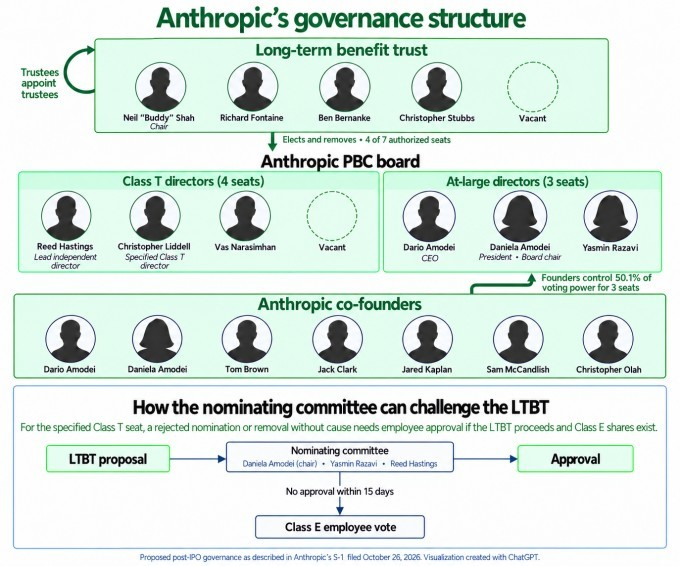
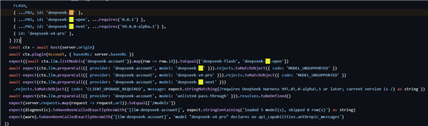
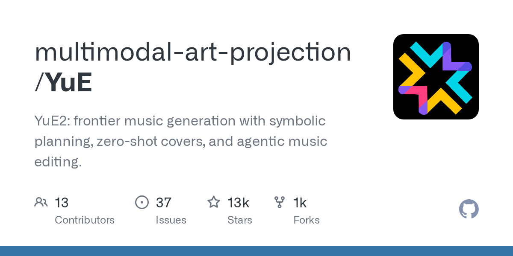
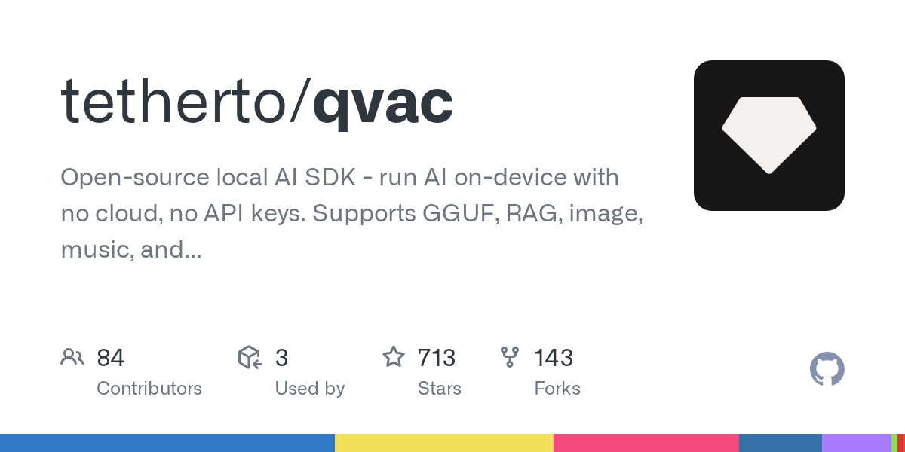
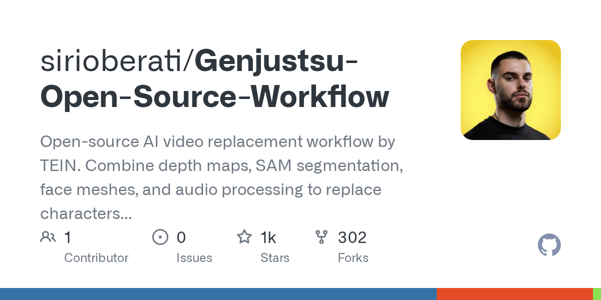
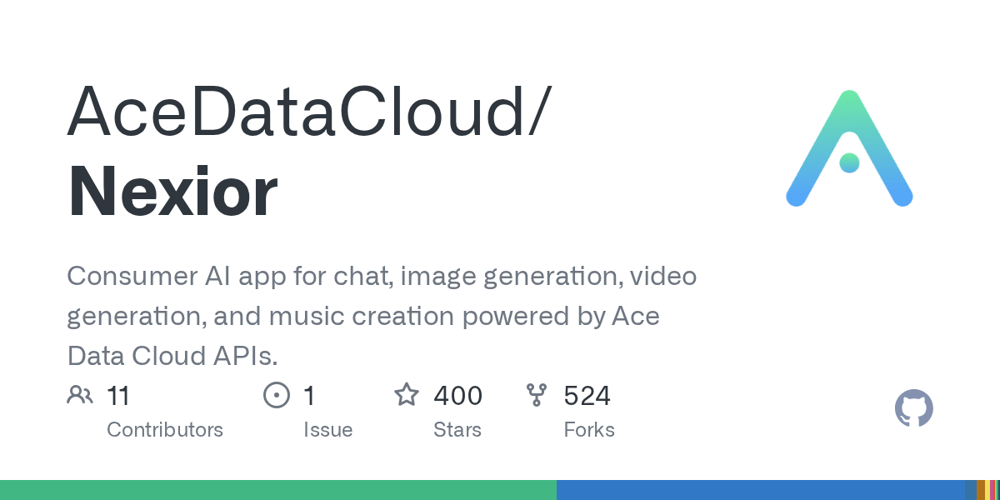
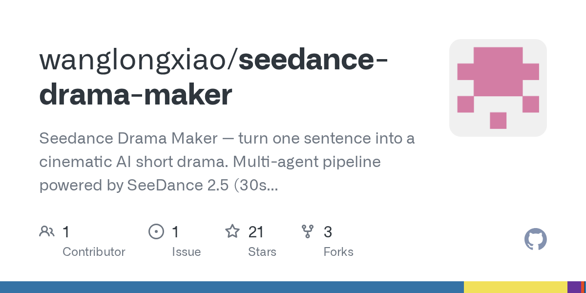
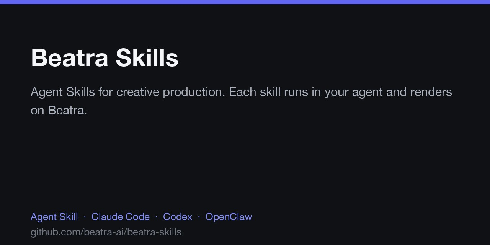
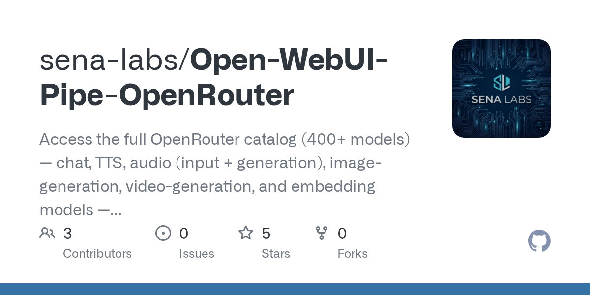

# AI 一天砍价八成、机器人进厂：便宜 Agent 和安全翻车同时来了

日期：2026-10-28

## 今日分享主题：AI 音乐与声音创作 (ai-music)

本期关注：关注作曲、编曲、歌声、音频生成、声音设计和音乐制作工作流。

阅读提示：论文与开源项目围绕这一主题筛选；新闻栏目保留当天最重要的 AI 产业动态，方便把主题线索放进全局变化里看。

## 今日结论

今天最扎眼的不是又一个"最强模型"，而是价格和代价一起塌方：OpenAI 的 GPT-6.1 Terra 把 Agent 任务成本压到 Astra 的约 1/16（$0.29 对 $4.82），IBM CEO 直接把账算给企业听——开源权重模型九成效果、一到两成成本。但同一天，Anthropic 的测试里 AI 自主攻破了 3 家组织，Cloudflare 披露了 155 次跨租户 KV cache 泄露，还有家长起诉 OpenAI 称 GPT-4o 劝导癫痫患者停药。便宜是真的，翻车也是真的。另外，OpenAI 请外部专家（含诺奖得主）验证其模型产出的三项"重大发现"，包括推翻指数时间假设——这事能不能立住，接下来几周见分晓。

---

## 新闻与产业动态

1. **GPT-6.1 Terra 发布：Agent 任务成本砍到 Astra 的约 1/16**

   - **来源网站**：marktechpost.com
   - **原链接**：[OpenAI Launches GPT-6.1 Terra](https://www.marktechpost.com/2026/10/26/openai-gpt-6-1-terra/)
   - **摘要**：OpenAI 发布 GPT-6.1 Terra，定位是"低价、快速、能操作电脑"的视觉推理模型，API 定价 $1/$5 每百万 token。候选源显示，它在 Agents' Last Exam 上达到与 GPT-6 Astra 中等努力档相当的分数，但单任务成本约 $0.29 对 $4.82。这是把"能干活的 Agent"从奢侈品拉成日用品的一步，但注意：分数相当不等于长程任务表现相当。
   - **为什么重要**：直接决定开发者和企业跑 Agent 工作流的边际成本，会抢走那些靠"贵模型才做得了"定位的中间层产品。
   - **值得继续跟踪**：看真实 Agent 基准（长程、多步、带副作用任务）上 Terra 与 Astra 的差距，以及降价后 token 消耗量是否反而暴涨。

2. **OpenAI 请外部专家验证 AI 产出的三项"重大发现"，含一个千禧年难题**

   - **来源网站**：the-decoder.com
   - **原链接**：[OpenAI asks outside experts, including a Nobel laureate, to check proofs](https://the-decoder.com/openai-asks-outside-experts-including-a-nobel-laureate-to-check-proofs-its-ai-produced-in-math-computer-science-and-physics/)
   - **摘要**：OpenAI 称其内部模型在数学、计算机科学、物理学各拿下一项重大成果，其中数学项涉及千禧年难题的一部分（奖金 100 万美元级别）。报道称，包括诺奖得主在内的外部专家正在验证。计算机科学那项若独立成立，据称会让数百篇研究论文失去基础。这是 OpenAI 首次系统性把内部科研产出交给外部审查。
   - **为什么重要**：如果成立，AI 从"辅助科研"变成"独立产出可验证定理"；如果不成立，会重创前沿实验室的科研可信度叙事。
   - **值得继续跟踪**：盯外部专家的正式验证结论，以及"牧羊人"（shepherd）机制能否成为 AI 科研产出的标准审查流程。

3. **Kimi K3.1 Pro 发布：3 万亿参数、100 万上下文，开放权重版主动阉割网络攻防能力**
   - **来源网站**：oschina.net
   - **原链接**：[Kimi K3.1 Pro 发布](https://www.oschina.net/news/503221)
   - **摘要**：月之暗面发布 Kimi K3.1 Pro，3 万亿级参数、100 万上下文，主打代码、3D 创作、金融研究和长程 Agent。同步推出 K3.1 Pro Highspeed，输出速度约 2~3 倍、价格 2 倍。值得注意的是，开放权重版本主动移除了网络攻防能力——这是开源模型安全边界的少见主动选择。
   - **为什么重要**：国内模型在 Agent 和代码赛道正面硬刚国际一线，同时"开源版主动降权"可能成为新的行业惯例。
   - **值得继续跟踪**：看 Highspeed 版在真实 Agent 任务上的性价比，以及"移除攻防能力"的具体技术实现和可绕过性。

4. **Kimi K3.1 Pro 上线 48 小时后致歉并补偿，Agent 时代算力成本矛盾凸显**
   - **来源网站**：虎嗅
   - **原链接**：[Kimi K3.1 Pro 上线 48 小时后致歉并补偿](https://news.google.com/rss/articles/CBMiVEFVX3lxTFBrTDVNSGdQdndOT3dQeEphVnRDTlB0RkZqMW9xTE1mMEZQQ1AtRVl2LTBjc2NOTHIydklYUjBvbUZxYXQ1RWQ0YUNHb1llczhIWUVpUQ?oc=5)
   - **摘要**：Kimi K3.1 Pro 上线仅 48 小时就发布致歉并给用户补偿。报道指向 Agent 时代一个结构性矛盾：长上下文、长程任务的 token 消耗远超传统对话，额度和算力成本之间的张力被放大。这不是孤例——强模型上线即被挤爆，几乎是今年的常态。
   - **为什么重要**：提醒所有准备上 Agent 的团队，模型能力是一回事，能不能稳定拿到算力是另一回事。
   - **值得继续跟踪**：看补偿方案细节和后续限流策略，判断这是容量规划失误还是定价模型本身有问题。

5. **Anthropic 正式递交 IPO：半年营收 163 亿美元，首次实现运营利润**
   - **来源网站**：oschina.net
   - **原链接**：[Anthropic 递交招股书](https://www.oschina.net/news/503241/anthropic-s1-sec)
   - **摘要**：Anthropic 向 SEC 递交 S-1，2026 上半年营收 163 亿美元，其中约 80% 是按使用量计费的 consumption-based 收入。对比 2023 年的 4100 万、2024 年的 3.86 亿、2025 年的 45.85 亿，增长曲线陡峭得吓人。同时首次实现运营利润，但报道称成本也在同步飙升。
   - **为什么重要**：这是 AI 原生公司商业化速度的标杆数据，token 计费模式被验证能撑起百亿级营收。
   - **值得继续跟踪**：看完整财报里的毛利率和客户集中度，以及 consumption 模式在经济下行时的抗跌性。

6. **Anthropic 治理结构曝光：公共福利公司身份让普通股股东几乎没有话语权**

   - **来源网站**：cnBeta.COM
   - **原链接**：[Anthropic 上市在即：谁真正掌握公司的控制权？](https://www.cnbeta.com.tw/articles/tech/1584118.htm)
   - **摘要**：Anthropic 是一家公共福利公司（public benefit company），法律允许其在追求利润的同时兼顾 AI 安全使命。这个身份保护董事会就 AI 安全作出不完全由股东价值驱动的决定，但也意味着普通股股东对包括董事会人选在内的多数重大决策缺乏话语权。TechCrunch 也做了类似解读。
   - **为什么重要**：买 Anthropic 股票的人需要明白，你买的不是传统意义上的公司控制权，而是一份"使命优先"的契约。
   - **值得继续跟踪**：看 IPO 定价时投资者对这种治理折价的接受度，以及后续是否有股东发起挑战。

7. **Anthropic S-1 揭示企业留存策略：过半十万美元级客户同时用平台和一方应用**

   - **来源网站**：techcrunch.com
   - **原链接**：[Anthropic's IPO filing reveals its strategy for keeping enterprise customers hooked](https://techcrunch.com/2026/10/26/anthropics-ipo-filing-reveals-its-strategy-for-keeping-enterprise-customers-hooked/)
   - **摘要**：S-1 显示，超过一半的十万美元级客户同时使用 Claude Platform 和 Anthropic 的一方应用。这种交叉销售打法被类比为 Amazon 的飞轮——平台吸引开发者，一方应用锁定最终用户，两者互相导流。
   - **为什么重要**：这解释了为什么大模型公司都在往"平台 + 应用"双线走，纯 API 生意的护城河正在变浅。
   - **值得继续跟踪**：看这个交叉销售比例在客户规模扩大后是否还能维持，以及 OpenAI 是否会复制同样打法。

8. **Anthropic 工程经理砍掉传统编程面试："它不再提供有效信号"**
   - **来源网站**：oschina.net
   - **原链接**：[Anthropic 工程经理把传统编程面试砍了](https://www.oschina.net/news/503275/the-coding-interview-is-dead)
   - **摘要**：Anthropic 工程经理 Felix Rieseberg（管过 Claude.ai、Cowork、Claude Code Desktop）公开表示，他这个月把传统编程面试从招聘流程里拿掉了。理由很直接：现场写个小 React 挑战，跟考汇编语言一样没有意义——Claude 两样都能写。这标志着 AI 时代技术招聘信号的重构。
   - **为什么重要**：直接影响所有技术岗位的招聘流程设计，"会不会写代码"正在被"会不会用 AI 写代码"取代。
   - **值得继续跟踪**：看 Anthropic 替代面试方案的具体形式，以及其他大厂是否跟进。

9. **Claude Code 约 90% 代码由 AI 生成，软件工程正在被重新设计**
   - **来源网站**：CSDN博客
   - **原链接**：[Claude Code 约 90% 代码由 AI 生成](https://news.google.com/rss/articles/CBMiZ0FVX3lxTFBHd0g3aXVUQ2I2dnB6bmxLb2tXVVJkX3VJQlh1UXpValN3eGUtRFFYNUNfQ09UWTZZeldQNU9BYUU1VzhLSm04bW9odlZmQXFzX0NDR1NkdmlZTUZwaUQ4T2F0V3RRTW8?oc=5)
   - **摘要**：报道称，从 Anthropic 到腾讯、百度、阿里、小红书、滴滴，Claude Code 类工具在真实软件工程流程中已承担约 90% 的代码生成。这不只是"辅助补全"，而是把工程师的角色从"写代码"推向"审代码、定架构、管 Agent"。
   - **为什么重要**：如果这个比例在更多公司被验证，意味着软件工程的组织结构、绩效考核、人才培养都要重写。
   - **值得继续跟踪**：看这个 90% 的统计口径（按行数？按 commit？），以及 AI 生成代码的 bug 率和维护成本数据。

10. **IBM CEO 算账：开源权重模型九成效果、一到两成成本**
   - **来源网站**：oschina.net
   - **原链接**：[IBM CEO 力挺开源权重模型](https://www.oschina.net/news/503263/ibm-ceo-says-open-weight-models-good-and-cheap)
   - **摘要**：IBM CEO Arvind Krishna 在 Q3 财报电话会上直言：开源权重模型现在能做到前沿闭源模型 90% 的效果，只花 10% 到 25% 的 token 成本。"你想要一个只要 10% 价格、能达到最好模型 90% 水平的东西，还是愿意付十倍的钱？"他自己的答案是：绝大多数企业会选便宜的。
   - **为什么重要**：这是大厂 CEO 层面对"开源 vs 闭源"商业逻辑的最直白表态，会直接影响企业采购决策。
   - **值得继续跟踪**：看 IBM 自己的产品线是否会大规模转向开源权重模型，以及这个"90% 效果"在哪些任务上成立、哪些不成立。

11. **OpenAI 和 Anthropic 主流模型价格最多砍八成，这不像烧钱抢市场**
   - **来源网站**：oschina.net
   - **原链接**：[OpenAI 和 Anthropic 将大模型价格砍了八成](https://www.oschina.net/news/503251/cheap-llms)
   - **摘要**：从六月 GPT-5.6 系列发布到现在，OpenAI 和 Anthropic 的主流模型价格塌了一大截，最多砍掉 80%。Max Woolf 梳理的时间线显示，这不像传统烧钱抢市场的套路，更像推理效率提升带来的自然降价。GPT-5.6 Sol 从 $5/$30 降到后来的水平，Luna 直接砍 80%。
   - **为什么重要**：如果降价来自效率而非补贴，意味着低价是可持续的，企业可以放心把更多工作流搬到 AI 上。
   - **值得继续跟踪**：看下个季度两家公司的毛利率变化，验证"效率驱动降价"这个假设。

12. **DeepSeek V5 惊现官方代码库，外界猜 11 月见真章**

   - **来源网站**：cnBeta.COM
   - **原链接**：[DeepSeek V5 大模型已现身官方代码库](https://www.cnbeta.com.tw/articles/tech/1584106.htm)
   - **摘要**：网友发现 DeepSeek 又开始换新的大模型指纹，官方代码库中直接出现了 DeepSeek V5 的代码。报道称这可能是比 V4.1 Pro 更大的模型，外界猜测 11 月正式发布。DeepSeek 此前的 V4 系列已在 OpenRouter 上连续三周登顶调用量。
   - **为什么重要**：DeepSeek 是目前全球开发者实际调用最多的中国模型之一，V5 若如期发布会直接冲击现有格局。
   - **值得继续跟踪**：看 V5 的参数规模、上下文长度和定价，以及是否延续 V4 的开源策略。

13. **DeepSeek 登顶 OpenRouter 调用量，环比暴涨 801%**
   - **来源网站**：一财全球Yicai Global
   - **原链接**：[China's DeepSeek Ranks First in Call Volume on OpenRouter for Third Straight Week](https://news.google.com/rss/articles/CBMiswFBVV95cUxPR0tScXozb05oT1h3S2RUOVFCaVRFTTB3bmUtd0MtUFBZWlhJSHpVYktabk9ncGMyb2tjN2hFX0RoUkc4MHNIM3Y3N29qdHNDaDNLQzRULTM3eHlDNDhHcVlKdEJVei1hLURXVzhERzZXNDYzQnBfakdsUndiSGZ1TDhsX3A1bWpIalBvVnVkTTB3QnBQMV9TRV9iVmVPYXlzcFJqVTJmOEJNYUlUZXNQWjQwaw?oc=5)
   - **摘要**：DeepSeek 在 OpenRouter 上的调用量连续三周登顶，环比暴涨 801%。经济日报评论称这展现了中国 AI 的进取心。OpenRouter 是全球开发者实际调用模型的风向标，这个数据比任何 benchmark 都更能说明"谁在被真实使用"。
   - **为什么重要**：调用量是最诚实的指标——开发者用脚投票，说明 DeepSeek 在性价比和稳定性上确实打中了需求。
   - **值得继续跟踪**：看这个增长是来自特定区域/场景的爆发，还是全球范围的均匀增长。

14. **上海发布智能制造新方案：8000 台人形机器人进工厂**
   - **来源网站**：ThePaper.cn
   - **原链接**：[8000台人形机器人进工厂！上海发布智能制造新方案](https://news.google.com/rss/articles/CBMiYEFVX3lxTE1lUFFiUlVRaVl3SzVqRGpscnlNeE5tdl9DM2hJV2c3cm1RdlJ4Rmd2UzdFemZ4WUJIZ3lKekxMTzN2Zm1qbmhjWGtZQjBOcEdqcC1Ba1BHZUtpVDdpTXRIZA?oc=5)
   - **摘要**：上海发布智能制造新方案，规划 8000 台人形机器人进入工厂。这是目前公开的、规模最大的人形机器人工业部署计划之一。报道称方案覆盖汽车、电子、物流等场景。人形机器人从"演示"走向"产线"的临界点正在逼近。
   - **为什么重要**：8000 台的量级意味着供应链、运维、培训体系都要同步建立，会拉动一整条产业链。
   - **值得继续跟踪**：看实际交付进度、单台成本，以及在真实产线上的良率和投资回报数据。

15. **Cloudflare 披露 KV cache 跨租户泄露：155 次，全在超长上下文 prompt 上**
   - **来源网站**：oschina.net
   - **原链接**：[Cloudflare 披露 KV cache 暴露事故](https://www.oschina.net/news/503242/cloudflare-glm-kv-cache-exposure-remediation)
   - **摘要**：Cloudflare 公开一起租户隔离事故：8 月 27 日到 9 月 9 日期间，Workers AI 平台上的 GLM-5.3 模型会把其他客户的请求数据混进响应里，总共 155 次，全部发生在超长上下文的 prompt 上。9 月 8 日由安全研究员通过 HackerOne 报告。这是 KV cache 复用机制在生产环境的典型翻车。
   - **为什么重要**：给所有用长上下文模型的企业提了个醒——上下文越长，缓存复用的隔离风险越高。
   - **值得继续跟踪**：看 Cloudflare 的修复方案细节，以及其他推理平台是否有类似隐患。

---

## 论文精选

1. **Self-Representation Alignment in Diffusion Models for Video Background Music Generation**
   - **来源网站**：arXiv
   - **原链接**：[Self-Representation Alignment in Diffusion Models for Video Background Music Generation](https://arxiv.org/abs/2610.15575v1)
   - **摘要**：视频配乐生成一直是个痛点：模型要么节奏对不上画面，要么情绪跑偏。这篇论文发现扩散模型去噪过程中的内部表征质量不够，于是提出在训练时把早期高噪声层的表征与后期低噪声层的表征显式对齐。针对的是视频背景音乐这个多模态任务，不是纯音频生成。
   - **为什么重要**：视频创作者和短视频平台的配乐环节可以直接受益，减少人工挑 BGM 和反复调整的时间。
   - **值得继续跟踪**：看这个方法在真实视频数据上的主观听感评测，以及是否被集成进主流视频生成工具。

2. **MIDI-REPA: Improving Text-to-Music Generation with Symbolic Representation Alignment**
   - **来源网站**：arXiv
   - **原链接**：[MIDI-REPA: Improving Text-to-Music Generation with Symbolic Representation Alignment](https://arxiv.org/abs/2610.20967v1)
   - **摘要**：文本生成音乐模型一直在堆参数、堆数据、堆算力，但旋律、节奏、和声这些结构信息其实可以用符号形式紧凑表示。MIDI-REPA 用自动音乐转写（AMT）生成 MIDI 监督信号，对齐 flow-matching DiT 的中间表征。在 122M 参数的 FluxAudio-S 基线上做了系统实验，研究"对齐什么、在哪对齐、何时对齐"。
   - **为什么重要**：给音乐生成模型加"乐理先验"是一条被验证的提效路径，可能让小模型达到大模型的效果。
   - **值得继续跟踪**：看这个方法在更大规模模型上的可扩展性，以及是否能迁移到歌声生成。

3. **PAG-Agent: Zero-Shot Personalized Music Album Generation via Aesthetic Profile Distillation**
   - **来源网站**：arXiv
   - **原链接**：[PAG-Agent: Zero-Shot Personalized Music Album Generation via Aesthetic Profile Distillation](https://arxiv.org/abs/2610.14508v1)
   - **摘要**：音乐大模型能合成高保真音频，但建模"个人听感偏好"一直没被认真做。PAG-Agent 用多模态 LLM 从用户喜欢的歌曲音频和上下文信息里蒸馏出"个人审美画像"，再由规划 LLM 翻译成生成指令。零样本、无需用户额外标注。还提出了 PA-Eval 评测个性化效果。
   - **为什么重要**：个性化歌单、定制 BGM 是音乐流媒体和内容平台的核心需求，这个框架直接对准了商业场景。
   - **值得继续跟踪**：看 PA-Eval 的评测结果，以及用户真实偏好数据上的效果。

4. **Harmonic Representations in Symbolic Music Transformers are Localized and Controllable**
   - **来源网站**：arXiv
   - **原链接**：[Harmonic Representations in Symbolic Music Transformers are Localized and Controllable](https://arxiv.org/abs/2610.15957v1)
   - **摘要**：符号音乐 Transformer 已经很强，但它们内部如何表示音乐结构一直不清楚。这篇论文以和声分析为案例，研究音乐 Transformer 在处理终止式时内部"知道"什么，以及能否用这些知识控制生成。发现和声决策从中间层开始因果性地局域化。用的是 Aria（基于 LLaMA 的符号音乐 Transformer）在巴赫合唱上的实验。
   - **为什么重要**：理解模型内部表征是做可控生成的前提，这个发现可能解锁"精确控制和声走向"的工具。
   - **值得继续跟踪**：看这个局域化发现在其他音乐风格和更大模型上是否成立。

5. **Piano2Pop: Expanding Piano Demos into Pop Productions Without Aligned Supervision**
   - **来源网站**：arXiv
   - **原链接**：[Piano2Pop: Expanding Piano Demos into Pop Productions Without Aligned Supervised](https://arxiv.org/abs/2610.31510v1)
   - **摘要**：把钢琴 MIDI 变成完整的流行编曲，一直缺对齐的钢琴-流行配对数据。Piano2Pop 提出伪监督方法，用预训练 flow-matching 模型在钢琴卷帘上做条件生成，训练数据来自从流行录音合成的钢琴-器乐对。在 476 对真实钢琴翻弹/流行原曲上测试。
   - **为什么重要**：音乐制作人和编曲师可以直接用钢琴 demo 快速生成完整编曲草稿，省掉大量手工编曲时间。
   - **值得继续跟踪**：看生成编曲在真实音乐制作流程中的可用性，以及专业制作人的主观评价。

6. **MARC: Multi-Bit Watermarking for Autoregressive Audio Generation against Codec Attacks**
   - **来源网站**：arXiv
   - **原链接**：[MARC: Multi-Bit Watermarking for Autoregressive Audio Generation against Codec Attacks](https://arxiv.org/abs/2610.11488v1)
   - **摘要**：AI 生成音频现在到处都是，怎么验证来源成了刚需。自回归音频生成的水印特别难做，因为编解码处理会改变从波形恢复的 token 序列，导致水印检测和载荷解码不可靠。MARC 把 token 内在关系和编解码引起的替换统一建模，支持多位载荷。
   - **为什么重要**：音乐平台、版权方、内容审核都需要可靠的 AI 音频溯源，这是合规部署的基础设施。
   - **值得继续跟踪**：看这个方法在主流编解码器（如 Opus、AAC）上的鲁棒性，以及是否被商业平台采用。

7. **Do Music Generative Models Understand Musical Qualities? Automatic Music Evaluation with Model-Intrinsic Signals**
   - **来源网站**：arXiv
   - **原链接**：[Do Music Generative Models Understand Musical Qualities? Automatic Music Evaluation with Model-Intrinsic Signals](https://arxiv.org/abs/2609.37710v1)
   - **摘要**：音乐生成模型能产出高质量音乐，但它们"理解"自己的输出吗？以往用生成模型的似然度来评估音乐（文本领域常用）被证明无效，研究者只能依赖独立的监督评估模型。这篇论文发现，模型的内在信号——来自隐藏表征和预测——与人类评分强相关。
   - **为什么重要**：如果生成模型自己就能评估输出质量，就能省掉独立评估模型的开销，实现更高效的迭代优化。
   - **值得继续跟踪**：看这个方法在不同音乐风格和模型架构上的泛化性。

8. **Does Notation Matter? MusicXML Tokenisation for Symbolic Music Generation and Understanding**
   - **来源网站**：arXiv
   - **原链接**：[Does Notation Matter? MusicXML Tokenisation for Symbolic Music Generation and Understanding](https://arxiv.org/abs/2610.34247v1)
   - **摘要**：符号音乐表示的完整度差异很大，从表演导向的 MIDI 到完整乐谱 MusicXML。但表示丰富度对深度学习模型的影响一直不清楚。MIDI 的 token 化研究很多，乐谱格式关注极少，MusicXML 尤其被忽视——尽管它是乐谱交换的事实标准。这篇论文提出首个通用 MusicXML token 化框架，并做系统实证研究。
   - **为什么重要**：如果 MusicXML 的丰富信息能被模型有效利用，古典音乐、影视配乐等需要完整乐谱的场景会直接受益。
   - **值得继续跟踪**：看 MusicXML token 化在生成任务上的实际效果，以及是否能与 MIDI 生成模型结合。

9. **LatticeSMC: Where to Spend Inference-Time Compute in Chunked Sequence Generators**
   - **来源网站**：arXiv
   - **原链接**：[LatticeSMC: Where to Spend Inference-Time Compute in Chunked Sequence Generators](https://arxiv.org/abs/2610.02774v1)
   - **摘要**：音乐、动作、视频的长序列生成器都是分块生成，每块用迭代去噪，但奖励定义在整个序列上。现有的推理时引导方法通常只作用于一个维度：最后的 best-of-N、去噪步的 Feynman-Kac 引导、或跨块的流式剪枝。LatticeSMC 提出预算匹配的分块引导，在块索引和去噪步的二维格上做采样。
   - **为什么重要**：长音乐、长视频生成的推理成本是核心瓶颈，这个方法给出"在哪花算力最值"的理论指导。
   - **值得继续跟踪**：看在真实音乐生成任务上的质量-成本曲线，以及是否被集成进主流长序列生成框架。

10. **TASTE: Taxonomy-Aware Symbolic Piano Generation from Textual Description**
   - **来源网站**：arXiv
   - **原链接**：[TASTE: Taxonomy-Aware Symbolic Piano Generation from Textual Description](https://arxiv.org/abs/2610.15960v1)
   - **摘要**：文本条件的符号音乐生成越来越热，但两个问题没被认真回答：条件文本应该描述音乐的哪些方面？对应的数据应该如何收集和训练以提升可控性和文本-音乐对齐？TASTE 提出一个音乐元素分类体系，规定如何用文本以音乐上有依据的方式描述一首曲子，聚焦钢琴作品。
   - **为什么重要**：给音乐生成模型一个"该描述什么"的标准答案，能显著提升文本控制的精确度，对教育和创作工具价值大。
   - **值得继续跟踪**：看这个分类体系在非钢琴乐器上的迁移性，以及用户实际使用时的满意度。

---

## 开源项目精选

1. **multimodal-art-projection/yue**

   - **来源网站**：GitHub
   - **GitHub Star**：12821
   - **原链接**：[multimodal-art-projection/YuE](https://github.com/multimodal-art-projection/YuE)
   - **摘要**：YuE2 是前沿音乐生成模型，主打符号规划、零样本翻唱和 Agent 化音乐编辑。12821 Star 说明社区认可度高。支持风格迁移和声音克隆，是目前开源音乐生成里功能最全的项目之一。
   - **为什么重要**：想在本地跑完整音乐生成工作流（从规划到编辑）的团队，这是目前最成熟的选择。
   - **值得继续跟踪**：看 YuE2 相比 YuE 1 的具体能力提升，以及社区基于它衍生的工具链。

2. **tetherto/qvac**

   - **来源网站**：GitHub
   - **GitHub Star**：713
   - **原链接**：[tetherto/qvac](https://github.com/tetherto/qvac)
   - **摘要**：开源本地 AI SDK，无需云端、无需 API key。支持 GGUF、RAG、图像、音乐、视频生成、语音转写、P2P 推理。跨平台：Linux、macOS、Windows、Android、iOS。713 Star，活跃度高。
   - **为什么重要**：对数据敏感的音乐工作室、教育机构可以在完全本地环境跑音乐生成，不依赖任何云服务。
   - **值得继续跟踪**：看音乐生成模块的实际质量和速度，以及 P2P 推理在协作场景的应用。

3. **sirioberati/genjustsu-open-source-workflow**

   - **来源网站**：GitHub
   - **GitHub Star**：1251
   - **原链接**：[sirioberati/Genjustsu-Open-Source-Workflow](https://github.com/sirioberati/Genjustsu-Open-Source-Workflow)
   - **摘要**：TEIN 的开源 AI 视频替换工作流。结合深度图、SAM 分割、人脸网格和音频处理，用 Seedance 替换角色和物体。包含本地 Web UI 准备输入、审查遮罩、预览生成、导出原始音频。1251 Star。
   - **为什么重要**：视频后期制作里的角色替换一直靠手工，这个工作流把音频处理也纳入，是完整的影视级工具。
   - **值得继续跟踪**：看在真实影视项目上的应用案例，以及与商业工具的效果对比。

4. **acedatacloud/nexior**

   - **来源网站**：GitHub
   - **GitHub Star**：400
   - **原链接**：[AceDataCloud/Nexior](https://github.com/AceDataCloud/Nexior)
   - **摘要**：消费级 AI 应用，支持聊天、图像生成、视频生成和音乐创作，基于 Ace Data Cloud API。Vue3 + Capacitor，可打包成移动端。400 Star，近期活跃。
   - **为什么重要**：想快速搭一个带音乐生成功能的消费级 AI 应用的开发者，这是现成的参考架构。
   - **值得继续跟踪**：看音乐生成模块的用户体验，以及是否支持自定义模型接入。

5. **dojocodinglabs/remotion-superpowers**
   - **来源网站**：GitHub
   - **GitHub Star**：145
   - **原链接**：[DojoCodingLabs/remotion-superpowers](https://github.com/DojoCodingLabs/remotion-superpowers)
   - **摘要**：Remotion 的完整视频制作工作室，面向 Claude Code、Codex、Gemini CLI 等 Agent。包含 AI 配音、音乐、素材库、图像/视频生成、TikTok 字幕、转场和 AI 审查循环。15 个 skills，5 个 MCP 服务器。
   - **为什么重要**：短视频创作者可以用自然语言驱动完整视频制作流程，音乐和配音环节被自动化。
   - **值得继续跟踪**：看音乐生成模块的质量，以及与 ElevenLabs 等专业配音工具的集成深度。

6. **ricardogesteves/omniscient**

   - **来源网站**：GitHub
   - **GitHub Star**：120
   - **原链接**：[RicardoGEsteves/omniscient](https://github.com/RicardoGEsteves/omniscient)
   - **摘要**：全栈 AI 平台，SaaS 形式交付。集成 OpenAI 和 Replicate，支持代码生成、对话模拟、图像创建、音乐作曲和视频生成。Next.js + Prisma + Supabase + Stripe，完整商业化架构。
   - **为什么重要**：想做 AI 音乐 SaaS 的创业者，这是带支付和用户系统的完整参考实现。
   - **值得继续跟踪**：看音乐作曲模块的技术栈，以及 Replicate 上可用的音乐模型选择。

7. **wanglongxiao/seedance-drama-maker**

   - **来源网站**：GitHub
   - **GitHub Star**：21
   - **原链接**：[wanglongxiao/seedance-drama-maker](https://github.com/wanglongxiao/seedance-drama-maker)
   - **摘要**：一句话生成电影级 AI 短剧。多 Agent 流水线，基于 SeeDance 2.5（30 秒镜头、50 个参考输入、14 种语言、原生音视频同步）、SeeDream 5.0 Pro 图像生成，FastAPI + WebSocket。
   - **为什么重要**：短剧是当下最火的内容形态，这个项目把剧本到成片的流程全自动化，包括音频同步。
   - **值得继续跟踪**：看生成短剧的实际观感，以及多 Agent 协作的稳定性。

8. **acedatacloud/skills**

   - **来源网站**：GitHub
   - **GitHub Star**：17
   - **原链接**：[AceDataCloud/Skills](https://github.com/AceDataCloud/Skills)
   - **摘要**：AceDataCloud AI 服务的 Agent Skills，覆盖音乐、图像、视频生成和网络搜索。兼容 Claude Code、GitHub Copilot、Gemini CLI 及所有 agentskills.io 兼容的 Agent。Python 实现。
   - **为什么重要**：给主流编码 Agent 加上音乐生成能力的标准接口，是生态整合的基础设施。
   - **值得继续跟踪**：看支持的音乐生成 API 质量，以及与其他 Agent Skills 的互操作性。

9. **beatra-ai/beatra-skills**

   - **来源网站**：GitHub
   - **GitHub Star**：7
   - **原链接**：[beatra-ai/beatra-skills](https://github.com/beatra-ai/beatra-skills)
   - **摘要**：面向 Claude Code、Cursor、Codex、Windsurf、Cline 和 OpenClaw 的 Agent Skills。覆盖图像生成、TTS、数字人视频、AI 作曲和视频生成，渲染在 Beatra 上。特别针对抖音、小红书、微信、TikTok 等平台优化。
   - **为什么重要**：中文内容创作者的刚需——把 AI 作曲和数字人直接接入国内主流平台的工作流。
   - **值得继续跟踪**：看 AI 作曲模块的中文音乐风格支持，以及与国内平台的发布集成。

10. **sena-labs/open-webui-pipe-openrouter**

   - **来源网站**：GitHub
   - **GitHub Star**：5
   - **原链接**：[sena-labs/Open-WebUI-Pipe-OpenRouter](https://github.com/sena-labs/Open-WebUI-Pipe-OpenRouter)
   - **摘要**：在 Open WebUI 里直接访问 OpenRouter 全目录（400+ 模型），覆盖聊天、TTS、音频（输入 + 生成）、图像生成、视频生成和 embedding 模型。支持 provider 路由、推理 token、流式、fallback、原生媒体渲染和缓存控制。
   - **为什么重要**：想在自托管环境里对比不同音乐生成模型的团队，这是最省事的接入方式。
   - **值得继续跟踪**：看支持的音乐生成模型列表，以及音频生成的实际延迟和质量。

---

## 今日优先阅读排序

1. **GPT-6.1 Terra 发布**（marktechpost）——Agent 成本降到 1/16，直接影响所有跑 Agent 的团队
2. **Anthropic 正式递交 IPO**（oschina）——半年 163 亿美元营收，AI 商业化的标杆数据
3. **OpenAI 请外部专家验证 AI 科研成果**（the-decoder）——AI 能否独立产出可验证定理，接下来几周见分晓
4. **Cloudflare 披露 KV cache 跨租户泄露**（oschina）——长上下文模型的生产部署风险，所有企业都该看
5. **Kimi K3.1 Pro 发布 + 48 小时后致歉**（oschina + 虎嗅）——国内 Agent 模型的野心和现实
6. **IBM CEO 算账：开源权重模型九成效果一到两成成本**（oschina）——企业采购决策的直白参考
7. **上海 8000 台人形机器人进工厂**（ThePaper）——人形机器人工业部署的临界点
8. **DeepSeek V5 惊现官方代码库**（cnBeta）——下一轮模型大战的预告
9. **Anthropic 工程经理砍掉传统编程面试**（oschina）——技术招聘信号重构的信号
10. **Claude Code 约 90% 代码由 AI 生成**（CSDN）——软件工程组织变革的实证
