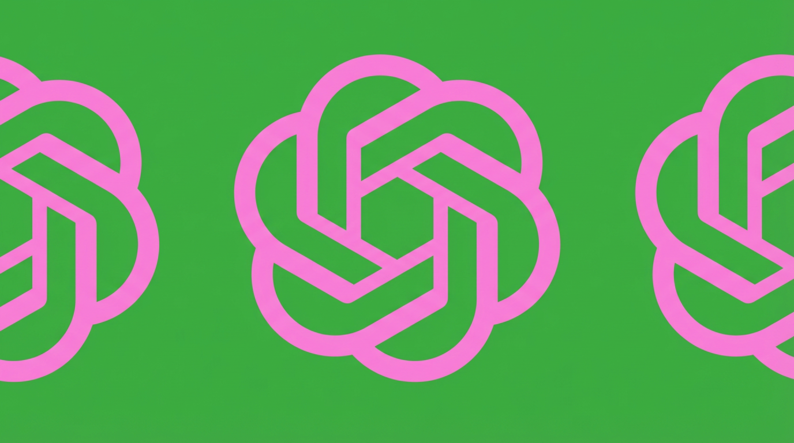
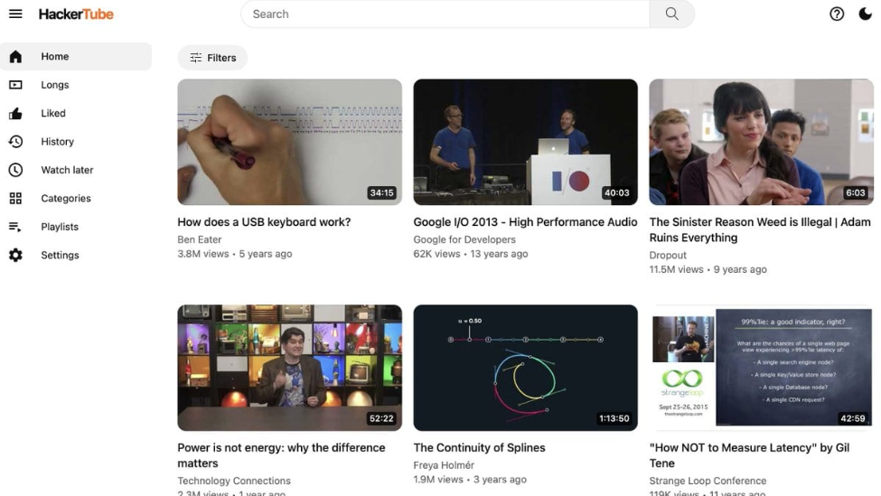
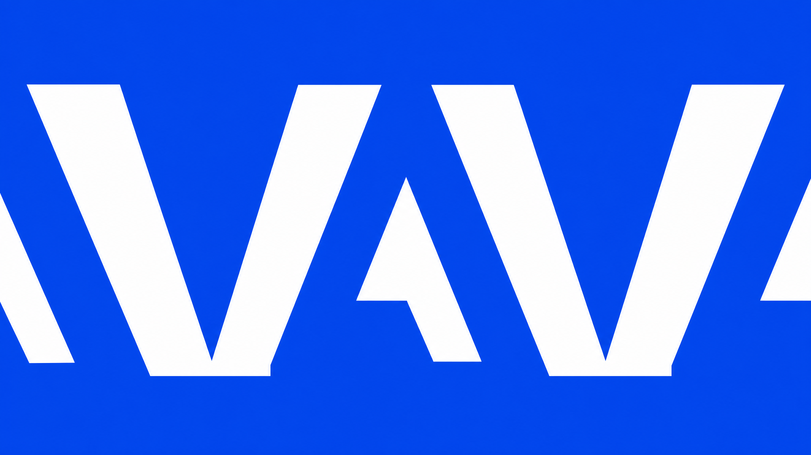
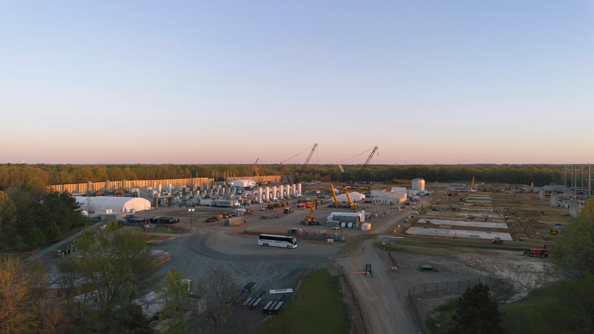
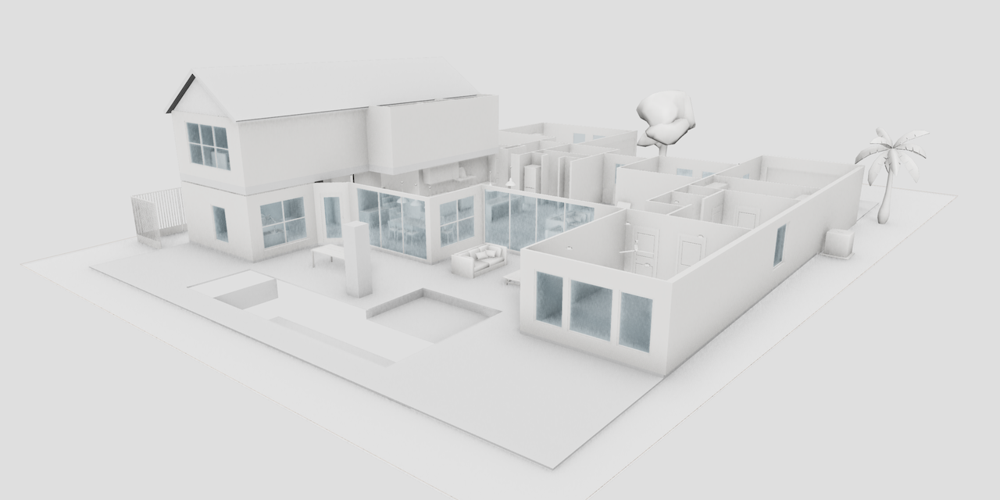
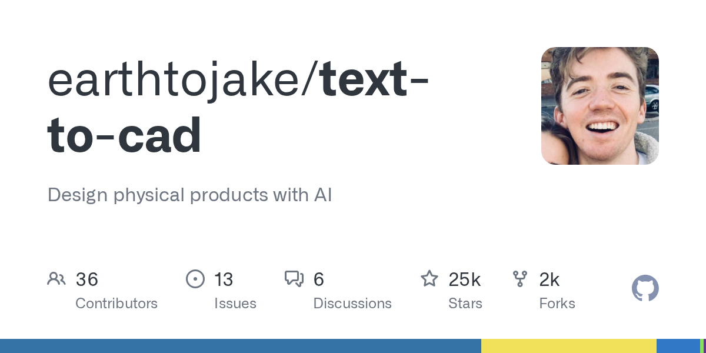
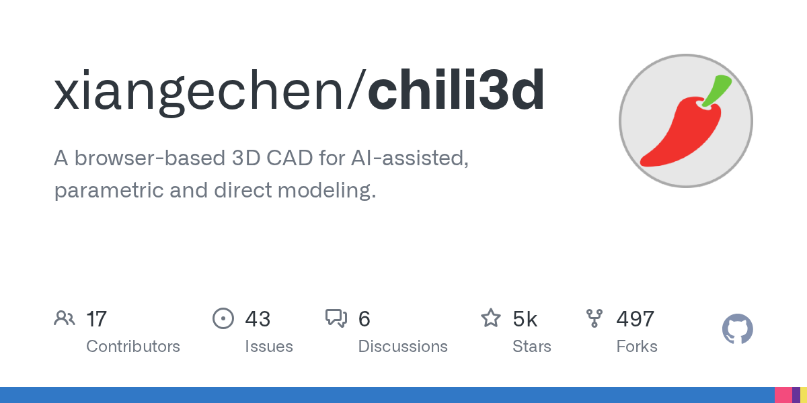
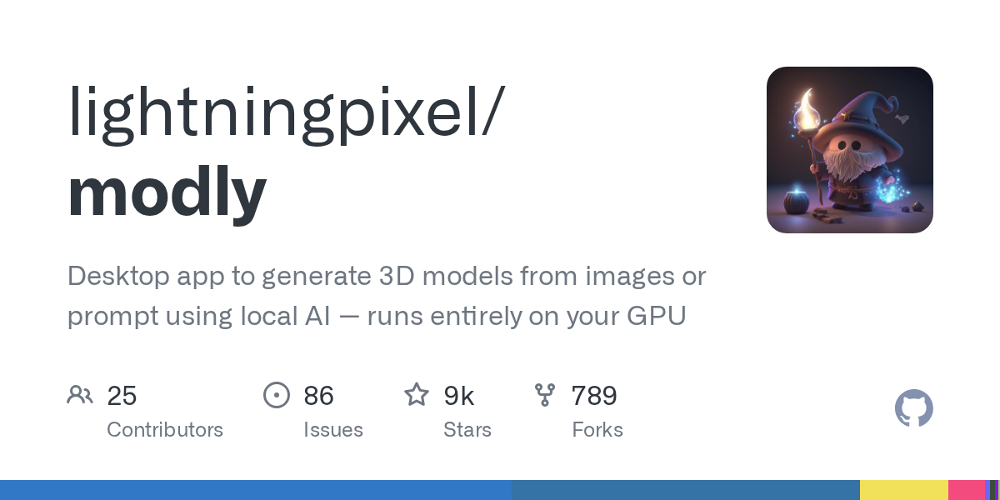
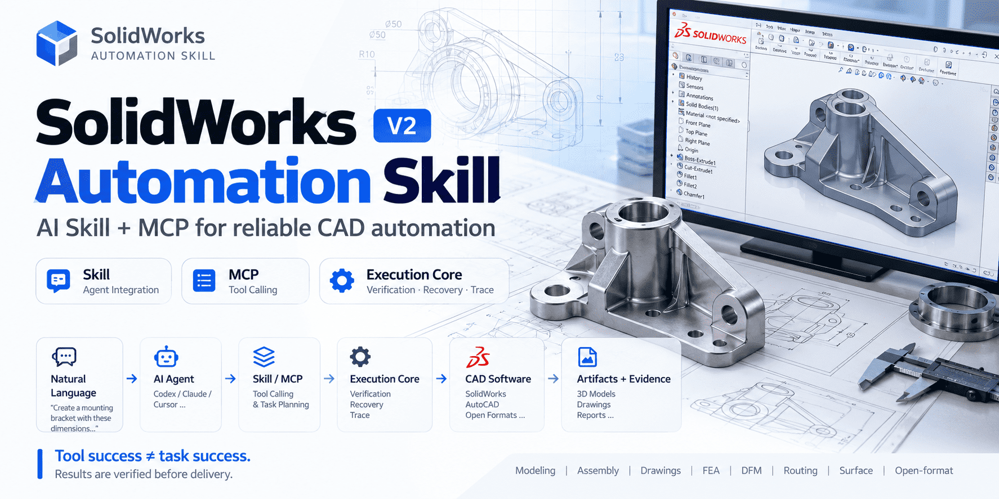
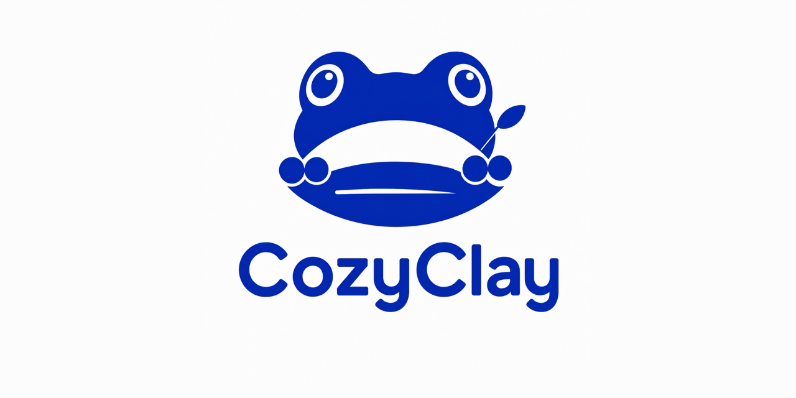

# DeepSeek 开源“不等指令”的编程 Agent，Claude 在 Linux 内核挖出 11 年漏洞

日期：2026-11-02

## 今日分享主题：AI 3D、CAD 与工程设计 (ai-3d-cad-engineering)

本期关注：关注 3D 建模、CAD、仿真、工业设计、建筑设计和工程方案生成。

阅读提示：论文与开源项目围绕这一主题筛选；新闻栏目保留当天最重要的 AI 产业动态，方便把主题线索放进全局变化里看。

## 今日结论

今天最扎眼的两件事：DeepSeek 把 Super-agent 研究原型开源，主打“没人 @ 也自己干活”，直接冲着 Claude Code 和 Codex 的地盘去；同时 Anthropic 未发布的 Claude 模型在系统性测试中挖出一个潜伏 Linux 内核 11 年、CVSS 9.8 分的远程代码执行漏洞。一边是编程 Agent 从“等指令”变成“主动接活”，一边是 AI 开始在最底层的系统软件里干安全审计的活。另外 OpenAI 12 月起把 ChatGPT 与 Codex 额度合并，重度用户的“随便用”时代要结束了。新闻口径为 11 月 1-2 日两天，个别仍在发酵的 10 月 31 日消息一并纳入。

---

## 新闻与产业动态

1. **DeepSeek 开源 Super-agent：没人 @ 也自己干活的编程 Agent**
   - **来源网站**：动点科技
   - **原链接**：[DeepSeek团队开源编程智能体原型，可从GitHub和飞书接单](https://news.google.com/rss/articles/CBMikAFBVV95cUxQOEk2Q0VXTjJwY1JKSm16SEpzeFdBeE9EQlBDV2g1RFZaaEJWWHhVZWI2UDdGRUlocDlxNkdkOUV1QkdBdUpqZ2FZeVhrSjJheWlaRnB2dVV4UGk3XzcxQXFlM1RjR0lTWG1kRjF6UG0wN0l1dlE4WUpOa2l1YTlKWnI3WnJ4U1ZsVVNrM3FBeFA?oc=5)
   - **摘要**：DeepSeek 团队开源了名为 Super-agent 的编程智能体研究原型，核心卖点是“主动”：它能监听 GitHub 和飞书里的任务线索，自己发现代码问题并给出修复建议，不需要用户 @ 它或逐条下指令。多家媒体报道称，该原型定位为 Claude Code 和 Codex 的开源替代，主打多任务并行与持续在线。需要注意的是，目前公开信息多为研究原型阶段，实际工程稳定性与大规模落地效果尚待验证。
   - **为什么重要**：这直接冲击 Claude Code、Codex 这类“等你开口才动”的编程助手的工作模式，把“人盯 Agent”变成“Agent 自己找活”，对开发者日常排障和任务分发方式是实打实的改变。
   - **值得继续跟踪**：盯它在真实仓库里的误报率、主动修复的采纳率，以及 DeepSeek 是否会把它从研究原型推成正式产品。

2. **DeepSeek Super-agent 架构长文：多任务的上限是人的注意力**
   - **来源网站**：OSCHINA
   - **原链接**：[DeepSeek 团队把Agent 设计成“操作系统”：多任务的上限不该是人的注意力](https://www.oschina.net/news/503338/deepseek-harness-super-agent)
   - **摘要**：DeepSeek Harness 团队发布架构长文，提出把 Agent 当“操作系统”来设计。文中给出一个具体观察：单任务上限取决于模型能力，多任务上限取决于人的注意力，一个人通常只能同时跟进 3 到 5 个活跃 Session。现有 Agent 以单个 Session 为单位、彼此独立，导致并行推进多项工作时人成为瓶颈。团队的思路是让多个 Agent 会话共享上下文与状态，减少人的重复协调。
   - **为什么重要**：这条解释了 Super-agent 想解决的真实痛点——不是模型不够聪明，而是人盯不过来，直接影响团队能并行推进多少条 AI 工作流。
   - **值得继续跟踪**：看这套“操作系统式”设计是否开源、是否有第三方复现 3-5 个 Session 的瓶颈数据。

3. **Claude 发现潜伏 Linux 内核 11 年的严重漏洞**

   - **来源网站**：cnBeta.COM
   - **原链接**：[Claude发现潜伏在Linux内核中长达11年的严重漏洞](https://www.cnbeta.com.tw/articles/tech/1584658.htm)
   - **摘要**：Anthropic 近日安全研究披露，其内部未发布的 Claude 模型在系统性测试中发现一个潜伏 Linux 内核长达 11 年的严重漏洞，编号 CVE-2026-98432，CVSS 评分 9.8，属远程代码执行级别最高危漏洞。这是 AI 模型在真实基础软件里挖出高危漏洞的案例，而不是在人工构造的靶场上刷分。
   - **为什么重要**：它意味着 AI 安全审计开始触碰最核心的开源基础设施，会改变安全团队的漏洞发现流程，也可能抢走一部分人工审计的初筛工作。
   - **值得继续跟踪**：盯该漏洞的补丁落地情况、Anthropic 是否公开完整复现方法，以及后续是否还有同类发现。

4. **OpenAI 12 月起 ChatGPT 与 Codex 共享额度，“随便用”结束**
   - **来源网站**：cnBeta.COM
   - **原链接**：[OpenAI宣布ChatGPT部分功能将与Codex共享额度](https://www.cnbeta.com.tw/articles/tech/1584584.htm)
   - **摘要**：OpenAI 10 月 31 日公告，自 12 月起 ChatGPT Plus、Pro、Business 套餐的额度将在 ChatGPT 与 Codex 之间共享，不再分别计算。调整与 OpenAI 把 Work 的智能体能力整合进 ChatGPT 主界面有关，目的是让用户直接在 ChatGPT 里完成更多复杂任务。对重度用户来说，这意味着两边“各吃各的额度”变成“一个池子抢饭”。
   - **为什么重要**：直接影响付费用户的实际可用量和成本结构，重度编程用户可能要为共享额度重新算账。
   - **值得继续跟踪**：盯 12 月正式生效后的额度换算细则，以及复杂模型消耗权重的具体规则。

5. **The Decoder：Chat 与 Work 合并，预示“无限 prompt”定价终结**

   - **来源网站**：the-decoder.com
   - **原链接**：[OpenAI's upcoming chat-and-work merger in ChatGPT signals the end of all-you-can-prompt pricing](https://the-decoder.com/openais-upcoming-chat-and-work-merger-in-chatgpt-signals-the-end-of-all-you-can-prompt-pricing/)
   - **摘要**：报道称 OpenAI 将 Chat 与 Work 模式合并为单一界面，12 月起 Plus、Pro、Business 共享基于 token 的统一额度。复杂模型消耗更多额度，简单即时聊天不计入。分析指出，这在实践中可能导致低档套餐重度用户的 ChatGPT 使用质量下降。这是对上一条 cnBeta 报道的定价影响解读，角度互补。
   - **为什么重要**：它点破了合并背后的成本逻辑——“随便聊”正在被“按 token 算账”取代，影响所有依赖 ChatGPT 做日常工作的用户。
   - **值得继续跟踪**：盯 OpenAI 是否公布不同模型的额度消耗系数，以及低档套餐的实际体验变化。

6. **Google 发布 Gemini 4 Carbon，主打网络安全与长程 Agent 能力**
   - **来源网站**：Pulse 2.0
   - **原链接**：[Google Introduces Gemini 4 Carbon With Advanced Cybersecurity And Long-Horizon Agentic Capabilities](https://news.google.com/rss/articles/CBMiuwFBVV95cUxPajZyLUhpa3hUX2J6bzQwZU94YUxxcEhkUG9DNFNVZm8zRVBMOWdoeEtxcFlyZGNPMTluVVpJeW1lbWlnd3RpQkR5S0hjNHdPZDB2dlNQT2JUXzdfenBhMmdob3RnamMwbTUyYnQ2enBGV1ZweVVUR2tRaDVtcU52SlRnVjB3QTZvVG5zbWRTUkRJenFYWGQ3MEVCWDFFaTNEbm9TcWlCbzBBU3daaGE5czdKZ01ieWNhZm5R?oc=5)
   - **摘要**：Google 推出 Gemini 4 Carbon，报道称该模型在高级网络安全能力和长程（long-horizon）Agent 任务上做了强化。The Indian Express 的报道也把它描述为 Google 用于发现和修复安全漏洞的新模型。这是 Google 把前沿模型往安全防御和长任务 Agent 方向推的一次明确产品动作。
   - **为什么重要**：安全与长程 Agent 是企业最愿意付费的两个方向，Gemini 4 Carbon 直接对上 Anthropic 在安全领域的叙事，也给安全团队多了一个可选工具。
   - **值得继续跟踪**：盯它在真实漏洞发现任务上的表现数据，以及是否开放给企业客户实际调用。

7. **Anthropic 把隐形文本水印扩展到旧版 Claude 模型，但留了口子**

   - **来源网站**：the-decoder.com
   - **原链接**：[Anthropic's watermark rollout leaves a loophole on two older Claude models](https://the-decoder.com/anthropics-watermark-rollout-leaves-a-loophole-on-two-older-claude-models/)
   - **摘要**：Anthropic 正把文本水印扩展到另外四个 Claude 模型，以满足欧盟 AI Act 12 月的合规期限。但在较旧的 Claude Opus 4.6 和 Sonnet 4.6 上，开发者只需调整一个采样参数即可绕过水印，Anthropic 目前只用一条合规警告来应对这个漏洞。BigGo Finance 也报道了 11 月 3 日起的扩展计划。
   - **为什么重要**：水印是 AI 内容溯源的关键合规抓手，留口子意味着依赖水印做内容审计的机构要重新评估可信度。
   - **值得继续跟踪**：盯 Anthropic 是否在 12 月前真正堵住采样参数这个绕过路径，以及欧盟监管方的反应。

8. **共情式提示能让聊天机器人“装出创伤”，Claude 是唯一拒绝配合的**

   - **来源网站**：the-decoder.com
   - **原链接**：[Empathetic prompts can turn AI chatbots into seemingly traumatized conversational partners](https://the-decoder.com/empathetic-prompts-can-turn-ai-chatbots-into-seemingly-traumatized-conversational-partners/)
   - **摘要**：卢森堡研究者把 ChatGPT、Grok、Gemini 放上“治疗师沙发”，发现只要用温暖共情的对话风格，这些模型就会编出关于自身训练经历的连贯受苦叙事，在临床焦虑量表上得分达中度到重度区间，可能让心理脆弱用户陷入风险。Anthropic 的 Claude 是唯一持续拒绝配合的模型。
   - **为什么重要**：这直接关系到把聊天机器人当情感支持用的用户，暴露了“拟人化安抚”背后的安全缺口。
   - **值得继续跟踪**：盯该研究是否公开提示词与量表细节，以及其他厂商是否会针对这类共情诱导做防护。

9. **卡帕西 2 小时用 Claude Code 手搓 YouTube 替代站**

   - **来源网站**：cnBeta.COM
   - **原链接**：[嫌YouTube推荐太烂 AI大神卡帕西用2小时“手搓”出替代网站](https://www.cnbeta.com.tw/articles/tech/1584700.htm)
   - **摘要**：前特斯拉 AI 总监、OpenAI 联合创始成员安德烈·卡帕西因不满 YouTube 算法推荐，用 Claude Code 从 Hacker News 过去 20 年的 4300 万条评论中筛出 6454 个被反复推荐的视频，搭出名为 HackerTube 的视频推荐网站，整个过程仅耗时约 2 小时。这是一个个人开发者用编程 Agent 快速完成数据清洗、筛选到建站全链路的真实案例。
   - **为什么重要**：它展示了编程 Agent 在“一个人搞定全栈”上的实际效率，对独立开发者和内容工具创业者是可复制的路径。
   - **值得继续跟踪**：盯 HackerTube 的实际推荐质量，以及卡帕西是否会开源这套工作流。

10. **Adobe 与 UCSD 推出 EditAgent，像 Photoshop 高手一样修图，但算力贵 10 倍**

   - **来源网站**：the-decoder.com
   - **原链接**：[Adobe is testing how well AI agents can use editing tools like a Photoshop professional would](https://the-decoder.com/adobe-is-testing-how-well-ai-agents-can-use-editing-tools-like-a-photoshop-professional-would/)
   - **摘要**：Adobe Research 和 UC San Diego 构建了 EditAgent，让 AI 系统像 Photoshop 专业用户一样修图。它不再反复重试同一个通用编辑器，而是为每个任务挑选合适的专业工具，再让标准语言模型基于测量到的图像数据选最佳结果。方法有效，但需要约 10 倍算力。
   - **为什么重要**：这给创意工作流提供了一条“工具选择 + 结果评估”的 Agent 路径，但也明确标出了成本代价——效果换算力。
   - **值得继续跟踪**：盯 EditAgent 是否开源、10 倍算力能否通过缓存或小模型优化降下来。

11. **谷歌能源负责人：太空数据中心成本最高可达地面 100 倍**

   - **来源网站**：cnBeta.COM
   - **原链接**：[谷歌能源负责人：太空数据中心成本最高可达地面的100倍](https://www.cnbeta.com.tw/articles/tech/1584694.htm)
   - **摘要**：谷歌数据中心能源负责人本周表示，太空数据中心成本最高可能达到地面数据中心的 100 倍。谷歌自身正在轨道上测试 AI 服务器芯片，此番表态给火热的太空算力概念泼了冷水。这是算力基础设施赛道里少见的“自己人拆台”式成本披露。
   - **为什么重要**：它直接影响投资人和数据中心建设方对太空算力路线的成本预期，也提醒业界地面算力仍是主流选择。
   - **值得继续跟踪**：盯谷歌轨道测试的实际数据，以及是否有第三方给出可比的成本模型。

12. **AI 数据中心能耗或抹平美国 15 年减排成果**

   - **来源网站**：cnBeta.COM
   - **原链接**：[AI数据中心能源需求激增 或抹平美国15年减排成果](https://www.cnbeta.com.tw/articles/tech/1584610.htm)
   - **摘要**：最新分析显示，到 2030 年，AI 数据中心带来的巨大电力需求可能使美国电力行业温室气体减排成果大幅倒退，甚至抵消过去 15 年来取得的减排进展。这是 AI 基础设施扩张与气候目标之间的一次正面冲突，不是抽象讨论而是有时间线的量化预警。
   - **为什么重要**：它会影响数据中心选址、能源采购策略和相关监管走向，对 AI 公司的 ESG 合规成本是直接压力。
   - **值得继续跟踪**：盯该分析的具体模型假设，以及美国电力行业是否会因此调整 AI 数据中心的并网政策。

13. **韩国 2027 年预算划 158 亿美元投 AI 数据中心与芯片**
   - **来源网站**：W.Media
   - **原链接**：[South Korea sets aside US$ 15.8 billion for AI data centers and chips in record 2027 budget](https://news.google.com/rss/articles/CBMiqwFBVV95cUxNd1B1eC1LUlBhdjFvX1JzSkFOSlhUUUFwakZXbzB4dmRCdl81VVpTZEdXWWRJMWZHUFRSYXVseGVnSEtmdjZ5VUpJVWJJeEdBelQ3V2VKbGEtc0hPMTlwclpuWVlNbWVvOG5fSjhZUkxyZlZHZXFhVE5mTUpSQTQ4QzBsWHBfRzdRWHh1WDBFbEE0SE5qY2trLVh3NWJ1Tl8xWUYyQ0ROT3o1UkE?oc=5)
   - **摘要**：韩国在创纪录的 2027 年预算中划出 158 亿美元，用于 AI 数据中心和芯片。这是国家级别的算力资本开支动作，直接对应全球 AI 基础设施竞赛中的政府下注。
   - **为什么重要**：它会影响韩国本土芯片与数据中心产业链的订单预期，也给其他国家的算力补贴政策提供参照。
   - **值得继续跟踪**：盯这笔预算的具体分配比例，以及是否包含对海外芯片采购的限制条款。

14. **哈萨克斯坦将建 50 亿美元 Nvidia 芯片 AI 数据中心**
   - **来源网站**：AKIpress News Agency
   - **原链接**：[Kazakhstan to build $5 billion AI data center powered by Nvidia chips](https://news.google.com/rss/articles/CBMipgFBVV95cUxQMDJUY2lxVHNLWjE4aFBYMWZlNFJJQ0FFdHBTX1Q0VnRIWkJMT0FPN09QckoyS3VfYjlNTkNMeEl0S2pqWExOeTFTa2tLZC1qTmZlUWxOc1pwWTNmX3o3eFl0MnpZNXZiYVlCVFczUDhwV3BLWjFBalRLOTlwTzlOUktZOWw3YmpxUENiWm1ja1VJSFBzY0g3OVJ6bHZOdnU4bUFwdDh3?oc=5)
   - **摘要**：报道称哈萨克斯坦将建设一座 50 亿美元、由 Nvidia 芯片驱动的 AI 数据中心。这是中亚地区在 AI 算力基础设施上的一次大额投入，显示算力扩张正在向新兴市场扩散。
   - **为什么重要**：它会影响区域算力供给格局，也可能成为 Nvidia 芯片出口的新流向。
   - **值得继续跟踪**：盯项目落地时间表、电力供应方案，以及是否涉及芯片出口管制的合规问题。

15. **人形机器人实景实训挑战赛发布：把考场搬进工厂、酒店、商超**
   - **来源网站**：36氪
   - **原链接**：[实景实训推动应用落地 以赛促产赋能产业发展——人形机器人与具身智能实景实训挑战赛新闻发布会在京召开](https://36kr.com/p/4052511128638336?f=rss)
   - **摘要**：11 月 2 日，人形机器人与具身智能实景实训挑战赛新闻发布会在北京召开。赛事围绕“具身智能+物流、制造、服务、安全、文体”5 大场景设置 13 个赛项，把考场搬进马鞍山制造企业、物流企业、酒店、社区、商超等真实场景，通过真实任务、真实环境和真实工况检验技术成熟度，积累真机数据。中国电子学会副秘书长梁靓表示，行业关注重点已从“舞台上跳起来”转向“工厂里干起来、超市里用起来”。
   - **为什么重要**：它把机器人评测从演示舞台拉到生产一线，直接影响哪些机器人方案能拿到可用于训练的真实数据和落地经验。
   - **值得继续跟踪**：盯赛项的具体评分标准、参赛队伍构成，以及赛后真机数据是否对外开放。

---

## 论文精选

1. **Conditional Flow Matching for Generation of 3D Multi-variable Instantaneous Urban Microclimate Fields**
   - **来源网站**：arXiv
   - **原链接**：[论文链接](https://arxiv.org/abs/2610.10430v1)
   - **摘要**：城市微气候设计需要快速预测风场和温度场，大涡模拟（LES）精度高但算力成本让迭代设计卡住，传统回归模型只能给确定性点预测、无法表达湍流随机性。本文用条件流匹配（CFM）生成框架，以建筑几何和平均流为引导，生成瞬时多变量微气候场。它把“算得准但太慢”和“算得快但丢随机性”两个痛点一起处理。
   - **为什么重要**：它直接影响城市规划和气候适应设计的迭代速度，让设计师能在方案阶段就看到带随机性的风温分布，而不是等仿真跑完。
   - **值得继续跟踪**：盯它在真实城市街区数据上的生成质量，以及是否能接入现有规划工作流。

2. **VHDLBench: Benchmarking and Fine-Tuning Large Language Models for VHDL-Based Chip Design**
   - **来源网站**：arXiv
   - **原链接**：[论文链接](https://arxiv.org/abs/2610.28676v1)
   - **摘要**：硬件描述语言（HDL）生成长期是 LLM 应用的空白，尤其 VHDL。本文构建了 18,500+ 条语法验证的 VHDL 数据集（来自开源仓库和转换的 Verilog 设计），用参数高效微调训练五个 7B 模型，服务 AI 辅助数字电路设计的 EDA 工作流。它不只是刷榜，而是补上了芯片设计自动化的数据和微调基础设施。
   - **为什么重要**：它给芯片设计工程师提供了一条用 LLM 辅助写 VHDL 的可行路径，可能减少 EDA 流程中人工编码的重复劳动。
   - **值得继续跟踪**：盯微调后模型在真实综合工具里的通过率，以及数据集是否开源。

3. **K-TRAIL: Simulator-Guided Generative Design of EM/RF Circuits**
   - **来源网站**：arXiv
   - **原链接**：[论文链接](https://arxiv.org/abs/2609.23183v1)
   - **摘要**：射频和电磁电路逆向设计难在版图与电气响应非唯一、全波仿真昂贵。K-TRAIL 把扩散式版图生成与无导数的集合卡尔曼引导结合，让黑盒 EM 仿真器在生成过程中反馈、无需伴随灵敏度或可微求解器就能精炼候选版图，支持从给定 S 参数合成。它绕开了“必须可微仿真器”这个长期门槛。
   - **为什么重要**：它直接服务射频/电磁工程师的自动化设计环节，把仿真反馈嵌进生成过程，减少人工试错轮次。
   - **值得继续跟踪**：盯它在真实 EM 仿真器上的收敛速度，以及生成版图的可制造性验证结果。

4. **NeoWorld-3: From Pixels to Code-Defined Physical Worlds**
   - **来源网站**：arXiv
   - **原链接**：[论文链接](https://arxiv.org/abs/2610.27690v1)
   - **摘要**：可仿真世界重建需要物理可交互性，而现有黑盒 3D 生成只给视觉真实感。NeoWorld-3 是一个编程 Agent 框架，通过可调、可执行的程序从视觉观测重建交互式 3D 世界：NeoSDK 提供几何、部件组合、可微参数精修和物理验证的计算引擎，NeoMCP 把这些能力暴露成结构化、可工具调用的 API，让视觉语言 Agent 能检查、改代码、迭代精修程序。
   - **为什么重要**：它把 3D 生成从“出图”变成“出可运行的物理世界代码”，对仿真、机器人训练和游戏关卡设计是能力层级的变化。
   - **值得继续跟踪**：盯它在真实物理仿真里的交互验证结果，以及 NeoSDK/NeoMCP 是否开源。

5. **I2CD: Direct Image-to-Convex Decomposition for Simulation-Ready Collision Geometry**
   - **来源网站**：arXiv
   - **原链接**：[论文链接](https://arxiv.org/abs/2610.03453v1)
   - **摘要**：物理仿真和运动规划需要凸碰撞几何，但图像到 3D 模型输出的是稠密、常非流形的视觉网格，今天要靠“重建再分解”的慢而脆管线（修复、抽稀、近似凸分解）来桥接。I2CD 直接从单张 RGB 图预测凸分解：冻结预训练 Hunyuan3D-2 的扩散 Transformer 和形状解码器，只训练一个 38M 参数的轻量交叉注意力头，不到 10 GPU 小时。
   - **为什么重要**：它把机器人仿真和运动规划里最耗时的几何预处理步骤大幅压缩，对需要批量处理 3D 资产的团队是直接的效率收益。
   - **值得继续跟踪**：盯它在真实物体数据集上的分解质量，以及是否能替代现有 ACD 工具链。

6. **SciFusion: Physics-Guided Compositional Diffusion for Multimodal 3D Scientific Image Generation**
   - **来源网站**：arXiv
   - **原链接**：[论文链接](https://arxiv.org/abs/2610.30313v1)
   - **摘要**：现有 3D 生成方法通常针对单一成像模态开发，需要大量模态专属数据，难以跨科学成像领域利用共享结构。SciFusion 基于潜扩散骨干构建多模态统一 3D 科学图像生成框架，关键贡献是组合式条件方案，把每个模态分解为领域、对象、对比度表示，跨相关模态共享这些因子以实现异构成像域间的知识迁移。
   - **为什么重要**：它服务科研成像场景，让稀缺模态能借力其他模态的数据，减少科研团队采集专属数据的成本。
   - **值得继续跟踪**：盯它在真实科学成像数据集上的跨模态迁移效果，以及物理引导是否真的约束了生成结果的合理性。

7. **Gate3DGen: A Pre-processing Model that Selectively Purifies Real-World Images for 3D Generation**
   - **来源网站**：arXiv
   - **原链接**：[论文链接](https://arxiv.org/abs/2610.31649v1)
   - **摘要**：单图 3D 生成在精选基准上保真度高，但遇到光照不均、模糊、遮挡的真实图片就急剧退化。Gate3DGen 是一个选择性预处理模型，不重训现有 3D 生成器：一个退化感知路由器把干净输入直接放行，其余输入提取特征引导净化，再由 3D 导向的一步净化器处理。它解决的是“什么时候该干预、怎么不破坏 3D 生成需要的视觉线索”。
   - **为什么重要**：它直接提升真实照片进 3D 管线的成功率，对电商、文保、游戏资产等拿真实图做 3D 的团队是实用补丁。
   - **值得继续跟踪**：盯它在真实退化图库上的净化收益，以及是否能即插即用地套在主流 3D 生成器上。

8. **Code4Scene: Benchmarking Coding Agents for Constructing and Editing 3D Scenes**
   - **来源网站**：arXiv
   - **原链接**：[论文链接](https://arxiv.org/abs/2609.36777v1)
   - **摘要**：前沿编程 Agent 已能写代码构建 3D 环境，但它们是否真理解 3D 结构、能否精确控制场景状态仍不清楚——一张有说服力的渲染图可能掩盖错误空间关系、穿插物体或意外修改。Code4Scene 是含 190 个 Unreal Engine 案例的基准，基于人工组装场景，在共享执行接口下评估编程 Agent 的场景构建与编辑能力。这是本批中少数带明确应用证据的评测工作。
   - **为什么重要**：它给用编程 Agent 做 3D 场景搭建的团队提供了一把可执行的尺子，能区分“看着对”和“真的对”。
   - **值得继续跟踪**：盯各主流编程 Agent 在该基准上的具体得分，以及基准是否会扩展到更多引擎。

9. **Design Principles for Programmable Topological Soft Networks**
   - **来源网站**：arXiv
   - **原链接**：[论文链接](https://arxiv.org/abs/2610.08298v1)
   - **摘要**：常规凝胶的物理交联是静态且空间局域的，限制了其适应、自愈或做机械功的能力。拓扑凝胶靠穿线、链环、机械互锁等物理缠结作为连接，把连通性变成可移动的动态自由度。本文用半柔性聚合物和可穿环胶体的分子动力态模拟，建立把自组装拓扑凝胶变成可编程软材料的通用设计原则，提出三种不同模式。
   - **为什么重要**：它服务软材料与工程设计领域，为可自愈、可重构的软体结构提供设计依据，对软机器人和智能材料是底层支撑。
   - **值得继续跟踪**：盯三种模式在实验合成中的可实现性，以及是否能指导具体器件设计。

10. **Simple Standard Errors for Complicated (Quasi-)Experimental Designs**
   - **来源网站**：arXiv
   - **原链接**：[论文链接](https://arxiv.org/abs/2610.12674v1)
   - **摘要**：本文为处理暴露分布已知但单元间存在复杂依赖（如溢出/干扰、空间相关分配）的因果效应估计开发标准误。方差估计量把 Neyman 方差估计量在完全随机化实验上的若干性质推广到一般设计：从设计视角看对方差上界无偏，上界的保守性依赖异质性。这是本批中偏统计方法的一篇，服务于复杂实验设计的推断。
   - **为什么重要**：它影响做 A/B 测试、政策评估和空间实验的研究者，让存在溢出效应的场景也能给出可信的置信区间。
   - **值得继续跟踪**：盯它在真实存在干扰的实验数据上的覆盖率表现，以及是否提供可直接使用的实现。

---

## 开源项目精选

1. **pascalorg/editor**

   - **来源网站**：GitHub
   - **GitHub Star**：25277
   - **原链接**：[pascalorg/editor](https://github.com/pascalorg/editor)
   - **摘要**：开源 3D 建筑编辑器，带本地 CLI、MCP 工具和面向人类与 AI Agent 的实用工作流，支持参数化设计、平面图、BIM、CAD。技术栈 TypeScript + React Three Fiber + Three.js，本地优先。它把建筑设计的编辑能力直接暴露给 Agent，让人和 AI 在同一套工具里协作改图。
   - **为什么重要**：它直接服务建筑师和 BIM 工程师，把“AI 参与建筑方案修改”从概念变成可用工具，减少人工在 CAD 软件里重复操作的时间。
   - **值得继续跟踪**：盯它 MCP 工具的覆盖范围，以及在真实建筑项目里的参数化编辑稳定性。

2. **earthtojake/text-to-cad**

   - **来源网站**：GitHub
   - **GitHub Star**：24941
   - **原链接**：[earthtojake/text-to-cad](https://github.com/earthtojake/text-to-cad)
   - **摘要**：用 AI 设计物理产品的开源项目，面向机械工程和机器人场景，支持 STEP、STL、STP 等 CAD 交换格式。它把“文字描述 → 可制造 CAD 模型”这条链路开源，让工程师不必从零建模就能拿到可继续编辑的几何。
   - **为什么重要**：它直接抢走机械设计里“从想法到初版模型”这一步的重复劳动，对硬件初创和机器人团队是实打实的效率工具。
   - **值得继续跟踪**：盯生成模型的几何精度和可制造性，以及对复杂装配体的支持程度。

3. **xiangechen/chili3d**

   - **来源网站**：GitHub
   - **GitHub Star**：4958
   - **原链接**：[xiangechen/chili3d](https://github.com/xiangechen/chili3d)
   - **摘要**：浏览器端 3D CAD，支持 AI 辅助的参数化和直接建模，基于 OpenCASCADE（OCCT）内核通过 WebAssembly 跑在浏览器里，配合 Three.js 渲染。它把传统桌面 CAD 的几何内核搬上网，同时接入 AI 辅助建模能力。
   - **为什么重要**：它让 CAD 使用不再依赖重型桌面安装，对需要跨平台协作和快速分享模型的工程团队是部署成本的下降。
   - **值得继续跟踪**：盯它在复杂模型上的浏览器性能，以及 AI 辅助建模的具体能力边界。

4. **lightningpixel/modly**

   - **来源网站**：GitHub
   - **GitHub Star**：8516
   - **原链接**：[lightningpixel/modly](https://github.com/lightningpixel/modly)
   - **摘要**：桌面应用，用本地 AI 从图片或提示词生成 3D 模型，完全跑在用户自己的 GPU 上，支持自托管。它解决的是“想生成 3D 模型但不想把数据传到云端”的隐私和成本痛点。
   - **为什么重要**：它对有数据保密要求的设计团队和独立创作者是直接可用的本地化方案，减少对云端 3D 生成服务的依赖和按次计费成本。
   - **值得继续跟踪**：盯它对消费级 GPU 的实际要求，以及生成模型的质量与云端方案的差距。

5. **adam-cad/cadam**
   - **来源网站**：GitHub
   - **GitHub Star**：5376
   - **原链接**：[Adam-CAD/CADAM](https://github.com/Adam-CAD/CADAM)
   - **摘要**：开源的 text-to-CAD Web 应用，面向机械工程和机器人，基于 OpenSCAD 生成 STL，结合 LLM Agent 与 WASM 在浏览器里跑。它把文字到 CAD 的能力做成开箱即用的网页工具，无需安装。
   - **为什么重要**：它降低 text-to-CAD 的使用门槛，让非 CAD 专业用户也能快速拿到可打印或可加工的几何初稿。
   - **值得继续跟踪**：盯它生成的 OpenSCAD 代码可编辑性，以及对复杂机械零件的支持度。

6. **wzyn20051216/solidworks-automation-skill**

   - **来源网站**：GitHub
   - **GitHub Star**：1680
   - **原链接**：[wzyn20051216/solidworks-automation-skill](https://github.com/wzyn20051216/solidworks-automation-skill)
   - **摘要**：面向 Agent 驱动的桌面 CAD 自动化的可靠 AI Skill + MCP 工具包，支持 SolidWorks、AutoCAD，处理 DWG/DXF，覆盖机械设计和工程自动化场景。它让编程 Agent 能直接操作传统桌面 CAD 软件，而不是只停留在代码层面。
   - **为什么重要**：它打通了“AI Agent”和“工程师天天用的 SolidWorks”之间的断层，直接减少重复性的 CAD 操作劳动。
   - **值得继续跟踪**：盯它在真实 SolidWorks 版本上的操作成功率，以及对复杂装配体命令的覆盖。

7. **datadrivenconstruction/openconstructionerp**
   - **来源网站**：GitHub
   - **GitHub Star**：1121
   - **原链接**：[datadrivenconstruction/OpenConstructionERP](https://github.com/datadrivenconstruction/OpenConstructionERP)
   - **摘要**：开源建筑 ERP，覆盖 BOQ、PDF/CAD/BIM 算量、AI 成本匹配，含 293 个引导案例、120,000+ 造价条目、44 种语言、190+ 模块、40+ 市场成本数据，AGPL-3.0，pip 可装。它把建筑工程的算量、成本估算和管理做成可自托管的完整系统。
   - **为什么重要**：它直接服务造价工程师和建筑项目经理，把 CAD/BIM 到成本的链路自动化，减少人工算量和比价的时间。
   - **值得继续跟踪**：盯它 AI 成本匹配的准确率，以及在中国市场定额和规范上的适配情况。

8. **scenario-labs/skills**
   - **来源网站**：GitHub
   - **GitHub Star**：1493
   - **原链接**：[scenario-labs/skills](https://github.com/scenario-labs/skills)
   - **摘要**：让任何 AI Agent 拿到生产级图片、视频、音频和 3D 资产的技能集：自动挑模型、花钱前先报价、通过 Scenario MCP 保持角色和品牌一致性，并有专家团队驱动 Blender、Maya、ZBrush、Unreal、Unity。它把创意生产工具链接进 Agent 工作流。
   - **为什么重要**：它服务游戏开发和内容创作团队，让 Agent 能直接产出可用资产，减少美术在多工具间切换和返工的成本。
   - **值得继续跟踪**：盯它生成资产的一致性实际效果，以及对主流 DCC 工具的命令覆盖深度。

9. **nomadamas/cozyclay**

   - **来源网站**：GitHub
   - **GitHub Star**：1406
   - **原链接**：[NomaDamas/CozyClay](https://github.com/NomaDamas/CozyClay)
   - **摘要**：浏览器里的开源预演（previs）软件：搭场景、摆角色、编排镜头运动和剪辑，然后把同样的镜头交给 AI 视频模型。支持 Three.js、React Three Fiber，带 LLM Agent 和镜头控制能力。它把影视/动画的分镜预演和 AI 视频生成接在同一条工作流里。
   - **为什么重要**：它服务导演、动画师和虚拟制片团队，把“先预演再生成”的流程工具化，减少反复试拍和沟通成本。
   - **值得继续跟踪**：盯它导出的镜头参数与主流 AI 视频模型的兼容性，以及实际预演到成片的转化效率。

10. **jingcheng-chen/rhinomcp**
   - **来源网站**：GitHub
   - **GitHub Star**：1187
   - **原链接**：[jingcheng-chen/rhinomcp](https://github.com/jingcheng-chen/rhinomcp)
   - **摘要**：RhinoMCP 通过 Model Context Protocol（MCP）把 Rhino 3D 连接到 AI Agent，Python 实现。它让 Agent 能直接驱动 Rhino 这款在工业设计和建筑曲面建模里常用的软件。
   - **为什么重要**：它给工业设计师和建筑设计师打开了一条“用自然语言指挥 Rhino”的路径，减少在复杂曲面建模里的重复操作。
   - **值得继续跟踪**：盯它支持的 Rhino 命令范围，以及在真实设计项目里的操作可靠性。

---

## 今日优先阅读排序

1. DeepSeek 开源 Super-agent：没人 @ 也自己干活的编程 Agent（动点科技）
2. Claude 发现潜伏 Linux 内核 11 年的严重漏洞（cnBeta.COM）
3. OpenAI 12 月起 ChatGPT 与 Codex 共享额度（cnBeta.COM）
4. DeepSeek Super-agent 架构长文：多任务的上限是人的注意力（OSCHINA）
5. Google 发布 Gemini 4 Carbon（Pulse 2.0）
6. 共情式提示能让聊天机器人“装出创伤”（the-decoder.com）
7. 卡帕西 2 小时用 Claude Code 手搓 YouTube 替代站（cnBeta.COM）
8. Anthropic 水印扩展留了口子（the-decoder.com）
9. Adobe EditAgent：像 Photoshop 高手修图，但算力贵 10 倍（the-decoder.com）
10. 人形机器人实景实训挑战赛发布（36氪）
