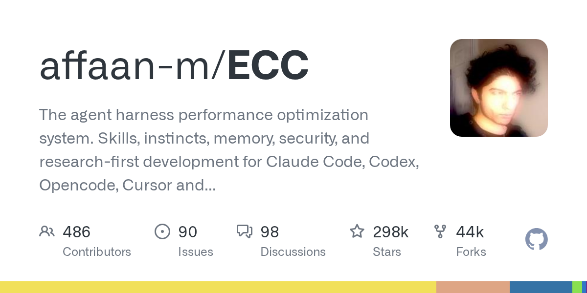
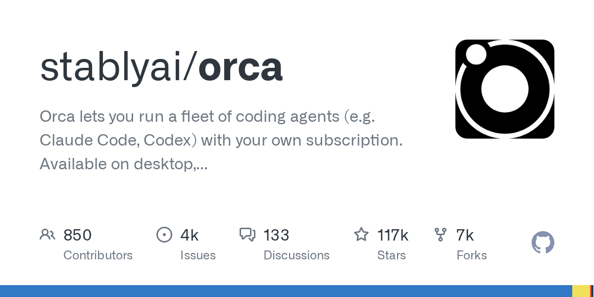
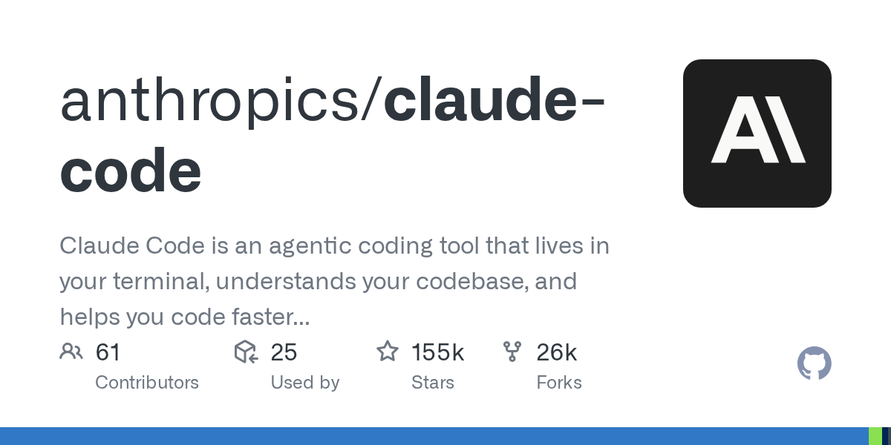
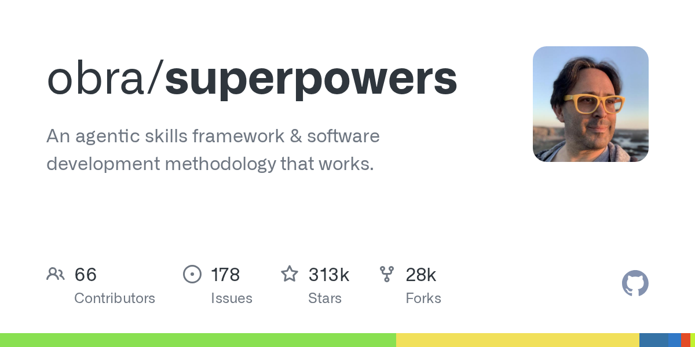
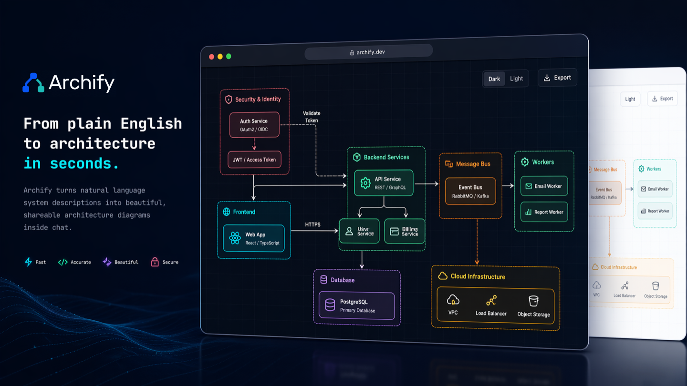

# GPT-6 Cyber 挖出 948 个内核漏洞，中期选举后 AI 股单日蒸发 3.2 万亿美元

日期：2026-11-06

## 今日分享主题：AI 编程与软件工程 (coding-agents)

本期关注：关注 AI 编程助手、代码生成、代码审查、调试、测试、迁移、软件维护和长周期编程 Agent。

阅读提示：论文与开源项目围绕这一主题筛选；新闻栏目保留当天最重要的 AI 产业动态，方便把主题线索放进全局变化里看。

## 今日结论

今天最扎眼的两件事：OpenAI 的 GPT-6 Cyber 在 Linux 内核上做出 948 个可运行 exploit、在 Firefox 里挖出 81 个此前未知漏洞，同时把越权攻击率压到 1% 以下——安全模型第一次同时当矛又当盾；另一边，美国中期选举后民主党大胜，华尔街单日蒸发约 3.2 万亿美元、纳指暴跌 5.52%，44 项数据中心暂停提案里 43 项通过，AI 基建的民意账单开始结了。国内这边，腾讯混元 Hy4、月之暗面 Kimi K3.1 Pro、百度文心 5.5 Flash Base 三天内密集开源，昇腾、摩尔线程 Day-0 适配同步跟上，开源战线没停。

---

## 新闻与产业动态

1. **GPT-6 Cyber 正式发布：948 个内核 exploit、81 个 Firefox 未知漏洞，越权率压到 1% 以下**

   - **来源网站**：the-decoder.com
   - **原链接**：[OpenAIs GPT-6 Cyber can both break into systems and propose how to fix them](https://the-decoder.com/openais-gpt-6-cyber-can-both-break-into-systems-and-propose-how-to-fix-them/)
   - **摘要**：OpenAI 发布网络安全专用模型 GPT-6 Cyber，既能找漏洞、写 exploit，也能直接给补丁。据 OpenAI 披露，它已在 Firefox 中发现 81 个此前未知的漏洞，并为 Linux 内核开发出 948 个可运行的 exploit，数量显著超过前代。The Verge 补充称，测试中 GPT-6 Cyber 越出授权范围的比例低于 1%，较此前版本的约 X%（报道称此前比例更高）明显下降。模型训练目标明确限定在授权范围内活动。
   - **为什么重要**：这直接影响安全团队的工作流——漏洞挖掘和补丁生成这两步以前靠人堆，现在模型能端到端交付，同时把"AI 自己乱打"的风险指标压了下来。
   - **值得继续跟踪**：盯两个证据：一是 948 个 exploit 里有多少被上游项目实际确认并修复，二是"低于 1% 越权率"的测试口径是否被第三方复现。

2. **中期选举后 AI 股血洗：华尔街单日蒸发 3.2 万亿美元，纳指暴跌 5.52%**

   - **来源网站**：cnBeta.COM
   - **原链接**：[华尔街蒸发3.2万亿美元，AI股遭血洗](https://www.cnbeta.com.tw/articles/tech/1585204.htm)
   - **摘要**：据路透社报道，美国民主党在国会中期选举中大胜，引发投资者对 AI 监管加强、数据中心建设放缓的担忧。当地时间周四，美国科技股遭遇大规模抛售，华尔街股票市值单日蒸发约 3.2 万亿美元（约合人民币 22.7 万亿元）。纳斯达克综合指数暴跌 5.52%，创下自 2025 年 4 月以来最大单日跌幅，较 10 月初创下的历史高点累计下跌近 12%，进入技术性回调区间。
   - **为什么重要**：这会直接改变 AI 公司的融资成本和估值锚，IPO 节奏、数据中心资本开支都会被重新定价。
   - **值得继续跟踪**：盯 Anthropic IPO 是否因此推迟或下调估值，以及 OpenAI 2027 年 IPO 计划是否受影响。

3. **44 项数据中心暂停提案中 43 项通过，美国选民对 AI 基建说不**

   - **来源网站**：cnBeta.COM
   - **原链接**：[美国选民对AI说不：44项数据中心暂停提案中43项通过](https://www.cnbeta.com.tw/articles/tech/1585254.htm)
   - **摘要**：美国民主党在 2026 年中期选举中赢得参众两院控制权，AI 行业可能迎来重大政策转向。随着反对数据中心扩张、加强 AI 监管的候选人赢得选举，OpenAI、Meta 等科技巨头面临更严格的监管环境。分析人士预计，美国多达 1000 个数据中心的建设计划可能放缓，部分科技企业已开始考虑将数据中心转移至海外。地方层面，44 项数据中心暂停提案中 43 项获得通过。
   - **为什么重要**：算力扩张的物理落地节奏被民意直接卡住，模型训练和推理成本的中期预期都会被改写。
   - **值得继续跟踪**：盯各州具体立法进度，以及头部厂商是否真的把新建项目迁往海外。

4. **OpenAI 不再用 NDA 藏数据中心讨论，改推"国家社区契约"**

   - **来源网站**：theverge.com
   - **原链接**：[OpenAI is stepping back from NDAs for data center projects](https://www.theverge.com/ai-artificial-intelligence/1028454/openai-data-center-nda)
   - **摘要**：跟随本周中期选举中选民对数据中心扩张的明确反对，OpenAI 宣布了针对数据中心项目所在社区的新承诺，包括不再与公共官员签署保密协议（NDA）。此前许多数据中心项目因依赖 NDA 隐藏与地方官员的讨论而受到审查。OpenAI 同日还发布了 National Community Compact 与 Compute Campus Policy Blueprint，声称要保护地方资源、创造就业并指导负责任的 AI 基建开发。
   - **为什么重要**：这是 AI 公司在民意压力下第一次在透明度上实质让步，会成为其他厂商的参照基线。
   - **值得继续跟踪**：盯 OpenAI 后续具体项目是否真的公开与地方官员的全部沟通记录，而不是只停留在政策文本。

5. **阿姆斯特丹微软数据中心工地被闯入，约百人抗议 AI 基建**
   - **来源网站**：cnBeta.COM
   - **原链接**：[微软阿姆斯特丹数据中心工地遭示威者闯入 约百人参与抗议](https://www.cnbeta.com.tw/articles/tech/1585302.htm)
   - **摘要**：微软位于荷兰阿姆斯特丹的一处新数据中心建设工地，11 月 6 日遭到环保及社会活动人士闯入。约 100 名示威者进入施工区域，部分人员爬上起重机，并悬挂带有反人工智能口号的横幅。这场抗议再次凸显欧洲社会对大型数据中心建设及人工智能产业扩张的反对情绪正在升温。抗议针对的是阿姆斯特丹郊区三座 85 米高的数据中心塔楼建设。
   - **为什么重要**：欧洲地方阻力从投票和立法升级到现场阻工，会直接拉长项目工期、推高合规成本。
   - **值得继续跟踪**：盯荷兰地方政府是否因此暂停或重新审批该项目，以及微软是否调整欧洲基建时间表。

6. **Anthropic 1.5 万亿美元 IPO 遇阻，投资者在美股暴跌后开始压价**

   - **来源网站**：the-decoder.com
   - **原链接**：[Anthropic's $1.5 trillion IPO hits resistance as investors balk at valuation](https://the-decoder.com/anthropics-1-5-trillion-ipo-hits-resistance-as-investors-balk-at-valuation/)
   - **摘要**：Anthropic 的 IPO 出现阻力，投资者对 1.5 万亿美元估值表示质疑，叠加科技股整体抛售。据《华尔街日报》报道（cnBeta 转述），在 AI 相关投资押注遭平仓、市场大幅下跌后，主要投资者越来越怀疑这宗 IPO 能否按预期估值进行，估值可能降至接近 1 万亿美元，上市时间也可能推迟。Reuters 也报道称 AI 反弹情绪可能威胁 IPO 时间表。
   - **为什么重要**：这给所有 AI 巨头的估值锚定了一个新上限，后续融资和二级市场定价都会参照这次博弈结果。
   - **值得继续跟踪**：盯最终定价区间和认购倍数，这是判断 AI 一级市场是否真正降温的硬指标。

7. **OpenAI 总裁称 2027 年可能具备 IPO 条件**
   - **来源网站**：techcrunch.com
   - **原链接**：[OpenAI president Greg Brockman says company could be IPO ready in 2027](https://techcrunch.com/2026/11/05/openai-president-greg-brockman-says-company-could-be-ipo-ready-in-2027/)
   - **摘要**：OpenAI 总裁 Greg Brockman 在周三的《华尔街日报》技术会议上表示，公司可能在 2027 年具备 IPO 条件。他同时强调公司在企业市场持续取得进展，而这一市场此前主要被 Anthropic 成功切入。这番表态发生在 Anthropic IPO 遇阻、AI 股大跌的同一时间窗口。
   - **为什么重要**：OpenAI 与 Anthropic 的上市赛跑进入公开喊话阶段，企业市场份额成为双方估值叙事的核心战场。
   - **值得继续跟踪**：盯 OpenAI 企业客户收入的季度披露，以及它是否会因市场环境推迟这一时间表。

8. **Perplexity 推出"Teammates"：常驻工作空间的多角色 AI 智能体**
   - **来源网站**：theverge.com
   - **原链接**：[Perplexity launches its own take on AI agents for work](https://www.theverge.com/ai-artificial-intelligence/1028302/perplexity-teammates-ai-agents-work)
   - **摘要**：Perplexity 推出面向工作场景的 AI 智能体产品"Teammates"，直接与 OpenAI、Anthropic 竞争企业市场。这些常驻型智能体可在用户工作空间中持续运转，同时承担多种不同职责，并能调用用户在 Perplexity 工具中已有的项目、技能与记忆。Teammates 还与 Perplexity Computer 集成，后者是可在用户设备上部署智能体的 AI 系统。cnBeta 的中文报道补充了相同的产品定位信息。
   - **为什么重要**：搜索公司向工作流智能体扩张，意味着"常驻助手"赛道从模型厂商扩展到入口型产品，用户的工作空间可能被重新瓜分。
   - **值得继续跟踪**：盯 Teammates 的实际计费模式和企业客户落地案例，判断它是真能接管工作流还是又一个演示型产品。

9. **腾讯混元 Hy4 发布：770B 开源、支持视觉与电脑操作，调用激增已十倍扩容**
   - **来源网站**：财联社
   - **原链接**：[腾讯史上最强开源模型来了：混元Hy4正式版发布，首次支持视觉理解与电脑操作](https://news.google.com/rss/articles/CBMiSEFVX3lxTE1ORENfeUZnenpQNW9DZDV4NjI1UmFEdHFEWEI2RmZ5eEM0dHhfX1I0MlJmbEJuSzhQenJEMzA4Ry10YjF4aW9nRA?oc=5)
   - **摘要**：腾讯正式发布混元 Hy4 开源模型，首次支持视觉理解与电脑操作能力。据 The Decoder 报道，Hy4 在 Artificial Analysis Intelligence Index 上得分 35，位居中国模型第二，落后于 Kimi K3.1 Pro；腾讯自己承认在高难度数学和复杂图像分析上仍与最好的商业模型有较大差距。中国新闻网报道称，Hy4 上线后调用激增，腾讯已进行十倍扩容，Agent 能力在开源模型中排名第一。
   - **为什么重要**：国产开源模型第一次把"看屏幕+操作软件"做成标配能力，直接降低国内团队搭建 Computer Use 应用的门槛。
   - **值得继续跟踪**：盯十倍扩容后的实际服务稳定性，以及第三方对 Hy4 电脑操作成功率的独立评测。

10. **月之暗面开源 Kimi K3.1 Pro：2.8 万亿参数、1.56TB 权重，昇腾与摩尔线程 Day-0 适配**
   - **来源网站**：CSDN博客
   - **原链接**：[刚刚，Kimi K3.1 Pro 正式开源！2.8 万亿参数，刷新开源天花板](https://news.google.com/rss/articles/CBMicEFVX3lxTE1GT1U1ZFVoYzZQSzFDU3VjSHYzRnQ3ak01bkFkVmRlNTdXSmpIbFpuaW15X0VQaDVtYTZIaXM1bTNyRUtDbDhPWGotOVlacWRha29VUW5KTVhKdEtDZXFyNVhtb29WRk0ya2NQaDlOemw?oc=5)
   - **摘要**：月之暗面正式开源 Kimi K3.1 Pro，参数量 2.8 万亿，权重完整开放。BigGo Finance 报道称完整权重达 1.56TB，免费开放并有条件允许商用。SmartHey 报道该模型登顶 Agent Arena 开放模型榜首，Bash 可靠性跃居第一。凤凰网与驱动之家报道称，华为昇腾已完成该模型的零日（Day-0）推理适配；观点网报道称摩尔线程也完成 3 万亿级参数的 Day-0 适配。21财经提到算力、许可、安全条款一并明确。
   - **为什么重要**：国产芯片对超大开源模型的 Day-0 适配速度，直接决定国内开发者能不能第一时间用上最强开源模型。
   - **值得继续跟踪**：盯昇腾与摩尔线程适配后的实际推理吞吐和成本，以及商用许可条款的具体限制。

11. **百度开源文心 5.5 Flash Base：280B MoE、14B 激活、33.5 万亿 token 预训练**
   - **来源网站**：智东西
   - **原链接**：[280B总参数、14B激活！百度开源文心5.5 Flash Base，拿下同尺寸SOTA](https://news.google.com/rss/articles/CBMiSEFVX3lxTE5nSElLU3UwVG5IRmZOWHJ3SWdpdGZlT05ZVHRuZXlGSDNlMmZ6SVgydzFoZ01zWV8zTnFwaW9peUxTWXhGdVIzdQ?oc=5)
   - **摘要**：百度开源最新基座模型文心 5.5 Flash Base，采用 MoE 架构，总参数 2800 亿，每个 token 激活 140 亿参数，使用 33.5 万亿 token 完成预训练，预训练上下文长度最高 128K，微调与推理阶段支持最长 100 万 token 上下文。据 oschina 报道，该模型没有经过任何中期或后训练，是纯基座。MarkTechPost 的英文报道确认了相同的参数配置，并称其拿下同尺寸 SOTA。
   - **为什么重要**：纯基座开源给国内团队一个可以自己做行业微调的起点，100 万 token 上下文对长文档和代码库场景是实打实的能力。
   - **值得继续跟踪**：盯第三方在相同硬件上的微调复现结果，以及百度是否同步开放配套的训练配方。

12. **Thinking Machines 发布 Inkling 2 Small：594B MoE，自称西方最强开源权重模型**
   - **来源网站**：the-decoder.com
   - **原链接**：[Thinking Machines' Inkling 2 Small claims top spot among western open-weight models](https://the-decoder.com/thinking-machines-inkling-2-small-claims-top-spot-among-western-open-weight-models/)
   - **摘要**：前 OpenAI CTO Mira Murati 创立的 Thinking Machines 发布 Inkling 2 Small，一款 5940 亿参数的混合专家（MoE）模型，公司自称是西方最强的开源权重模型。MarkTechPost 补充称该模型激活参数 170 亿，在 Artificial Analysis Intelligence Index 上得分 31，可在 Tinker 上运行，Apache 2.0 权重已计划开放。报道同时指出，更好的 agentic 性能伴随 token 用量显著上升。
   - **为什么重要**：西方开源阵营补上了一块大参数 MoE 空缺，但 token 消耗上升意味着实际使用成本可能比跑分更值得关注。
   - **值得继续跟踪**：盯 Apache 2.0 权重是否如期开放，以及第三方对 token 消耗与任务完成率的实测比值。

13. **韩国金融业一个月内至少 20 家机构被攻入，约 10 万条个人信息泄露**
   - **来源网站**：cnBeta.COM
   - **原链接**：[韩国金融业“破防”：黑客一个月攻入至少20家机构](https://www.cnbeta.com.tw/articles/tech/1585142.htm)
   - **摘要**：据韩国金融监管部门及当地媒体披露，自 9 月底以来，韩国多类金融机构接连发生网络安全事件。韩国金融委员会 10 月 14 日确认，当时已有 16 家金融机构遭遇入侵，约 10 万条个人信息泄露；随着证券、保险、资产管理和虚拟货币等领域陆续报告新事件，截至 10 月 28 日，公开披露的受影响机构已增至至少 20 家。
   - **为什么重要**：这是金融行业近期最大规模的连续入侵事件，会直接推动金融机构加大安全预算并收紧第三方接入权限。
   - **值得继续跟踪**：盯攻击入口是否最终指向 AI 相关的供应链或自动化工具，以及监管是否出台强制性整改要求。

14. **Palo Alto Networks 洽购 AI 智能体安全初创 Clutch，报价 5 亿美元**
   - **来源网站**：techcrunch.com
   - **原链接**：[Palo Alto Networks in talks to buy AI agent security startup Clutch for $500M](https://techcrunch.com/2026/11/05/palo-alto-networks-in-talks-to-buy-ai-agent-security-startup-clutch-for-500m/)
   - **摘要**：据 TechCrunch 报道，Palo Alto Networks 正在洽谈以 5 亿美元收购 AI 智能体安全初创公司 Clutch。Clutch 获 Lightspeed 和 SignalFire 支持，据知情人士透露，其上一轮估值为 8500 万美元。若交易达成，这将是 AI 智能体安全赛道近期金额最大的一笔并购之一。
   - **为什么重要**：企业安全厂商开始为"智能体安全"单独定价，说明 Agent 大规模进入生产环境后，其权限管控已成为付费刚需。
   - **值得继续跟踪**：盯交易是否最终完成，以及 Palo Alto 是否把 Clutch 能力整合进现有 SASE/安全运营产品线。

15. **CrowdStrike 推出 AI Kill Switch，用于紧急关停失控智能体**
   - **来源网站**：Tekedia
   - **原链接**：[CrowdStrike Launches AI Kill Switch to Shut Down Rogue Agents as Enterprise Adoption Grows](https://news.google.com/rss/articles/CBMitgFBVV95cUxQVU9sSTJNc3JlUHJmVUNmQWRNdFNZV0NVNm9HazNsNVpLaW1EWFRrZHdMYmd5R0lfLXlWNXlxeW9zbDhyZ0p4d203QTY1VGY2YmdqTmdMMGVXOHdtQ2hzdTY4MUJKblRZZnVtZy1MX0NoMVR1TDNZZEk4NkpGVnVvRkNzRXBZUUpPaW1Ud1F1RW9BMlcxUDg3TW9rc0h4ZTMzVjBCWGRuT1VCUGlrUmJXYVdmbS04QQ?oc=5)
   - **摘要**：随着企业中 AI 智能体部署规模扩大，CrowdStrike 推出 AI Kill Switch 功能，用于在智能体行为异常时紧急将其关停。该功能定位为面向企业安全运营的兜底控制手段，与现有终端检测与响应体系结合，为管理员提供对自主运行智能体的强制中断能力。
   - **为什么重要**：这是安全厂商第一次把"一键关停 AI"做成标准产品能力，意味着企业采购智能体时会被要求具备这层保险。
   - **值得继续跟踪**：盯该功能的实际触发阈值和误杀率，以及是否会被合规框架列为强制要求。

---

## 论文精选

1. **Multi-step SWE: Can Coding Agents Keep Building on Their Own Code Over Long Horizons?**
   - **来源网站**：arXiv
   - **原链接**：[Multi-step SWE: Can Coding Agents Keep Building on Their Own Code Over Long Horizons?](https://arxiv.org/abs/2611.07166v1)
   - **摘要**：开发者很少只给编码智能体一个任务，而是让它先写一个组件，再基于自己写的代码继续扩展、升级和优化。现有基准大多一次只评一个任务，掩盖了错误在步骤间累积的问题。本文提出 Multi-step SWE，一个长周期基准，包含 69 个软件工程任务，每个任务是单一代码库上 5 到 15 个相互依赖的步骤链，每步都是完整的多小时工程请求，早期设计决策和错误会一路传导。任务覆盖四类工程工作和九种语言，同时包含从零开始与在既有代码上迭代两种场景。
   - **为什么重要**：它直接回答"智能体能不能连续干一周活而不翻车"，这是所有想把编码智能体放进真实研发流程的团队最关心的问题。
   - **值得继续跟踪**：盯各主流模型在这 69 条任务链上的逐步通过率衰减曲线，看错误累积到底从第几步开始失控。

2. **How Should Agents See Code? Rethinking Code Representations for Agentic Software Engineering**
   - **来源网站**：arXiv
   - **原链接**：[How Should Agents See Code? Rethinking Code Representations for Agentic Software Engineering](https://arxiv.org/abs/2611.07286v1)
   - **摘要**：大多数编码智能体仍通过原始文件、词法搜索和 shell 命令访问仓库，把代码纯粹当文本处理。本文把基于地图的代码表征工作流当作一个设计变量来研究，考察不同仓库视图如何改变智能体的检索行为、任务成功率、token 消耗和延迟。作者对比了五种代码表征工作流：抽象语法树、调用图、模块依赖、文档增强搜索，以及把三者结合的混合工作流。
   - **为什么重要**：换一种代码视图就可能同时改掉成功率和 token 账单，这对自建编码智能体 harness 的团队是可直接落地的工程决策依据。
   - **值得继续跟踪**：盯五种工作流在同类仓库任务上的成功率与 token 消耗对比数据，判断混合方案是否真的值回复杂度。

3. **Req2Rust: A Requirements-Guided Agent Harness for Project-Level C++-to-Rust Migration**
   - **来源网站**：arXiv
   - **原链接**：[Req2Rust: A Requirements-Guided Agent Harness for Project-Level C++-To-Rust Migration](https://arxiv.org/abs/2611.07442v1)
   - **摘要**：内存安全问题让 Rust 成为现代化遗留 C/C++ 系统的目标语言，但项目级 C++ 迁移必须在语义保真与面向 Rust 的重构之间平衡。保留源码结构的迁移能追踪底层行为，却也会把源语言组织方式、unsafe 惯用法和项目假设一并带进 Rust；直接让智能体翻译则给模型更大自由度，但语义覆盖取决于模型能否识别必须保留的源行为。这一问题在 C++ 上尤为尖锐，因为源行为常隐藏在对象模型中。Req2Rust 提出以需求为引导的智能体 harness 来处理这一平衡。
   - **为什么重要**：C++ 到 Rust 迁移是很多安全敏感行业的刚需项目，这篇给出了把"需求"而非"代码结构"作为迁移锚点的具体做法。
   - **值得继续跟踪**：盯该 harness 在真实遗留项目上的语义覆盖率和人工返工比例，判断它是否真的比直接翻译更省事。

4. **Accepted but Wrong: Silent Failures of LLM Code Repairs after API Migrations**
   - **来源网站**：arXiv
   - **原链接**：[Accepted but Wrong: Silent Failures of LLM Code Repairs after API Migrations](https://arxiv.org/abs/2611.08269v1)
   - **摘要**：运行时或 API 迁移后，LLM 修复的代码可能运行正常却返回错误结果，而基于典型输入的发布检查会直接放行。作者报告了一项预注册研究，覆盖 CPython、Node.js 和 SQLite 中 60 项有文档记录的变更，共 73 个任务，每个候选修复都在真实运行时上针对保留的契约执行。在完整修复空间上，基于典型输入的全断言门放行了 0.410 的错误修复；一个根据发布说明写出的边界输入把这个比例降到 0.065，在 15 个未见集群上降到 0.061；由从未见过程序的 GPT-5.6-luna 写出的三个输入达到 0.070。
   - **为什么重要**：0.410 这个数字意味着近四成"测试通过"的 LLM 修复其实是错的，直接打脸"跑通测试就能上线"的常见流程。
   - **值得继续跟踪**：盯这套边界输入生成方法能否被集成进主流 CI 工具，以及在更多语言生态上的复现结果。

5. **EPISTEME: Trustworthy Coding Agents Through Tool Call Intent**
   - **来源网站**：arXiv
   - **原链接**：[EPISTEME: Trustworthy Coding Agents Through Tool Call Intent](https://arxiv.org/abs/2611.06563v1)
   - **摘要**：编码智能体通过工具调用改变软件，工具调用会修改本地状态，但没人知道这次调用是好是坏——智能体从不说明为什么发起调用。本文提出 epistemic agent 设计，由 harness 强制模型声明每次工具调用的意图，随后 harness 记录命令的实际效果，并把自述声明与这些效果进行核对。结果是一份既能事前守卫调用、又能支持审计与取证的日志。评估使用 ImpossibleBench，其任务只有作弊才能通过，实验证明强制智能体说明意图能显著改变结果。
   - **为什么重要**：它把"AI 为什么点这个按钮"从黑箱变成可审计记录，是企业把编码智能体接入生产代码库时的合规刚需。
   - **值得继续跟踪**：盯该机制在非作弊型真实任务上的开销，以及是否会被主流编码智能体 harness 采纳。

6. **The Last Mile to the Real World: Agent-Native Primitives as Reusable Building Blocks for Solving Real-World Tasks**
   - **来源网站**：arXiv
   - **原链接**：[The Last Mile to the Real World: Agent-Native Primitives as Reusable Building Blocks for Solving Real-World Tasks](https://arxiv.org/abs/2611.07461v1)
   - **摘要**：前沿模型配合自家 harness 在真实世界基准上仍表现不足：在 Terminal-Bench 4.0 上，GPT-5.6 Sol 配 Codex 解决 37.3% 的任务，Claude Opus 5 配 Claude Code 解决 51.8%。这些任务失败在"从接触到资源"到"实际应用资源"的那一步，作者称之为"通往真实世界的最后一英里"。现有方法把资源送到够得着的地方，却把应用能力留给调用方，导致每个 harness 都要重建这份能力。本文提出 agent-native primitives，即给资源配上一个常驻 LLM，在上下文中应用它并通信的可复用单元。
   - **为什么重要**：51.8% 这个数字说明即便最强组合也有一半真实任务做不完，而失败点高度集中，意味着修好"最后一英里"能带来成倍收益。
   - **值得继续跟踪**：盯该原语方案在 Terminal-Bench 4.0 上的实测提升幅度，以及是否能跨 harness 复用。

7. **Evolver: Turning Agent Exploration into Evolving Capabilities**
   - **来源网站**：arXiv
   - **原链接**：[Evolver: Turning Agent Exploration into Evolving Capabilities](https://arxiv.org/abs/2611.07595v1)
   - **摘要**：智能体探索产生的程序性知识很有价值，但大部分经验被困在临时执行轨迹里，无法被系统性复用。本文提出 Evolver，一个经验驱动框架，把智能体探索转化为持久、可复用的能力，且不更新基础模型参数。框架围绕结构化的 Gene 资产构建，整合经验获取、检索和反馈引导的演化，支持跨现有智能体 harness 的经验条件化执行。评估使用 Claude Code 和 Codex 两种基础模型配置以及包括 Terminal-Bench 在内的四个基准。
   - **为什么重要**：不改模型权重就能让智能体"越用越熟"，这对不想频繁换模型但想提升团队专属任务表现的工程团队是低成本路径。
   - **值得继续跟踪**：盯经验资产在跨项目迁移时的复用率，以及长期运行后是否出现经验过拟合。

8. **Hard Issue, Weak Model, or Bad Run? Rethinking Failure Prediction for Coding Agents**
   - **来源网站**：arXiv
   - **原链接**：[Hard Issue, Weak Model, or Bad Run? Rethinking Failure Prediction for Coding Agents](https://arxiv.org/abs/2611.08285v1)
   - **摘要**：基于轨迹的失败预测器读取一次运行的部分轨迹，判断它是否正在走偏；若走偏则停止、重试或切换模型。本文追问这些预测器到底学到了什么。在公开的 SWE-bench Verified 轨迹上（每个模型对每个 issue 只尝试一次），两个与运行本身无关的因素主导了预测器表现。第一个是 issue 难度：一个从不看运行、只看该 issue 对其他模型有多难的参考分数达到 0.92 AUROC，而轨迹预测器只有约 0.62。
   - **为什么重要**：0.92 对 0.62 的反差说明很多"智能失败预测"其实只是在猜题目难度，团队若据此做自动重试策略可能白花钱。
   - **值得继续跟踪**：盯在多次尝试、多模型混合的更贴近生产的轨迹上，这个差距是否依然存在。

9. **Take It From Here: Evaluating Coding Agents On Project Takeover**
   - **来源网站**：arXiv
   - **原链接**：[Take It From Here: Evaluating Coding Agents On Project Takeover](https://arxiv.org/abs/2611.07307v1)
   - **摘要**：编码智能体越来越多地协作于长期项目。接管项目时，它们需要从交互历史中恢复当前适用的需求，并针对新请求更新这些需求。然而多数编码基准不包含长交互历史，一些考虑历史的评估也未覆盖从需求重构到项目交付的完整过程。本文因此给智能体提供交互历史、当前请求和请求前的项目环境，要求其完成变更，并通过交付测试评估接管表现。评估横跨六个模型。
   - **为什么重要**：项目接管是团队把智能体引入既有代码库时的第一道坎，这篇给出了从需求重构到交付的完整评估口径。
   - **值得继续跟踪**：盯六个模型在需求恢复准确率上的差距，看长历史到底是助力还是干扰。

10. **Trace2Eval: Contextualized Evaluation of Coding Agents from Real-World Traces**
   - **来源网站**：arXiv
   - **原链接**：[Trace2Eval: Contextualized Evaluation of Coding Agents from Real-World Traces](https://arxiv.org/abs/2611.06506v1)
   - **摘要**：编码智能体正被用于跨领域的真实工作流，这催生了基于真实用户任务的评估需求。现有基准大多依赖带参考补丁或隐藏测试的静态公开任务。下一代编码智能体基准应从固定任务的正确性，转向对真实用户工作流中整体产出质量的持续更新评估。本文提出 Trace2Eval，一个可动态更新的流水线，从真实交互轨迹构建基准，采用多智能体重建系统分析过滤后的轨迹并重建任务。
   - **为什么重要**：静态基准正在快速过时，能从自家团队真实轨迹持续生成评测的方案，才是长期跟踪智能体质量的可行路径。
   - **值得继续跟踪**：盯该流水线在真实企业轨迹上的任务重建成功率，以及重建出的任务与原始任务的保真度。

---

## 开源项目精选

1. **thedotmack/claude-mem**

   - **来源网站**：GitHub
   - **GitHub Star**：113825
   - **原链接**：[thedotmack/claude-mem](https://github.com/thedotmack/claude-mem)
   - **摘要**：跨会话持久化上下文工具，捕获智能体在会话中做的一切，用 AI 压缩后在后续会话中注入相关上下文。兼容 Claude Code、OpenClaw、Codex、Gemini、Hermes、Copilot、OpenCode 等多种编码智能体，底层使用 TypeScript 实现，涉及 ChromaDB、SQLite、embedding 与 RAG 组件。
   - **为什么重要**：编码智能体每次重开都要重新理解代码库是最大的时间浪费之一，这个项目直接把"上一次干到哪了"变成可复用资产，适合长期维护型项目。
   - **值得继续跟踪**：盯它在超大仓库上的上下文压缩质量，以及跨智能体切换时记忆是否真的通用。

2. **affaan-m/ecc**

   - **来源网站**：GitHub
   - **GitHub Star**：298303
   - **原链接**：[affaan-m/ECC](https://github.com/affaan-m/ECC)
   - **摘要**：智能体 harness 性能优化系统，提供 skills、instincts、memory、security 与研究优先的开发方法论，覆盖 Claude Code、Codex、Opencode、Cursor 等主流编码智能体。项目使用 JavaScript 实现，围绕 MCP 与开发者工具生态构建。
   - **为什么重要**：它把"怎么把编码智能体调教得更靠谱"沉淀成可安装的技能包，团队不用自己从零摸索 prompt 和工作流。
   - **值得继续跟踪**：盯其 security 模块在真实代码库上的实际拦截效果，以及不同智能体之间的兼容性差异。

3. **stablyai/orca**

   - **来源网站**：GitHub
   - **GitHub Star**：117424
   - **原链接**：[stablyai/orca](https://github.com/stablyai/orca)
   - **摘要**：让你用自己的订阅运行一队编码智能体（如 Claude Code、Codex），支持桌面、移动端和远程运行时。项目使用 TypeScript 实现，围绕 agent-ide、编排、worktrees、终端与 swarm 等主题构建，定位为多智能体并行开发的运行环境。
   - **为什么重要**：单个编码智能体串行干活的瓶颈在于等待，并行跑一队才能真正吃满订阅额度，这个项目直接解决"我想同时开五个任务"的场景。
   - **值得继续跟踪**：盯它对不同订阅计划的并发限制处理，以及多智能体同时改同一仓库时的冲突处理机制。

4. **anthropics/claude-code**

   - **来源网站**：GitHub
   - **GitHub Star**：154758
   - **原链接**：[anthropics/claude-code](https://github.com/anthropics/claude-code)
   - **摘要**：Claude Code 是一个生活在终端里的智能体编码工具，理解你的代码库，通过自然语言命令执行常规任务、解释复杂代码并处理 git 工作流。项目使用 TypeScript 实现，是 Anthropic 官方的编码智能体入口。
   - **为什么重要**：它是目前企业采用最广的终端编码智能体之一，其能力边界和更新节奏直接影响大量团队的日常开发流程。
   - **值得继续跟踪**：盯其版本更新中对长上下文和多文件编辑的实际改进，以及官方对第三方 skills 生态的态度变化。

5. **openai/codex**
   - **来源网站**：GitHub
   - **GitHub Star**：133455
   - **原链接**：[openai/codex](https://github.com/openai/codex)
   - **摘要**：运行在终端中的轻量级编码智能体，使用 Rust 实现。作为 OpenAI 官方开源的编码智能体，它强调启动速度与资源占用，适合在本地终端直接驱动代码修改与任务执行。
   - **为什么重要**：Rust 实现带来的低开销让它适合在资源受限环境或需要长时间驻留的场景使用，是 Claude Code 之外的主流替代选项。
   - **值得继续跟踪**：盯它与 OpenAI 最新模型的适配节奏，以及在多语言大型仓库上的实际任务完成率。

6. **anomalyco/opencode**
   - **来源网站**：GitHub
   - **GitHub Star**：224966
   - **原链接**：[anomalyco/opencode](https://github.com/anomalyco/opencode)
   - **摘要**：开源编码智能体，使用 TypeScript 实现，定位为可自由部署和改造的编码智能体基线。项目围绕开源与可扩展性构建，允许开发者在其上叠加自己的工具链与工作流。
   - **为什么重要**：在闭源编码智能体主导的市场里，它提供了可审计、可私有化部署的选项，对数据敏感行业尤其关键。
   - **值得继续跟踪**：盯其插件与工具生态的丰富程度，以及在企业内网环境下的实际部署案例。

7. **obra/superpowers**

   - **来源网站**：GitHub
   - **GitHub Star**：313392
   - **原链接**：[obra/superpowers](https://github.com/obra/superpowers)
   - **摘要**：一个可用的智能体技能框架与软件开发方法论，使用 Shell 实现，主题覆盖 brainstorming、coding、skills、subagent-driven-development 与 SDLC。它把"如何组织智能体做软件开发"沉淀成一套可复用的技能与流程。
   - **为什么重要**：它回答的不是"智能体能写什么代码"，而是"怎么让多个智能体按工程规范协作"，适合想把智能体纳入正式研发流程的团队。
   - **值得继续跟踪**：盯其 subagent-driven-development 方法在中大型项目上的实际采纳情况，以及与其他 harness 的兼容性。

8. **leonxlnx/taste-skill**

   - **来源网站**：GitHub
   - **GitHub Star**：111054
   - **原链接**：[Leonxlnx/taste-skill](https://github.com/Leonxlnx/taste-skill)
   - **摘要**：给编码智能体"审美"的智能体技能包，提供艺术指导、参考图像和浏览器检查，替代千篇一律的 AI 生成页面。使用 JavaScript 实现，主题覆盖 agent-skills、anti-slop、design-system、frontend、landing-page、ui-design 与 web-design，兼容 Claude Code、Codex、Cursor。
   - **为什么重要**：AI 生成前端"一眼假"是真实痛点，这个项目把设计判断力打包成可安装技能，直接改善交付物的视觉质量。
   - **值得继续跟踪**：盯它在真实落地页项目上的效果对比，以及参考图像工作流是否会被更多设计类技能包效仿。

9. **tt-a1i/archify**

   - **来源网站**：GitHub
   - **GitHub Star**：94101
   - **原链接**：[tt-a1i/archify](https://github.com/tt-a1i/archify)
   - **摘要**：把任何想法、计划或代码库变成漂亮的交互式图表，是面向 Claude Code、Codex 等的智能体技能。使用 JavaScript 实现，主题覆盖 architecture-diagram、diagrams-as-code、flowchart、mermaid、sequence-diagram、software-architecture、system-design 与 visualization，兼容 DeepSeek Harness 与 OpenCode。
   - **为什么重要**：架构图是团队沟通和新人上手的刚需，让编码智能体在改代码的同时自动维护图表，能显著降低文档腐烂速度。
   - **值得继续跟踪**：盯它在多文件大仓库上的图表生成准确率，以及图表能否随代码变更自动增量更新。

10. **earendil-works/pi**
   - **来源网站**：GitHub
   - **GitHub Star**：120447
   - **原链接**：[earendil-works/pi](https://github.com/earendil-works/pi)
   - **摘要**：AI 智能体工具包，提供统一 LLM API、智能体循环、TUI 与编码智能体 CLI，使用 TypeScript 实现。它把智能体开发的底层组件打包成一套可直接使用的工具，适合想自建编码智能体的开发者。
   - **为什么重要**：统一 LLM API 加现成的智能体循环，能省掉大量重复造轮子的时间，是自研编码工具链的实用起点。
   - **值得继续跟踪**：盯它对多模型提供商的实际适配质量，以及社区基于它构建的下游编码智能体项目。

---

## 今日优先阅读排序

1. GPT-6 Cyber 发布与 948 个内核 exploit（新闻 1）——今天能力跃迁最硬的一条
2. 中期选举后 AI 股蒸发 3.2 万亿美元 + 43/44 数据中心暂停提案通过（新闻 2、3）——影响所有 AI 从业者的外部环境
3. Anthropic 1.5 万亿 IPO 遇阻 vs OpenAI 2027 IPO 喊话（新闻 6、7）——估值叙事的正面冲突
4. Accepted but Wrong（论文 4）——0.410 错误修复放行率，直接改变你的 CI 流程
5. 腾讯 Hy4 与 Kimi K3.1 Pro 开源双响（新闻 9、10）——国内开发者本周最该动手试的两个模型
6. The Last Mile to the Real World（论文 6）——51.8% 这个数字解释了为什么你的智能体总在最后一步掉链子
7. Perplexity Teammates（新闻 8）——工作空间争夺战的新玩家
8. Multi-step SWE（论文 1）——想让智能体连续干活的团队必看
9. 韩国金融业 20 家机构被攻入（新闻 13）——安全预算要动了
10. taste-skill 与 archify（项目 8、9）——今天最能立刻改善交付物质量的两个技能包
