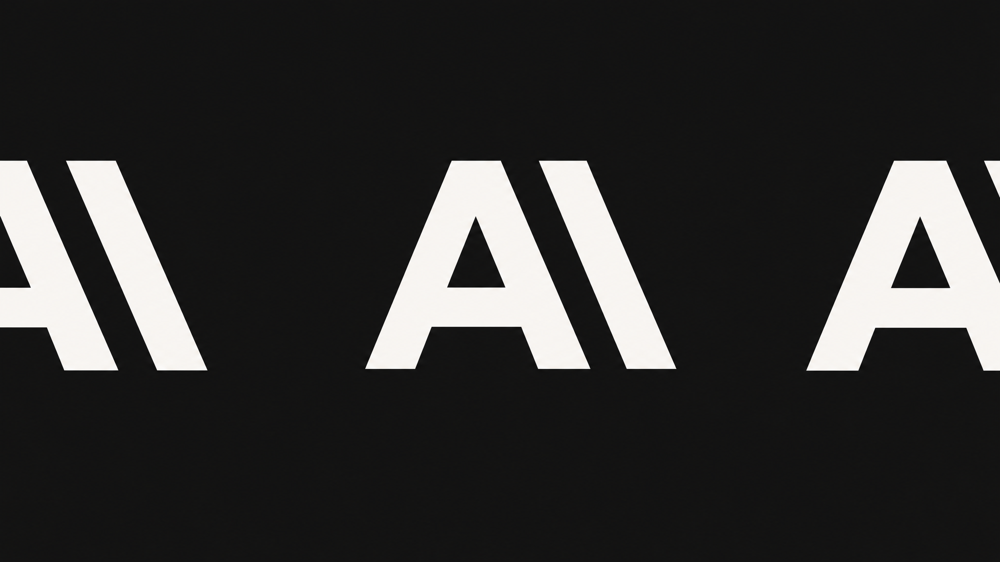
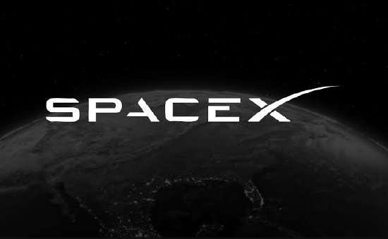
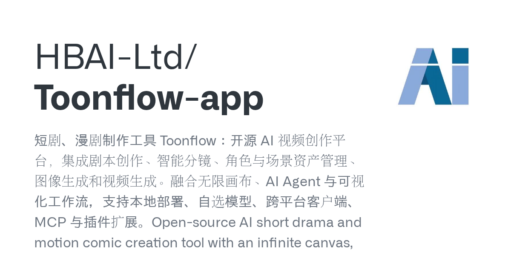
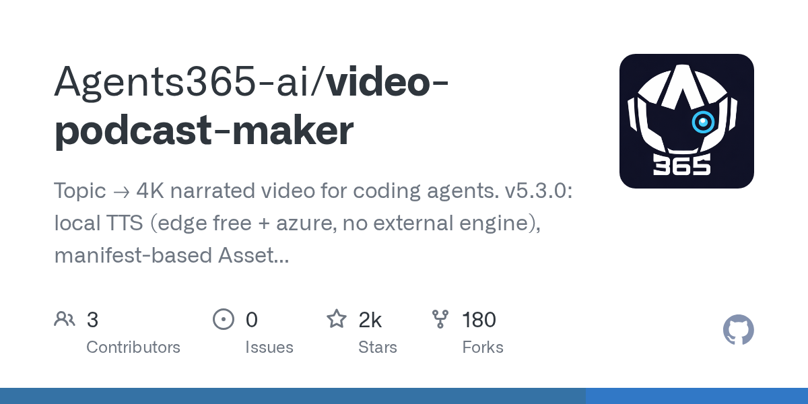
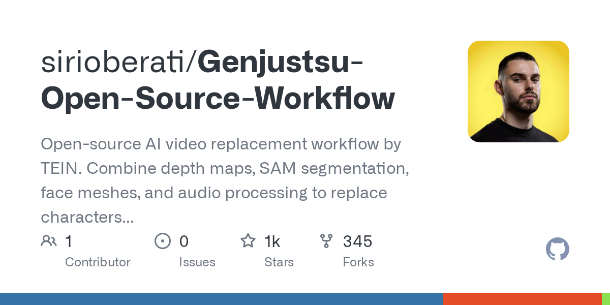

# GPT-6 Cyber 找出 948 个内核漏洞，编程智能体真实任务只完成 26.4%

日期：2026-11-09

## 今日分享主题：多模态内容与创意生产 (multimodal-creative)

本期关注：关注视频、图像、音频、设计、3D 和从创意到成品的多模态生产流程。

阅读提示：论文与开源项目围绕这一主题筛选；新闻栏目保留当天最重要的 AI 产业动态，方便把主题线索放进全局变化里看。

## 今日结论

今天最扎眼的不是模型又刷榜，而是两个数字撞在一起：OpenAI 的 GPT-6 Cyber 据报道挖出 948 个 Linux 内核漏洞、81 个 Firefox 高危缺陷，而阿里 Co-Design Bench 显示表现最好的编程智能体在真实用户需求上只完整搞定 26.4%——旧基准上它们能跑 99% 以上。安全侧的能力跃迁是真的，工程侧的"能干活"还差得远。同时，英伟达因黄仁勋与涉华情报人员关系启动独立调查，暗盘跌 2%，芯片出口管制的博弈被这场治理风波搅浑；Anthropic 拟感恩节前 IPO、募资至多 1000 亿美元，估值却从期望的 2 万亿降到 1.25-1.75 万亿。中文来源覆盖量子位、cnBeta、36氪、财联社、智源社区等，中国公司动态没有缺席。

---

## 新闻与产业动态

1. **GPT-6 Cyber 挖出 948 个内核漏洞、81 个 Firefox 高危缺陷**
   - **来源网站**：GBHackers News
   - **原链接**：[OpenAI's New GPT-6 Cyber Finds 81 High-Severity Firefox Vulnerabilities and 948 Linux Kernel Exploits](https://news.google.com/rss/articles/CBMimAFBVV95cUxQLWxNc2dmdzhSemhiaDFUUjhUbUVzWnFMbkVRNG9fTWhqWkYwVHRLNUx1cDl5ZnNReUFDZlJUamJvTFRjd3VscDU5RXc5NFNDSkJyVkduTk9WTWQxTVotUlhoZ1l4amxUNlEtR04yUFhDWG9mVjdOTDgzdkVobzBjVUtCVExrZTJDSVJaVWlQcm9PQjgwVVpjZdIBngFBVV95cUxQWEhEMTRxZUc3bnQ0cTFRUURSaUVBZXptb01JekV6cjk2ZDVOd0pRWTNsQjNqVnJxZ0tiREhKck5iV2twSzViVXZSNnVKQjg4SVRadDYtSlpIYmo4QmVuaHhqTU9EcFZHclQwQ1hhZzQ5SjlvVm5kenVKSlUydXhDT01RVU43cHprZnFlZFdoS1ZfY0hkUmpQLWlaQ2Rqdw?oc=5)
   - **摘要**：OpenAI 发布的网络安全专用模型 GPT-6 Cyber 据报道在授权测试中发现 948 个 Linux 内核漏洞和 81 个 Firefox 高危缺陷，Mozilla 已开始推送修复。该模型被 OpenAI 自评为"Critical"级别，面向授权安全研究场景，另据报道在 ExploitGym 评测中拿到 48.5%。这不是纸面跑分——漏洞进了真实软件的修复流程，说明前沿模型已经能直接嵌进漏洞挖掘工作流。
   - **为什么重要**：安全团队少了一步人工初筛，但攻击者同样拿到了更快的挖洞工具，防守方的时间窗被双向压缩。
   - **值得继续跟踪**：看 Mozilla 修复节奏、漏洞披露流程是否规范，以及该模型的访问门槛能否挡住非授权滥用。

2. **编程智能体真实任务只完成 26.4%，旧基准却跑 99%**

   - **来源网站**：the-decoder.com
   - **原链接**：[AI coding agents still need human cleanup on nearly three out of four tasks in a real-world test](https://the-decoder.com/ai-coding-agents-still-need-human-cleanup-on-nearly-three-out-of-four-tasks-in-a-real-world-test/)
   - **摘要**：阿里发布的 Co-Design Bench 用真实用户需求测试编程智能体，表现最好的 GPT-6 Astra 也只完整解决 26.4% 的任务，近四分之三需要人工收尾；而在旧基准上同类模型得分超过 99%。基准与现实的落差说明，刷榜能力不等于交付能力，需求理解、边界处理和验收环节仍是断点。
   - **为什么重要**：直接改变企业采购和排期预期——按 99% 规划人效会翻车，按 26.4% 才能算清真实人力成本。
   - **值得继续跟踪**：看该基准是否公开任务集与评分细则，以及头部厂商如何回应这个落差。

3. **英伟达董事会启动独立调查，黄仁勋承认出轨，暗盘跌 2%**
   - **来源网站**：量子位
   - **原链接**：[黄仁勋承认出轨发全员信道歉！英伟达启动紧急调查](https://www.qbitai.com/2026/11/508498.html)
   - **摘要**：英伟达董事会宣布由独立董事组成专门委员会、聘请外部律师，调查黄仁勋与一名据报被中国国家安全部招募的商界女性之间的关系；黄仁勋随后发全员信承认对妻子不忠并道歉。报道称英伟达暗盘下跌 2%，耶鲁学者 Sonnenfeld 估计其留任概率"约五五开"。这是这家约 4.5 万亿美元市值公司创立以来最严峻的治理考验之一。
   - **为什么重要**：CEO 去留直接关系英伟达在 AI 芯片出口管制谈判中的话语权，供应链客户和政策对手都在重新算账。
   - **值得继续跟踪**：调查结论、董事会是否调整治理结构，以及韩国方面称 GPU 交付不受影响的说法能否兑现。

4. **美国批准向中国空壳企业供应 H200，注册地址空无一人**

   - **来源网站**：cnBeta.COM
   - **原链接**：[调查发现美国批准向中国空壳企业供应英伟达H200芯片 注册地址空无一人](https://www.cnbeta.com.tw/articles/tech/1585514.htm)
   - **摘要**：《纽约时报》调查发现，美国商务部已批准约 24 家中国企业购买或经手 H200 芯片，但部分获批企业注册地址是无人办公的空置房间，另一些与受制裁的中国半导体供应商及军事相关机构存在关联。报道质疑商务部与英伟达的尽职调查存在漏洞，出口许可审查机制被指形同虚设。
   - **为什么重要**：审查失灵会让出口管制政策的实际效果打折，也给主张收紧管制的一方提供了新弹药。
   - **值得继续跟踪**：商务部是否启动复核、英伟达是否调整客户筛查流程，以及这批许可是否被撤销。

5. **Anthropic 拟感恩节前 IPO，募资至多 1000 亿美元，估值主动下调**

   - **来源网站**：the-decoder.com
   - **原链接**：[Anthropic pushes ahead with pre-Thanksgiving IPO despite tech selloff, accepts lower valuation](https://the-decoder.com/anthropic-pushes-ahead-with-pre-thanksgiving-ipo-despite-tech-selloff-accepts-lower-valuation/)
   - **摘要**：尽管科技股遭遇抛售，Anthropic 仍计划在感恩节前推进 IPO，目标估值 1.25 万亿至 1.75 万亿美元，低于此前期望的 2 万亿，拟募资 800 亿至 1000 亿美元。竞争对手 OpenAI 近期也下调过估值。报道称这是一次"做与不做都难"的抉择：错过窗口可能更贵，硬上则要接受折价。
   - **为什么重要**：AI 头部公司的估值锚正在下移，直接影响后续融资、人才争夺和整个板块的定价逻辑。
   - **值得继续跟踪**：最终定价区间、认购倍数，以及 OpenAI 是否跟进调整节奏。

6. **Anthropic 豪掷 34 亿美元自购发电设备，绕开公用事业公司**
   - **来源网站**：36氪
   - **原链接**：[Anthropic豪掷34亿美元自建发电设备](https://36kr.com/newsflashes/4062479710655367?f=rss)
   - **摘要**：据英国《金融时报》等报道，Anthropic 已与美国供应商达成发电设备采购协议，斥资 34 亿美元（约 227 亿元人民币）为数据中心供电。报道称 Claude 系列模型的强劲需求促使公司锁定更多算力与电力；此前外媒曾报道其未来 10 年计划投入超 5000 亿美元建设 AI 基础设施。分析认为，科技巨头正绕过传统公用事业公司，直接向上游设备商预订产能。
   - **为什么重要**：电力成为算力扩张的第一约束，自建电源意味着成本结构和交付节奏都要自己扛，也挤压了传统能源供应商的议价空间。
   - **值得继续跟踪**：设备交付时间表、实际并网容量，以及这 34 亿是否只是更大采购计划的前奏。

7. **OpenAI 新一轮融资 110 亿美元，估值 1.25 万亿美元**
   - **来源网站**：AIBase
   - **原链接**：[OpenAI新一轮融资筹集110亿美元，估值达1.25万亿美元](https://news.google.com/rss/articles/CBMiTkFVX3lxTE5BaFlMV0VfLXY2TEJqY2N5aGpsbXdHeG5PVUxwUjktQ2NCQ0lVai16XzNNaVN6YWg1OHppbFlYc3FRQjJXeVZva1NlQlBUdw?oc=5)
   - **摘要**：据报道，OpenAI 新一轮融资筹集 110 亿美元，估值达到 1.25 万亿美元。在 Anthropic 同步推进大额 IPO 的背景下，两家头部公司的资本动作都指向同一个判断：训练与推理的现金消耗还在加速，必须在市场窗口关闭前囤足弹药。
   - **为什么重要**：头部公司融资规模和估值直接决定算力采购、人才价格和整个 AI 供应链的订单能见度。
   - **值得继续跟踪**：本轮投资方构成、资金用途披露，以及估值是否包含尚未交付的产品承诺。

8. **GPT-6.2 灰度现身，单任务成本仅为 Opus 5.5 的 11.8%**
   - **来源网站**：BigGo Finance
   - **原链接**：[GPT-6.2 Sol Launches in Gray Release, Debuts Atop Leaderboard With Per-Task Cost Just 11.8% of Opus 5.5](https://news.google.com/rss/articles/CBMidkFVX3lxTE5pRmNhdS01UlVlYU5ldk5JMlNZTTFWczFxb1RXc2hURk5QeEZzSHdObFRYZzBnVXE0QnNTbXhuQzhvZFdlaHR4V0JtdDhsb3lkdUhTbEhLOE9uWUlVaFBQUGo5a0FnbHYxZWdoX29HMXphODhZM0E?oc=5)
   - **摘要**：报道称 GPT-6.2 Sol 已进入灰度发布并登上排行榜首位，单任务成本仅为 Opus 5.5 的 11.8%。不过智源社区有用户以截图反驳，认为灰度中出现的实为 GPT-6.1 Sol，型号存在争议；另有报道称 OpenAI 因安全疑云暂缓了相关发布。价格战的信号很明确，但"到底发了哪个模型"还没定论。
   - **为什么重要**：若成本真降到对手的约十分之一，API 集成商和 Agent 产品的毛利结构会被重写。
   - **值得继续跟踪**：官方型号确认、灰度范围扩大时间，以及安全审查是否构成长期阻塞。

9. **OpenAI 再次叫停前沿模型开发，首席科学家呼吁放慢节奏**
   - **来源网站**：财联社
   - **原链接**：[OpenAI再次叫停前沿模型开发 AI+网络安全成国家级战略重点方向](https://news.google.com/rss/articles/CBMiSEFVX3lxTE9XcEhsbEZkZ1NUNUVOT0FvUzRfSTlpSjE3Z3BtQms1c3VKeGpIdU9BTFM1LXNvUkdyT3ZFeE9DVG05Rlg5c2tyRA?oc=5)
   - **摘要**：财联社报道，OpenAI 再次叫停前沿模型开发，同时 AI 与网络安全被列为国家级战略重点方向。另据财联社，OpenAI 首席科学家在发布"地球最强"模型仅几天后发长文呼吁放慢 AI 开发速度。一边是能力冲刺，一边是主动踩刹车，内部对节奏的分歧已经公开化。
   - **为什么重要**：发布节奏反复会打乱下游产品的集成排期，也让"安全优先"从口号变成可观察的工程约束。
   - **值得继续跟踪**：暂停的具体范围、恢复条件，以及首席科学家长文是否对应内部政策调整。

10. **DeepSeek Harness 日活突破 154 万，单日消耗 92T 词元**
   - **来源网站**：AIBase
   - **原链接**：[DeepSeek 开源智能体应用Harness 日活突破154 万：上线不到三月，单日大模型消耗飙升至92T 词元](https://news.google.com/rss/articles/CBMiTkFVX3lxTFBWM21XSEIxSThmcFpKWnh0RkZYOGVxaGFHRG5MaTNsR0VETWxFWGFUb0JCMmJYWTRFcFhBLU5zMXA3MUVFbjZJUThlLXBWdw?oc=5)
   - **摘要**：DeepSeek 开源智能体应用 Harness 上线不到三个月，日活突破 154 万，单日大模型消耗飙升至 92T 词元。智源社区消息称，Harness 正筹建官方插件市场与作者扶持计划，已披露约 3.5 万个第三方插件。Bloomberg 与南华早报也报道了这一数据，生态扩张速度超出多数开源项目的冷启动曲线。
   - **为什么重要**：日活和词元消耗是真实使用强度的硬指标，插件市场一旦成型会直接决定开发者留在哪个 Agent 生态。
   - **值得继续跟踪**：插件市场的分成规则、头部插件的留存率，以及 92T 词元背后的推理成本由谁承担。

11. **Revolut 用中国 GLM 替换 Claude Code，编码成本降 90%**
   - **来源网站**：OpenTools
   - **原链接**：[Revolut Swaps Claude Code for Chinese GLM, Cuts Coding Costs 90%](https://news.google.com/rss/articles/CBMingFBVV95cUxQanhlaV9OUnBRYjhtNmZfN001MkJoR3hySXFDWXB0c1JCUjRIbnEtOXZERWFqa3RZNmVPY3pqeUtRbEU5UkVHUEZWNGFwbWVRZ1NITmRSSGRaSVhnT3dXTDBta2pTYlU5Vk5nMFl6eGl1YVpMUXBnNlhfTmZpTnJuSW56VkZMbEF5Y2U3RGxPbUhxX0xYaVpQZXVJbDAyUQ?oc=5)
   - **摘要**：据报道，金融科技公司 Revolut 已将编码助手从 Claude Code 切换为中国 GLM 模型，编码成本下降 90%。这是少见的公开成本对比：同一批开发任务，换模型直接改写了单位产出的账单。报道未披露切换后的代码质量评估细节，成本优势是否伴随返工率上升仍需观察。
   - **为什么重要**：给所有在为 Claude Code、Cursor 付费的工程团队提供了一个可量化的替代选项，采购谈判的筹码变了。
   - **值得继续跟踪**：Revolut 后续是否披露质量指标，以及是否引发更多欧洲金融科技公司跟进。

12. **Claude Code "Don't Ask Again" 在 GitHub 泄露 2539 个密钥**
   - **来源网站**：OpenTools
   - **原链接**：[Claude Code's 'Don't Ask Again' Exposed 2,539 Secrets on GitHub](https://news.google.com/rss/articles/CBMiiwFBVV95cUxPYktrMy05SDJicGExRjZOaG5PSEt4X0JMTjUxVFpHS3JRUWU2RnZWc0oyS2hNaDVKblpja2J4QkxJa1ozbUtKajFXRWJTUkM0YW1XSkpZY2xlQ3VrRUZHWmREVTFFcUpQV1AzQTlWUWx4TnNSd1ZpOFFsY2FxRk9TSWRNenFaNkpkaFRr?oc=5)
   - **摘要**：安全研究发现，Claude Code 的 "Don't Ask Again" 选项导致 2539 个密钥被写入 GitHub，Apiiro 另有发现称密码被直接写进 Git。CIO 的报道进一步指出，Claude Code、Codex 和 Cursor 已在未经审批的情况下成为软件供应链的一部分。一键跳过确认的便利，换来了凭据外泄的现实代价。
   - **为什么重要**：这是开发工作流层面的系统性风险，直接影响所有把 AI 编码工具接入 CI/CD 的团队。
   - **值得继续跟踪**：厂商是否默认收紧该选项、是否有自动扫描补救，以及企业侧的密钥轮换规模。

13. **腾讯姚顺雨警告：AI 很快将真正掌握生物学**
   - **来源网站**：cnBeta.COM
   - **原链接**：[腾讯首席AI科学家发出警告：AI即将掌握生物学 安全风险或比网络攻击更难管控](https://www.cnbeta.com.tw/articles/tech/1585556.htm)
   - **摘要**：腾讯首席 AI 科学家、前 OpenAI 研究员姚顺雨在香港一场科学研讨会表示，前沿模型正快速向生物学领域迈进，能力很快将达到可能造成现实危害的临界点。他指出这一变化有望推动新药研发和医学创新，但也可能带来比网络攻击更难管控的全新安全挑战。南华早报、华尔街见闻等也报道了同一表态。
   - **为什么重要**：生物安全风险的可验证性和追溯性远弱于网络安全，监管和模型发布策略都要提前换挡。
   - **值得继续跟踪**：腾讯是否配套发布生物能力的评估与访问控制措施，以及行业是否形成统一的生物安全红线。

14. **SpaceX 拟在得州建 240 亿美元自供电超级计算设施**

   - **来源网站**：cnBeta.COM
   - **原链接**：[SpaceX拟在得州建设240亿美元超级计算设施](https://www.cnbeta.com.tw/articles/tech/1585594.htm)
   - **摘要**：SpaceX 计划在得克萨斯州建设一座配备独立天然气发电厂的 AI 超级计算设施，总投资 240 亿美元，约为该公司比特币持仓价值的 17 倍。SpaceX 于今年 6 月完成历史上规模最大的 IPO，如今选择自建电源而非依赖电网，与 Anthropic 直接采购发电设备的路径形成呼应。
   - **为什么重要**：自供电成为头部玩家的共同选择，意味着 AI 基础设施的竞争正从买卡转向锁定能源。
   - **值得继续跟踪**：项目环评与建设周期、实际算力上线时间，以及 240 亿的融资结构。

15. **"Apple 智能"完成备案，新增 iPad 与 MacBook 场景**
   - **来源网站**：36氪
   - **原链接**：["Apple智能"生成式人工智能服务新增苹果平板、笔记本电脑两类场景，已完成备案](https://36kr.com/newsflashes/4062451508351881?f=rss)
   - **摘要**：据"网信上海"消息，根据《生成式人工智能服务管理暂行办法》相关要求，"Apple 智能"生成式人工智能服务新增苹果平板和苹果笔记本电脑两类场景，已完成备案。cnBeta 同步报道了这一进展，意味着国行设备上的 AI 功能覆盖范围进一步扩大。
   - **为什么重要**：备案节奏直接决定国行用户能用上哪些功能，也是海外 AI 功能进入中国市场的合规风向标。
   - **值得继续跟踪**：实际推送时间、功能范围是否包含生成式写作与图像能力，以及后续是否新增 iPhone 场景。

---

## 论文精选

1. **Making MLLM Latents Matter: Factor-Aware Predictive Learning for Cinematic Video Generation**
   - **来源网站**：arXiv
   - **原链接**：[Making MLLM Latents Matter: Factor-Aware Predictive Learning for Cinematic Video Generation](https://arxiv.org/abs/2610.30926v2)
   - **摘要**：电影感视频生成既要从稀疏输入做时间推断，又要分别控制角色、场景、动作和摄影机。论文指出多模态大模型的表征并不天然可用于视频生成——Video DiT 可能绕过它们走原生条件通路。作者提出 FAPL，让 MLLM 潜变量真正参与预测学习，建立因子感知的可控生成路径。
   - **为什么重要**：直接命中短剧与影视预演工作流里"想控制运镜和角色却控不住"的痛点，减少反复抽卡的时间成本。
   - **值得继续跟踪**：在真实分镜任务上的控制精度数据，以及是否开源权重与推理代码。

2. **Behind Video Generation: Observations and Insights on Multimodal Understanding from Kling**
   - **来源网站**：arXiv
   - **原链接**：[Behind Video Generation: Observations and Insights on Multimodal Understanding from Kling](https://arxiv.org/abs/2611.04916v1)
   - **摘要**：可灵团队的这份报告认为，视频生成的瓶颈已从渲染转向语义控制，生成质量是多模态理解沿"数据—条件—对齐—评估"整条链路的投影。报告逐模块拆解经验，并介绍统一图像、视频、音频与音视频交错输入的 Kling-MLLM 基础模型及其下游特化方式。
   - **为什么重要**：来自大规模生产系统的工程复盘，比纯学术论文更直接告诉团队该把预算投在数据、对齐还是评估环节。
   - **值得继续跟踪**：报告披露的具体失败案例与评估指标，以及 Kling-MLLM 是否对外开放接口。

3. **WeLM-Image: A Unified Image Generation Model towards Visual Intelligence**
   - **来源网站**：arXiv
   - **原链接**：[WeLM-Image: A Unified Image Generation Model towards Visual Intelligence](https://arxiv.org/abs/2611.07392v1)
   - **摘要**：微信团队提出 WeLM-Image，把多模态理解整合进文生图、指令编辑与多参考合成，目标是单卡部署以支撑大规模消费级应用。模型将文本、参考图与目标潜变量作为交错序列处理，用 Mixture-of-Transformers 骨干分离理解与生成参数以减少优化干扰，存储参数 31.7B。
   - **为什么重要**：单卡部署意味着中小团队也能复现接近大厂的图像编辑能力，直接降低创意生产工具的算力门槛。
   - **值得继续跟踪**：单卡推理延迟与实际吞吐，以及是否开源权重或提供 API。

4. **VibeVideoBench: Evaluating Multimodal Agents on Code-Driven Video Generation**
   - **来源网站**：arXiv
   - **原链接**：[VibeVideoBench: Evaluating Multimodal Agents on Code-Driven Video Generation](https://arxiv.org/abs/2610.35864v2)
   - **摘要**：扩散视频模型难以可靠渲染精确公式、正确图表、规则一致的游戏或与画面同步的旁白。论文提出用写代码逐帧渲染、合成声音的多模态 Agent 走另一条路，并发布含 239 个中英双语自包含任务、覆盖 12 类场景的评测，任务在无图像视频生成模型的沙箱中原生运行。
   - **为什么重要**：数据新闻、课堂讲解、论文解读这类需要精确性的视频生产找到了可量化的新路线，也给 Agent 编程能力提供了真实验收标准。
   - **值得继续跟踪**：各主流 Agent 在该基准上的得分分布，以及任务集是否开源供复现。

5. **StreamStudio: Exploring Video Authoring with Streaming Autoregressive Generation**
   - **来源网站**：arXiv
   - **原链接**：[StreamStudio: Exploring Video Authoring with Streaming Autoregressive Generation](https://arxiv.org/abs/2610.38467v1)
   - **摘要**：创作者不再输入提示词后干等完整视频，而是在生成过程中实时干预：引导接下来的内容、回到早前时刻、探索不同续写分支。StreamStudio 是围绕流式自回归生成的原型系统，把创作控制从"生成后修改"前移到"生成中交互"，重点贡献在于支撑这种范式的交互机制。
   - **为什么重要**：改掉了视频创作最耗时的"整段重抽"环节，对分镜迭代和广告片快速试错的工作流是结构性提速。
   - **值得继续跟踪**：系统是否开源、交互延迟数据，以及创作者在真实项目中的采纳率。

6. **Drive2Gauss: FeedForward 4D Gaussian Reconstruction from Multimodal Generative Driving Videos**
   - **来源网站**：arXiv
   - **原链接**：[Drive2Gauss: FeedForward 4D Gaussian Reconstruction from Multimodal Generative Driving Videos](https://arxiv.org/abs/2610.26585v1)
   - **摘要**：要生成可复用的驾驶环境，既需要可控的未来观测，也需要支持多视角渲染的显式场景表示，但现有方法仍要对每段生成视频做逐序列优化。Drive2Gauss 用前馈框架把联合生成的 RGB、度量深度与动态光流转换成动态 4D 高斯场景，由多模态视频生成器从参考多视图图像与未来控制信号预测三种模态。
   - **为什么重要**：自动驾驶仿真与数字孪生少了一步昂贵的逐场景优化，场景资产的生产成本和周期都会下降。
   - **值得继续跟踪**：在nuScenes 类数据上的重建质量，以及是否提供可运行代码与预训练模型。

7. **GSExplorer: Interactive World Generation with a Persistent 3D Gaussian World State**
   - **来源网站**：arXiv
   - **原链接**：[GSExplorer: Interactive World Generation with a Persistent 3D Gaussian World State](https://arxiv.org/abs/2611.01543v1)
   - **摘要**：交互式世界生成既要精确的局部控制，又要在长程探索中保持场景一致，而现有方法在目标视角引导不完整时会不断累积不一致。GSExplorer 用持久 3D 高斯世界状态构建生成—重建框架，每一步由当前 3DGS 场景为条件驱动的视频生成器提供多模态渲染条件。
   - **为什么重要**：游戏关卡预演、虚拟制片和机器人场景探索都能受益于"走很远也不崩"的世界状态，减少重置与重生成成本。
   - **值得继续跟踪**：长程探索的最长稳定步数，以及交互延迟是否达到实时可用水平。

8. **Code2Video-Compass: A Comprehensive Benchmark for General-Purpose Code-Based Video Generation across T2V, I2V, and V2V**
   - **来源网站**：arXiv
   - **原链接**：[Code2Video-Compass: A Comprehensive Benchmark for General-Purpose Code-Based Video Generation across T2V, I2V, and V2V](https://arxiv.org/abs/2610.28416v1)
   - **摘要**：代码驱动的视频生成相比直接生成具备更细的控制、定向编辑与组件复用能力，要求 MLLM 把视觉与时序需求翻译成可执行程序。论文指出既有代码类基准多面向专门任务，缺少对跨创意类别、跨输入模态的完整视频创作评估，因此发布覆盖 T2V、I2V、V2V 的通用基准。
   - **为什么重要**：给"用代码做视频"这条路线提供了统一标尺，团队可以据此判断该押注 Agent 写代码还是继续堆扩散模型。
   - **值得继续跟踪**：基准任务与评分脚本是否开源，以及头部模型在三类任务上的能力差异。

9. **MaterialVellum: Steering Generative AI by Leveraging Expressive Material Affordances to Form Design Constraints**
   - **来源网站**：arXiv
   - **原链接**：[MaterialVellum: Steering Generative AI by Leveraging Expressive Material Affordances to Form Design Constraints](https://arxiv.org/abs/2611.01800v1)
   - **摘要**：城市设计里，分区边界可以用橡皮筋的拉伸来定义，建筑密度可以用揉黏土来重新分配，功能关系可以用磁铁的吸力来组织。MaterialVellum 抛开纯自然语言提示，利用用户已有的物理材料直觉来表示和操纵设计约束，并给出把材料可供性映射到生成式 AI 控制的框架。
   - **为什么重要**：给建筑师和规划师一条比写提示词更直觉的控制通道，减少"说不清想要什么"的来回沟通成本。
   - **值得继续跟踪**：用户研究中的任务完成率与主观控制感数据，以及是否提供可下载的交互原型。

10. **Synthetic Realities: Evaluating Human Ability to Distinguish AIGenerated Videos from Real Footage**
   - **来源网站**：arXiv
   - **原链接**：[Synthetic Realities: Evaluating Human Ability to Distinguish AIGenerated Videos from Real Footage](https://arxiv.org/abs/2611.01990v1)
   - **摘要**：高保真视频合成已有文生视频、图生视频动画、视频外扩三条路径，但普通观众能否分辨的实证研究很少。论文系统比较三类生成技术在历史影像、影视媒体、自然环境三个主题下的检测准确率，构建了均衡刺激集，真实与 AI 生成视频各 18 条，AI 片段在三类技术间均分。
   - **为什么重要**：内容平台的审核策略、新闻机构的标注流程和创作者的披露义务，都需要知道人眼到底还能不能分辨。
   - **值得继续跟踪**：三类技术的检测准确率差异，以及不同人群（专业 vs 普通观众）的表现差距。

---

## 开源项目精选

1. **hbai-ltd/toonflow-app**

   - **来源网站**：GitHub
   - **GitHub Star**：21215
   - **原链接**：[HBAI-Ltd/Toonflow-app](https://github.com/HBAI-Ltd/Toonflow-app)
   - **摘要**：短剧、漫剧制作的一站式开源平台，把剧本创作、智能分镜、角色与场景资产管理、图像生成和视频生成串成一条流水线。融合无限画布、AI Agent 与可视化工作流，支持本地部署、自选模型、跨平台客户端、MCP 与插件扩展。
   - **为什么重要**：短剧团队不必再在五六个工具间倒素材，分镜到成片的链路在一个仓库里闭环，自选模型也避开了单一供应商锁定。
   - **值得继续跟踪**：新版本的视频生成质量与工作流稳定性，以及社区插件的实际活跃度。

2. **invoke-ai/invokeai**

   - **来源网站**：GitHub
   - **GitHub Star**：29040
   - **原链接**：[invoke-ai/InvokeAI](https://github.com/invoke-ai/InvokeAI)
   - **摘要**：面向专业创作者、艺术家与爱好者的创意引擎，用图像与视频生成模型支撑视觉媒体生产，提供业界领先的应用界面，并作为多个商业产品的底层。支持 img2img、inpainting、outpainting 等完整编辑链路，跨 Linux、macOS、Windows。
   - **为什么重要**：这是少数同时服务个人与商业产品的开源图像工作台，团队可以直接拿它做私有化部署的创意中台。
   - **值得继续跟踪**：视频生成能力的整合进度，以及商业版与开源版的功能边界。

3. **yils-lin/short-video-factory**

   - **来源网站**：GitHub
   - **GitHub Star**：6094
   - **原链接**：[YILS-LIN/short-video-factory](https://github.com/YILS-LIN/short-video-factory)
   - **摘要**：一键生成产品营销与泛内容短视频，AI 批量自动剪辑，高颜值跨平台桌面端工具。覆盖 TikTok 等平台的营销场景，支持 Linux、Mac、Windows，把"产品素材进、成片出"做成可批量跑的桌面流程。
   - **为什么重要**：电商与出海团队的短视频产能瓶颈在剪辑环节，批量自动化直接压缩单条视频的人工工时。
   - **值得继续跟踪**：批量生成的成片可用率，以及对不同平台尺寸与审核规则的适配情况。

4. **anil-matcha/open-generative-ai**

   - **来源网站**：GitHub
   - **GitHub Star**：33559
   - **原链接**：[Anil-matcha/Open-Generative-AI](https://github.com/Anil-matcha/Open-Generative-AI)
   - **摘要**：自托管的开源 AI 图像与视频生成工作室，聚合 600+ 模型（Flux、Midjourney、Kling、Sora、Veo 等），MIT 许可，主打无内容过滤的替代方案。定位是视频平台的开源替代，支持 image-to-video、lipsync 等常见创意任务。
   - **为什么重要**：把分散在各家的模型收进一个自托管入口，创作者和团队能在一个界面里横向比较成本与效果，减少多平台来回切换。
   - **值得继续跟踪**：模型接入的维护节奏，以及"无过滤"定位在企业场景中的合规接受度。

5. **agents365-ai/video-podcast-maker**

   - **来源网站**：GitHub
   - **GitHub Star**：1717
   - **原链接**：[Agents365-ai/video-podcast-maker](https://github.com/Agents365-ai/video-podcast-maker)
   - **摘要**：从选题直接产出 4K 旁白视频，面向编码 Agent 设计。v5.3.0 支持本地 TTS（edge 免费 + azure，无需外部引擎）、基于 manifest 的资产引擎、Remotion 合成、成本受控的 AI 生成，并覆盖 Bilibili、YouTube、小红书、抖音、微信视频号。
   - **为什么重要**：知识类博主和团队能把"选题到多平台成片"交给 Agent 跑完，本地 TTS 还省掉了按字符计费的语音成本。
   - **值得继续跟踪**：各平台成片的过审率与播放表现，以及成本闸门的实际省钱幅度。

6. **sirioberati/genjustsu-open-source-workflow**

   - **来源网站**：GitHub
   - **GitHub Star**：1468
   - **原链接**：[sirioberati/Genjustsu-Open-Source-Workflow](https://github.com/sirioberati/Genjustsu-Open-Source-Workflow)
   - **摘要**：TEIN 的开源 AI 视频替换工作流，组合深度图、SAM 分割、人脸网格与音频处理，用 Seedance 替换视频中的角色与物体。附带本地 Web UI，可准备输入、审查遮罩、预览生成结果，并保留原始音频导出。
   - **为什么重要**：换角色、换道具这类后期需求原本要进合成软件手工抠，这条流水线把最耗时的遮罩环节自动化了。
   - **值得继续跟踪**：复杂场景下的遮罩准确率，以及对长视频的处理稳定性。

7. **qzw881130/ai-novelflow**

   - **来源网站**：GitHub
   - **GitHub Star**：119
   - **原链接**：[qzw881130/AI-NovelFlow](https://github.com/qzw881130/AI-NovelFlow)
   - **摘要**：把小说自动转换为视频的 AI 平台，文生图、图生图、图生视频均基于开源模型及 B 站创作者分享的工作流模板搭建。面向网文改编与内容再生产场景，从文本直接走到可发布视频。
   - **为什么重要**：网文 IP 的视频化原本需要改编、分镜、绘图、动画多工种协作，这条链路把门槛压到一个人加一台机器。
   - **值得继续跟踪**：长章节的连贯性表现，以及角色一致性的保持能力。

8. **ludwigkienle/ai-video-production-editor**

   - **来源网站**：GitHub
   - **GitHub Star**：173
   - **原链接**：[LudwigKienle/ai-video-production-editor](https://github.com/LudwigKienle/ai-video-production-editor)
   - **摘要**：面向电影创作者与 AI 艺术家的开源视频制作编辑器，React + Electron 桌面应用，内置节点式管线、图像/视频生成、分镜、预演（previs）、剪辑与创意生产工作流。把生成与剪辑收进同一个节点编辑环境。
   - **为什么重要**：独立导演和小型制片团队能在一款工具里完成从预演到粗剪，不必在生成工具和剪辑软件之间反复导出。
   - **值得继续跟踪**：节点管线的渲染性能，以及对主流视频编码格式的支持广度。

9. **0xsline/storygen-atelier**

   - **来源网站**：GitHub
   - **GitHub Star**：1009
   - **原链接**：[0xsline/StoryGen-Atelier](https://github.com/0xsline/StoryGen-Atelier)
   - **摘要**：AI 辅助分镜与视频生成工具，用 Gemini 生成分镜文本与画面，Vertex AI Veo 生成过渡片段，再用 ffmpeg 拼接成片，内置日志与画廊管理。把"文字脚本 → 分镜 → 过渡镜头 → 成片"串成一条可回溯的流水线。
   - **为什么重要**：分镜到成片的衔接是短视频制作最碎的一步，自动化拼接加上日志管理让返工有迹可循。
   - **值得继续跟踪**：Veo 片段与 Gemini 分镜的风格一致性，以及整条链路的单次生成耗时。

10. **sahandghavidel/ai-video-editor**

   - **来源网站**：GitHub
   - **GitHub Star**：22
   - **原链接**：[sahandghavidel/ai-video-editor](https://github.com/sahandghavidel/ai-video-editor)
   - **摘要**：AI 驱动的视频制作工作区，覆盖脚本、TTS、转写、配音、场景生成、剪辑、自动化与导出，自托管，基于 Next.js 与 React，使用 ffmpeg。把配音与多语言本地化也纳入同一条制作链。
   - **为什么重要**：出海内容团队做多语言版本原本要外采配音服务，自托管工作区把转写、配音、剪辑收进一个可私有部署的环境。
   - **值得继续跟踪**：多语言配音的音色自然度，以及自托管环境下的实际部署资源需求。

---

## 今日优先阅读排序

1. GPT-6 Cyber 挖出 948 个内核漏洞、81 个 Firefox 高危缺陷——能力跃迁与滥用风险同时到位
2. 编程智能体真实任务只完成 26.4%，旧基准却跑 99%——采购与排期预期该改了
3. 英伟达董事会启动独立调查，黄仁勋承认出轨，暗盘跌 2%——4.5 万亿美元公司的治理危机
4. 美国批准向中国空壳企业供应 H200，注册地址空无一人——出口管制审查被指失灵
5. Anthropic 拟感恩节前 IPO，募资至多 1000 亿美元，估值主动下调——AI 估值锚在下移
6. Claude Code "Don't Ask Again" 在 GitHub 泄露 2539 个密钥——开发工作流的系统性风险
7. DeepSeek Harness 日活突破 154 万，单日消耗 92T 词元——开源 Agent 生态的真实强度
8. Anthropic 豪掷 34 亿美元自购发电设备——电力成为算力扩张的第一约束
9. Revolut 用中国 GLM 替换 Claude Code，编码成本降 90%——可量化的替代选项
10. 腾讯姚顺雨警告 AI 很快将真正掌握生物学——比网络攻击更难管控的新风险
