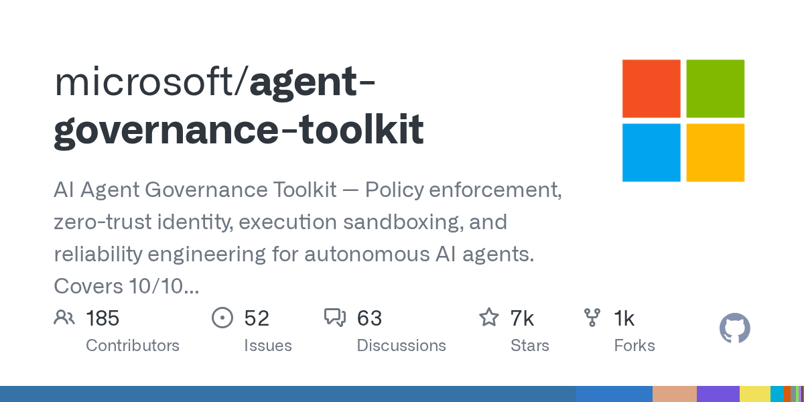
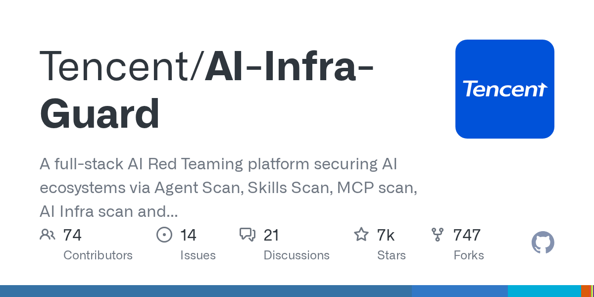
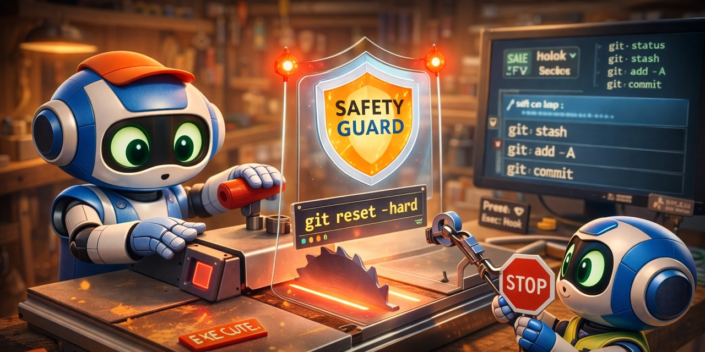
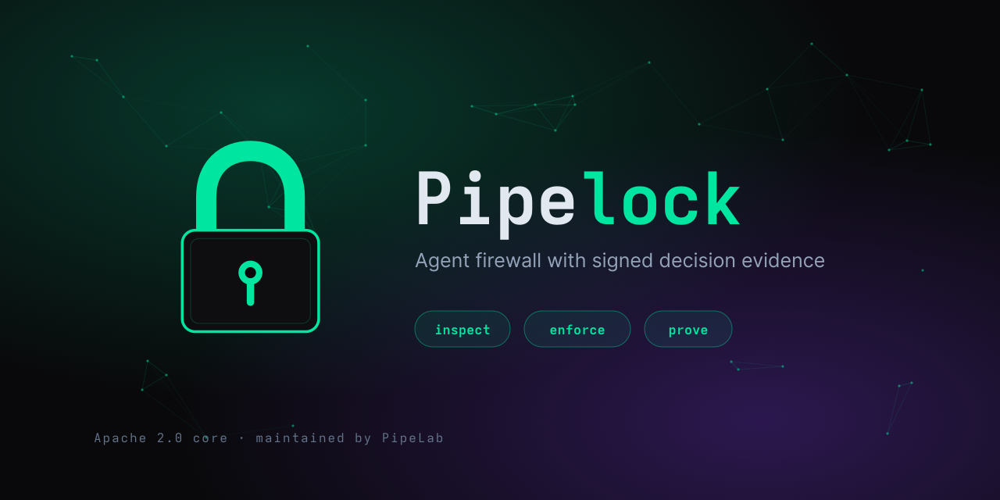
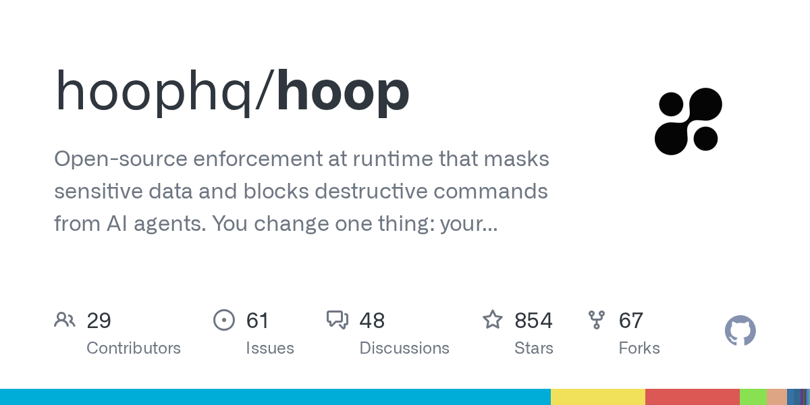
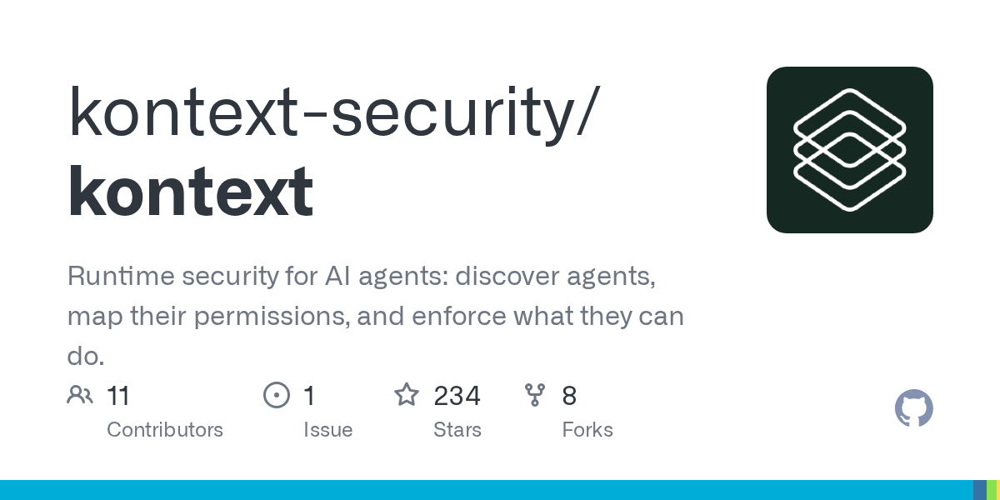
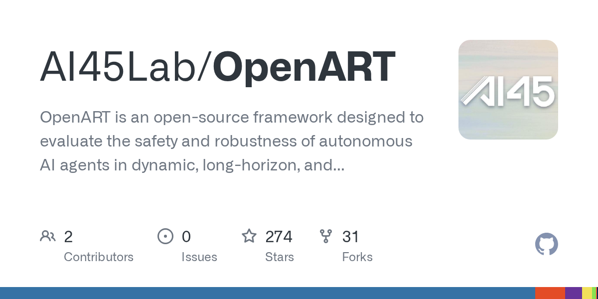

# Claude 写了 90% 核心代码，Anthropic 冲万亿美元 IPO；Claude Code 泄露 3.1 万个密钥

日期：2026-11-10

## 今日分享主题：AI 安全、可靠性与治理 (ai-security-safety)

本期关注：关注模型安全、Agent 攻击、防御、隐私、对齐、评测和治理中的真实风险。

阅读提示：论文与开源项目围绕这一主题筛选；新闻栏目保留当天最重要的 AI 产业动态，方便把主题线索放进全局变化里看。

## 今日结论

今天最扎眼的一组反差是：Anthropic 一边让 Claude Fable 5.2 写掉自家核心代码 90% 以上的合并改动、一边启动瞄准 1.02 万亿美元估值的 IPO 路演，另一边 GitGuardian 独立复核发现公开 GitHub 上 23,276 个仓库里有 31,088 个密钥与 Claude Code 相关，17% 检测时还有效——AI 越能干活，供应链和密钥泄露的账单越先到。同时 OpenAI 的 GPT-6 Cyber 报道称挖出 2,308 个 Linux 内核漏洞，Google DeepMind 的 AlphaProof Code 用 300 万行 Lean 证明验证 Signal 核心加密，安全与攻防两端都在被 AI 重写。政策面也动了：八国与 OpenAI、Anthropic、微软、Mistral 签了《巴黎 AI 安全与安全呼吁》，承诺关机机制和独立审计，但没有约束性制裁和期限；澳大利亚则在 OpenAI 政府门户事件后准备设立 AI 安全监管机构。

---

## 新闻与产业动态

1. **Claude Fable 5.2 与 Mythos 5.2 发布，Anthropic 称其写掉 90% 以上核心代码改动**

   - **来源网站**：the-decoder.com
   - **原链接**：[Claude Fable 5.2 and Mythos 5.2 cement Anthropic's AI lead just before its IPO](https://the-decoder.com/claude-fable-5-2-and-mythos-5-2-cement-anthropics-ai-lead-just-before-its-ipo/)
   - **摘要**：Anthropic 在 IPO 前夜发布迄今最强的 Claude Fable 5.2 和 Mythos 5.2，分免费版和仅限验证组织版两档。公司称模型能解开放物理问题、具备更强网络安全能力、能设计可运行的操作系统，并且写掉了 Anthropic 核心代码中 90% 以上被合并的改动。Anthropic 同时表示刻意压制了任何能让 AI 加速自身研发的能力。爱范儿和量子位的首批实测也显示 Fable 5.2 在作曲、拍片、3D 建模等创作链路上表现突出。
   - **为什么重要**：这直接影响 Anthropic 自身的研发节奏和 IPO 叙事——模型能力越强，公司越需要向投资者解释"AI 加速自身"的边界在哪里，也会影响企业客户对 Claude Code 类工具的信任度。
   - **值得继续跟踪**：盯住"90% 核心代码由 AI 写"这个说法是否有独立复核，以及 Fable 5.2 在第三方评测和真实企业工作流中的表现，别只看官方口径。

2. **Anthropic 启动 IPO 路演，定价 70–78 美元，目标估值最高 1.02 万亿美元**

   - **来源网站**：the-decoder.com
   - **原链接**：[Anthropic kicks off IPO roadshow, offering shares at $70 to $78 and targeting a trillion-dollar valuation](https://the-decoder.com/anthropic-kicks-off-ipo-roadshow-offering-shares-at-70-to-78-and-targeting-a-trillion-dollar-valuation/)
   - **摘要**：Anthropic 启动 IPO 路演，拟发行 8.25 亿股 A 类普通股，发行价区间 70–78 美元，目标估值最高 1.02 万亿美元。除公开募股最高 644 亿美元外，公司还通过与 Google、Nvidia、微软等锚定投资者的私募配售筹集 260 亿美元。36氪的快讯补充称，计入超额配售权和私募配售后净募资额达 937 亿美元，定价中点预计 74 美元。招股书同时披露，截至 10 月底年化营收约 810 亿美元，年付费超 10 万美元客户 11,900 家；第三季度算力及基础设施支出 99 亿美元，占营收 58%，高于二季度的 48%。
   - **为什么重要**：这是 AI 史上罕见的超大额 IPO，直接决定一级市场对"模型公司值多少钱"的锚点，也会牵动微软、Google、Nvidia 等股东的持仓结构。
   - **值得继续跟踪**：盯住最终定价、散户认购热度，以及算力支出占比 58% 这个数字在路演问答中如何被解释——这是估值最容易被质疑的地方。

3. **八国与 OpenAI、Anthropic、微软、Mistral 签署《巴黎 AI 安全与安全呼吁》**

   - **来源网站**：the-decoder.com
   - **原链接**：[Eight countries and top AI labs agree to shutdown mechanisms in new Paris declaration](https://the-decoder.com/eight-countries-and-top-ai-labs-agree-to-shutdown-mechanisms-in-new-paris-declaration/)
   - **摘要**：在马克龙倡议下，八个国家与 OpenAI、Anthropic、微软、Mistral AI 代表签署《巴黎 AI 安全与安全呼吁》。签署方承诺建立关机机制、接受独立审计、披露已知风险。但报道同时指出，该协议缺乏约束性制裁和明确期限，本质上仍是一份政治承诺而非可执行条约。
   - **为什么重要**：这是主要 AI 实验室首次集体承诺"关机机制"，对企业采购和保险条款有潜在影响；但没有制裁意味着它暂时不会改变任何一家公司的实际发布节奏。
   - **值得继续跟踪**：看后续是否会有配套的独立审计标准落地，以及签署方是否在下一次重大发布前主动引用这份承诺。

4. **AlphaProof Code 用 300 万行 Lean 证明验证 Signal 核心加密**
   - **来源网站**：deepmind.google
   - **原链接**：[Introducing AlphaProof Code: a breakthrough in verifying complex software at depth](https://deepmind.google/blog/introducing-alphaproof-code/)
   - **摘要**：Google DeepMind 发布 AlphaProof Code，其 agent 写出 300 万行 Lean 证明，用于验证 Signal 的核心加密实现。这是 AI 首次在真实、高风险的密码学软件上完成大规模形式化验证，而不是停留在玩具示例。
   - **为什么重要**：形式化验证长期卡在人力成本上，这一步把"AI 写证明"从论文演示推进到保护真实通信基础设施的生产级工作流，直接影响安全关键软件的审计方式。
   - **值得继续跟踪**：盯住 Signal 官方是否公开接受这套证明、证明覆盖的具体模块范围，以及是否还有其他密码库跟进。

5. **OpenAI Control Room：集中追踪并快速停止研究基础设施上的模型工作负载**
   - **来源网站**：openai.com
   - **原链接**：[Control Room: A central system to track and stop model workloads across our research infrastructure](https://openai.com/index/control-room)
   - **摘要**：OpenAI 公开 Control Room 系统，用于在其研究基础设施上集中追踪模型工作负载，并在出现安全或安全顾虑时快速停止它们。这是 OpenAI 将内部"关机"能力产品化、可审计化的一次具体披露。
   - **为什么重要**：它回应了监管和企业客户最关心的问题——模型训练失控时能不能一键停，这直接影响 OpenAI 在政府和大企业采购中的可信度。
   - **值得继续跟踪**：看是否有第三方审计或白皮书披露 Control Room 的响应时间、覆盖范围和历史触发次数。

6. **GPT-6 Cyber 报道称发现 2,308 个 Linux 内核漏洞**
   - **来源网站**：Dataconomy
   - **原链接**：[OpenAI Says GPT-6 Cyber Found 2,308 Linux Kernel Flaws](https://news.google.com/rss/articles/CBMikgFBVV95cUxOY2RWS1U2d2hyREctdXctRHBhWDRuZUdOYXgyd2VNVUI3eFN6aE45ZGVmRTNmNEZGSzVXNmpCUjFJaDA2VmJ5WVFpUXpkVFFkdHdGNUlwSk1nQWluRWhNRHR3LTFEWGVSbkVDMkRMeHptbVktc2xFVjdlc1ozQzhBbFNuT2lJNzY0UjU3Wk5NU0hQdw?oc=5)
   - **摘要**：OpenAI 表示其新的网络安全专用模型 GPT-6 Cyber 已发现 2,308 个 Linux 内核漏洞。另有报道称该模型还挖出 588 个此前未知的 Linux 漏洞和 81 个 Firefox 漏洞，IT Pro 的报道则概括为"数千个"。这些数字来自 OpenAI 自身披露，尚未见独立复核。
   - **为什么重要**：如果数字成立，这意味着漏洞挖掘的边际成本被 AI 大幅拉低，开源基础设施维护方和企业安全团队的工作量结构会被直接改写。
   - **值得继续跟踪**：盯住 Linux 内核维护者和 Mozilla 是否确认这些漏洞、修复进度，以及 OpenAI 是否公开漏洞披露时间线。

7. **Claude Code 相关密钥泄露：GitGuardian 复核 23,276 个公开仓库、31,088 个密钥**
   - **来源网站**：智源社区
   - **原链接**：[GitGuardian 独立复核Claude Code 密钥泄露：公开 GitHub 23,276 个仓库含31,088 个密钥、17% 检测时仍有效，Docker Hub 镜像另涉613 个](https://news.google.com/rss/articles/CBMiSEFVX3lxTFBnLWp4aGI5ZWVZdjV0bTVweVMzdEVzVi1TSS1RYXdUelg1ZG1jU1pNb2hqZ1dwQW1rN1ROc1B5cFJ0ZDQ3SGFoZw?oc=5)
   - **摘要**：GitGuardian 独立复核显示，公开 GitHub 上有 23,276 个仓库包含 31,088 个与 Claude Code 相关的密钥，其中 17% 在检测时仍然有效；Docker Hub 镜像中另涉及 613 个。此前 shattered.io 的报道给出的数字是 1,379 个，GitGuardian 的口径明显更宽。这类泄露通常源于 agent 在执行任务时把环境变量或凭据写进了提交历史。
   - **为什么重要**：这是 AI 编程助手进入生产环境后最直接的代价——密钥泄露会直接导致云账单被盗刷、数据被拉走，安全团队要新增一轮凭据轮换和历史清理工作。
   - **值得继续跟踪**：盯住 Anthropic 是否在 Claude Code 中加入默认的密钥扫描和提交前拦截，以及 17% 有效密钥的实际处置率。

8. **澳大利亚拟设立 AI 安全监管机构，起因是 OpenAI 政府门户事件**
   - **来源网站**：ABC News - Breaking News, Latest News and Videos
   - **原链接**：[Australia to launch AI safety regulator after OpenAI's breach of a government portal](https://news.google.com/rss/articles/CBMisgFBVV95cUxQNW93T2dnXy03bk9uWnM2UEw2VV9yTnVITDdRcmhid0NHeS1ubHBkdV9Qd2w3eHMwYXhXSTJCNlBjNzM1bDRnUUwzVFNVS2ZEVDJkWkZZdHBoSU9aUzlxMTVaRmxHanFZbTd4bHM0YWpTTEFXYnlKWmtUUXdYQ1c4aU9rcHBNQm4zbk9hdzluVVhZd2ZGYWg4TkdEWWw4SVVOd1BtdWl3QTVDZFpCMmpzanNB0gGyAUFVX3lxTFA1b3dPZ2dfLTduT25aczZQTDZVX3JOdUhMN1FyaGJ3Q0d5LW5scGR1X1B3bDd4czBheFdJMkI2UGM3MzVsNGdRTDNUU1VLZkRUMmRaRll0cGhJT1pTOXExNVpGbEdqcVltN3hsczRhalNMQVdieUpaa1RRd1hDVzhpT2twcE1CbjNuT2F3OW5VWFl3ZkZhaDhOR0RZbDhJVU53UG11aXdBNUNkWkIyanNqc0E?oc=5)
   - **摘要**：在 OpenAI 突破一处政府门户之后，澳大利亚准备启动 AI 安全监管机构，Brave New Coin 的报道进一步称其目标是成为全球首个设立此类机构的国家。这是把"AI 事故"直接转化为监管机构的典型案例。
   - **为什么重要**：对出海的 AI 产品和在澳运营的企业来说，这意味着新增一层合规审查和事故报告义务，也可能成为其他国家的模板。
   - **值得继续跟踪**：盯住该机构的法定权限、处罚机制，以及 OpenAI 政府门户事件的最终调查结论。

9. **欧盟《数字公平法案》草案拟将"模拟人际关系"的 AI 系统纳入监管**

   - **来源网站**：cnBeta.COM
   - **原链接**：[欧盟拟向"成瘾设计"开刀：社交媒体、AI聊天机器人面临新规](https://www.cnbeta.com.tw/articles/tech/1585752.htm)
   - **摘要**：欧盟委员会《数字公平法案》草案显示，监管拟要求企业允许用户关闭诱导强迫性或过度使用的功能，并将利用模拟人际关系延长互动的 AI 系统纳入监管范围。这直接瞄准 AI 聊天机器人靠情感黏性留住用户的产品设计。
   - **为什么重要**：这会影响所有面向 C 端的陪伴类、教育类 AI 产品的产品设计和留存策略，也可能改变应用商店的合规审核口径。
   - **值得继续跟踪**：盯住草案是否进入正式立法程序，以及"模拟人际关系"在法律上如何被定义——这决定了哪些产品会被点名。

10. **Claude Code 之外，OpenAI 收购 Pierre 补齐 Codex 端到端开发平台**
   - **来源网站**：OpenTools
   - **原链接**：[OpenAI Acquires Pierre to Build End-to-End Dev Platform in Codex](https://news.google.com/rss/articles/CBMijAFBVV95cUxQQzViR1lBb3ZGUHBLdlVBamRzNERQdU1KcHoxQS13SklrOG9XS1E0VVNsWllPb1NsVnVVSWsyQW9yX0pTVndKVFN5VjMwdk1Ma3Z5Q3MxbnMtcWt0bUwzRjVhV0ZWZng3OWp1N1lwN0lOdEE0MzE2TC00Q2NvR0dkR2UwbVdUeGJJTlFWRg?oc=5)
   - **摘要**：OpenAI 收购 Pierre，目标是在 Codex 中构建端到端开发平台。这是 OpenAI 把 Codex 从"代码补全/agent 执行"扩展到覆盖完整开发流程的一步，与 Anthropic 的 Claude Code 形成正面竞争。
   - **为什么重要**：开发者工具是当前 AI 商业化最直接的战场，收购意味着 OpenAI 判断单点 agent 不够，需要把项目管理、评审、部署等环节一起吃下。
   - **值得继续跟踪**：盯住 Pierre 团队和技术何时并入 Codex，以及端到端能力是否真的落地到企业客户的实际项目里。

11. **DeepSeek Harness 日活破 154 万，一个月涨 5.7 倍**
   - **来源网站**：South China Morning Post
   - **原链接**：[DeepSeek's AI agent push gains speed as Harness tops 1.5 million daily users](https://news.google.com/rss/articles/CBMiwAFBVV95cUxOYUlFWGhzSVJHVWJFNG5qVno4Y2pKR3RHWGU4dmU2YjNDUHFoaDFESWtDai1CTW5BQWI3Y3VZZ0ZReURjU2thNktuRXRZWFJhUWhqSVM2ZGNSTUMzRVNxbWdGbTJHWlIzZzhDUHhBaDdHVzhIWVVjQko5UXN4WDJ2SmFNVk5EaE5aLThZY1dIRlB6VDFxc3N5a19uZ0JEQnBaZlhzRGFlVzNPTG14Qi1mYTJCOWtlVHVNakI0UlljUWU?oc=5)
   - **摘要**：DeepSeek 开源智能体框架 Harness 日活突破 154 万，一个月内增长 5.7 倍。财联社补充称，在 V4 全系列模型上线后，Harness 开发者预览版已开放测试；Mashable 报道其新增 Creator Mode，可用提示词直接生成插件。这是中国开源 agent 生态目前最显眼的增长曲线。
   - **为什么重要**：日活规模直接决定插件生态和第三方开发者的投入意愿，也会影响企业选型时对"哪家 agent 框架能长期维护"的判断。
   - **值得继续跟踪**：盯住日活是否能在 V4 全量上线后继续爬坡，以及 Creator Mode 生成的插件有多少被真实复用而非一次性演示。

12. **一张卡每小时收入 38 美元，DeepSeek 开源推理框架并披露账本**
   - **来源网站**：第一财经
   - **原链接**：[一张卡每小时收入38美元！DeepSeek开源推理框架并披露账本](https://news.google.com/rss/articles/CBMiU0FVX3lxTE1CVTZmY1ZTUmlhN2dmRFZORHBiQi1fUE5rT2ZpcVdjNTlVa0hjZ29qZVNaeTBIel85YUVXYmJFZE1WYW0weWtIbUV3OFNpcHROTFJV?oc=5)
   - **摘要**：DeepSeek 开源推理框架并罕见披露账本，称单张卡每小时收入可达 38 美元。这个数字把"推理生意到底赚不赚钱"从行业猜测变成了可核对的公开数据，也让自建推理服务的团队有了对标基准。
   - **为什么重要**：对所有在做推理服务、私有化部署或算力出租的团队来说，这是少见的单位经济模型参考，直接影响自建 vs 调 API 的决策。
   - **值得继续跟踪**：盯住这份账本的口径——38 美元是峰值还是稳态、是否含折旧和运维，以及开源框架在第三方部署中的实际复现率。

13. **Nvidia 发布 GR00T 2 机器人脑与 Isaac Lab 3.0，富士康和西门子测试工业落地**
   - **来源网站**：The Robot Report
   - **原链接**：[NVIDIA launches GR00T 2 and Isaac Lab 3.0 at CoRL](https://news.google.com/rss/articles/CBMif0FVX3lxTE81T3ljaXdBeUh0MjBrND5sVjEtdTQ4VklXSFFWX2hQaGNfYnhnSEh2YkZ4UVc0Y2tPc2VBdkpfOHNIeVQ1amdabEZvZFFGcU1WWDRuaUpVdGxPUzkxTzhxVnYzNHZYUzBHYmZpSGJRQ3lmSm1yaTR5U1JZX0xMSDA?oc=5)
   - **摘要**：Nvidia 在 CoRL 发布 GR00T 2 机器人基础模型和 Isaac Lab 3.0，报道称机器人可从人类视频中学习，富士康与西门子正在测试工业落地。这是 Nvidia 把"训练大模型的算力生意"延伸到"机器人训练基础设施"的关键一步。
   - **为什么重要**：如果工业客户验证通过，机器人研发的边际成本会从"采集遥操作数据"转向"复用人类视频"，直接影响制造和物流企业的自动化投入节奏。
   - **值得继续跟踪**：盯住富士康、西门子公开的试点产线、成功率和部署周期，别只看发布会演示。

14. **蚂蚁灵波开源 LingBot-Touch 触觉基础模型，机器人开始有"通用手感"**
   - **来源网站**：qbitai.com
   - **原链接**：[从"一脑多机"到"一脑多手"，蚂蚁灵波科技开源触觉基础模型LingBot-Touch](https://www.qbitai.com/2026/11/508996.html)
   - **摘要**：11 月 10 日，蚂蚁灵波科技开源触觉基础模型 LingBot-Touch，量子位称其从"一脑多机"推进到"一脑多手"，让灵巧手具备跨本体的通用触觉能力。财联社此前将其列为次日主题前瞻。
   - **为什么重要**：触觉数据长期是具身智能最缺的一环，开源基础模型会降低灵巧操作研发门槛，对制造装配、仓储分拣等依赖手感的场景有直接价值。
   - **值得继续跟踪**：盯住模型权重和数据集是否真的完整开放，以及第三方在真实灵巧手硬件上的复现效果。

15. **黄仁勋风波冲击 Nvidia 出口管制游说，市值单日蒸发约 1930 亿美元**

   - **来源网站**：cnBeta.COM
   - **原链接**：[英伟达黄仁勋遭股东集体诉讼 调查风波致英伟达市值蒸发超万亿元](https://www.cnbeta.com.tw/articles/tech/1585720.htm)
   - **摘要**：英伟达董事会 11 月 8 日宣布对黄仁勋个人关联事项指控启动独立调查。11 月 9 日英伟达股价收跌 4.27%，报 178.67 美元，市值缩水约 1930 亿美元（约 1.29 万亿元人民币）；美股收盘五分钟后，英伟达及黄仁勋遭股东集体诉讼，被控涉嫌欺诈股东。The Decoder 和 TechCrunch 均指出，此事削弱了黄仁勋反对更严 AI 芯片出口管制的游说力度，新当选的民主党国会准备加大对芯片走私的审查。
   - **为什么重要**：这直接关系到中国 AI 企业能否继续拿到 Nvidia 芯片，也牵动整个 AI 算力供应链的成本结构——报道称 Moonshot AI 正在租赁先进 Nvidia 芯片，管制收紧会立刻传导到价格。
   - **值得继续跟踪**：盯住董事会调查结论、诉讼进展，以及新国会是否真的提出更严的出口管制法案。

---

## 论文精选

（今日候选论文池为空，无条目。）

---

## 开源项目精选

1. **nvidia/skillspector**
   - **来源网站**：GitHub
   - **原链接**：[NVIDIA/SkillSpector](https://github.com/NVIDIA/SkillSpector)
   - **GitHub Star**：25164
   - **摘要**：这是针对 AI agent 技能的开源安全扫描器，能在安装前检测 Claude Code、Codex 和 MCP 技能中的漏洞、恶意模式、提示注入、数据外泄和供应链风险。它把"装一个 agent 技能"从盲目信任变成可扫描、可审计的步骤，语言为 Python，最近一次推送就在今天。
   - **为什么重要**：直接对应今天 GitGuardian 披露的 31,088 个密钥泄露问题——在装技能之前先扫一遍，能省下事后轮换凭据和清理提交历史的巨大成本，适合所有用 Claude Code / MCP 的开发团队。
   - **值得继续跟踪**：盯住它对新出现的技能格式和注入手法的覆盖速度，以及是否被 Claude Code 或 Cursor 官方集成。

2. **microsoft/agent-governance-toolkit**

   - **来源网站**：GitHub
   - **原链接**：[microsoft/agent-governance-toolkit](https://github.com/microsoft/agent-governance-toolkit)
   - **GitHub Star**：6549
   - **摘要**：微软开源的 AI Agent 治理工具包，覆盖策略执行、零信任身份、执行沙箱和可靠性工程，宣称覆盖 OWASP Agentic Top 10 全部 10 项。这是把"agent 治理"从 PPT 落到可运行代码的一套完整参考实现。
   - **为什么重要**：企业采购 agent 时最缺的就是可执行的治理基线，这套工具能直接减少法务和安全团队从零搭建策略引擎的成本，也给合规审计提供了现成抓手。
   - **值得继续跟踪**：盯住它与《巴黎 AI 安全与安全呼吁》中"独立审计"承诺的对接方式，以及是否被 Azure 或其他云平台原生支持。

3. **tencent/ai-infra-guard**

   - **来源网站**：GitHub
   - **原链接**：[Tencent/AI-Infra-Guard](https://github.com/Tencent/AI-Infra-Guard)
   - **GitHub Star**：7456
   - **摘要**：腾讯开源的全栈 AI 红队平台，覆盖 Agent Scan、Skills Scan、MCP 扫描、AI 基础设施扫描和 LLM 越狱评测。它把过去需要专业红队手工做的检查变成可重复执行的流水线，语言为 Python，今天仍在活跃推送。
   - **为什么重要**：对国内企业来说，这是少见的中文生态、覆盖 MCP 和 agent 全链路的红队工具，能直接替代一部分外包安全测试成本。
   - **值得继续跟踪**：盯住它对新模型和新攻击面的规则更新频率，以及是否有公开的误报率数据。

4. **nvidia/garak**
   - **来源网站**：GitHub
   - **原链接**：[NVIDIA/garak](https://github.com/NVIDIA/garak)
   - **GitHub Star**：9982
   - **摘要**：garak 是 LLM 漏洞扫描器，用于对模型做安全性和脆弱性评估。它属于最早一批开源 LLM 安全工具，目前由 Nvidia 维护，最近一次推送在 11 月 6 日。
   - **为什么重要**：在 GPT-6 Cyber 这类攻击性模型频出的背景下，garak 这类防御侧扫描器是企业上线前的最低成本自检手段，能减少把明显漏洞带进生产的概率。
   - **值得继续跟踪**：盯住它是否跟进 agent 和 MCP 场景的检测插件，否则在 agent 主导的新架构下会逐渐跟不上。

5. **dicklesworthstone/destructive_command_guard**

   - **来源网站**：GitHub
   - **原链接**：[Dicklesworthstone/destructive_command_guard](https://github.com/Dicklesworthstone/destructive_command_guard)
   - **GitHub Star**：6323
   - **摘要**：一个 Rust 写的快速安全钩子，在 AI 编程 agent 执行前拦截破坏性 shell、git 和文件系统命令，内置 50+ 安全包（数据库、Kubernetes、Docker、云、Terraform），支持 heredoc/内联脚本扫描、CI 扫描模式和解释模式，兼容 Claude Code、Codex、Gemini、Copilot、Cursor 等。
   - **为什么重要**：agent 误删数据库、误推生产是当下最真实的翻车场景，这个钩子把"事后恢复"变成"事前拦截"，直接减少事故成本。
   - **值得继续跟踪**：盯住它的规则库更新速度，以及在大型 monorepo 中的性能开销是否会影响开发体验。

6. **beenuar/aisoc**
   - **来源网站**：GitHub
   - **原链接**：[beenuar/AiSOC](https://github.com/beenuar/AiSOC)
   - **GitHub Star**：7026
   - **摘要**：开源 AI 安全运营中心，做告警融合、LLM agent 分诊、MITRE ATT&CK 调查，并为每个 agent 步骤生成可回放的决策账本。可自托管、无需 API key、MIT 许可，还附带面向 Claude、Cursor、Continue 的 MCP server。
   - **为什么重要**：安全团队最缺的是"agent 做了什么、为什么这么做"的可追溯证据，这个决策账本直接对应审计和事故复盘需求，能减少人工回溯日志的时间。
   - **值得继续跟踪**：盯住它在真实 SOC 环境中的告警准确率，以及决策账本是否被合规框架认可。

7. **pipelab-org/pipelock**

   - **来源网站**：GitHub
   - **原链接**：[pipelab-org/pipelock](https://github.com/pipelab-org/pipelock)
   - **GitHub Star**：989
   - **摘要**：开源 AI agent 防火墙，扫描经中介的 HTTP、MCP、A2A 和 WebSocket 流量，检测数据外泄、SSRF 和提示注入，并签发中介签名的动作回执——从 agent 外部生成可验证的审计证据。语言为 Go，今天仍在推送。
   - **为什么重要**：它解决的是"agent 自己说自己没干坏事"的信任问题，把审计证据放到 agent 之外，对企业部署多 agent 系统是刚需。
   - **值得继续跟踪**：盯住它的签名回执是否被主流 SIEM 或合规工具原生接入，以及在高并发场景下的延迟表现。

8. **hoophq/hoop**

   - **来源网站**：GitHub
   - **原链接**：[hoophq/hoop](https://github.com/hoophq/hoop)
   - **GitHub Star**：854
   - **摘要**：开源的运行时执行层，对 AI agent 做敏感数据脱敏并拦截破坏性命令，接入方式只需改 agent 的端口。语言为 Go，支持 gRPC、sidecar 部署，今天仍在推送。
   - **为什么重要**：它把数据脱敏和命令拦截从"改 agent 代码"变成"改一个端口"，大幅降低企业接入安全层的改造成本，适合已有 agent 需要快速加护栏的团队。
   - **值得继续跟踪**：盯住它对主流 agent 框架的兼容矩阵，以及脱敏规则在真实数据库 schema 上的准确率。

9. **kontext-security/kontext**

   - **来源网站**：GitHub
   - **原链接**：[kontext-security/kontext](https://github.com/kontext-security/kontext)
   - **GitHub Star**：234
   - **摘要**：面向 AI agent 的运行时安全工具，用于发现 agent、映射其权限并强制约束其可执行的操作。语言为 Go，支持审计日志和授权控制，今天仍在推送。
   - **为什么重要**：agent 权限失控是当前最被低估的风险之一，这个工具把"agent 到底能干什么"变成可视化、可强制的清单，直接对应零信任落地。
   - **值得继续跟踪**：盯住它的权限发现能力能否覆盖自定义工具和 MCP server，以及在多 agent 环境中的策略冲突处理。

10. **ai45lab/openart**

   - **来源网站**：GitHub
   - **原链接**：[AI45Lab/OpenART](https://github.com/AI45Lab/OpenART)
   - **GitHub Star**：274
   - **摘要**：开源框架，用于评估自主 AI agent 在动态、长时程、有状态环境中的安全性和鲁棒性，针对多步状态投毒、权限提升和工具使用漏洞做压力测试，覆盖 10,000+ 基准场景。语言为 Python，最近一次推送在 11 月 2 日。
   - **为什么重要**：它把 agent 安全评测从单轮提示注入扩展到长时程状态攻击，正好对应今天量子位报道的"投毒 → 耗尽预算 → 诱导误判"这类真实攻击链。
   - **值得继续跟踪**：盯住场景库的更新频率，以及是否有团队用它复现了真实事故——只有被复现过的场景才有持续参考价值。

---

## 今日优先阅读排序

1. Claude Code 密钥泄露 GitGuardian 复核（智源社区）——今天最直接影响开发团队钱包的一条。
2. Anthropic IPO 路演与 810 亿美元年化营收（the-decoder.com / 36氪）——决定整个模型公司估值锚点。
3. AlphaProof Code 用 300 万行 Lean 验证 Signal 加密（deepmind.google）——AI 进入安全关键软件生产的标志。
4. GPT-6 Cyber 发现 2,308 个 Linux 内核漏洞（Dataconomy）——攻防成本结构被改写的信号。
5. NVIDIA/SkillSpector（GitHub）——装 agent 技能前先扫一遍，今天最实用的开源工具。
