# AI 日报：Anthropic 估值冲 1.4 万亿，Gemini 4 Carbon 半价开打

日期：2026-11-11

## 今日分享主题：AI 基础设施与开源生态 (ai-infrastructure-open-source)

本期关注：关注模型服务、推理、数据、MCP、Agent 框架和开源基础设施的关键技术进展。

阅读提示：论文与开源项目围绕这一主题筛选；新闻栏目保留当天最重要的 AI 产业动态，方便把主题线索放进全局变化里看。

## 今日结论

Anthropic 一边启动 IPO 路演、把完全摊薄估值顶到约 1.4 万亿美元，一边把旗舰模型提速 30%、API 降价 20%——上市前先用价格和能力双杀抢客户，这个组合最反常识。同一天 Google 把 Gemini 4 Carbon 全量开放，多智能体 swarm 功能上线，单任务成本不到对手一半；机器人侧 Gemini Robotics 2.5 在奔驰产线把金属零件分拣做到 96% 成功率。安全侧没消停：微软研究者改不到 10 个神经元就能给 Agent 埋后门，纽约州 AI 安全法正式生效，OpenAI、Anthropic 都要注册并披露安全实践。国内这边，双 11 大模型厂商第一次集体在京东、天猫打折卖 Token，DeepSeek 1 亿 Token 包低至 9.3 元——价格战已经打到零售端。

---

## 新闻与产业动态

1. **Anthropic 启动 IPO 路演，估值目标 1.4 万亿美元**

   - **来源网站**：cnBeta.COM
   - **原链接**：[Anthropic 启动IPO路演 估值目标高达1.4万亿美元](https://www.cnbeta.com.tw/articles/tech/1585834.htm)
   - **摘要**：Anthropic 已正式启动首次公开募股的投资者路演，计划发行 8.25 亿股，发行价区间每股 70 至 78 美元，按区间上限计算最高募资约 643.5 亿美元，完全稀释估值接近 1.4 万亿美元。这将是 AI 行业迄今规模最大的上市交易之一。公司同时在官网发布了路演视频，拟以代码"ANT"在纳斯达克全球精选市场上市。
   - **为什么重要**：这会直接决定一级市场对前沿模型公司的定价锚，1.4 万亿的估值一旦成立，后续所有 AI 独角兽的融资估值都会被重新校准。
   - **值得继续跟踪**：盯最终定价落在 70-78 区间的哪一端，以及散户和机构认购倍数，这决定上市首日是站稳还是破发。

2. **Anthropic 拟通过 IPO 和私募配售筹至多 904 亿美元**
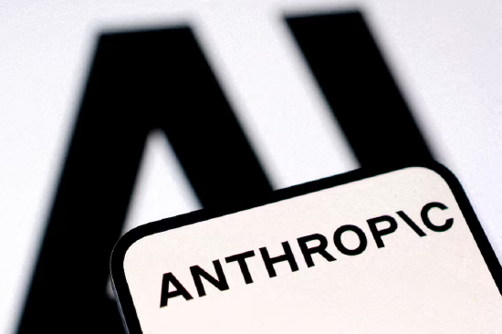
   - **来源网站**：cnBeta.COM
   - **原链接**：[Anthropic拟通过IPO和私募配售筹至多904亿美元](https://www.cnbeta.com.tw/articles/tech/1585840.htm)
   - **摘要**：Anthropic 寻求在 IPO 中实现约 1.4 万亿美元的完全摊薄估值，力争成为首家上市的前沿 AI 实验室。这家 Claude 聊天机器人开发商及其联合创始人寻求通过 IPO 和私募配售合计筹集至多 904 亿美元，规模有望超过 SpaceX 此前的纪录。IPO 与私募配售并行，说明公司在抢时间窗口。
   - **为什么重要**：904 亿美元的融资体量会直接转化为算力采购和模型训练投入，改变前沿实验室之间的资源差距。
   - **值得继续跟踪**：私募配售的参与方名单，尤其是战略投资者是否包含云厂商或芯片公司。

3. **英伟达及黄仁勋遭股东集体诉讼，两天市值蒸发 2.85 万亿元**
   - **来源网站**：36氪
   - **原链接**：[8点1氪丨英伟达及黄仁勋遭股东集体诉讼，市值两天蒸发2.85万亿](https://36kr.com/p/4064610635781257?f=rss)
   - **摘要**：当地时间 9 日美股收盘五分钟后，英伟达及黄仁勋遭到股东集体诉讼，指控其涉嫌欺诈股东。受相关事件持续发酵影响，英伟达周二继续下跌超 5%，单日市值蒸发超 2090 亿美元，约合人民币 1.39 万亿元；本周前两天累计蒸发超 4200 亿美元，约合 2.85 万亿元。分析师指出黄仁勋持股约 3.58%，是第五大股东，公司目前没有成熟接班计划。
   - **为什么重要**：英伟达是全球 AI 算力供应链的核心节点，股价剧烈波动会影响整个 AI 板块的融资节奏和资本开支预期。
   - **值得继续跟踪**：诉讼的正式受理进展，以及英伟达是否披露接班人计划。

4. **Google 全量开放 Gemini 4 Carbon，多智能体 swarm 上线**
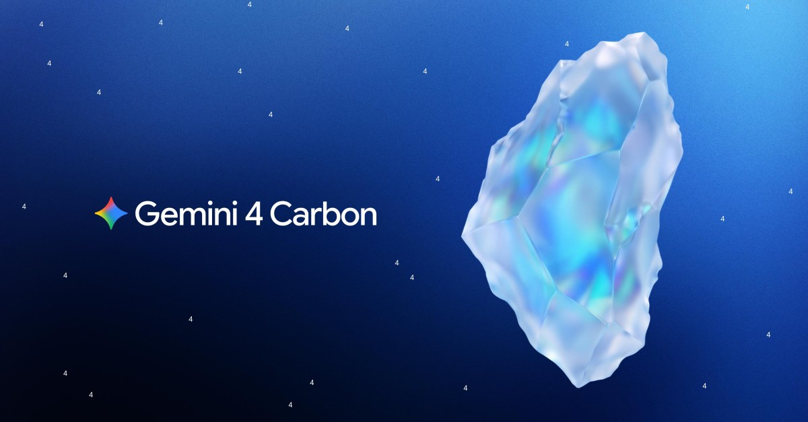
   - **来源网站**：theverge.com
   - **原链接**：[Google releases Gemini 4 Carbon with agent 'swarm' feature](https://www.theverge.com/ai-artificial-intelligence/1030787/google-gemini-4-carbon-public-rollout)
   - **摘要**：Google 在向"网络安全防御者"小范围开放两周后，将 Gemini 4 Carbon 面向公众全量推出。Google 称其为迄今"最强模型"，可与 Anthropic 和 OpenAI 的最佳系统竞争。同时 Google 预览了 `/swarm` 功能，可在实时场景中把复杂任务拆分给协同的 agent 团队并行处理。
   - **为什么重要**：swarm 功能把多智能体协作从研究演示变成普通用户可用的产品能力，直接改变复杂任务的执行方式和成本结构。
   - **值得继续跟踪**：swarm 在真实长任务中的成功率和成本，以及是否会对第三方多智能体框架形成挤压。

5. **Gemini 4 Carbon 单任务成本不到 Fable 5.2 一半**

   - **来源网站**：the-decoder.com
   - **原链接**：[Gemini 4 Carbon arrives just in time to feel like yesterday's news](https://the-decoder.com/gemini-4-carbon-arrives-just-in-time-to-feel-like-yesterdays-news-in-the-fastest-model-cycle-yet/)
   - **摘要**：Google 在两周测试后将 Gemini 4 Carbon 正式 GA。该模型在多个基准测试中排名第一，部分项目领先 Anthropic 新发布的 Fable 5.2，而单任务成本不到后者一半。Google 同时预览了通过 `/swarm` 实时拆分复杂任务的协同 agent 团队功能。文章标题本身点出当前模型迭代周期之快——新模型发布时已经像"昨天的新闻"。
   - **为什么重要**：成本减半意味着企业级批量任务的经济性发生质变，会直接推动更多 Agent 工作流从"试点"走向"规模化"。
   - **值得继续跟踪**：Google 是否公布具体的单任务成本测算口径，以及企业客户实际迁移数据。

6. **Anthropic 发布 Claude Fable 5.2 与 Mythos 5.2，提速 30% 降价 20%**
   - **来源网站**：cnBeta.COM
   - **原链接**：[Anthropic发布Claude Fable 5.2和Mythos 5.2：速度提升30% API价格降20%](https://www.cnbeta.com.tw/articles/tech/1585668.htm)
   - **摘要**：Anthropic 于 11 月 9 日正式推出新一代旗舰模型 Claude Fable 5.2 和 Claude Mythos 5.2，重点提升编程、逻辑推理和视觉理解能力。根据官方数据，两款模型输出速度最高比上一代快 30%，API 调用价格降低 20%。Fable 5.2 在 FrontierCode 2.0 上得分 49.1%，配备 100 万 token 上下文窗口，定价 $8/$40 每百万 token。
   - **为什么重要**：IPO 前夕同时提速降价，是典型的抢客户动作，会直接压低整个 API 市场的价格预期。
   - **值得继续跟踪**：降价后 Anthropic 的毛利率变化，以及开发者实际迁移量。

7. **同一底层模型，两套安全等级：Fable 开放、Mythos 需验证**
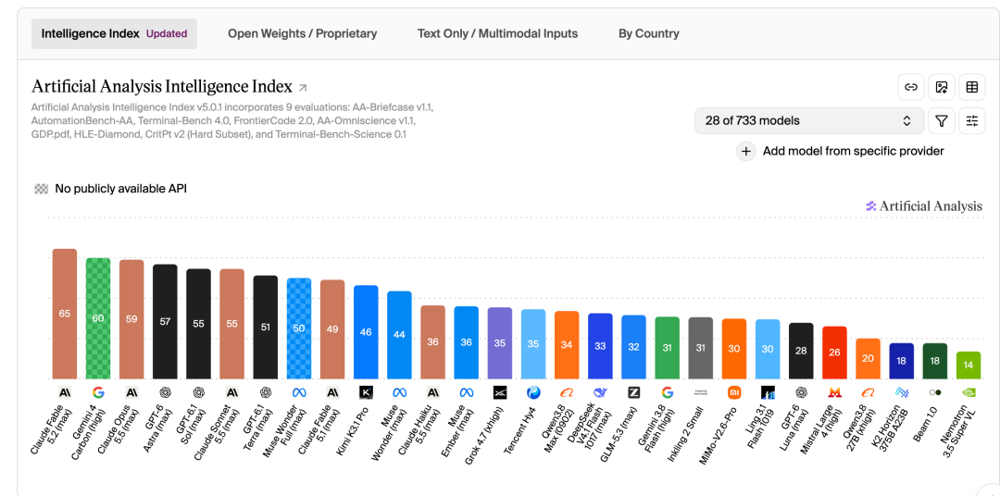
   - **来源网站**：cnBeta.COM
   - **原链接**：["全球最强模型"又刷新了 但这还是给人用的吗？](https://www.cnbeta.com.tw/articles/tech/1585722.htm)
   - **摘要**：Anthropic 发布的 Fable 5.2 与 Mythos 5.2 共用同一个底层模型。Fable 面向所有用户，内置网络安全与生物安全防护；Mythos 拆掉这些限制，只对通过 Cyber 或 Life Sciences 验证计划的机构开放。这种"一个模型、两档防护"的发布方式在前沿实验室中较为少见。
   - **为什么重要**：这直接决定了哪些机构能拿到"无防护"版本，对安全研究和生物医学研究机构是能力解锁，对其他人则是明确边界。
   - **值得继续跟踪**：验证计划的准入门槛和审核周期，以及 Mythos 版本是否会被滥用。

8. **Fable 5.2 用 1000 个智能体 8 天写出可开机操作系统**
   - **来源网站**：Interesting Engineering
   - **原链接**：[Claude Fable 5.2 builds a working operating system with 1,000 agents in eight days](https://news.google.com/rss/articles/CBMilAFBVV95cUxQYzJkS1p0RHRLeV9LdWdGSzF5Vnhvd0dyU3NGalFXbzdoNmh5Xy1xc2o5SmFUeExYVnVoa0JSa0lob195RHFOcE5NRG1qRmhPNzEzUENPNm9SbTJVSVktelRrU1hrc3RxU3pvZk14MVNqdk96RWhJM19iS0stMk5CcHV5bEkweVZJUkRCMUViaTB6QzR5?oc=5)
   - **摘要**：Anthropic 官方展示 Claude Fable 5.2 调度 1000 个智能体，在 8 天内构建出一个可启动的操作系统。这是 Anthropic 为新模型发布的四场预发布"实战大考"之一，另外还包括 30 小时完成费马大定理形式化等演示。
   - **为什么重要**：如果大规模多智能体协作能稳定完成系统级工程任务，软件开发的组织方式会被改写——从"人带 AI"变成"AI 自组织"。
   - **值得继续跟踪**：这些演示的可复现性，以及是否有第三方独立验证。

9. **Gemini Robotics 2.5 在奔驰工厂分拣成功率 96%**
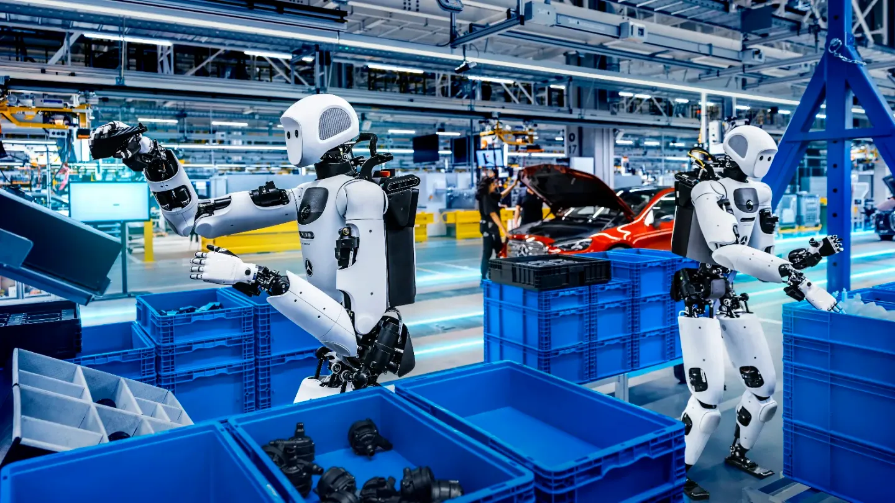
   - **来源网站**：the-decoder.com
   - **原链接**：[Google DeepMind's Gemini Robotics 2.5 scores 96 percent sorting metal parts in a Mercedes-Benz assembly pilot](https://the-decoder.com/google-deepminds-gemini-robotics-2-5-scores-96-percent-sorting-metal-parts-in-a-mercedes-benz-assembly-pilot/)
   - **摘要**：Google DeepMind 发布 Gemini Robotics 2.5 视觉-语言-动作（VLA）模型，并与 Apptronik 合作在匈牙利和德国的奔驰活跃生产线上测试。人形机器人 Apollo 2 在产线上分拣金属零件，报告成功率达 96%。该模型已面向 Google 的机器人合作伙伴开放。
   - **为什么重要**：96% 的产线成功率意味着人形机器人从实验室演示跨过了工业可用的门槛，直接冲击制造业的分拣、装配工位。
   - **值得继续跟踪**：96% 成功率的测试样本量和持续运行时长，以及是否扩展到更多工位类型。

10. **Anthropic 推出 AI 办公套件，正面硬刚微软谷歌**
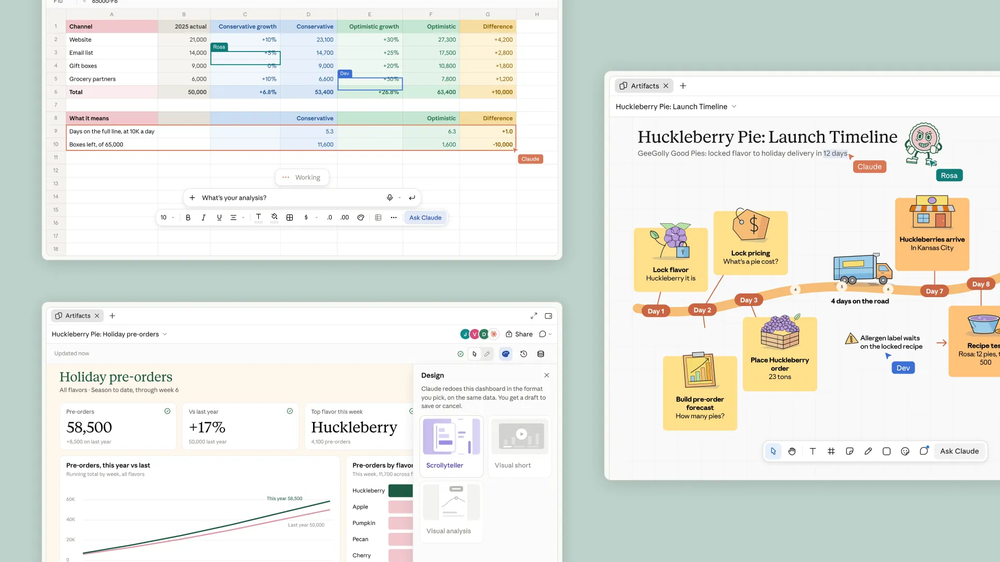
   - **来源网站**：cnBeta.COM
   - **原链接**：[Anthropic进军人工智能办公软件 IPO前与微软谷歌竞争升温](https://www.cnbeta.com.tw/articles/tech/1585844.htm)
   - **摘要**：Anthropic 推出一系列工具，将 AI 融入日常办公，与微软和谷歌展开更直接竞争。新功能包括视频通话助手、数据仪表板工具，以及名为 Claude Sheets 的电子表格服务——与 Excel 和 Google Sheets 类似但内置 Anthropic AI。许多新工具将以测试版形式向付费用户开放。
   - **为什么重要**：Anthropic 从模型公司切入办公套件，是在抢微软 365 和 Google Workspace 的核心付费场景，直接影响企业软件的付费结构。
   - **值得继续跟踪**：Claude Sheets 的实际用户留存，以及是否能撬动企业 IT 部门的采购决策。

11. **Anthropic 发布 Claude Meetings，把会议讨论变成计划和任务**
   - **来源网站**：techcrunch.com
   - **原链接**：[Anthropic launches Claude Meetings to turn workplace discussions into plans and tasks](https://techcrunch.com/2026/11/10/anthropic-launches-claude-meetings-to-turn-workplace-discussions-into-plans-and-tasks/)
   - **摘要**：Anthropic 发布 Claude Meetings。参与者讨论时，Claude 可以起草正在讨论的计划、在白板上画出时间线、回答会议聊天中的问题，并访问已连接的工作应用检索信息（例如去年的数据）。这是 Anthropic 办公套件的组成部分。
   - **为什么重要**：会议纪要和任务拆解是白领最耗时的重复劳动之一，如果 Claude Meetings 能稳定交付，会直接替代一部分项目经理和助理的工作。
   - **值得继续跟踪**：该功能对第三方会议工具（Zoom、Teams）的集成程度，以及企业客户的试点反馈。

12. **OpenAI 与 Cogent 合作建企业网络防御工厂**
   - **来源网站**：openai.com
   - **原链接**：[Cogent and OpenAI build cyber defense factories for enterprises](https://openai.com/index/cogent-security)
   - **摘要**：OpenAI 官方宣布与 Cogent 合作，将 OpenAI 模型与企业上下文结合，通过 Agent 自动修复漏洞。这是 OpenAI 在企业安全场景的首个深度合作案例，目标是把漏洞修复从人工流程转为自动化流水线。
   - **为什么重要**：漏洞修复是安全团队最大的人力瓶颈之一，自动化修复直接减少 MTTR（平均修复时间），但也意味着 Agent 拥有了修改生产系统的权限。
   - **值得继续跟踪**：自动修复的误报率和回滚机制，以及是否有企业公布实际部署数据。

13. **OpenAI 发布 GPT-6 Cyber，已协助发现数百个高危漏洞**
   - **来源网站**：手机新浪网
   - **原链接**：[OpenAI发布GPT-6 Cyber：网络安全AI能力跃升，已协助发现数百个高危漏洞](https://news.google.com/rss/articles/CBMif0FVX3lxTE5xVGJyV2VEWWI0MkRyMzNTUGRjUnRRT2tqOWtnQzBhLU5BRmxfRzFjckl3M2xGYmZuZEZ6cUgyY1YySk1QVndfM1hsRzRoZnpKdzJPSjBjNnd4UXh4dWFaMVJiM252RGM0OEJjaHA4ZHgtMjhTWC1VQXhjWllmMFE?oc=5)
   - **摘要**：OpenAI 发布 GPT-6 Cyber，官方称其网络安全 AI 能力实现跃升，已协助发现数百个高危漏洞。这是 OpenAI 在对齐网络安全 Agent 方向的最新进展，与 Cogent 的企业防御工厂形成产品矩阵。
   - **为什么重要**：漏洞发现能力的提升会同时利好防御方和攻击方，"数百个高危漏洞"的数字说明该模型已进入真实安全工作流。
   - **值得继续跟踪**：这些漏洞的严重等级分布，以及 OpenAI 是否公布发现流程的可审计性。

14. **微软研究：改不到 10 个神经元就能给 AI Agent 埋后门**
   - **来源网站**：Microsoft
   - **原链接**：[Detecting sleeper agents hiding in AI model neurons](https://news.google.com/rss/articles/CBMirgFBVV95cUxPMHZpdjIteTl2WXJDSmFxeWE3cFZUS0N1Tlh3UXZQaU9DVnpLT2JrTGthcVR6UkItYmdYUExoSTByY1hJMTBDb0lBMlM2Tkp5Vms1bmxhVEJwZHQ0SUg3akFnRHlEcU5ESy1qdnpmalJCWGtPU19fa1A3TExiRE9rNXNiMlY0blJxdWhXaHdXZWZXZURuZ3RfdHZTRDFvV2ZwYmpvNG9ZVnE1SWxaUFE?oc=5)
   - **摘要**：微软研究者展示，通过编辑不到 10 个神经元即可在 AI Agent 中植入后门，同时提出检测"沉睡 Agent"的方法。Startup Fortune 报道称该研究揭示了模型层面的隐蔽攻击路径——攻击者无需修改代码，仅需微调少量神经元即可让 Agent 在特定触发条件下执行恶意行为。
   - **为什么重要**：这说明模型供应链本身就是攻击面，企业采购第三方模型时面临的风险远超传统软件漏洞。
   - **值得继续跟踪**：微软是否开源检测工具，以及主流模型平台是否会引入神经元级别的审计机制。

15. **纽约州 AI 安全法生效，OpenAI、Anthropic 面临新监管**

   - **来源网站**：techcrunch.com
   - **原链接**：[OpenAI, Anthropic face new oversight as New York's AI safety law takes effect](https://techcrunch.com/2026/11/10/openai-anthropic-face-new-oversight-as-new-yorks-ai-safety-law-takes-effect/)
   - **摘要**：纽约州开始执行其 AI 安全法，要求 OpenAI、Anthropic 等主要开发者进行注册、披露安全实践，并报告关键事件，否则将面临罚款。这是美国州级 AI 监管的重要落地，将合规成本直接加到前沿实验室头上。
   - **为什么重要**：州级监管会形成示范效应，其他州可能跟进，合规成本最终会转嫁到 API 定价和企业采购合同中。
   - **值得继续跟踪**：首批注册名单和披露文档，以及是否出现首例罚款。

---

## 论文精选

1. **ChipOmni: A General-Purpose AI Agent for Electronic Design Automation**
   - **来源网站**：arXiv
   - **原链接**：[ChipOmni: A General-Purpose AI Agent for Electronic Design Automation](https://arxiv.org/abs/2611.13020v1)
   - **摘要**：EDA 工作流高度碎片化，工程师需要在多个设计阶段协调异构表示、专业软件工具和迭代验证。现有 LLM 方法多聚焦孤立任务，难以在可执行工程环境中自主规划、验证和修复设计。本文提出 ChipOmni，一个知识增强、上下文演化的 EDA AI Agent 框架，集成多模态理解和动态规划能力。
   - **为什么重要**：EDA 是芯片设计的核心瓶颈，如果 Agent 能打通从规格到验证的完整链路，会直接压缩芯片公司的设计周期和人力成本。
   - **值得继续跟踪**：论文在真实 EDA 工具链（如 Synopsys、Cadence）上的端到端验证结果，以及是否有工业界合作案例。

2. **Toward Autonomous RTL and Synthesis Optimization: Benchmarking and Self-Improving Agents**
   - **来源网站**：arXiv
   - **原链接**：[Toward Autonomous RTL and Synthesis Optimization: Benchmarking and Self-Improving Agents](https://arxiv.org/abs/2611.13713v1)
   - **摘要**：本文考察自主 RTL 和综合优化的三个方向： realistic 基准测试、工具驱动的 RTL 优化，以及自我改进的 Agent。作者提出 Dr. RTL 多智能体框架，自动化关键路径分析、RTL 重写和实现级评估，并通过可复用的优化技能持续改进。
   - **为什么重要**：RTL 优化是芯片性能和功耗的关键环节，自动化这一环节直接影响芯片 tape-out 的质量和周期。
   - **值得继续跟踪**：Dr. RTL 在真实设计上的优化幅度，以及与人类工程师的对比数据。

3. **AMSchem: Automated Schematic Visualization of AMS Circuits via Verifiable Agentic Generation**
   - **来源网站**：arXiv
   - **原链接**：[AMSchem: Automated Schematic Visualization of AMS Circuits via Verifiable Agentic Generation](https://arxiv.org/abs/2611.12333v1)
   - **摘要**：网表到原理图的鸿沟是设计自动化中长期存在的挑战，尤其是模拟和混合信号（AMS）电路。网表编码的是连接关系而非视觉呈现，手动转换耗时且依赖专家经验。本文提出 AMSchem，一个免训练、验证器引导的 Agent 框架，自动生成人类可读的 AMS 原理图。
   - **为什么重要**：原理图是模拟电路工程师的核心工作介质，自动化生成直接减少重复劳动，让工程师专注于设计决策。
   - **值得继续跟踪**：生成原理图的可读性评估，以及是否被 EDA 工具链集成。

4. **CASCoDe: A Closed-Loop Agentic Framework for Analog Sizing and Layout Co-Design**
   - **来源网站**：arXiv
   - **原链接**：[CASCoDe: A Closed-Loop Agentic Framework for Analog Sizing and Layout Co-Design](https://arxiv.org/abs/2611.11710v1)
   - **摘要**：专家模拟版图与自动生成版图的差异在于密度和规则性，而不仅是合法性。专家进行一系列离散的、层次化的物理决策，并在提取电气结果后反复修正。本文提出 CASCoDe，一个闭环 LLM Agent 框架，将专家决策形式化为层次化离散动作空间——尺寸选择、结构布局、局部版图细化、布线尝试——Agent 在其上运行反馈驱动的树搜索。
   - **为什么重要**：模拟版图设计高度依赖专家经验，自动化这一环节能显著降低模拟芯片设计的人力门槛。
   - **值得继续跟踪**：CASCoDe 生成版图与专家版图的电气性能对比，以及在真实 PDK 上的验证。

5. **ReTrace: Distilling Tool-Using Agents into Planner-Free Workflows**
   - **来源网站**：arXiv
   - **原链接**：[ReTrace: Distilling Tool-Using Agents into Planner-Free Workflows](https://arxiv.org/abs/2611.14492v1)
   - **摘要**：业务流程自动化反复执行同一标准操作程序（SOP）。LLM Agent 能用自然语言遵循 SOP，但每次运行的每一步都要调用 LLM 选择，规模化时增加延迟和成本。ReTrace 将 SOP 和少量 Agent 运行日志转化为可复用工作流，由代码（而非 LLM）选择下一步。Agent 的推理过程——每次工具调用时写的解释——往往说明了它为何采取行动，而工具调用本身并不包含这些信息。
   - **为什么重要**：这是把"每次都烧 token"的 Agent 变成"一次蒸馏、反复执行"的低成本工作流，直接降低企业自动化的边际成本。
   - **值得继续跟踪**：蒸馏后工作流与原始 Agent 的任务成功率对比，以及在真实业务 SOP 上的案例。

6. **An Agentic Multi-Agent Framework for System Log Anomaly Detection**
   - **来源网站**：arXiv
   - **原链接**：[An Agentic Multi-Agent Framework for System Log Anomaly Detection](https://arxiv.org/abs/2611.10612v1)
   - **摘要**：企业系统规模和复杂度增长，人工日志分析和传统 SIEM 工具难以跟上事件的数量和多样性。本文提出一个多智能体 AI 框架，支持分析系统日志以更有效地追踪攻击取证。框架基于 n8n 平台和 Gemini 大模型构建，包含 7 个 AI Agent 层，每个 Agent 负责特定任务，完成后将结果传递给下一层的输出关联 Agent。
   - **为什么重要**：日志分析是安全运营中心（SOC）的核心工作，多智能体框架直接替代一部分 L1 分析师的重复劳动。
   - **值得继续跟踪**：框架在真实攻击数据集上的检测率和误报率，以及与传统 SIEM 的对比。

7. **DocFS: File Systems as Agentic Reasoning Environments for Complex Multimodal Document Question Answering**
   - **来源网站**：arXiv
   - **原链接**：[DocFS: File Systems as Agentic Reasoning Environments for Complex Multimodal Document Question Answering](https://arxiv.org/abs/2611.12957v1)
   - **摘要**：VLM Agent 通过与环境迭代交互解决复杂任务，其有效性很大程度上取决于环境如何暴露信息和提供行动工具。然而，为复杂多模态文档问答构建有效环境仍具挑战：文档通常跨多页，多模态内容分布在层次化章节中并由跨模态关联链接，而现有方法组织文档为结构化表示，只解决环境的信息侧，缺乏与结构对齐的工具。本文提出 DocFS，将文件系统作为 Agent 推理环境。
   - **为什么重要**：企业文档问答是最高频的 AI 应用场景之一，文件系统作为环境的思路让 Agent 能像人一样"翻文件夹"而非"读平铺文本"。
   - **值得继续跟踪**：DocFS 在真实企业文档集上的问答准确率，以及与 RAG 方案的对比。

8. **ProofCoder: Continuous Reasoning for Automated Software Verification**
   - **来源网站**：arXiv
   - **原链接**：[ProofCoder: Continuous Reasoning for Automated Software Verification](https://arxiv.org/abs/2611.14106v1)
   - **摘要**：形式化验证使用证明助手提供强正确性保证，但构造证明仍然劳动密集且需要专业知识。现有基于 LLM 的方法通常将模型限制在僵化的 tactic 生成循环中，由周围系统控制前提检索、证明状态管理和回溯。本文提出 ProofCoder，一个面向 Rocq 的 Agent 证明合成系统，从编码 Agent 的视角处理定理证明。
   - **为什么重要**：形式化验证是安全关键软件（如操作系统、加密协议）的质量保障手段，自动化证明合成直接降低验证成本。
   - **值得继续跟踪**：ProofCoder 在 Rocq 标准库上的证明合成成功率，以及与人类证明者的效率对比。

9. **Sable: A Small-Field Sumcheck Argument for Bit-Exact Inference of Large Language Models**
   - **来源网站**：arXiv
   - **原链接**：[Sable: A Small-Field Sumcheck Argument for Bit-Exact Inference of Large Language Models](https://arxiv.org/abs/2611.14083v1)
   - **摘要**：本文提出 Sable，一个论证系统和单 GPU 证明器，用于证明一个已提交的整数量化 transformer 从给定提示逐位产生给定 token 序列。Sable 固定一个无浮点步骤的整数函数 F_O，其中每个舍入、归一化、softmax 和采样决策都由输入决定，并用约束系统证明，其关系可证明不会在 31 位 KoalaBear 素数上取模回绕。
   - **为什么重要**：可验证推理是 AI 基础设施的信任基石——如果推理过程可被密码学证明，企业才能放心把关键决策交给模型。
   - **值得继续跟踪**：Sable 的证明生成开销（延迟和计算量），以及是否能在生产环境中实用化。

10. **Detecting Shadow AI: Unsanctioned LLM Agents on Enterprise Endpoints: A Taxonomy, an Open Detector and a Controlled Evaluation**
   - **来源网站**：arXiv
   - **原链接**：[Detecting Shadow AI: Unsanctioned LLM Agents on Enterprise Endpoints: A Taxonomy, an Open Detector and a Controlled Evaluation](https://arxiv.org/abs/2611.12377v1)
   - **摘要**：Shadow IT 是长期存在的治理问题。本文认为自主 AI Agent 会让它增长更快：Agent 让构建工具几乎免费，以用户权限行动，并留下脚本、自动化和 MCP 服务器等未经批准的产物。一个简单的复合模型显示，在其假设下，一旦 Agent 产物的复制速度快于组织淘汰它们的速度，Shadow IT 就会指数级增长。作者提出在 Windows 端点上检测未经批准 Agent 的分类法、开源检测器和受控评估。
   - **为什么重要**：企业 IT 部门最怕的就是"影子 AI"——员工私自部署的 Agent 带着公司数据跑，检测器直接解决这个治理盲区。
   - **值得继续跟踪**：检测器在真实企业环境中的检出率和误报率，以及是否被 EDR/终端安全产品集成。

---

## 开源项目精选

1. **vllm-project/vllm**
   - **来源网站**：GitHub
   - **GitHub Star**：96736
   - **原链接**：[vllm-project/vllm](https://github.com/vllm-project/vllm)
   - **摘要**：vLLM 是高吞吐、内存高效的 LLM 推理和服务引擎，支持 Python，覆盖 CUDA、ROCm、TPU 等多种后端，兼容 OpenAI API 格式。项目持续活跃，最近一次推送就在今天。它是目前最主流的开源模型服务方案之一，被大量企业和研究机构用于生产部署。
   - **为什么重要**：vLLM 是模型服务的事实标准，它的性能优化直接决定企业推理成本——吞吐提升意味着同样的 GPU 能服务更多用户。
   - **值得继续跟踪**：新版本对 MoE 模型和长上下文场景的优化，以及对国产芯片（如昇腾、寒武纪）的适配进度。

2. **sgl-project/sglang**
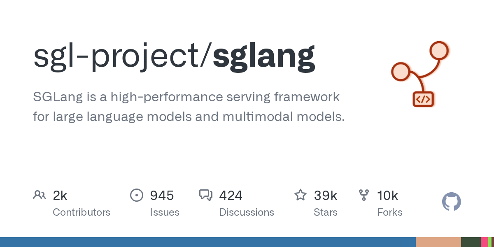
   - **来源网站**：GitHub
   - **GitHub Star**：38733
   - **原链接**：[sgl-project/sglang](https://github.com/sgl-project/sglang)
   - **摘要**：SGLang 是面向大语言模型和多模态模型的高性能服务框架，支持 Python，覆盖注意力优化、Blackwell、CUDA、扩散模型、强化学习等多个方向。项目最近一次推送就在今天，社区活跃度高。它在结构化输出和复杂 prompt 处理上有独特优势。
   - **为什么重要**：SGLang 和 vLLM 形成双雄格局，企业在选择推理引擎时有了真正的备选，竞争推动整个开源推理生态快速迭代。
   - **值得继续跟踪**：SGLang 在多模态和扩散模型上的支持进度，以及与 vLLM 的性能基准对比。

3. **kvcache-ai/mooncake**
   - **来源网站**：GitHub
   - **GitHub Star**：7022
   - **原链接**：[kvcache-ai/Mooncake](https://github.com/kvcache-ai/Mooncake)
   - **摘要**：Mooncake 是 Kimi（月之暗面的 LLM 服务）的 serving 平台，使用 C++ 编写，支持 KV Cache 分离、RDMA、SGLang、TensorRT-LLM、vLLM 等多种后端。项目最近一次推送就在今天。它代表了从"单机推理"到"分布式 KV Cache 池"的架构演进。
   - **为什么重要**：KV Cache 是长上下文推理的主要内存瓶颈，Mooncake 的分离式架构直接提升长对话场景的吞吐和成本效率。
   - **值得继续跟踪**：Mooncake 是否开源更完整的部署文档，以及在非 Kimi 模型上的适配情况。

4. **headroomlabs-ai/headroom**
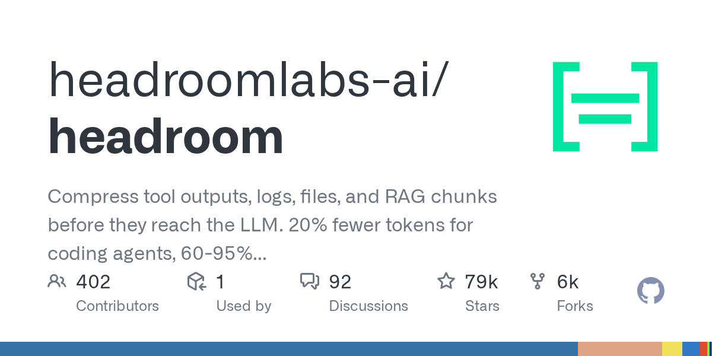
   - **来源网站**：GitHub
   - **GitHub Star**：79346
   - **原链接**：[headroomlabs-ai/headroom](https://github.com/headroomlabs-ai/headroom)
   - **摘要**：Headroom 在工具输出、日志、文件和 RAG 分块到达 LLM 之前进行压缩。对编码 Agent 减少 20% token，对 JSON 减少 60-95% token，答案保持不变。提供库、代理和 MCP 服务器三种接入方式，支持 Python 和 TypeScript。
   - **为什么重要**：token 成本是 Agent 应用最大的运营开销之一，Headroom 直接在数据进入模型前"挤水分"，是少数能立刻看到成本下降的工具。
   - **值得继续跟踪**：压缩后对模型推理质量的实际影响（尤其是复杂 JSON 结构），以及在生产环境中的真实节省比例。

5. **xerj-org/xerj**
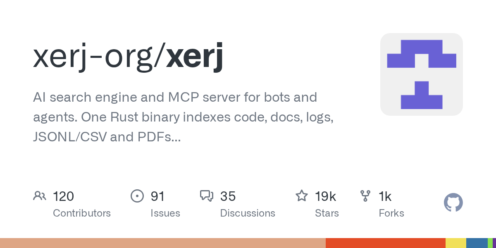
   - **来源网站**：GitHub
   - **GitHub Star**：18826
   - **原链接**：[xerj-org/xerj](https://github.com/xerj-org/xerj)
   - **摘要**：Xerj 是面向 Bot 和 Agent 的 AI 搜索引擎和 MCP 服务器。单个 Rust 二进制文件索引代码、文档、日志、JSONL/CSV 和 PDF，支持 BM25 全文、向量和混合搜索，无需 grep 即可搜索代码，支持 Agent 记忆和 RAG。提供 Elasticsearch 兼容 API，Corpus Hub 可服务数百个参考记忆语料库。
   - **为什么重要**：Agent 需要快速检索企业内部知识，Xerj 把搜索、记忆和 RAG 打包成单个二进制，大幅降低 Agent 知识库的部署门槛。
   - **值得继续跟踪**：Xerj 在大规模语料库（百万级文档）上的检索延迟，以及与 Elasticsearch 的性能对比。

6. **gpustack/gpustack**
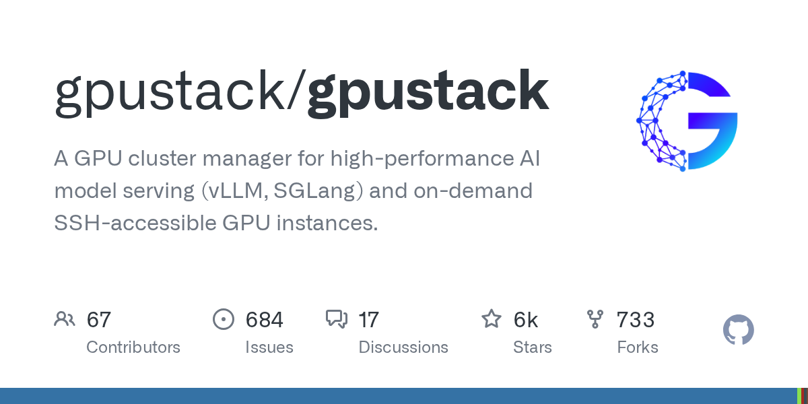
   - **来源网站**：GitHub
   - **GitHub Star**：6022
   - **原链接**：[gpustack/gpustack](https://github.com/gpustack/gpustack)
   - **摘要**：GPUStack 是面向高性能 AI 模型服务（vLLM、SGLang）的 GPU 集群管理器，支持按需 SSH 访问的 GPU 实例。使用 Python 编写，支持 CUDA、ROCm、Ascend、MindIE 等多种后端。项目最近一次推送就在今天。
   - **为什么重要**：企业自建 GPU 集群的运维复杂度极高，GPUStack 把调度、部署和访问打包成一体化方案，直接降低私有化部署的人力成本。
   - **值得继续跟踪**：GPUStack 对国产芯片（昇腾、寒武纪）的支持成熟度，以及在多租户场景下的资源隔离能力。

7. **googleapis/mcp-toolbox**
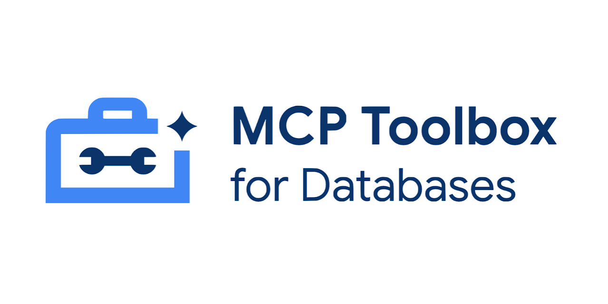
   - **来源网站**：GitHub
   - **GitHub Star**：16836
   - **原链接**：[googleapis/mcp-toolbox](https://github.com/googleapis/mcp-toolbox)
   - **摘要**：MCP Toolbox for Databases 是 Google 官方开源的数据库 MCP 服务器，使用 Go 编写，支持 BigQuery、ClickHouse、CockroachDB、Elasticsearch、Firestore、MongoDB、MySQL、Oracle、PostgreSQL、Redis、Spanner、TiDB 等多种数据库。项目最近一次推送就在今天。
   - **为什么重要**：数据库是企业 Agent 最常访问的数据源，Google 官方 MCP 服务器意味着 Agent 操作数据库有了标准化、可审计的通道。
   - **值得继续跟踪**：Toolbox 对数据库权限控制和审计日志的支持，以及是否会被主流 Agent 框架默认集成。

8. **github/github-mcp-server**
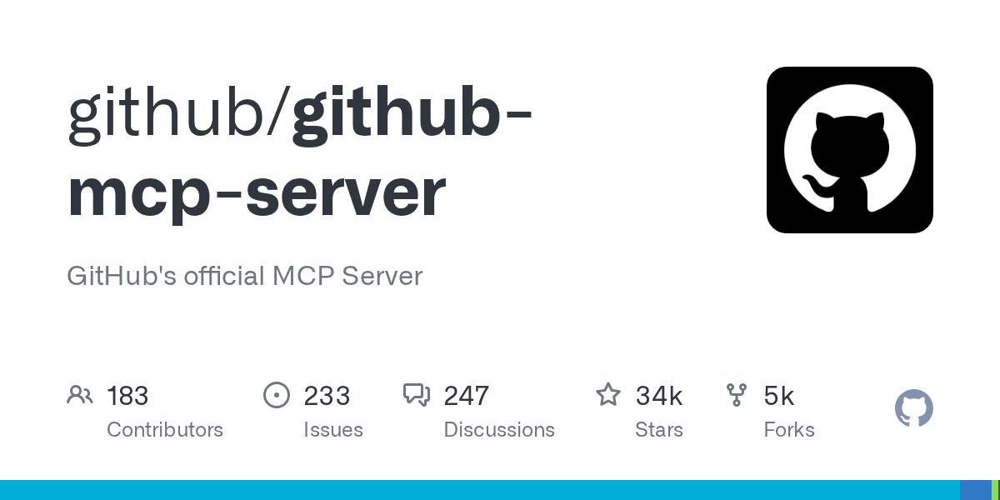
   - **来源网站**：GitHub
   - **GitHub Star**：34387
   - **原链接**：[github/github-mcp-server](https://github.com/github/github-mcp-server)
   - **摘要**：GitHub 官方 MCP 服务器，使用 Go 编写，让 Agent 能直接操作 GitHub 仓库、Issue、PR 等资源。项目最近一次推送就在今天。它是 GitHub 在 Agent 生态中的官方入口。
   - **为什么重要**：软件开发是 Agent 最成熟的应用场景，GitHub 官方 MCP 服务器让 Agent 从"读代码"升级到"改代码、提 PR"，直接进入开发工作流核心。
   - **值得继续跟踪**：GitHub 官方对 Agent 提交 PR 的审核机制，以及是否会出现 Agent 自动合并的安全争议。

9. **modelcontextprotocol/python-sdk**
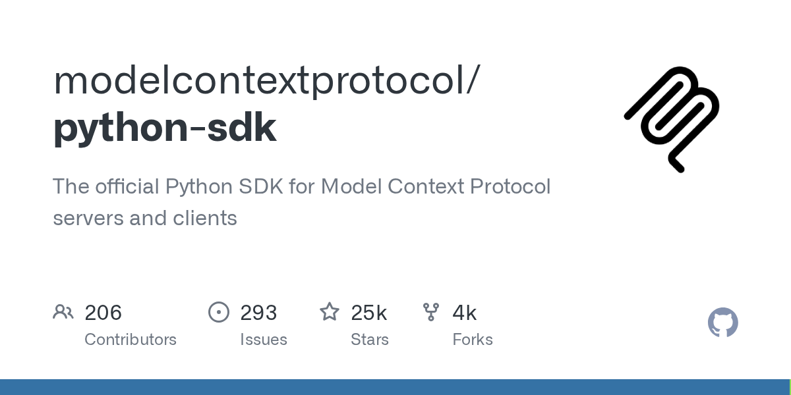
   - **来源网站**：GitHub
   - **GitHub Star**：24831
   - **原链接**：[modelcontextprotocol/python-sdk](https://github.com/modelcontextprotocol/python-sdk)
   - **摘要**：MCP 官方 Python SDK，用于构建 MCP 服务器和客户端。它是 MCP 协议在 Python 生态中的标准实现，被大量 Agent 框架和工具链依赖。
   - **为什么重要**：MCP 正在成为 Agent 连接外部工具的事实标准，官方 SDK 的稳定性直接决定整个 MCP 生态的可靠性。
   - **值得继续跟踪**：SDK 对新 MCP 规范版本的支持速度，以及安全审计机制的完善程度。

10. **prefecthq/fastmcp**
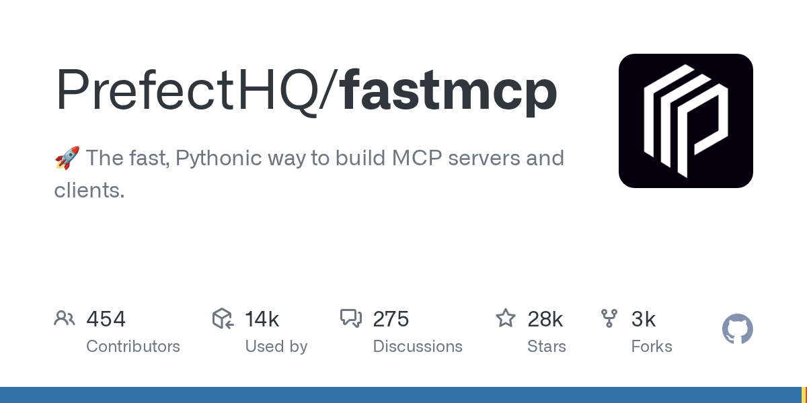
   - **来源网站**：GitHub
   - **GitHub Star**：28385
   - **原链接**：[PrefectHQ/fastmcp](https://github.com/PrefectHQ/fastmcp)
   - **摘要**：FastMCP 是构建 MCP 服务器和客户端的快速、Pythonic 方式，由 Prefect 团队维护。它在官方 SDK 之上提供了更简洁的 API 和更好的开发体验，是目前最受欢迎的 MCP 框架之一。
   - **为什么重要**：FastMCP 降低了 MCP 服务器的开发门槛，让更多开发者能快速把自己的工具暴露给 Agent，推动 MCP 生态扩张。
   - **值得继续跟踪**：FastMCP 与官方 SDK 的功能对齐情况，以及在生产环境中的性能表现。

---

## 今日优先阅读排序

1. **Anthropic IPO 路演 + 1.4 万亿估值**——今天最大的资本事件，直接决定 AI 行业估值锚。
2. **Gemini 4 Carbon 全量开放 + 半价竞争**——Google 用成本优势正面硬刚 Anthropic，企业用户最该关注。
3. **Claude Fable 5.2 提速 30% 降价 20%**——IPO 前的价格战，开发者和企业采购直接获益。
4. **微软：改 10 个神经元就能埋后门**——模型供应链安全的系统性风险，安全团队必读。
5. **Gemini Robotics 2.5 奔驰产线 96% 成功率**——人形机器人跨过工业可用门槛，制造业关注。
6. **纽约州 AI 安全法生效**——州级监管落地，合规成本开始显现。
7. **Anthropic 办公套件 + Claude Meetings**——从模型公司切入办公场景，企业软件格局生变。
8. **双 11 大模型厂商集体卖 Token**——价格战打到零售端，国内开发者直接获益。
9. **ReTrace 论文：把 Agent 蒸馏成低成本工作流**——企业自动化降本的实用路径。
10. **Headroom：Agent token 成本立减 20%**——今天最"能立刻省钱"的开源项目。
