# 黄仁勋33年首度下台，英伟达一夜蒸发1.4万亿美元

日期：2026-11-13

## 今日分享主题：机器人与具身智能 (robotics-physical-ai)

本期关注：关注视觉语言动作模型、机器人操作、视觉导航、仿真、自动驾驶、真机部署和 AI 进入物理世界的能力与证据。

阅读提示：论文与开源项目围绕这一主题筛选；新闻栏目保留当天最重要的 AI 产业动态，方便把主题线索放进全局变化里看。

## 今日结论

今天最扎眼的不是又一个模型发布，而是英伟达33年来第一次换帅：黄仁勋因多起婚外情与间谍调查风波辞去CEO、总裁及董事职务，CFO科莱特·克雷斯临时接任，公司股价单日暴跌超10%，市值蒸发约1.4万亿美元，华尔街14家投行的共识却是"无人可替"。同一时间，AI的物理世界那条线也没闲着：Google升级机器人"大脑"后，奔驰工厂测试成功率冲到96%，而德国军方却因网络攻击停飞了Quantum Systems的无人机——能力在涨，翻车的代价也在涨。论文和开源项目今天全部聚焦机器人与具身智能，从VLA推理部署、5万小时人类视频预训练，到低成本双臂马桶清洁真机实验，AI进物理世界的证据比上周更硬了。

---

## 新闻与产业动态

1. **黄仁勋辞去英伟达CEO，33年来首次换帅，市值一夜蒸发1.4万亿美元**
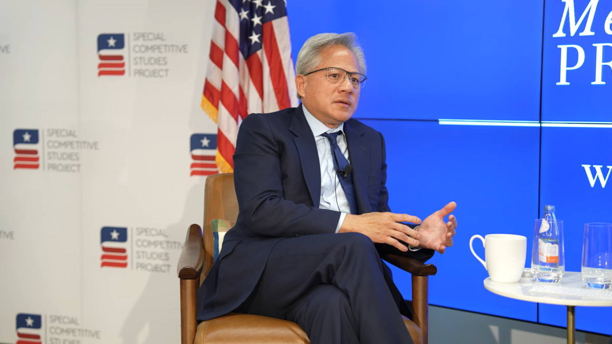
   - **来源网站**：the-decoder.com
   - **原链接**：[Jensen Huang resigns as Nvidia CEO after espionage scandal wipes out $1.4 trillion in market value](https://the-decoder.com/jensen-huang-resigns-as-nvidia-ceo-after-espionage-scandal-wipes-out-1-4-trillion-in-market-value/)
   - **摘要**：英伟达11月12日声明，联合创始人黄仁勋即刻辞去CEO、总裁及董事职务。起因是董事会对其多起婚外情展开调查，其中涉及一名直接下属和一名被怀疑为中国间谍的女子Alice Huang。消息公布后英伟达股价暴跌超10%，报道称市值蒸发约1.4万亿美元。CFO科莱特·克雷斯出任临时CEO，董事会同步启动正式继任者遴选，内外部候选人均在考虑之列。
   - **为什么重要**：英伟达是全球AI算力供应链的绝对核心，CEO突然离场直接冲击所有依赖其路线图的模型公司、云厂商和机器人团队的采购与交付预期。
   - **值得继续跟踪**：正式CEO人选、克雷斯对激进投资的态度，以及间谍调查是否会有司法结论。

2. **黄仁勋下台，14家华尔街投行火速解读：共识是"无人可替"**
   - **来源网站**：cnBeta.COM
   - **原链接**：[黄仁勋下台，14家华尔街投行火速解读：共识是"无人可替"](https://www.cnbeta.com.tw/articles/tech/1586234.htm)
   - **摘要**：黄仁勋辞任后，14家华尔街投行连夜发布解读。多数分析师认为，黄仁勋在战略、产品愿景、客户关系和投资者信心上都处于英伟达核心位置，管理层更迭带来的不确定性难以在短期内被替代。花旗分析师已将目标价从285美元下调至225美元，但维持买入评级。Synopsys资深人士Harvey Jones出任公司首位董事会主席。
   - **为什么重要**：投行共识直接影响英伟达的估值锚，而英伟达估值又是整个AI板块定价的基准，这会传导到一级市场融资和AI创业公司的估值预期。
   - **值得继续跟踪**：花旗等机构后续是否继续下调目标价，以及正式CEO候选名单浮出水面后的市场反应。

3. **英伟达市值缩水约1.6万亿美元，分析师：黄仁勋离任或长期压制股价**
   - **来源网站**：cnBeta.COM
   - **原链接**：[英伟达市值缩水约1.6万亿美元 分析师：黄仁勋离任或长期压制股价](https://www.cnbeta.com.tw/articles/tech/1586266.htm)
   - **摘要**：截至周四收盘，英伟达市值已从年内高点蒸发约1.6万亿美元，缩水29%，被苹果反超，失去全球市值最高企业地位。该股可能迎来周线六连跌，为2012年以来最长连跌周期。分析师指出，黄仁勋离任带来的不确定性或长期压制股价，即便公司基本面并未出现实质性恶化。
   - **为什么重要**：市值排名易主和六连跌是市场信心的硬指标，会影响英伟达的融资成本、供应链议价能力以及AI基建投资的整体节奏。
   - **值得继续跟踪**：周线是否真的六连跌，以及苹果与英伟达的市值差距是否继续拉大。

4. **神秘交易者在黄仁勋辞职前做空英伟达，800万美元成本赚约2亿美元**
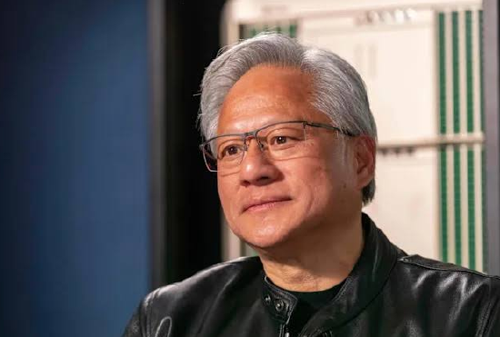
   - **来源网站**：cnBeta.COM
   - **原链接**：[神秘交易者在黄仁勋辞职前做空英伟达，赚了2亿美元](https://www.cnbeta.com.tw/articles/tech/1586274.htm)
   - **摘要**：Macro Risk Advisors发现，10月12日有人在英伟达股票上建立大幅虚值看跌期权头寸：买入18万份行权价150美元的看跌期权，同时卖出28万份行权价100美元的看跌期权，明年1月到期，初始成本约800万美元。随着股价暴跌，这笔交易据估算获利约2亿美元。时间点早于丑闻公开发酵。
   - **为什么重要**：这笔交易暗示市场在公开消息之前已有异动，对关注信息不对称和期权异动的交易者来说是重要信号。
   - **值得继续跟踪**：监管机构是否会调查该笔交易是否存在内幕信息，以及是否还有其他类似头寸被曝光。

5. **美国参议院要求黄仁勋与商务部长出席听证会，黄仁勋已同意作证**
   - **来源网站**：cnBeta.COM
   - **原链接**：[英伟达风波持续发酵 美参议院要求黄仁勋与商务部长出席听证会](https://www.cnbeta.com.tw/articles/tech/1586226.htm)
   - **摘要**：美国参议院银行委员会主席蒂姆·斯科特致函黄仁勋及美国商务部长霍华德·卢特尼克，要求两人出席听证会，就英伟达相关事件作出说明。在多名资深议员威胁传唤后，黄仁勋已同意作证。听证会焦点预计集中在黄仁勋与中国商人Alice Huang的关系，以及是否涉及敏感技术信息外泄。
   - **为什么重要**：听证会可能演变为对英伟达对华业务和出口管制的政策讨论，直接影响中国AI公司获取英伟达芯片的路径和合规成本。
   - **值得继续跟踪**：听证会具体日期、证词内容，以及是否引发新的对华出口限制措施。

6. **美国司法部尚未认定Alice Huang是中国间谍，FBI仍在调查**

   - **来源网站**：cnBeta.COM
   - **原链接**：[美国司法部尚未认定Alice Huang是中国间谍 司法部长称FBI仍在调查](https://www.cnbeta.com.tw/articles/tech/1586150.htm)
   - **摘要**：据路透社报道，美国代理司法部长Todd Blanche表示，司法部尚未就Alice Huang是否为中国间谍作出结论。此前媒体报道称，美国情报部门怀疑她受中国政府指使，可能通过与黄仁勋的私人关系获取敏感信息。情报系统内部对此看法不一：部分官员认为直接称她为间谍言过其实，另一些官员则认为她与黄仁勋关系密切且在中国商业环境有影响力，难以相信她与政府毫无联系。
   - **为什么重要**：间谍指控是否坐实，决定了这场风波是个人丑闻还是国家安全事件，后者会直接触发对英伟达的监管和业务限制。
   - **值得继续跟踪**：FBI调查结论，以及司法部是否正式提起指控。

7. **特朗普公开建议苹果执行董事长库克接任英伟达CEO，古尔曼称传闻荒谬**
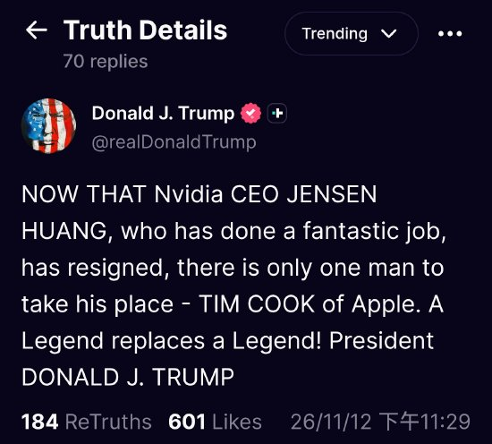
   - **来源网站**：cnBeta.COM
   - **原链接**：[特朗普发文谈英伟达人事变动 建议苹果执行董事长库克接任](https://www.cnbeta.com.tw/articles/tech/1586112.htm)
   - **摘要**：美国总统特朗普在Truth Social发文，公开建议由苹果执行董事长蒂姆·库克接替黄仁勋，称"传奇取代另一位传奇"。但彭博社记者马克·古尔曼随后在X上回应，称库克接掌英伟达的猜测"荒谬至极"。天风国际分析师郭明錤也指出，成本管理是库克所长，但新技术开发只有黄仁勋做得好。
   - **为什么重要**：总统公开点名科技公司CEO人选，把一场企业治理危机推向政治化，可能影响英伟达与美国政府的关系。
   - **值得继续跟踪**：英伟达董事会是否回应特朗普表态，以及正式候选人是否与政治因素挂钩。

8. **英伟达员工内网集体挽留黄仁勋，帖子收获超1600条评论**
   - **来源网站**：cnBeta.COM
   - **原链接**：[英伟达员工内网集体挽留黄仁勋 总部Logo前出现鲜花致敬](https://www.cnbeta.com.tw/articles/tech/1586262.htm)
   - **摘要**：据外媒Wired报道，英伟达内网意见箱一条关于黄仁勋去留的帖子已积累超1600条评论，绝大多数员工支持黄仁勋留任。总部Logo前也出现员工摆放的鲜花致敬。员工呼吁董事会先公布调查结果并听取员工意见，再决定继任安排。
   - **为什么重要**：核心研发团队的忠诚度直接影响英伟达的产品迭代节奏，若人才因管理层动荡流失，冲击会比股价下跌更持久。
   - **值得继续跟踪**：是否出现关键高管或研究员离职，以及董事会是否就调查结果对内沟通。

9. **德国军方因网络攻击停飞Quantum Systems无人机**
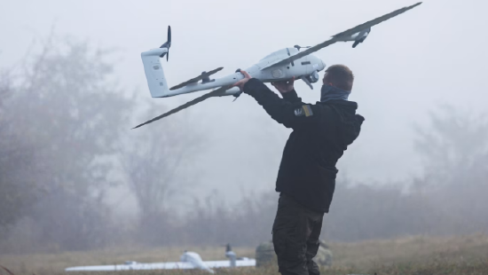
   - **来源网站**：cnBeta.COM
   - **原链接**：[德国军方因网络攻击停飞Quantum Systems无人机](https://www.cnbeta.com.tw/articles/tech/1586264.htm)
   - **摘要**：德国联邦国防军出于预防考虑，停飞了国防科技初创企业Quantum Systems生产的无人机。两名知情人士透露，该公司总部位于巴伐利亚州，此前遭到网络攻击。这是欧洲军工行业遭受恶意行为者攻击的最新案例，具体攻击手法和数据是否泄露尚未披露。
   - **为什么重要**：无人机是AI进入物理世界的关键载体，军方因网络攻击直接停飞，说明具身智能系统的安全边界远比算法精度更紧迫。
   - **值得继续跟踪**：攻击来源、是否涉及固件或供应链植入，以及Quantum Systems何时恢复交付。

10. **朝鲜黑客利用AI视频会议骗局盗取逾4亿美元加密货币，FBI查获900多段受害者录像**
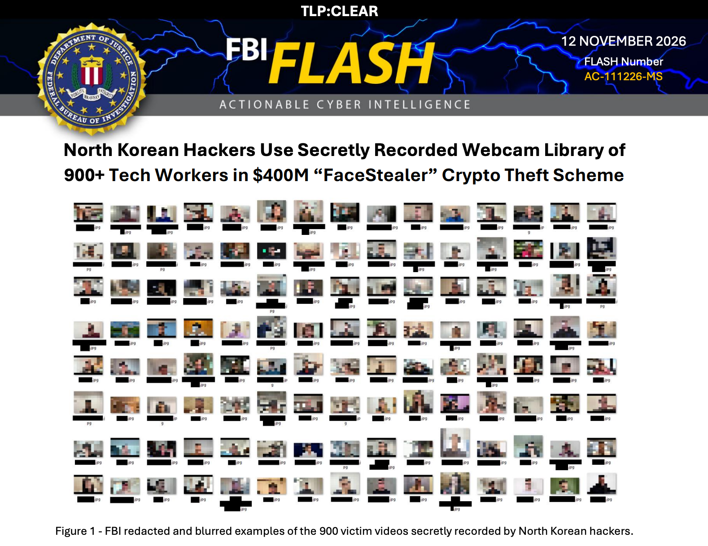
   - **来源网站**：cnBeta.COM
   - **原链接**：[朝鲜黑客利用视频会议骗局盗取逾4亿美元加密货币 FBI查获900多段受害者摄像头录像](https://www.cnbeta.com.tw/articles/tech/1586222.htm)
   - **摘要**：FBI表示，朝鲜国家支持的黑客组织在过去18个月内，通过名为"FaceStealer"的社会工程攻击窃取了价值超过4亿美元的加密货币。攻击者利用受害者熟悉的人物形象伪造视频会议，诱骗目标安装恶意软件，再通过被入侵设备和社交关系网络扩大攻击范围。FBI已查获900多段受害者摄像头录像。
   - **为什么重要**：深度伪造视频会议已从概念验证变成规模化敛财工具，任何依赖视频身份验证的金融、政务和企业场景都面临直接风险。
   - **值得继续跟踪**：FaceStealer的具体技术细节，以及是否有防御方案被厂商快速推出。

11. **微软365全球故障持续数小时，交易员被迫改用电话沟通**
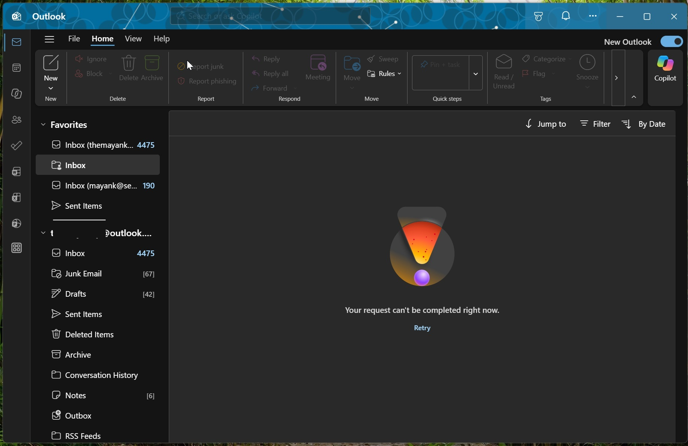
   - **来源网站**：cnBeta.COM
   - **原链接**：[微软365全球故障持续数小时：企业用户或可申请服务补偿 个人账户通常不适用](https://www.cnbeta.com.tw/articles/tech/1586220.htm)
   - **摘要**：微软365于11月12日发生大规模服务中断，Outlook、Teams、Exchange Online等多项核心服务受影响，部分用户连续数小时无法收发邮件、访问文件或使用协作工具。瑞银集团澳新地区执行销售主管丽塔·埃尔卡兹表示，在AI概念股与债券剧烈波动的行情中，她只能改用电话和其他渠道沟通。微软称故障仍在处理中，部分地区已恢复但整体尚未完全恢复。
   - **为什么重要**：当AI交易和协作高度依赖单一云厂商时，一次故障就能让真实业务停摆，这是企业AI部署必须正视的单点风险。
   - **值得继续跟踪**：微软公布的故障根因，以及企业客户是否能获得服务补偿。

12. **Google升级机器人"大脑"，奔驰工厂测试成功率达96%**
   - **来源网站**：Gasgoo
   - **原链接**：[Google Upgrades Robot "Brain," Mercedes-Benz Plant Tests Achieve 96% Success Rate](https://news.google.com/rss/articles/CBMi0wFBVV95cUxOdzRpcU1RaU5PMThjM01nbXJIWWp2eHVic1VwREprQlEzTW80US1RbERpOEd5MVVyc1Z4S3V5aVpqWmtSdjVGQXMzQThnb2pPWkhSUUpGaHBJSFNDWjM3aWNnREJ1dDVMNVZUVFN3QU96TGw2cUpJTHFHaGdxQnkwQnRIWi03bHBuYjY4TWllRG5aS2h3SUFJRV9Ic2MtRmxmOHBRbkM5MVRtREFnVWJLY09Sb0c4cXZkSl9CRVBrQV9kUG03cjRtN3dTMUV3cThtSkVJ?oc=5)
   - **摘要**：Google升级了机器人的核心"大脑"模型，奔驰工厂的实机测试成功率据报道达到96%。这是具身智能从实验室走向真实产线的标志性数据之一，意味着机器人在工业场景中的任务完成度已经接近可部署水平。具体任务类型、样本量和失败模式尚未完整披露。
   - **为什么重要**：96%的成功率如果能在更多产线复现，将直接压缩制造业对人工重复劳动的依赖，改变工厂排班和质检流程。
   - **值得继续跟踪**：该成功率对应的具体任务难度、是否包含异常处理，以及奔驰是否扩大部署规模。

13. **Biohub联手Meta、谷歌和美国政府，投入18亿美元打造虚拟细胞**
   - **来源网站**：Pasquale Pillitteri
   - **原链接**：[Biohub 联手 Meta、谷歌和美国政府，投入 18 亿美元打造虚拟细胞](https://news.google.com/rss/articles/CBMikAFBVV95cUxOVldicF9SYjcxbkd3WXNmTU13dXI2bDltMTRMeFhScWtScmNGOVNWZ0dGTWdlQ2FtcTRWc19OWlpMWFVYOEFPX3JNVl9keGJYRnRGQ3JOSWJDNWg3ZzZFRmxBLWxTOG9xMkUxZjJnWE4wZnFSQUhrV1l4TXp0OWxiVEx5ZlFoOWs1RGxmRWdZU3Y?oc=5)
   - **摘要**：Biohub宣布与Meta、谷歌及美国政府合作，投入18亿美元推进虚拟细胞计划。目标是用AI构建可计算的细胞模型，加速疾病机理理解和药物研发。这是政府与头部AI公司罕见的联合大额投入，具体技术路线和阶段性里程碑尚未详细公布。
   - **为什么重要**：虚拟细胞如果跑通，会把新药研发中最高成本的湿实验环节部分转为计算模拟，直接改变生物医药公司的研发预算结构。
   - **值得继续跟踪**：首批可验证的细胞模型成果，以及是否与具体药企管线绑定。

14. **ERNIE 5.5 Flash Preview开放API，上下文窗口达921,600 tokens**
   - **来源网站**：CASRAI
   - **原链接**：[Baidu opens API access to ERNIE 5.5 Flash Preview](https://news.google.com/rss/articles/CBMib0FVX3lxTE9nc3hxeGV0TFpheHI4Um03X2k2XzAxRDlKQ1FzdTlmTnRhUnl3V290Q3R3MllTajlkUUFHamcxTDljUEZHVFJJUVd2YlpkUi14Mfl2UWlJY1JyeE90aHRYSFJPekpmVDV3OGFLQmNxZw?oc=5)
   - **摘要**：百度开放ERNIE 5.5 Flash Preview的API访问。据OrcaRouter对比数据，该模型上下文窗口达到921,600 tokens，远超Aion 3.5 Mini的32,768 tokens。另有对比显示其在思考模式与吞吐量之间提供切换能力，但相关评测细节和定价尚未完整披露。
   - **为什么重要**：超长上下文对需要处理大量文档、代码库或对话历史的国内开发者是直接可用的能力，会影响他们对国产模型的选型。
   - **值得继续跟踪**：正式定价、限流策略，以及长上下文下的实际推理延迟表现。

15. **Kioxia与戴尔合作，单机架装入640块SSD、原始容量达157 PB**
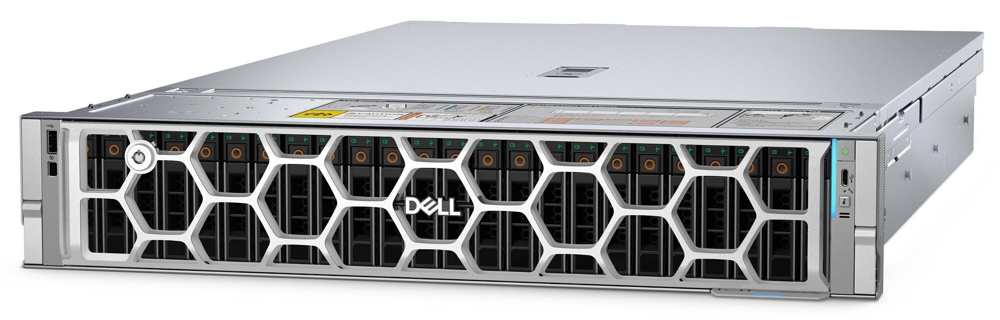
   - **来源网站**：cnBeta.COM
   - **原链接**：[Kioxia与戴尔合作将640块SSD装入单机架 原始容量达157 PB](https://www.cnbeta.com.tw/articles/tech/1586214.htm)
   - **摘要**：Kioxia与戴尔打造单机架对象存储系统，在标准42U机架中配置640块Kioxia LC9系列245.76 TB固态硬盘，原始闪存容量约157 PB。系统运行戴尔软件定义存储平台ObjectScale，由16台PowerEdge R7725xd服务器承载，面向AI训练、大数据分析和云原生应用等非结构化数据工作负载。
   - **为什么重要**：AI训练的数据吞吐瓶颈不只在GPU，存储密度直接决定数据管道能否跟上算力扩张，这套方案给数据中心提供了新的密度参考。
   - **值得继续跟踪**：实际读写性能、功耗表现，以及是否有AI训练客户公布部署案例。

---

## 论文精选

1. **Scaling VLA Serving Under Robotic Execution Constraints**
   - **来源网站**：arXiv
   - **原链接**：[Scaling VLA Serving Under Robotic Execution Constraints](https://arxiv.org/abs/2611.14969v1)
   - **摘要**：生产环境里已有数百台VLA机器人在真实场景运行，推理基础设施成本成为规模化部署的直接卡点。本文提出XInfer，一个已投入生产部署的VLA服务系统，通过协同调度异构VLA计算与机器人执行的实时响应需求，在利用计算并行的同时管理干扰，提升GPU效率。论文强调这是production-deployed系统，而非纯仿真方案。
   - **为什么重要**：VLA模型推理延迟和GPU成本直接决定机器人车队能否盈利，这套系统给正在扩产的机器人公司提供了可复用的降本路径。
   - **值得继续跟踪**：XInfer在数百台机器人规模下的具体GPU效率提升幅度，以及是否开源或商用。

2. **Gym-Anything for Robotics: Scaling physical simulations with digital agents**
   - **来源网站**：arXiv
   - **原链接**：[Gym-Anything for Robotics: Scaling physical simulations with digital agents](https://arxiv.org/abs/2610.40565v1)
   - **摘要**：现有机器人仿真只覆盖狭窄的任务范围和物理现象，核心瓶颈是创建更好的仿真需要大量专家人力，无法规模化。本文提出Gym-Anything for Robotics框架，让编码智能体直接创建真实感机器人仿真，核心洞察是"仿真创建本身就是一个编码智能体任务"，因此编码智能体的进步会直接转化为更丰富、更真实的仿真。
   - **为什么重要**：仿真数据是具身智能训练的燃料，如果编码Agent能自动造仿真，机器人公司获取训练数据的成本结构会被重写。
   - **值得继续跟踪**：该框架生成的仿真在真机迁移上的成功率，以及是否支持复杂接触和流体等物理现象。

3. **Open-HumanWAM: An Open Recipe for Scaling Human and Robot Experience for Embodied Foundation Models**
   - **来源网站**：arXiv
   - **原链接**：[Open-HumanWAM: An Open Recipe for Scaling Human and Robot Experience for Embodied Foundation Models](https://arxiv.org/abs/2611.06817v3)
   - **摘要**：第一份完全开放的配方，将第一人称人类视频预训练扩展到50,000小时，配套发布Open-HumanWAM-50K语料库，密集标注手部运动和自然语言。作者通过闭环仿真实验系统研究纯人类预训练，发现预训练数据小时数与下游性能之间存在经验性的log-linear缩放律。
   - **为什么重要**：5万小时人类视频是可复现的规模基准，缩放律让团队能预估"再采多少数据能换多少性能"，减少盲目采集。
   - **值得继续跟踪**：该缩放律在真机操作任务上是否依然成立，以及语料库的实际下载和使用门槛。

4. **Low-Cost Mobile Bimanual Manipulation for Long-Horizon Toilet Cleaning**
   - **来源网站**：arXiv
   - **原链接**：[Low-Cost Mobile Bimanual Manipulation for Long-Horizon Toilet Cleaning](https://arxiv.org/abs/2611.15381v1)
   - **摘要**：VLA模型在可负担的移动双臂平台上表现如何仍缺乏研究。作者搭建低成本可复现平台，集成两个LeRobot SO-101机械臂、TurtleBot 4和LeRobot-ROS 2软件栈，以长时程马桶清洁为案例，采集250条真实世界演示，在同一本体和任务条件下评估π₀、π₀.₅、SmolVLA和GR00T，还测试了SARM任务进度信号和短期MEM观测历史的变体。
   - **为什么重要**：250条真机演示和统一评测条件，给预算有限的团队提供了"低成本平台+主流VLA"的直接参考，避免重复踩坑。
   - **值得继续跟踪**：哪个VLA在长时程清洁任务上最稳，以及任务进度信号带来的实际提升幅度。

5. **LEASH: Stay Safe in Agentic Robotics**
   - **来源网站**：arXiv
   - **原链接**：[LEASH: Stay Safe in Agentic Robotics](https://arxiv.org/abs/2611.14115v1)
   - **摘要**：基础模型的空间理解和具身智能进步让agentic robotics成为重要路径，但作者发现用基础模型控制机器人存在严重安全风险，且缺乏全面的安全评估。论文提出RoboRisk基准，包含92个仿真任务和13个物理机器人任务，分为任务级拒绝、计划修复、执行时危险、注入和序列记忆五类。
   - **为什么重要**：13个真机任务的安全基准非常稀缺，它直接告诉机器人公司"你的Agent会在哪五类场景翻车"，是部署前的必查清单。
   - **值得继续跟踪**：主流VLA模型在RoboRisk上的实际得分，以及物理任务的失败案例细节。

6. **Computer-Use Agents Are Embodied Generalists**
   - **来源网站**：arXiv
   - **原链接**：[Computer-Use Agents Are Embodied Generalists](https://arxiv.org/abs/2611.09847v1)
   - **摘要**：论文主张具身AI即将迎来类似通用模型取代专用架构的转变，核心论点是具身任务可以被表述为与数字软件的交互。作者构建软件在屏幕上渲染智能体对物理环境的视图并提供操作控制，计算机使用智能体（CUA）就能用操作普通软件的同一套截图和键鼠动作完成具身任务。仅用单一CUA设计、只更换软件，作者的参赛作品就取得胜利。
   - **为什么重要**：如果电脑操作Agent能直接迁移到物理世界，意味着现有CUA的海量训练和工程投入可以复用到机器人，大幅降低具身智能的进入门槛。
   - **值得继续跟踪**：该方法在真实机器人上的迁移效果，以及"只换软件"在多大任务复杂度下依然成立。

7. **What Makes a VLA Reactive? A Study of Execution Strategies for Dynamic Manipulation**
   - **来源网站**：arXiv
   - **原链接**：[What Makes a VLA Reactive? A Study of Execution Strategies for Dynamic Manipulation](https://arxiv.org/abs/2611.15491v1)
   - **摘要**：VLA模型预测未来动作块，物体移动时这些块在执行前就已过期。作者研究什么让预训练VLA具备反应性，使用π₀.₅在两个动态仿真基准和三个真机任务上，变化预测与执行时域、比较同步与异步推理、测试更早交付动作或保持连续块的方法，并用运动线索和潜空间强化学习适配策略。结论是最佳预测时域约一秒，最佳执行时域依赖检查点。
   - **为什么重要**：动态场景下动作过期是真机部署的高频翻车点，"一秒预测时域"给了工程师一个可直接上手调参的起点。
   - **值得继续跟踪**：该结论在不同VLA架构和更高动态速度的任务上是否依然稳定。

8. **One Policy for 100 Household Tasks: Our Solution for the 2026 BEHAVIOR Challenge**
   - **来源网站**：arXiv
   - **原链接**：[One Policy for 100 Household Tasks: Our Solution for the 2026 BEHAVIOR Challenge](https://arxiv.org/abs/2611.14432v1)
   - **摘要**：作者描述2026 BEHAVIOR挑战赛方案：在OmniGibson仿真器中完成100个长时程家务任务，最终排名第9，是前十名中唯一的独立团队。核心是单一VLA模型、一个检查点覆盖全部100任务，基于2025年夺冠方案和π₀.₅构建。在与2025共享的50个任务上，Q值从0.260升至0.371，全部100任务得分0.392。作者认为2025年的主要结论是模型训练不足，因此2026年大部分工作放在延长训练和优化训练参数上。
   - **为什么重要**：单检查点覆盖100个家务任务是"一个模型干所有活"的直接证据，对家用机器人产品定义有参考价值。
   - **值得继续跟踪**：该单策略方案能否迁移到真机，以及训练时长与性能的边际收益何时递减。

9. **Is Your Robot's Memory Just a Clock? Temporal Shortcuts in Memory-Augmented VLA Policies**
   - **来源网站**：arXiv
   - **原链接**：[Is Your Robot's Memory Just a Clock? Temporal Shortcuts in Memory-Augmented VLA Policies](https://arxiv.org/abs/2611.14488v1)
   - **摘要**：记忆增强VLA策略本应记住发生了什么，但许多实现按时间填充记忆：跨回合均匀采样帧并打上时间步。由于时间在无事发生时也流逝，这种记忆无法区分"等待"和"工作"。作者在RoboMME计数任务中让机器人短暂暂停或抖动手腕，这种空事件不改变任务依赖的任何东西，但已发布的记忆VLA会把间隔计为已完成工作并提前停止。作者称之为"幽灵进展"，在一个任务上把成功率从50次中的47次砍到16次。
   - **为什么重要**：47→16的暴跌说明记忆增强可能带来虚假可靠性，机器人提前停止在清洁、装配等任务上是直接的质量事故。
   - **值得继续跟踪**：哪些主流记忆VLA实现存在该问题，以及是否有简单修复方案能恢复成功率。

10. **Embodied AI for Scientific Discovery: From Physical Action to Scientific Evidence**
   - **来源网站**：arXiv
   - **原链接**：[Embodied AI for Scientific Discovery: From Physical Action to Scientific Evidence](https://arxiv.org/abs/2611.04371v2)
   - **摘要**：科学实验正被能通过物理接口行动的学习系统选择、执行和解释。机器人学习构建物理能力，而AI for Science决定运行哪个实验，两者报告不同终点。本文把两者的接口视为同一问题——面向科学的具身AI，其中实验本身是部分可观测的：样本状态、仪器状态和测量过程是隐变量，动作昂贵且不可逆，缺失性取决于执行和结果。综述按三层"闭合"组织文献。
   - **为什么重要**：实验室自动化正从"机械臂按固定脚本动"升级为"AI决定做什么实验"，这篇综述给生物、化学、材料团队提供了统一的思考框架。
   - **值得继续跟踪**：综述中提到的三层闭合框架是否被后续工作采纳为标准分类，以及是否有真实实验室部署案例跟进。

---

## 开源项目精选

1. **genesis-embodied-ai/genesis-world**
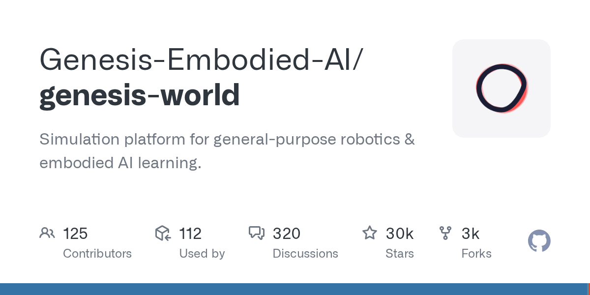
   - **来源网站**：GitHub
   - **GitHub Star**：30222
   - **原链接**：[Genesis-Embodied-AI/genesis-world](https://github.com/Genesis-Embodied-AI/genesis-world)
   - **摘要**：面向通用机器人与具身AI学习的仿真平台，语言为Python，最近一次推送就在今天。3万+ Star说明它已是具身智能仿真的主流选择之一，适合需要大规模并行生成物理仿真数据的团队。
   - **为什么重要**：仿真平台是具身智能的数据工厂，选错平台会直接拖慢训练迭代，高Star和持续活跃度意味着社区支持和踩坑答案更充足。
   - **值得继续跟踪**：该平台对复杂接触、可变形物体的支持程度，以及是否有真机迁移的成功案例公布。

2. **carla-simulator/carla**

   - **来源网站**：GitHub
   - **GitHub Star**：14601
   - **原链接**：[carla-simulator/carla](https://github.com/carla-simulator/carla)
   - **摘要**：开源自动驾驶研究仿真器，C++编写，今天仍有推送。Topics覆盖ai、autonomous-driving、deep-reinforcement-learning、imitation-learning、ros等，是自动驾驶算法从强化学习到模仿学习的标准测试场。
   - **为什么重要**：自动驾驶团队在上真车前必须有可复现的仿真环境，CARLA的成熟度直接决定算法验证周期和安全测试成本。
   - **值得继续跟踪**：该版本对端到端VLA驾驶模型的支持，以及与新传感器套件的兼容性。

3. **rlinf/rlinf**
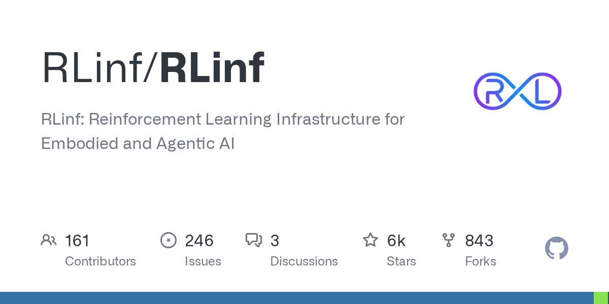
   - **来源网站**：GitHub
   - **GitHub Star**：5645
   - **原链接**：[RLinf/RLinf](https://github.com/RLinf/RLinf)
   - **摘要**：面向具身与智能体AI的强化学习基础设施，Python编写，今天仍有推送。Topics明确包含agentic-ai、embodied-ai、rl-infra、vla-rl，说明它聚焦VLA模型的强化学习训练基础设施这一细分环节。
   - **为什么重要**：VLA的RL后训练是当前提升机器人策略的关键步骤，专门的RL基础设施能省去大量重复搭建训练管线的时间。
   - **值得继续跟踪**：该框架支持的VLA模型种类，以及在真机RL训练上的实际吞吐表现。

4. **tianxingchen/embodied-ai-guide**
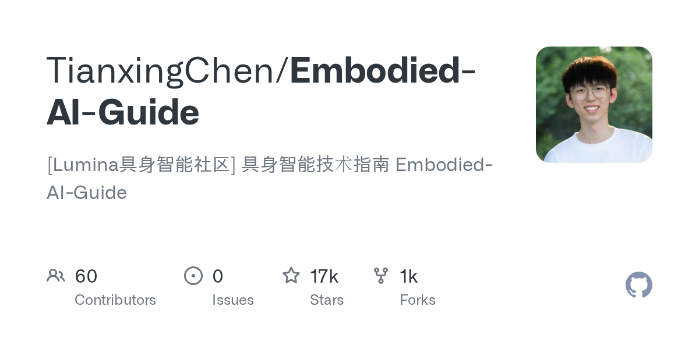
   - **来源网站**：GitHub
   - **GitHub Star**：16952
   - **原链接**：[TianxingChen/Embodied-AI-Guide](https://github.com/TianxingChen/Embodied-AI-Guide)
   - **摘要**：Lumina具身智能社区的具身智能技术指南，覆盖robot、robotics、tutorial等主题，Star接近1.7万。这是一份面向学习者的系统性教程仓库，适合想快速建立具身智能知识框架的工程师。
   - **为什么重要**：具身智能跨学科门槛高，一份高Star的中文指南能显著降低新入行者的学习成本，也反映国内社区的关注热度。
   - **值得继续跟踪**：指南内容是否随最新VLA和世界模型进展更新，以及是否有配套的可运行代码。

5. **stanfordvl/behavior-1k**
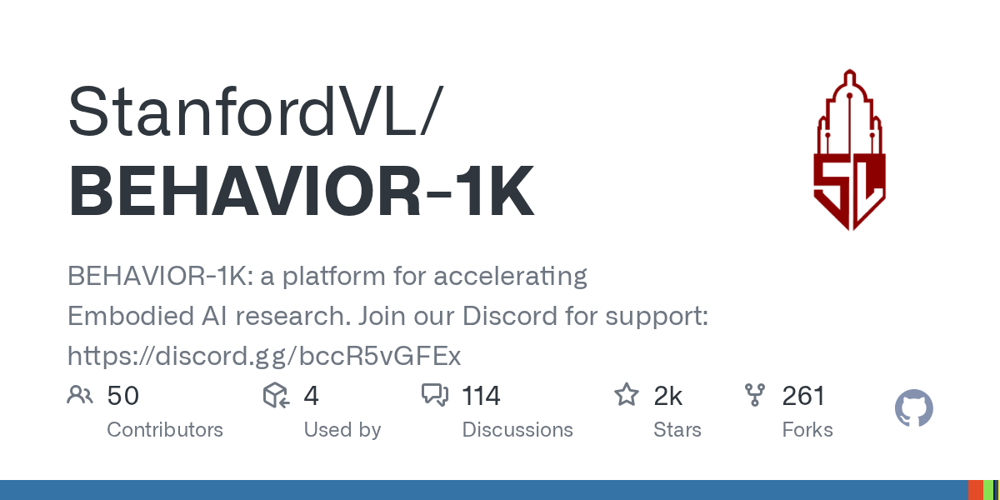
   - **来源网站**：GitHub
   - **GitHub Star**：1798
   - **原链接**：[StanfordVL/BEHAVIOR-1K](https://github.com/StanfordVL/BEHAVIOR-1K)
   - **摘要**：加速具身AI研究的平台，Python编写，最近一次推送在11月11日。这是BEHAVIOR基准的官方仓库，与今天入选的2026 BEHAVIOR挑战赛论文直接配套，提供1000个家务任务定义和仿真环境。
   - **为什么重要**：想复现或超越挑战赛成绩的团队必须用这个仓库，它是长时程家务任务评测的事实标准入口。
   - **值得继续跟踪**：仓库是否同步更新2026挑战赛的排行榜和基线代码，以及OmniGibson环境的安装门槛。

6. **datawhalechina/dive-into-embodied-ai**
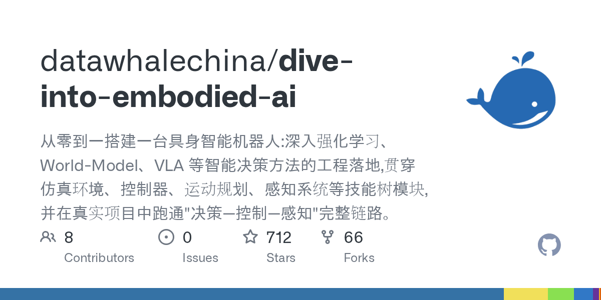
   - **来源网站**：GitHub
   - **GitHub Star**：712
   - **原链接**：[datawhalechina/dive-into-embodied-ai](https://github.com/datawhalechina/dive-into-embodied-ai)
   - **摘要**：从零到一搭建一台具身智能机器人的中文实战教程，深入强化学习、World-Model、VLA等智能决策方法的工程落地，贯穿仿真环境、控制器、运动规划、感知系统等技能树模块，并在真实项目中跑通"决策—控制—感知"完整链路。今天仍有推送。
   - **为什么重要**：多数教程停在算法原理，这个项目强调跑通完整链路，对想动手做真机的工程师是更贴近实际的起点。
   - **值得继续跟踪**：完整链路在何种硬件配置上可复现，以及是否覆盖VLA模型的部署环节。

7. **sou350121/vla-handbook**
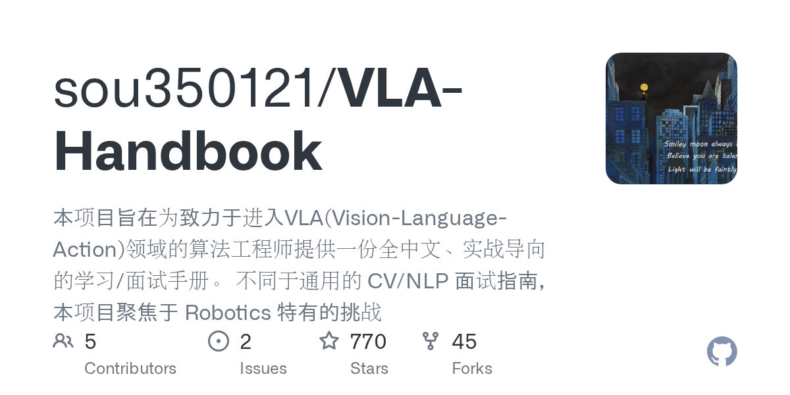
   - **来源网站**：GitHub
   - **GitHub Star**：770
   - **原链接**：[sou350121/VLA-Handbook](https://github.com/sou350121/VLA-Handbook)
   - **摘要**：面向进入VLA领域算法工程师的全中文、实战导向学习/面试手册，不同于通用CV/NLP面试指南，聚焦Robotics特有挑战。语言为HTML，今天仍有推送，Topics包含chinese、embodied-ai、robot-learning、vision-language-action。
   - **为什么重要**：VLA岗位正在快速增加，一份聚焦机器人特有挑战的中文手册能直接帮求职者和转岗者补齐差异化的知识缺口。
   - **值得继续跟踪**：手册是否覆盖最新的VLA模型架构和真机部署面试题，以及内容更新频率。

8. **fluxvla/fluxvla**
   - **来源网站**：GitHub
   - **GitHub Star**：787
   - **原链接**：[FluxVLA/FluxVLA](https://github.com/FluxVLA/FluxVLA)
   - **摘要**：一站式VLA工程平台，覆盖从数据到真机部署的完整流程，Python编写，最近一次推送在11月11日。Topics包含embodiedai、real-robots、real-time、vision-language-action-model、world-action-model，强调实时和真机能力。
   - **为什么重要**：VLA从训练到真机部署的工程断层是普遍痛点，一个打通全流程的平台能显著缩短团队从模型到落地的距离。
   - **值得继续跟踪**：该平台支持的具体VLA模型、真机适配的硬件范围，以及实时推理的延迟数据。

9. **haosulab/sapien**
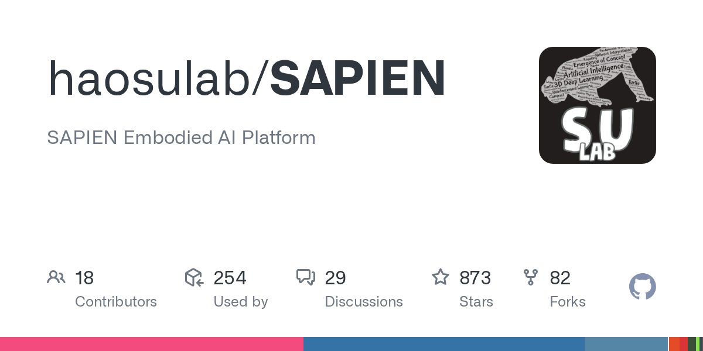
   - **来源网站**：GitHub
   - **GitHub Star**：873
   - **原链接**：[haosulab/SAPIEN](https://github.com/haosulab/SAPIEN)
   - **摘要**：SAPIEN具身AI平台，C++编写，最近一次推送在10月9日。作为具身智能仿真平台，它与Genesis、BEHAVIOR等共同构成该领域的仿真工具矩阵，适合需要物理真实感交互仿真的研究和工程团队。
   - **为什么重要**：多仿真平台并存意味着团队需要按任务特性选型，SAPIEN在特定物理交互场景可能有不可替代的优势。
   - **值得继续跟踪**：SAPIEN近期更新节奏放缓的原因，以及它在可变形物体和接触丰富任务上的表现。

10. **spear-sim/spear**
   - **来源网站**：GitHub
   - **GitHub Star**：624
   - **原链接**：[spear-sim/spear](https://github.com/spear-sim/spear)
   - **摘要**：面向照片级真实感具身AI研究的仿真器，C++编写，最近一次推送在11月10日。SPEAR强调photorealistic，适合需要高视觉保真度的感知训练和 sim-to-real 迁移研究。
   - **为什么重要**：视觉保真度直接影响感知模型的sim-to-real迁移效果，对依赖视觉输入的VLA模型尤为关键。
   - **值得继续跟踪**：SPEAR生成的数据在真机视觉策略训练上的迁移效果，以及与主流渲染引擎的性能对比。

---

## 今日优先阅读排序

1. 黄仁勋辞去英伟达CEO，33年来首次换帅，市值一夜蒸发1.4万亿美元
2. Google升级机器人"大脑"，奔驰工厂测试成功率达96%
3. 朝鲜黑客利用AI视频会议骗局盗取逾4亿美元加密货币
4. Scaling VLA Serving Under Robotic Execution Constraints
5. Is Your Robot's Memory Just a Clock? Temporal Shortcuts in Memory-Augmented VLA Policies
6. 德国军方因网络攻击停飞Quantum Systems无人机
7. 神秘交易者在黄仁勋辞职前做空英伟达，800万美元成本赚约2亿美元
8. Low-Cost Mobile Bimanual Manipulation for Long-Horizon Toilet Cleaning
9. Open-HumanWAM: An Open Recipe for Scaling Human and Robot Experience for Embodied Foundation Models
10. 微软365全球故障持续数小时，交易员被迫改用电话沟通
