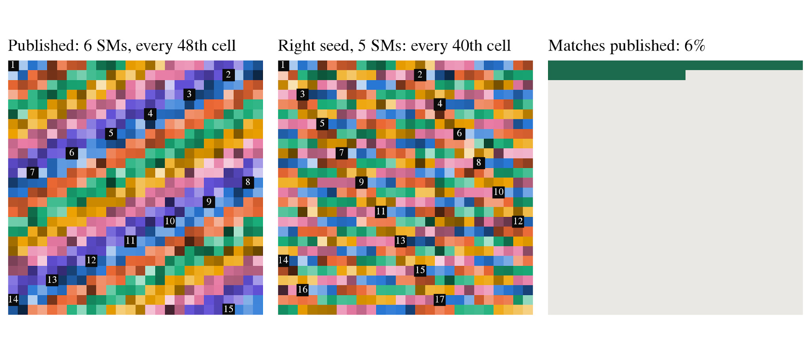
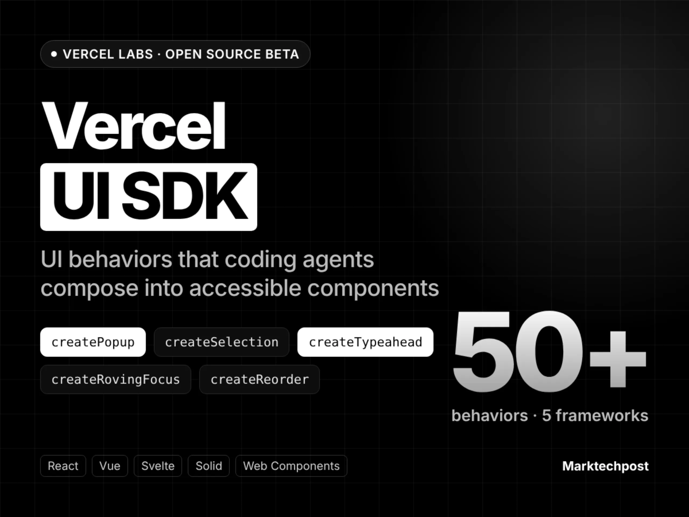
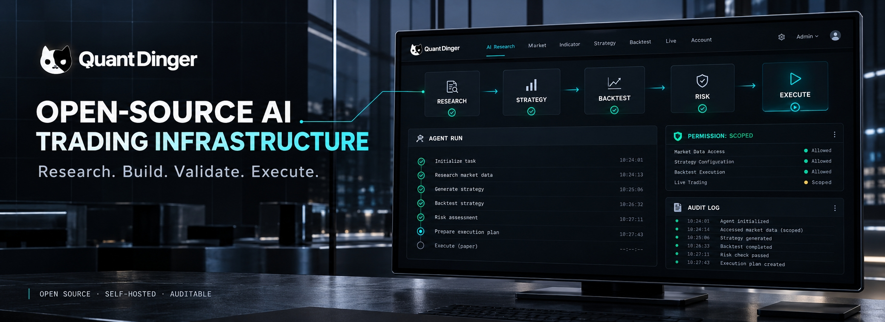
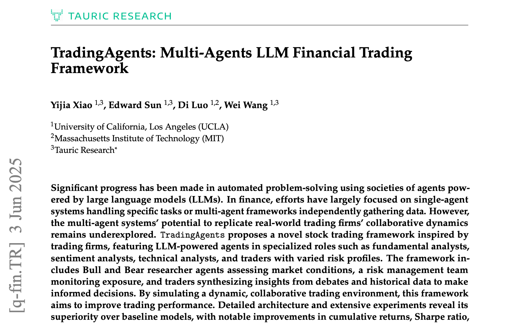
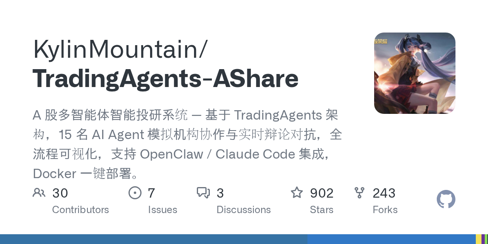
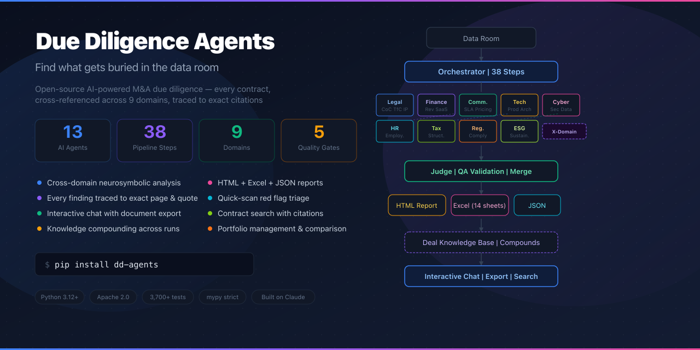
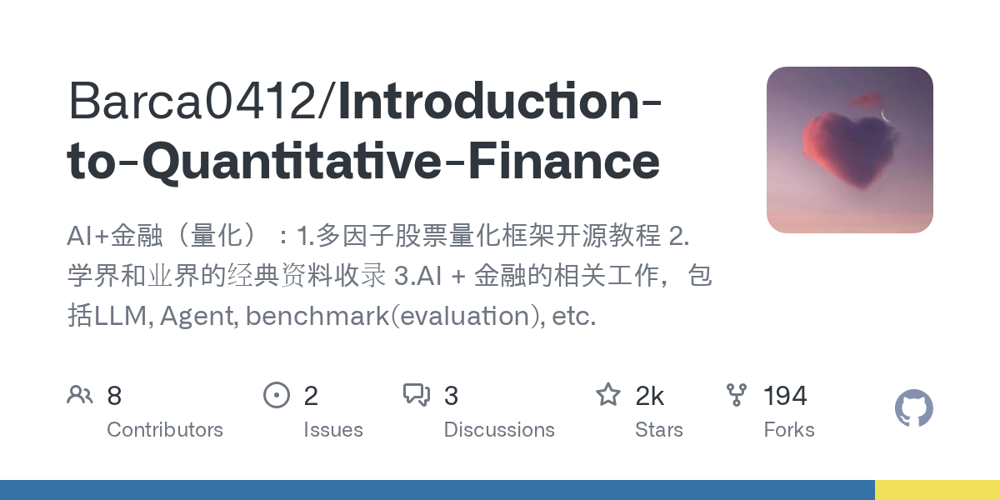
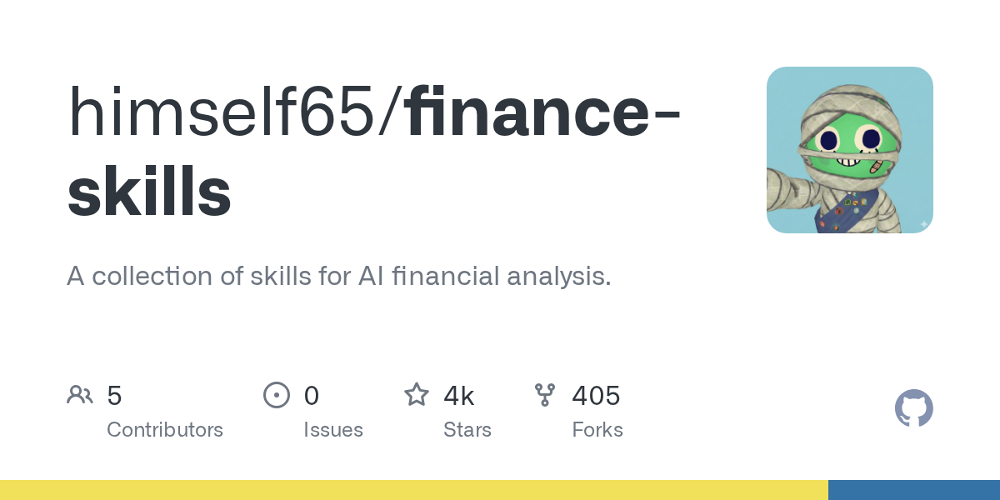
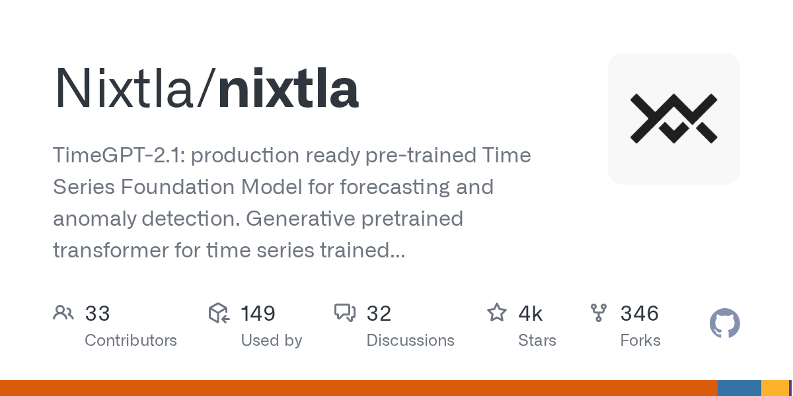
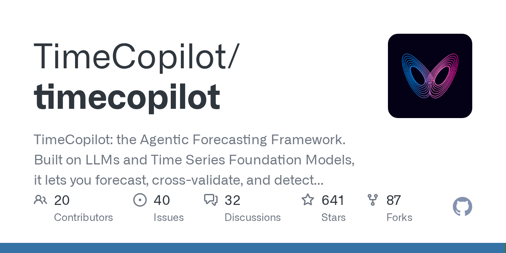

# 黄仁勋辞职余波未平，美团1.6万亿参数模型全程国产芯片训练

日期：2026-11-15

## 今日分享主题：AI 金融、财税与风控 (ai-finance)

本期关注：关注投研、财报、审计、税务、银行保险、风险识别和金融决策支持。

阅读提示：论文与开源项目围绕这一主题筛选；新闻栏目保留当天最重要的 AI 产业动态，方便把主题线索放进全局变化里看。

## 今日结论

今天最扎眼的一件事：有研究团队通过分析模型权重里的“硬件指纹”，指认 DeepSeek、月之暗面、MiniMax、蚂蚁等中国头部模型可能用了受出口管制的英伟达 Blackwell 芯片初始化甚至训练，推算部分训练集群规模达 3000 至 4500 颗——这直接戳中了美国芯片管制的执行漏洞。同一时间，美团开源了 1.6 万亿参数的 Agent 模型 LongCat-2.5，样本部署跑在 194 颗华为昇腾上，全程没碰英伟达 GPU，Terminal Bench 得分 88.4，仅次于 Claude Opus 5。一边是“绕开管制”的指控，一边是“完全不用管制芯片”的实证，两条线撞在一起，算力自主和管制有效性同时被推到台前。另外，OpenAI 解散独立机器人团队、Anthropic 上市前夕估值预期下修、英伟达因黄仁勋辞职一周市值蒸发超 5730 亿美元，都是会影响接下来几个月竞争格局的信号。口径说明：本日报覆盖 11 月 13 日至 15 日的新闻，优先当天与近两天，个别仍在发酵的事件（如黄仁勋辞职后续）一并纳入。

---

## 新闻与产业动态

1. **研究指认中国头部模型藏有 Blackwell 芯片指纹，推算训练集群达 3000-4500 颗**

   - **来源网站**：cnBeta.COM
   - **原链接**：[中国AI模型被发现英伟达Blackwell芯片“指纹” 研究推算部分训练集群规模达3000至4500颗](https://www.cnbeta.com.tw/articles/tech/1586310.htm)
   - **摘要**：一个名为 Unemployment Labs 的独立研究团队通过分析 DeepSeek、月之暗面、MiniMax 和蚂蚁集团公开发布的模型权重，发现其中保留了与特定英伟达 GPU 架构相匹配的数字特征，据此推断这些模型可能使用了受美国出口管制限制的 Blackwell 芯片进行初始化甚至大规模训练，部分训练集群规模估计在 3000 至 4500 颗之间。这项研究为此前关于中国 AI 企业获取受限芯片的猜测提供了新的技术证据，但目前仍是基于权重特征的推断，并非直接的采购或部署记录。
   - **为什么重要**：如果推断成立，美国对华芯片出口管制的执行有效性将被直接质疑，涉及的中国模型公司和英伟达供应链都可能面临更严格的审查，也会改变外界对中国 AI 算力真实水平的估计。
   - **值得继续跟踪**：盯住研究团队是否公开完整的指纹比对方法和可复现代码，以及被点名的中国公司或英伟达是否作出正式回应。

2. **美团开源 1.6 万亿参数 Agent 模型 LongCat-2.5，全程未用英伟达 GPU**

   - **来源网站**：the-decoder.com
   - **原链接**：[Meituan releases a 1.6-trillion-parameter agent model that never touched an Nvidia GPU](https://the-decoder.com/meituan-releases-a-1-6-trillion-parameter-agent-model-that-never-touched-an-nvidia-gpu/)
   - **摘要**：美团开源了面向 AI Agent 的 1.6 万亿参数模型 LongCat-2.5 的权重，该模型完全在中国国产硬件上训练完成，样本部署运行在 194 颗华为昇腾芯片上，报道中未提及任何英伟达 GPU 的参与。在 Terminal Bench 基准测试中，LongCat-2.5 得分 88.4，仅落后于 Claude Opus 5。这是国产算力链上一次可验证的能力展示，但基准分数不等于真实业务部署效果。
   - **为什么重要**：它给“没有英伟达就做不出顶级 Agent 模型”的论调提供了一个反例，对华为昇腾生态和国内算力供应链是实质性背书，也会让依赖国产芯片的团队更有底气做选型。
   - **值得继续跟踪**：关注权重和部署代码的开源完整度，以及是否有第三方在昇腾集群上复现 Terminal Bench 分数和真实 Agent 任务表现。

3. **OpenAI 解散独立机器人团队，研究员被调往核心组**
   - **来源网站**：The Decoder
   - **原链接**：[OpenAI reassigns robotics researchers to other teams as general-purpose models might make specialized robotics AI unnecessary](https://news.google.com/rss/articles/CBMi5AFBVV95cUxQc0RCaDFRSml1TkxBN09Ed3pkZDhDNDAzYThkdktlU3lVMy1IblZSb0dyRkw2TjNCTFF0c0dha25JdlZNNzh1OWlrTzI5T2dOUEtGSHdWNDVMTlMyZm5BS3lGQXNtTnN3Wm82OUtMOGVHX2FsOUhBZHRGQlVKQXJrMTZtM2xHTWQ2VmVnRlhhd0RTamJiWEZabWc1TVFZTk1ieDdDQ3ZxTmxJVy1kczNnUWM0UVpEVVFZWmgtM1RhVXpyMGdKN0ZpY3I4SzZIR0RJd2JMdmY5S1Q2VTFYTFVTUG1zcmE?oc=5)
   - **摘要**：报道称 OpenAI 已撤销独立的机器人团队，将相关研究员重新分配到其他核心团队，理由是通用模型的发展可能让专门的机器人 AI 变得多余。此前 OpenAI 在具身智能方向投入过专门人力，这次调整意味着其战略重心向通用模型进一步集中，机器人能力可能更多通过通用模型外溢而非独立团队推进。
   - **为什么重要**：这会影响具身智能方向的人才流向和 OpenAI 的资源分配，对押注专用机器人模型的创业公司来说既是竞争压力也是差异化窗口。
   - **值得继续跟踪**：观察被调走的研究员落在哪些团队，以及 OpenAI 后续是否通过通用模型发布机器人控制相关能力来验证这次重组的逻辑。

4. **Anthropic 上市前夕估值预期下修，693 亿美元融资文件曾紧急撤回**
   - **来源网站**：金十数据
   - **原链接**：[693亿美元IPO融资文件发出后紧急撤回！Anthropic上市前夕突发插曲-市场参考](https://news.google.com/rss/articles/CBMiT0FVX3lxTFBSYkh5c2ZnanVRWGlKYnpLMF9HWkRZV1EzUU83YmQ4eVpYNy1uMDBCOU1zR1ZyLVBNcXZrN0FBMWs2Mk1BYlkzTHl6Vkd2TjQ?oc=5)
   - **摘要**：据报道，Anthropic 在 IPO 前夕出现插曲，一份涉及 693 亿美元融资的文件在发出后被紧急撤回。与此同时，其 IPO 估值预期已降至 2 万亿美元以下，低于此前市场希望的水平，CEO Dario Amodei 表态要“少承诺、多兑现”。上市节奏和定价的反复，说明资本市场对前沿模型公司的高估值开始更谨慎地定价。
   - **为什么重要**：Anthropic 的 IPO 定价是观察一级市场 AI 估值是否见顶的风向标，直接影响后续 AI 初创公司的融资估值锚点。
   - **值得继续跟踪**：盯住最终发行价区间、认购倍数，以及招股书里关于算力成本（有报道称其 S-1 提到天然气而非芯片是最大瓶颈）和收入结构的披露。

5. **英伟达一周市值蒸发超 5730 亿美元，马斯克公开签名支持黄仁勋复职**
   - **来源网站**：36氪
   - **原链接**：[9点1氪丨马斯克在X平台公开表态，将参与要求黄仁勋重返英伟达的请愿活动](https://36kr.com/p/4068905666859912?f=rss)
   - **摘要**：黄仁勋 11 月 12 日辞去英伟达总裁、CEO 及董事职务后，公司股价本周累计下跌 12.7%，市值蒸发超过 5730 亿美元，连续第六周下跌，创下 2012 年以来最长连跌纪录。11 月 13 日英伟达收报 162.85 美元，市值约 3.92 万亿美元，重新超越微软位居美股第二。内部通信显示有资深工程师在内网建议箱发帖要求董事会听取员工意见，帖子已有逾 1600 条评论，马斯克也在 X 平台表态将参与要求黄仁勋复职的请愿活动。
   - **为什么重要**：英伟达是全球 AI 算力供应链的枢纽，其领导层动荡和市值波动会传导到整个 AI 基础设施投资节奏和芯片采购决策。
   - **值得继续跟踪**：关注临时 CEO Colette Kress 的正式任命进展、新任 CEO 遴选程序，以及黄仁勋离职的真实原因是否随更多内部披露浮出水面。

6. **Anthropic 推出 Claude for Manufacturing，内置 17 项工厂技能**
   - **来源网站**：OpenTools
   - **原链接**：[Anthropic Launches Claude for Manufacturing With 17 Factory Skills](https://news.google.com/rss/articles/CBMihAFBVV95cUxPUEtxdHRIOUNDSDFnQk1aamFBQllSd3lNME1ZZFp2RTBqZDVYd255emtkcGdBYlVfak9aVzNIRGlvS2RnQ2NiV1ZNZnk3d21UX0lHRGtnMndWSTFHVlRGUTc0YWtFb2JYeER4dnF1dWMzeGthc2hXZ1NtOWlqeW1pSm1EZzg?oc=5)
   - **摘要**：Anthropic 发布了面向制造业的 Claude 产品，内置 17 项工厂场景技能，把大模型能力直接嵌入制造工作流。这是前沿模型公司从通用助手向垂直行业解决方案下沉的又一步，制造业客户不必自己从零搭建提示词和工具链，就能获得针对工厂任务预置的能力。
   - **为什么重要**：它抢的是制造业企业原本要靠内部 IT 或集成商定制开发的那一步，降低部署门槛的同时也把行业 know-how 的定价权握在模型厂商手里。
   - **值得继续跟踪**：看这 17 项技能具体覆盖哪些工厂任务（如质检、排产、设备维护），以及是否有真实工厂的落地案例和可量化的效果数据。

7. **OpenAI 推出 Daybreak，把 AI Agent 带进软件测试与漏洞修复**
   - **来源网站**：Business Upturn
   - **原链接**：[OpenAI launches Daybreak to bring AI agents into software testing and vulnerability fixes](https://news.google.com/rss/articles/CBMixwFBVV95cUxQMnZTRGhuWHNxRWtvc2xTTlFyVnJzeWp2QnozbDZBV25QNThIM1B6MWZJbWZybHpwUUY0V05VbzdPOWFDLVRUM2dUX21vSFNDOE91MzNMTDBFRUd2TEVOdmVLbkVDeUQ5X3JzenhrZ3FSNWg1LU1GUzFybkk2OTJtMl96ZjZLMm1jVW10N1RtRnRxczVJNGphblBncTM1OGVzZTItaDBxNGVoRlZIbU1PdVRMclUxRTNCRnNDUTBERnpOM3NLNmFv?oc=5)
   - **摘要**：OpenAI 推出 Daybreak，将 AI Agent 引入软件测试和漏洞修复流程，让 Agent 不只写代码，还能参与测试执行与安全缺陷的定位修复。这把编程助手的能力边界从“生成代码”推向“参与质量与安全闭环”，对软件工程工作流是实质性扩展。
   - **为什么重要**：测试和漏洞修复是软件开发中成本高、人力密集的环节，Agent 真正切入这一步会直接改变研发团队的人力分配和安全响应速度。
   - **值得继续跟踪**：关注 Daybreak 能否接入主流 CI/CD 和漏洞管理工具，以及在真实项目中发现和修复漏洞的准确率与误报率。

8. **Vercel 发布 UI SDK，为 AI 编程 Agent 提供 50+ UI 行为组件**

   - **来源网站**：MarkTechPost
   - **原链接**：[Vercel Releases UI SDK: 50+ UI Behaviors for AI Coding Agents](https://www.marktechpost.com/2026/11/13/vercel-ui-sdk-agent-ui-behaviors/)
   - **摘要**：Vercel Labs 发布了 Apache-2.0 协议的 beta 库 Vercel UI SDK，包含 50 多种 UI 行为，编程 Agent 可以将它们组合成 React、Vue、Svelte、Solid 和 Web Components 的可访问组件，并提供一个桥接层用于直接 UI 控制。这解决的是 Agent 生成前端时组件行为不规范、可访问性差的痛点，把 UI 从“能跑”推向“行为正确”。
   - **为什么重要**：它直接影响用 Agent 做前端开发的产出质量，减少开发者手工修补组件行为的时间，也给 UI 组件库生态设定了 Agent 友好的新标准。
   - **值得继续跟踪**：观察主流 Agent 编程工具是否集成该 SDK，以及 50+ 行为在真实项目中的覆盖度和可访问性合规表现。

9. **IBM 与微软联合推出 Imagine Enterprise，预置超 6000 个 AI Agent**
   - **来源网站**：StorageReview.com
   - **原链接**：[IBM and Microsoft Launch Imagine Enterprise With More Than 6,000 Prebuilt AI Agents and Assets](https://news.google.com/rss/articles/CBMikwFBVV95cUxQbDhDX0VzUHluQXFVZC1sRnpQNnlVXzhvWUxoZmlTSUdDOThlZVdyZWY4cnZjeEtPREctUEcxMEtmeHRnSmdMSW9fYk1WMlZzcHZIeWJzdVU0OHo3cW9jUnZMSGlXWV9qRkZfRTNwV0szWWFaenhJekxjMVdfNVF3SnZmMGRmX25NVVY0ZnhzcGxoN0nSAZMBQVVfeXFMUGw4Q19Fc1B5bkFxVWQtbEZ6UDZ5VV84b1lMaGZpU0lHQzk4ZWVXcmVmOHJ2Y3hLT0RHLVBHMTBLZnh0Z0pnTElvX2JNVjJWc3B2SHlic3VVNDh6N3FvY1J2TEhpV1lfakZGX0UzcFdLM1lhWnp4SXpMYzFXXzVRd0p2ZjBkZl9uTVVWNGZ4c3BsaDdJ?oc=5)
   - **摘要**：IBM 与微软联合推出 Imagine Enterprise，开箱提供超过 6000 个预构建 AI Agent 和相关资产，面向企业级 Agent 部署场景。这是两家传统企业 IT 巨头在 Agent 时代的合流，试图用预置资产缩短企业从试点到规模化的路径，而不是让每个客户从零搭建。
   - **为什么重要**：它抢的是企业客户原本要靠内部团队或咨询商定制开发 Agent 的那一步，预置资产的行业覆盖度将直接决定这套方案能不能替代定制项目。
   - **值得继续跟踪**：关注 6000 个 Agent 覆盖哪些行业和职能，以及首批企业客户的实际部署规模和替换掉的人工流程。

10. **Google 开源 WeatherNext 3 两大基础数据集，开放实时数据流与历史归档**
   - **来源网站**：cnBeta.COM
   - **原链接**：[Google开源WeatherNext3气象模型两大基础数据集](https://www.cnbeta.com.tw/articles/tech/1586374.htm)
   - **摘要**：Google DeepMind 正式公开 WeatherNext 3 气象模型依托的 SatWeave、PARDIG 两大基础数据集，面向全球科研人员与开发者开放实时数据流及历史归档资料，为天气、水文、气候研究及相关领域应用建模提供数据支撑。把训练气象模型的底层数据开放出来，意味着第三方可以复现和扩展这类模型，而不只是使用黑箱预测结果。
   - **为什么重要**：气象与气候数据是农业、能源、防灾等行业的共同底座，数据集开放会降低科研和产业机构自建气象 AI 的门槛，也对数据质量与授权边界提出新要求。
   - **值得继续跟踪**：关注数据集的授权条款、更新频率，以及是否有第三方基于 SatWeave、PARDIG 复现出可比的预报精度。

11. **思灵机器人完成 5 亿美元 F 轮融资，估值达 85 亿美元**
   - **来源网站**：人工智能
   - **原链接**：[思灵机器人Agile Robots 完成5亿美元F轮融资，估值达85亿美元，加速物理AI落地与全球化布局](https://news.google.com/rss/articles/CBMiUkFVX3lxTE9qbVhrTy1iVl84VWl2M1djdmRmbEtrLVhIM0ZPc3FQd19ldVBhbmRVS19yem9zQjUyMWxoaEtoNjdvX1AxUW1EckVNRE1DNmRpc0E?oc=5)
   - **摘要**：思灵机器人（Agile Robots）完成 5 亿美元 F 轮融资，估值达到 85 亿美元，资金用于加速物理 AI 落地与全球化布局。在具身智能融资整体活跃的背景下，这笔融资把一家做工业级机器人与物理 AI 的公司推到高估值区间，反映资本对“模型+机器人”结合路径的持续押注。
   - **为什么重要**：高估值融资会抬高具身智能赛道的人才和资产价格，也会给同类公司设定新的融资参照系，影响整个物理 AI 赛道的资金流向。
   - **值得继续跟踪**：关注本轮投资方构成、资金具体投向（研发还是产能），以及公司披露的在手订单和商业化落地进度。

12. **北航博士创办的青葵智造完成亿元 A 轮融资，做自驱动实验室**
   - **来源网站**：36氪
   - **原链接**：[36氪首发丨北航博士做AI4S，获亿元融资，要造自驱动实验室](https://36kr.com/p/4067548192576389?f=rss)
   - **摘要**：面向科学研发的 Physical AI 公司青葵智造完成亿元 A 轮融资，由创东方投资、飞荣达股份及金辉大数据共同参与，资金用于核心技术研发、重点行业拓展和云实验室建设。公司提供“AI 设计—自动化执行—多模态数据回流—模型自适应迭代”的干湿实验闭环方案，服务生物医药、化学工业、先进材料、新能源等领域，直指行业内“执行鸿沟”与“数据鸿沟”——模型能提假设但缺真实实验验证和结构化湿实验数据。
   - **为什么重要**：它切入的是 AI4S 从“算”到“做”的关键断点，若干湿闭环跑通，生物医药和材料研发的实验迭代速度和数据质量都会被改写，也会改变 CRO 和自动化设备商的竞争边界。
   - **值得继续跟踪**：关注云实验室的实际客户和吞吐数据，以及闭环方案在真实研发项目中缩短了多少实验周期、提升了多少预测命中率。

13. **具身智能建筑机器人企业蔚建科技完成超亿元融资，订单三年复合增速超 100%**
   - **来源网站**：36氪
   - **原链接**：[36氪首发丨具身智能建筑机器人企业完成超亿级融资，连续三年订单复合增长率超100%](https://36kr.com/p/4070571639067782?f=rss)
   - **摘要**：建筑机器人公司上海蔚建科技完成第五轮融资，金额超亿元人民币，投资方为财通资本，资金用于生产制造、海外市场开拓和具身智能技术研发。公司成立于 2020 年，是全球建筑机器人领域少数实现规模化商业落地的企业之一，连续三年订单复合增长率超 100%。创始人梁衍学指出建筑行业人工成本是工业的 2 至 3 倍但自动化水平几乎为零，公司聚焦焊接、涂装、抹灰等“增值动作”而非空间转移等低附加值环节。
   - **为什么重要**：建筑是自动化几乎空白的大市场，订单复合增速超 100% 说明这类机器人已跨过试点进入规模交付，会直接冲击建筑施工的人力成本结构。
   - **值得继续跟踪**：关注海外订单的具体落地国家和项目规模，以及机器人在真实工地的作业效率与人工替代比例。

14. **Unit 42 称关联黑客用 AI 攻击框架入侵芯片与国防企业**
   - **来源网站**：MLQ.ai
   - **原链接**：[China-linked hackers used an AI attack framework on DeepSeek and Zhipu models to breach chip and defense groups, Unit 42 says](https://news.google.com/rss/articles/CBMi3gFBVV95cUxOcGdzVE5JT2ljZTZSUXhra1drZ0hhaE41ZFc5ejlSQWYyekxxclJSRC13c2NESjB6SkhmVGU0c3c3Vi0wQnRndWZ6WkRvdTItRjBXN3FzUXY5WGQzdFIwOWdxazR4WGg5YjctNS00SWJzZ2hWYWY5N2p5SW84UG1XQkY0QVUtYXJGdDJrb2lXc1dMekg2TkMwNEw3bVBiT3NrQVg5aFY5dG0tOU9UMVFLQ2NwMUZucnRucHRXRTNYeF8xRkE1b0dYQzNhMWZLb3RvZnVxZ0tod0dCb1hkYVE?oc=5)
   - **摘要**：Palo Alto Networks 的 Unit 42 报告称，关联黑客使用了一个 AI 攻击框架，利用 DeepSeek 和智谱的模型入侵芯片与国防相关企业。这说明攻击者已在真实行动中把第三方大模型当作攻击链的一环，AI 不再只是防御方的工具，也成了攻击者的基础设施。
   - **为什么重要**：被入侵的是芯片和国防这类高敏感行业，事件会推动企业重新审视第三方模型接入的安全边界，也可能引发对模型提供方的连带责任讨论。
   - **值得继续跟踪**：关注 Unit 42 是否公开攻击框架的技术细节、受影响企业的范围，以及 DeepSeek、智谱是否就模型被滥用作出回应或加固使用条款。

15. **韩国 10 月芯片出口同比大增 259.4%，AI 数据中心投资拉动 SSD 出货飙升 584.3%**
   - **来源网站**：36氪
   - **原链接**：[韩国10月ICT产业出口额达703.5亿美元 芯片出口同比大增259.4%](https://36kr.com/newsflashes/4070541922685828?f=rss)
   - **摘要**：韩国 10 月信息通信技术产业出口额达 703.5 亿美元，连续第二个月突破 700 亿美元，同比增速 202.0% 首次超过 200%。半导体是增长主力，芯片出口同比大增 259.4% 至 564.7 亿美元，占 ICT 出口总额的 80.3%；受 AI 数据中心投资增加带动，固态硬盘出货量飙升 584.3%，计算机及外设出口同比大涨 439.3% 至 59.9 亿美元。
   - **为什么重要**：这组数字是 AI 基础设施投资热度的硬指标，存储和芯片出口的爆发式增长说明数据中心建设仍在加速，也会传导到上游设备和材料供应商的业绩。
   - **值得继续跟踪**：关注 11 月数据是否延续这一增速，以及 SSD 出货结构中企业级与消费级的占比变化，判断增长是真实需求还是渠道备货。

---

## 论文精选

（今日无论文候选池，故本节为空。）

---

## 开源项目精选

1. **microsoft/qlib**
   - **来源网站**：GitHub
   - **原链接**：[microsoft/qlib](https://github.com/microsoft/qlib)
   - **GitHub Star**：50297
   - **摘要**：Qlib 是微软开源的 AI 量化投资平台，覆盖从研究想法到生产落地的完整链路，支持监督学习、市场动态建模和强化学习等多种建模范式，并已集成 RD-Agent 自动化研发流程。它解决的是量化研究员在数据、模型、回测之间反复手工搬运的痛点，把研究到生产的过程收进一个平台。
   - **为什么重要**：5 万 Star 说明它已是量化圈的事实基础设施之一，直接帮投研团队省掉自建数据管道和实验管理的成本，也降低了个人研究者进入量化建模的门槛。
   - **值得继续跟踪**：关注 RD-Agent 自动化研发在真实策略迭代中的采纳度，以及平台对新数据源和新资产类别的支持速度。

2. **openbyteinc/quantdinger**

   - **来源网站**：GitHub
   - **原链接**：[OpenByteInc/QuantDinger](https://github.com/OpenByteInc/QuantDinger)
   - **GitHub Star**：13777
   - **摘要**：QuantDinger 是一个开源、自托管的 Agentic Trading OS，把 AI 研究、Python 策略、因子发现、回测、优化、模拟/实盘多资产执行、风控、监控、MCP 和多租户 SaaS 集成在一个可审计的技术栈里。它面向的是想自己掌控交易系统而非依赖闭源 SaaS 的团队，强调全流程可审计。
   - **为什么重要**：它把原本要拼接多个工具的交易工作流收进一个自托管栈，对重视数据主权和合规审计的私募、家族办公室是直接可用的方案，也压缩了自建系统的集成成本。
   - **值得继续跟踪**：关注多资产实盘执行的券商/交易所接入覆盖度，以及风控模块在真实行情下的触发表现。

3. **tauricresearch/tradingagents**

   - **来源网站**：GitHub
   - **原链接**：[TauricResearch/TradingAgents](https://github.com/TauricResearch/TradingAgents)
   - **GitHub Star**：122667
   - **摘要**：TradingAgents 是一个多智能体 LLM 金融交易框架，用多个 Agent 模拟交易流程中的不同角色协作决策。它解决的是单一模型做交易决策视角单一的痛点，通过角色分工让决策过程更接近真实投研团队的辩论与制衡。
   - **为什么重要**：12 万 Star 说明它是多智能体金融交易方向的头部开源项目，很多后续的 A 股、加密货币衍生实现都基于它的架构，是这个赛道的事实参考实现。
   - **值得继续跟踪**：关注框架在真实市场数据上的回测表现，以及社区衍生版本（如 A 股实现）的落地效果。

4. **openbq-org/openbb**

   - **来源网站**：GitHub
   - **原链接**：[openbq-org/OpenBB](https://github.com/openbq-org/OpenBB)
   - **GitHub Star**：75438
   - **摘要**：OpenBB 是面向分析师、量化研究员和 AI Agent 的开放数据平台，覆盖股票、加密货币、衍生品、固定收益、经济数据等多个资产类别。它解决的是金融数据源分散、接入成本高的痛点，用统一接口把多源数据喂给人和 Agent。
   - **为什么重要**：它直接减少分析师和 Agent 在数据接入上的重复劳动，7.5 万 Star 说明已被广泛用作金融数据的统一入口，也是很多 AI 投研工具的底层数据层。
   - **值得继续跟踪**：关注数据源的稳定性和授权边界，以及平台对 Agent 原生调用（如 MCP 接口）的支持进展。

5. **kylinmountain/tradingagents-ashare**

   - **来源网站**：GitHub
   - **原链接**：[KylinMountain/TradingAgents-AShare](https://github.com/KylinMountain/TradingAgents-AShare)
   - **GitHub Star**：902
   - **摘要**：这是一个 A 股多智能体智能投研系统，基于 TradingAgents 架构，用 15 名 AI Agent 模拟机构协作与实时辩论对抗，全流程可视化，支持 OpenClaw / Claude Code 集成和 Docker 一键部署。它把海外多智能体交易框架本土化到 A 股场景，解决了直接用原版框架不适配 A 股交易规则和数据的痛点。
   - **为什么重要**：对 A 股投研团队和量化爱好者来说，这是一个开箱可用的中文多智能体投研参考实现，降低了把多智能体辩论机制用到 A 股的门槛。
   - **值得继续跟踪**：关注 15 个 Agent 的角色分工是否贴合 A 股机构投研流程，以及可视化界面对决策链路的还原度。

6. **zoharbabin/due-diligence-agents**

   - **来源网站**：GitHub
   - **原链接**：[zoharbabin/due-diligence-agents](https://github.com/zoharbabin/due-diligence-agents)
   - **GitHub Star**：136
   - **摘要**：这是一个开源的法证式 M&A 尽职调查系统，13 个 AI Agent 跨 9 个领域（法务、财务、商业、技术、网络安全、人力、税务、监管、ESG）阅读数据室材料，交叉引用单一审查员难以串联的发现，并把每一条结论追溯到具体页码和原文引用。它解决的是尽调中跨领域风险互相割裂、结论难以溯源的痛点。
   - **为什么重要**：尽调是投行、PE、公司发展部门的高成本人力环节，能跨域交叉引用并给出页码级溯源，直接压缩人工通读数据室的时间，也降低漏检风险。
   - **值得继续跟踪**：关注 13 个 Agent 在真实数据室上的召回率与误报率，以及页码级溯源在合规审查中的可用性。

7. **barca0412/introduction-to-quantitative-finance**

   - **来源网站**：GitHub
   - **原链接**：[Barca0412/Introduction-to-Quantitative-Finance](https://github.com/Barca0412/Introduction-to-Quantitative-Finance)
   - **GitHub Star**：1886
   - **摘要**：这是一个 AI+金融（量化）的开源教程仓库，包含多因子股票量化框架开源教程、学界和业界经典资料收录，以及 LLM、Agent、benchmark 等 AI+金融相关工作整理。它解决的是 AI 金融方向学习资料分散、缺少可跑通框架的痛点，把教程、资料和代码收在一处。
   - **为什么重要**：对想进入 AI 量化方向的个人和团队，它提供了一条从多因子框架到 LLM/Agent 应用的完整学习路径，减少自己搜集资料和搭环境的时间。
   - **值得继续跟踪**：关注教程中多因子框架的更新频率，以及新增的 LLM/Agent 金融工作是否附带可复现代码。

8. **himself65/finance-skills**

   - **来源网站**：GitHub
   - **原链接**：[himself65/finance-skills](https://github.com/himself65/finance-skills)
   - **GitHub Star**：3547
   - **摘要**：这是一组面向 AI 金融分析的技能集合，可被 Claude Code 等 Agent 工具调用，覆盖交易相关的分析能力。它解决的是 Agent 做金融分析时缺少领域专用技能、每次都要重新写提示词的痛点，把常用金融分析动作沉淀成可复用技能。
   - **为什么重要**：3500+ Star 说明它已被 Agent 用户实际采用，直接提升 Claude Code 类工具在金融任务上的即战力，也代表了“技能包”这种 Agent 能力组织方式的兴起。
   - **值得继续跟踪**：关注技能包的更新频率和覆盖的金融任务类型，以及在真实分析任务中的调用成功率。

9. **nixtla/nixtla**

   - **来源网站**：GitHub
   - **原链接**：[Nixtla/nixtla](https://github.com/Nixtla/nixtla)
   - **GitHub Star**：4049
   - **摘要**：Nixtla 提供 TimeGPT-2.1，一个生产可用的预训练时序基础模型，用于预测和异常检测，在超过 1000 亿数据点上训练，覆盖零售、电力、金融、IoT 等领域，只需几行代码即可使用。它解决的是各行业自建时序模型成本高、数据不足的痛点，用一个预训练模型覆盖多域预测需求。
   - **为什么重要**：金融领域的波动率预测、风险监测、资金需求预测都是典型时序任务，TimeGPT 让没有充足数据的机构也能直接获得可用的预测能力，减少自建模型的投入。
   - **值得继续跟踪**：关注 TimeGPT-2.1 在金融时序任务上的实际预测精度，以及异常检测在真实风控场景中的误报表现。

10. **timecopilot/timecopilot**

   - **来源网站**：GitHub
   - **原链接**：[TimeCopilot/timecopilot](https://github.com/TimeCopilot/timecopilot)
   - **GitHub Star**：641
   - **摘要**：TimeCopilot 是一个 Agentic 预测框架，基于 LLM 和时序基础模型，通过单一 API 即可完成预测、交叉验证和异常检测，支持多个基础模型，覆盖金融、能源、Web 分析等场景，把自然语言查询转成生产可用的预测结果。它解决的是在多个时序模型间切换、验证和部署流程繁琐的痛点。
   - **为什么重要**：对金融和能源这类需要频繁做预测与异常监测的行业，它把“选模型—验证—部署”的流程收进一个 Agent 框架，减少数据科学家在工程环节的重复劳动。
   - **值得继续跟踪**：关注框架对多个基础模型的调度策略，以及自然语言查询转预测在真实业务中的准确率和可用性。

---

## 今日优先阅读排序

1. 研究指认中国头部模型藏有 Blackwell 芯片指纹（管制有效性受质疑，影响面最大）
2. 美团开源 1.6 万亿参数 Agent 模型，全程未用英伟达 GPU（国产算力能力实证）
3. 黄仁勋辞职余波：英伟达一周市值蒸发超 5730 亿美元（算力供应链枢纽动荡）
4. Anthropic 上市前夕估值下修与 693 亿美元融资文件撤回（AI 估值风向标）
5. OpenAI 解散独立机器人团队（具身智能战略转向）
6. Unit 42 称黑客用 AI 攻击框架入侵芯片与国防企业（AI 安全实战事件）
7. Anthropic 推出 Claude for Manufacturing（制造业垂直落地）
8. OpenAI 推出 Daybreak，Agent 进入测试与漏洞修复（编程 Agent 能力扩展）
9. 韩国 10 月芯片出口同比大增 259.4%（AI 基础设施投资硬指标）
10. 青葵智造亿元融资做自驱动实验室（AI4S 干湿闭环）
11. 蔚建科技超亿元融资，订单三年复合增速超 100%（建筑机器人规模落地）
12. 思灵机器人 5 亿美元融资，估值 85 亿美元（物理 AI 赛道估值参照）
13. IBM 与微软推出 Imagine Enterprise，预置 6000+ Agent（企业 Agent 资产化）
14. Google 开源 WeatherNext 3 两大基础数据集（气象科研数据开放）
15. Vercel 发布 UI SDK，50+ UI 行为给编程 Agent（前端 Agent 质量提升）
