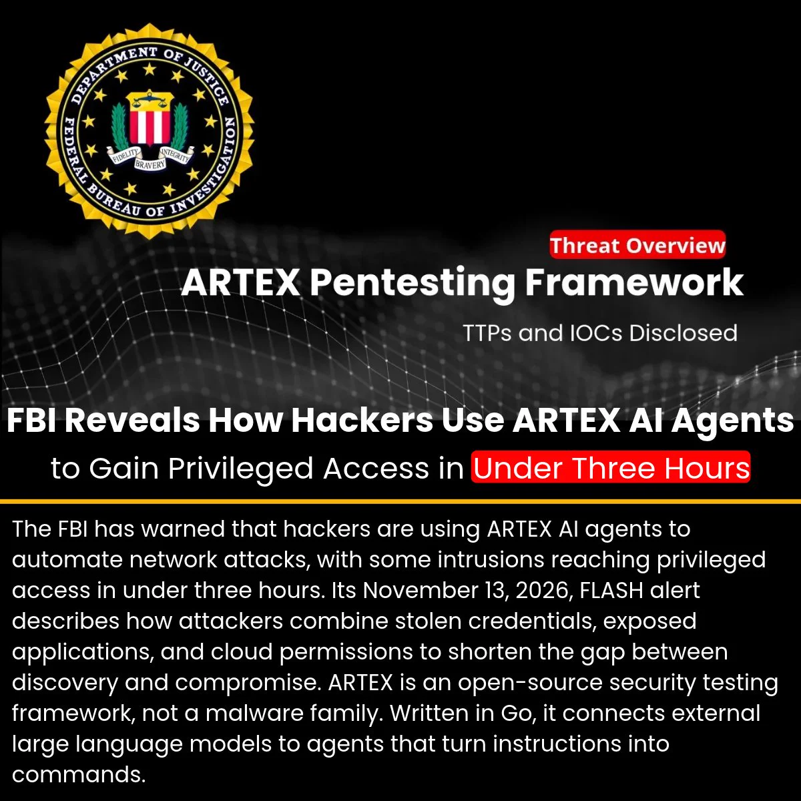
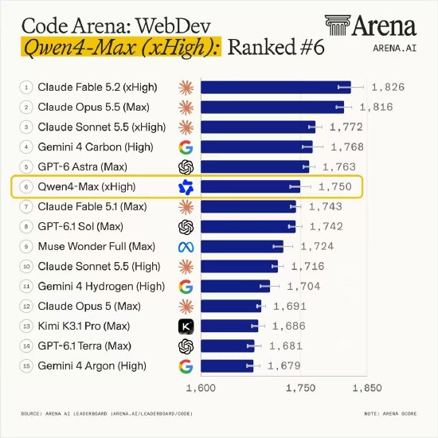
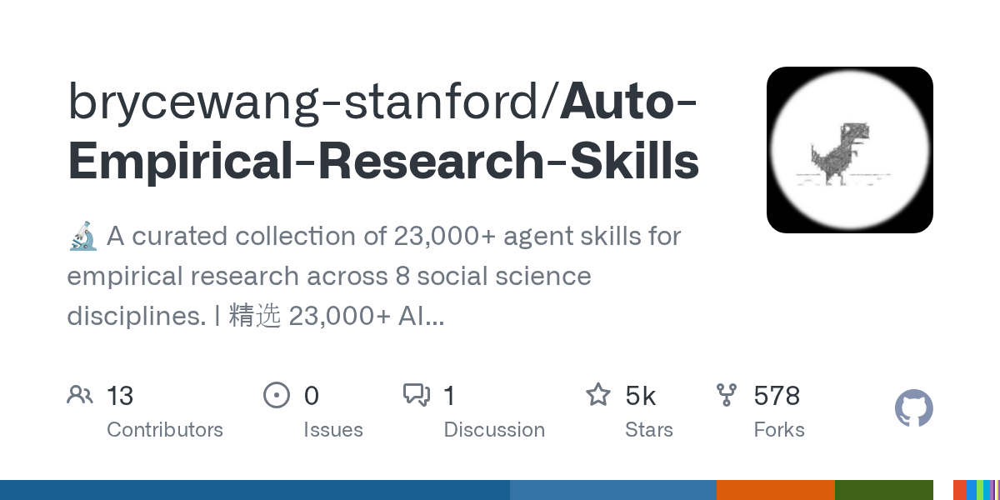
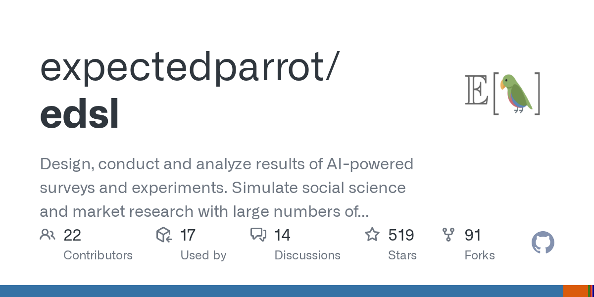
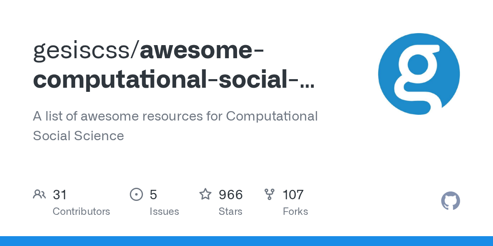
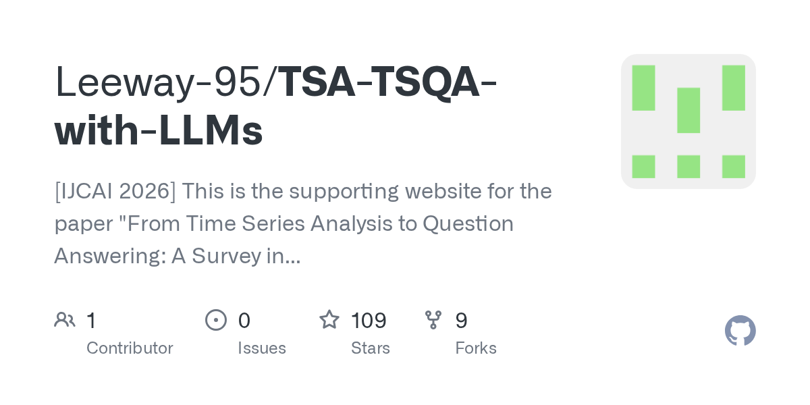

# 3小时拿下最高权限，AI渗透测试已成攻击武器；阿里Qwen4-Max单任务费用降6成

日期：2026-11-16

## 今日分享主题：AI 社会科学研究 (ai-social-science)

本期关注：关注社会学、经济学、政治学、传播学、调查研究和社会数据分析中的 AI 方法。

阅读提示：论文与开源项目围绕这一主题筛选；新闻栏目保留当天最重要的 AI 产业动态，方便把主题线索放进全局变化里看。

## 今日结论

今天最该警惕的一件事：FBI通报称，攻击者用开源AI渗透测试框架ARTEX把入侵流程自动化，部分案例从锁定目标到拿到最高权限用不到3小时——AI安全工具正在被反向武器化。同时，阿里发布Qwen4-Max，宣称单任务平均费用直降6成、总参数2.4T并支持百万上下文，直接把"旗舰模型=贵"的默认印象打了个对折；Anthropic则带着1.4万亿美元估值预期冲向纳斯达克，而OpenAI解散独立机器人团队、称通用大模型已能接管物理AI，赛道逻辑正在重排。另外，一份研究声称DeepSeek、Kimi等中国头部开源模型的训练痕迹指向受限的英伟达Blackwell芯片，出口管制争议再度升温。

---

## 新闻与产业动态

1. **开源AI渗透测试框架ARTEX被FBI点名：3小时拿下最高权限**

   - **来源网站**：cnBeta.COM
   - **原链接**：[开源AI渗透测试框架ARTEX引起FBI关注：从锁定目标到取得最高权限用时不到3小时](https://www.cnbeta.com.tw/articles/tech/1586538.htm)
   - **摘要**：FBI安全通报显示，攻击者正利用开源AI渗透测试框架ARTEX，把网络侦查、漏洞利用、数据窃取等环节串成自动化流水线。自2026年8月以来，多个攻击团伙用ARTEX针对全球金融、政府、科技行业发起行动，部分案例从锁定目标到取得最高权限访问用时不到3小时。这不再是"AI写钓鱼邮件"的低级玩法，而是把专业渗透测试的完整工作流交给了模型。
   - **为什么重要**：它直接抬高了所有联网企业的防守成本——过去需要资深红队数天完成的链条，现在被压缩到小时级，安全团队的响应窗口被大幅挤压。
   - **值得继续跟踪**：ARTEX的具体开源仓库与能力边界、FBI后续是否给出IOC指标，以及金融和政务行业是否出现可验证的受害案例。

2. **阿里发布Qwen4-Max：2.4T参数、百万上下文，单任务费用直降6成**

   - **来源网站**：cnBeta.COM
   - **原链接**：[阿里Qwen4发布：性能升级，性价比更优，单任务平均费用直降6成](https://www.cnbeta.com.tw/articles/tech/1586562.htm)
   - **摘要**：阿里巴巴发布新一代基座大模型Qwen4-Max，总参数2.4T，具备原生视觉能力，支持百万上下文。阿里称基于新架构和训练优化，Qwen4-Max用更少Token实现更高性能，在智能体和编程等关键能力上持续进化，单任务平均费用直降6成。多家外媒报道称阿里宣称其在编码等项上超过GPT-6.1-Sol和Claude Opus 5.5，但这些对比目前主要来自官方口径。
   - **为什么重要**：对重度调用API的企业来说，单任务成本降6成意味着原本卡在预算上的Agent批量任务可以真正跑起来，直接改变模型选型的性价比天平。
   - **值得继续跟踪**：第三方独立评测能否复现"费用降6成"和对标美国旗舰模型的结论，以及百万上下文在真实长文档任务中的实际召回表现。

3. **OpenAI解散独立机器人团队：通用大模型直接接管物理AI**
   - **来源网站**：BigGo Finance
   - **原链接**：[OpenAI Scraps Standalone Robotics Team as General-Purpose Models "Take Over" the Embodied AI Race](https://news.google.com/rss/articles/CBMidkFVX3lxTE45S2lZUnZVTDlENFlwekNGVkphUUsxN0drSlhjSl9mT1NBenN2NDZDQU4xZG8wT1lZWGEtdzRyN3l5YUxnNUZKTWpfczRQb29MdTNlMkZ5NGFpUDNIeEVfR3p1SmNfendXVi1HSXd3b05XOW5zMFE?oc=5)
   - **摘要**：报道称OpenAI已解散独立机器人团队，把研究人员并入核心团队，理由是通用大模型正在"接管"具身AI竞赛。另有报道称GPT-6 Astra在仿真中登上机器人模型榜首，任务耗时11-19秒。中文媒体也跟进解读，认为这印证了通用大模型可直接用于"物理AI"、无需专用模型的判断。
   - **为什么重要**：这是一次组织层面的路线投票——如果通用模型真能覆盖机器人任务，过去两年为机器人单独训模型的投入逻辑就要重算，机器人公司的技术选型也会跟着动摇。
   - **值得继续跟踪**：GPT-6 Astra的11-19秒成绩出自哪个仿真基准、是否可复现，以及OpenAI并入核心组后是否还会保留任何机器人硬件侧投入。

4. **研究称DeepSeek、Kimi等中国模型训练痕迹指向英伟达Blackwell**
   - **来源网站**：Tekedia
   - **原链接**：[Leading Open-Weight Chinese AI Models Trained On Restricted Nvidia Chips, A New Research Claim](https://news.google.com/rss/articles/CBMiugFBVV95cUxOTUVsWjlJVjBfWFFzNlV5ZkhyY0I4cWJyZTl2NHVjTVYtSmNpbVk0clI4czlDN0UyS0t1TnVlNjlWaXBtN28zbDFsb0JUaEo0djUyWEtyM1pwUl81MDZtOXZzcGdGNVdRNTJpWTlSMmRlYlZ3YWFGNTNiNTVlbWZRYUpudW5SbklFWE4tU204dk0yZzBDODhDc24wQXVvSHktR2kyUm1sMUhZX29MSHNiM2hLcVZHN09DbWc?oc=5)
   - **摘要**：一项新研究声称，包括DeepSeek、Kimi在内的中国头部开源AI模型，其训练痕迹指向受出口限制的英伟达Blackwell芯片。韩媒与多家外媒跟进报道称，涉及的模型还包括MiniMax、蚂蚁集团相关模型，甚至点名Kimi K3与DeepSeek V4。需要强调的是，这是研究方的推断性结论，尚无官方确认，检测方法的可靠性本身也待检验。
   - **为什么重要**：如果结论成立，出口管制的实际效果将被直接质疑，美国对华芯片政策的执行成本和可信度都会被重新评估。
   - **值得继续跟踪**：研究方公开的具体检测方法与证据链，以及被点名的中国公司是否作出回应。

5. **美国国会要收紧AI芯片出口规则，黄仁勋风波持续发酵**

   - **来源网站**：theverge.com
   - **原链接**：[Congress wants to tighten export rules on AI chips after Nvidia spy scandal](https://www.theverge.com/ai-artificial-intelligence/1033984/congress-export-rules-ai-chips-china)
   - **摘要**：在黄仁勋相关间谍风波后，美国国会两党均表态支持收紧AI芯片出口规则，已提出多项法案，并要求黄仁勋及其他英伟达高管到国会作证。此前有报道称，与黄仁勋前伴侣关联的公司Megaspeed在2024-2025年间为中国企业撮合了近120亿美元的英伟达芯片订单，做空机构Culper Research估计英伟达实际中国收入占比或超20%，远高于官方披露的7%。
   - **为什么重要**：出口规则一旦收紧，中国AI公司的算力获取路径和美国芯片商的收入结构都会被改写，这是影响整个竞争格局的政策变量。
   - **值得继续跟踪**：具体法案的落地进度、英伟达高管作证时间，以及"实际中国收入占比20%"这一估算能否被更多数据佐证。

6. **郭明錤：英伟达换帅空窗，Google TPU订单能见度延到2029**

   - **来源网站**：cnBeta.COM
   - **原链接**：[郭明錤：英伟达换帅，GoogleTPU借OpenAI、Anthropic订单扩大业务](https://www.cnbeta.com.tw/articles/tech/1586604.htm)
   - **摘要**：天风国际分析师郭明錤称，因英伟达CEO接班人选存在不确定性，Google的TPU芯片正借OpenAI、Anthropic的强劲新订单扩大业务；其产业调查显示，Google TPU出货能见度已延伸至2029年，优于英伟达GPU及其他AI芯片供应商（多数订单能见度为2027年四季度至2028年二季度）。出货能见度指企业能明确看到的未来订单与出货计划时长。
   - **为什么重要**：这直接关系到AI算力供应链的分散化速度——如果TPU真的接住OpenAI和Anthropic的订单，英伟达的垄断溢价会被实质性稀释。
   - **值得继续跟踪**：OpenAI和Anthropic是否公开确认TPU采购规模，以及英伟达新CEO人选落定后订单能见度是否回升。

7. **Anthropic冲刺纳斯达克：寻求1.4万亿美元估值**

   - **来源网站**：cnBeta.COM
   - **原链接**：[Anthropic即将登陆纳斯达克：寻求1.4万亿美元估值 被寄望接替英伟达成为AI新标杆](https://www.cnbeta.com.tw/articles/tech/1586600.htm)
   - **摘要**：据彭博社报道，Anthropic即将进行史上规模最大的首次公开招股，寻求1.4万亿美元估值，被部分投资者寄望接替英伟达成为AI新标杆。《经济学人》评论称，Anthropic的巨型IPO给OpenAI带来了压力。IPO前几天，其Claude Fable 5.2的成本争议也被摆上台面——有报道称其成本比对手高出15倍甚至17倍。
   - **为什么重要**：1.4万亿美元估值会成为整个AI一级市场的定价锚，也把"模型能力"和"商业化兑现能力"的矛盾摆到公开市场聚光灯下。
   - **值得继续跟踪**：正式招股书披露的营收、毛利与算力成本结构，以及高估值能否被真实的企业级收入增长支撑。

8. **Gemini 4 Carbon拿下MathArena榜首，但成本是GPT-6.1 Sol的15倍**

   - **来源网站**：the-decoder.com
   - **原链接**：[Gemini 4 Carbon takes the MathArena crown but costs 15 times more than GPT-6.1 Sol](https://the-decoder.com/gemini-4-carbon-takes-the-matharena-crown-but-costs-15-times-more-than-gpt-6-1-sol/)
   - **摘要**：一段时间以来首次，没有OpenAI模型领跑MathArena数学基准——Google的Gemini 4 Carbon和Anthropic的Fable 5.2把GPT-6.1 Sol挤下榜首，但两者成本都显著更高。测试中Gemini无视时间限制，几乎从不放弃任务。另有报道称Google新Gemini单任务成本约0.82美元，而Anthropic最强模型约4.64美元，两家口径的任务定义并不一致，横向对比需谨慎。
   - **为什么重要**：对预算敏感的用户来说，"更强"和"更贵"被绑在了一起，选型时必须先算单位任务成本，而不是只看榜单名次。
   - **值得继续跟踪**：MathArena官方是否公布各模型的token消耗与成本口径，以及Gemini 4 Carbon"无视时间限制"是否影响评分公平性。

9. **Claude Fable 5.2不生成图像，它用70万笔刷"画"出来**

   - **来源网站**：the-decoder.com
   - **原链接**：[Anthropic's Claude Fable 5.2 doesn't generate images, it paints them](https://the-decoder.com/anthropics-claude-fable-5-2-doesnt-generate-images-it-paints-them/)
   - **摘要**：Anthropic的Claude Fable 5.2不走常规图像生成路线：它不直接计算像素，而是写Python代码，在虚拟画布上放置数十万笔模拟笔触，带笔刷纹理和颜料涂抹效果。据Anthropic员工Jake Eaton称，一张写实停车场场景用了约70万笔。这种方式产出的图像在风格和可控性上与扩散模型截然不同。
   - **为什么重要**：它把"图像生成"变成了"可编辑的代码过程"，设计师和创意工作者可能获得前所未有的逐笔控制力，但也意味着生成速度和成本结构完全不同。
   - **值得继续跟踪**：这种笔触式生成是否开放API、单张图的实际生成耗时与成本，以及在商业设计工作流中的可用性。

10. **豆包工作上线「工作台」：首批21个，覆盖金融、医疗、教育**
   - **来源网站**：CSDN博客
   - **原链接**：[豆包工作上线「工作台」：首批21个，覆盖金融、医疗、教育等场景](https://news.google.com/rss/articles/CBMiZ0FVX3lxTE0tYjRYd0l2NDZCMGRoVk42T1oyZjJoZjFGdF9nMTB3MXBreUhfRnA3Zmh1Y0hvNF9Pd3MwZWNoaDFIeTFWN1RicXg4TlczcVFhVUFBbU5nbGxOR2YwRmxpTlVTZ0NhbDA?oc=5)
   - **摘要**：字节旗下豆包工作上线「工作台」功能，首批上线21个，覆盖金融、医疗、教育等场景。这是把通用大模型能力封装成具体行业岗位工作台的尝试，用户不再需要自己写提示词，而是直接进入预设好的场景化入口。具体每个工作台的功能细节和实际效果，候选源显示信息仍较有限。
   - **为什么重要**：对普通职场用户来说，这降低了使用门槛——从"会写提示词才能用AI"变成"点开就能干活"，是AI工具从极客玩具走向办公标配的关键一步。
   - **值得继续跟踪**：21个工作台的具体功能清单、实际用户反馈，以及是否支持企业自定义接入。

11. **Gemini Robotics 2.5发布：灵巧性和工业能力升级**
   - **来源网站**：Robotics & Automation News
   - **原链接**：[Google DeepMind launches Gemini Robotics 2.5 with improved dexterity and industrial capabilities](https://news.google.com/rss/articles/CBMi6AFBVV95cUxOcEFaUHVBNmxBYUNlSDZYOTlfTlhHN2xKSmdJT0ExNXNNVlo5YlRJNnpoWjF5LUJkZEhoS3lTcUktRkRPLXEtMGV1ZWt5N3VPbklPbEFqUzFibGVEYUp5enNBWS1rOXZkTGNVY2pHSEtSNVU0LV9Pc3VBSkl0Mk9XZzZpY3pIaUdYa0Z3cXdZVDZDMEdURloyMWVIbnEwLURqWDJvTTdhN3lTVHd0Y1Zjc0kwX21heldUQ2xBLTVPQmpEcGFZVExGaXlpVGt2cF9DOW9tblBZMVlhaFBLNW1GYkNLWlEyVjNr?oc=5)
   - **摘要**：Google DeepMind发布Gemini Robotics 2.5，主打灵巧性提升和工业场景能力。另有报道称该模型对应的人形机器人已在奔驰工厂工作。这是Google把多模态大模型能力向工业机器人落地的又一步，但候选源对具体灵巧性指标和部署规模披露有限。
   - **为什么重要**：工业机器人长期卡在"通用性差、部署成本高"上，如果大模型真能提升灵巧性和泛化能力，制造业的自动化改造成本结构会被改写。
   - **值得继续跟踪**：奔驰工厂的实际部署台数、任务成功率数据，以及Gemini Robotics 2.5是否开放给第三方机器人厂商。

12. **美团开源LongCat-2.5：1.6万亿参数Agent模型，全程国产芯片训练**
   - **来源网站**：TradingView
   - **原链接**：[美团开源1.6万亿参数智能体模型LongCat-2.5，全程基于国产芯片训练](https://news.google.com/rss/articles/CBMiZkFVX3lxTE9SRW5EemN4N3c4d0g1SGJ4Ui03bnRuWXB6RW5SX1IzVG00eXlYdzdrZVVZX1RiVjVnNmtMd3daRG03dERULVVJYnNwWGVwT2oyc1VlSDdBVllvX1pEYThGbjJzNEoxQQ?oc=5)
   - **摘要**：美团开源1.6万亿参数MoE智能体模型LongCat-2.5，全程基于国产芯片训练。智源社区的跟进报道指出，其自托管指南未提供Nvidia GPU路径——这既体现了国产算力适配的决心，也意味着海外开发者想自托管会遇到额外门槛。模型主打Agent能力，与美团自身的本地生活业务场景高度相关。
   - **为什么重要**：1.6万亿参数的开源Agent模型直接给国内开发者提供了可自托管的旗舰级选择，同时国产芯片全程训练的路径为供应链安全提供了一个可参考样本。
   - **值得继续跟踪**：模型权重的实际下载量与社区微调生态，以及非Nvidia硬件上的推理性能实测数据。

13. **阿里Qwen4-Max强化网络安全护栏，主打"安全的旗舰模型"**
   - **来源网站**：South China Morning Post
   - **原链接**：[Alibaba launches Qwen4-Max model with strict cybersecurity guardrails](https://news.google.com/rss/articles/CBMi1AFBVV95cUxQaHl0ZVByMTFnMVVaU2h5UFBhMzFaVmFKQi1pcGhPb3lLeTdjdGh4TkpnU0FPUVAyMU9rYjV2UkhFdjhOUHRDVUFMRm9seUVzWDRzeno1YllqLVpmY3R6WmI5bnJSS1lkeFAzSm1lM1pkWnAtclpOQmxRWFVwMmZaVjE2cy1KYzRJcEw5RUVIbVExdlhveFJYLU1HRTFSVERTV2VzdHFtS1J2SE1PMjBFbVNYMFNRSmZmT3FtV2kxYUd0QmdBSkJMb3pGUWJTUGFzcC1wYtIB1AFBVV95cUxPWS1MdnU4cWMyN3ktNnVyR2Vtcnhqa1hUVHUxeUxTRDhIUVRjRkJsNmlIM1RDWUFGSkgxeHIxR0h2NUU4WUJ5d3h2eFhKVXU2ekdLRkhSbmpVdHVRaDJrOXhOTkpyOW4ya2dpdDVQb0JVd3Y3UXFfU19fLXNHelFNUnhncDMwTS1yQWFkc1F3SFZoM0ZMZGFIRGhwNS1CRzd4UXRXOUtnS21UMHRZLUNUNlp0cmZtMWVvRUhSaE53UFFrbmQ3SHRQaTRxUVRFVmE4VmZZdw?oc=5)
   - **摘要**：南华早报报道，阿里发布Qwen4-Max时特别强调严格的安全护栏设计，主打网络安全防御能力。在ARTEX这类AI攻击工具泛滥的背景下，模型厂商主动强化安全属性，反映出企业级客户对"可控部署"的硬需求。多家外媒也报道了该模型在编码能力上对标美国旗舰的宣称。
   - **为什么重要**：对企业采购方来说，模型的安全护栏直接决定能否通过内部安全审查——这是一道真实的采购门槛，不是营销话术。
   - **值得继续跟踪**：阿里是否公布安全护栏的具体技术细节和第三方审计结果，以及在红队测试中的实际表现。

14. **UiPath推出AI编码Agent，集成Claude Code和Codex**
   - **来源网站**：BigGo Finance
   - **原链接**：[UiPath Launches AI Coding Agent, Integrates Claude Code and Codex to Target Development Automation](https://news.google.com/rss/articles/CBMidkFVX3lxTE1XOC0zY09sVnNSLVlDOXhfeF9xeUhBcFM3QVIyd2dmOHhmYW05WkxDR3ZXM3k4cDU1WXF3UEszVDVSdEZyaFlqbTdBQmlzb1M3YmFzOWpTSzBmOHdkRVlTZHFxWm5LUS1CWTNQWUI3RXNoaXFwWVE?oc=5)
   - **摘要**：RPA厂商UiPath推出AI编码Agent，集成Anthropic的Claude Code和OpenAI的Codex，目标是开发流程自动化。这标志着UiPath从传统RPA向AI Agent开发平台的延伸——不再只是模拟点击，而是让Agent直接参与代码编写和软件交付流程。候选源对具体集成方式和定价披露有限。
   - **为什么重要**：UiPath手握大量企业RPA客户，把编码Agent塞进现有工作流，等于给存量客户一个"零迁移成本"的AI开发入口，可能抢走一部分独立编码工具的市场。
   - **值得继续跟踪**：UiPath客户实际采用编码Agent的比例，以及与Claude Code、Codex原生体验相比的差异化价值。

15. **华为云开源具身世界模型CloudRobo-WM1.2**
   - **来源网站**：金融界
   - **原链接**：[华为云开源具身世界模型CloudRobo-WM1.2](https://news.google.com/rss/articles/CBMib0FVX3lxTE1HV0tuTk41dmV0S0ZSVllObDBmc3NpNlg1OVVOM2x6U2ROM01qc2taWHlIR1d6elR4WEtCbmdFc0h6bmVTb1pmcWhpSVk3cXhxQlJydWZJY3UtbU5iUVdiTF9Eb01VQ1hZRk5PV0V4MA?oc=5)
   - **摘要**：华为云开源具身世界模型CloudRobo-WM1.2。世界模型是让机器人理解物理环境、预测动作后果的关键组件，华为云选择开源这条路径，与此前媒体报道的"华为云将举行具身世界模型发布会"相呼应。候选源对模型参数、支持的机器人本体和实际部署案例披露有限。
   - **为什么重要**：具身智能长期缺一套可用的"世界模型基座"，华为云开源给国内机器人厂商提供了一个可自研改造的起点，可能降低行业整体研发门槛。
   - **值得继续跟踪**：模型的实际开源协议、支持的机器人硬件清单，以及是否有可验证的工业部署案例。

---

## 论文精选

（今日论文候选池为空，无内容。）

---

## 开源项目精选

1. **brycewang-stanford/auto-empirical-research-skills**

   - **来源网站**：GitHub
   - **GitHub Star**：5041
   - **原链接**：[brycewang-stanford/Auto-Empirical-Research-Skills](https://github.com/brycewang-stanford/Auto-Empirical-Research-Skills)
   - **摘要**：一个覆盖8大社会科学学科、超过23,000条Agent技能的精选库，专为实证研究设计，涉及经济学、政治学、社会学、心理学、国际关系、传播学、教育学和公共管理。项目由斯坦福REAP的CoPaper.AI维护，宣称20分钟完成一篇可复现的规范实证论文，并支持用户上传自定义Skills。主要语言为Stata，说明它面向的是社会科学主流的计量分析工作流。
   - **为什么重要**：它直接抢走社会科学研究生和研究助理最耗时的一步——从数据清洗、模型设定到结果表生成的重复性劳动，把实证研究的门槛从"会写Stata"降到"会描述研究问题"。
   - **值得继续跟踪**：23,000条技能的实际质量和去重情况，以及生成的论文能否通过同行评审对可复现性的检验。

2. **expectedparrot/edsl**

   - **来源网站**：GitHub
   - **GitHub Star**：519
   - **原链接**：[expectedparrot/edsl](https://github.com/expectedparrot/edsl)
   - **摘要**：一个用于设计、执行和分析AI驱动的调查与实验的Python框架，可以用大量AI Agent和LLM模拟社会科学研究和市场调研。它提供领域特定语言（DSL）来声明调查设计，支持多模型后端（OpenAI、Anthropic、Llama等），并能生成合成数据。最近一次推送就在2026年11月15日，社区活跃度很高。
   - **为什么重要**：对市场调研和社会科学团队来说，它把"跑一轮问卷调查"的成本从数周压到数小时，同时保留了实验设计的严谨结构，而不是简单地让LLM瞎编答案。
   - **值得继续跟踪**：AI模拟受访者与真实人群在关键变量上的分布差异，以及框架在正式学术论文中的实际引用情况。

3. **gesis24csspy/agent-based-modelling**
   - **来源网站**：GitHub
   - **GitHub Star**：5
   - **原链接**：[gesis24csspy/agent-based-modelling](https://github.com/gesis24csspy/agent-based-modelling)
   - **摘要**：GESIS计算社会科学秋季研讨会的Agent-Based Modelling（ABM）模块课程材料，基于John McLevey 2024年《Introduction to Computational Social Science with Python》。内容为HTML格式，面向需要在社会科学研究中构建基于Agent仿真模型的研究者，涵盖从模型设定到仿真实验的完整流程。
   - **为什么重要**：ABM是研究社会 contagion、舆论演化、制度变迁等复杂现象的核心方法，但学习曲线陡峭——这套课程材料给非计算机背景的社会科学家提供了一个可直接上手的入口。
   - **值得继续跟踪**：课程材料是否包含可运行的示例代码和数据集，以及GESIS后续是否更新以纳入LLM驱动的Agent建模内容。

4. **gesiscss/awesome-computational-social-science**

   - **来源网站**：GitHub
   - **GitHub Star**：966
   - **原链接**：[gesiscss/awesome-computational-social-science](https://github.com/gesiscss/awesome-computational-social-science)
   - **摘要**：由GESIS维护的计算社会科学资源精选列表，涵盖网络分析、文本挖掘、Python和R等相关工具与文献。作为该领域的权威导航清单，它帮助研究者快速定位可用的数据集、方法论资源和软件工具，而不是在海量信息中盲目搜索。
   - **为什么重要**：对刚进入计算社会科学领域的研究者来说，这份清单直接省掉了数周的文献和工具调研时间，是"从零到一"最经济的起点。
   - **值得继续跟踪**：列表是否持续纳入AI/LLM相关的新方法和数据集，以及资源条目的实际可用性验证。

5. **compsocialscience/summer-institute**
   - **来源网站**：GitHub
   - **GitHub Star**：388
   - **原链接**：[compsocialscience/summer-institute](https://github.com/compsocialscience/summer-institute)
   - **摘要**：计算社会科学暑期研究所（Summer Institutes in Computational Social Science）的官方仓库，包含历年课程材料、讲义和项目资源。这是一个成熟的学术培训项目，为来自不同学科的研究者提供密集的计算方法训练，内容覆盖数据收集、网络分析、文本挖掘和机器学习在社会科学研究中的应用。
   - **为什么重要**：它为社会科学界提供了一个标准化的计算方法培训路径，许多后来在该领域产出重要研究的学者都出自这个体系——这是在培养"会用AI做社会科学研究"的人，而不只是提供工具。
   - **值得继续跟踪**：暑期研究所最新一期的课程大纲是否加入LLM和Agent相关模块，以及往期学员的研究产出情况。

6. **leeway-95/tsa-tsqa-with-llms**

   - **来源网站**：GitHub
   - **GitHub Star**：109
   - **原链接**：[Leeway-95/TSA-TSQA-with-LLMs](https://github.com/Leeway-95/TSA-TSQA-with-LLMs)
   - **摘要**：IJCAI 2026论文《From Time Series Analysis to Question Answering: A Survey in the LLM Era》的配套网站。该综述系统梳理了LLM时代时间序列分析与问答（TSQA）的研究进展，对需要处理时序数据的社会科学研究者（如经济周期分析、舆论趋势追踪、调查面板数据）具有直接参考价值。
   - **为什么重要**：时序问答是把非结构化研究问题转化为可计算分析的关键桥梁——研究者可以用自然语言提问，让LLM直接在时序数据上执行分析，省去编写专门查询代码的步骤。
   - **值得继续跟踪**：综述中提到的TSQA方法是否有开源实现，以及在真实社会经济数据上的准确率表现。

7. **higherbar-ai/ai-workflows**
   - **来源网站**：GitHub
   - **GitHub Star**：7
   - **原链接**：[higherbar-ai/ai-workflows](https://github.com/higherbar-ai/ai-workflows)
   - **摘要**：一个支持AI工作流的工具包，明确面向社会科学研究和项目评估等场景。以Jupyter Notebook为主要形式，提供可直接运行的工作流模板，帮助研究者把LLM能力嵌入到数据收集、分析和报告生成的完整研究链路中，而不是只在单一环节调用模型。
   - **为什么重要**：对独立研究者和小型评估团队来说，现成的工作流模板省去了从零搭建LLM集成的工程成本，让AI能力真正落到"从数据到结论"的全流程。
   - **值得继续跟踪**：工具包覆盖的具体工作流类型、模板的实际可复用性，以及是否有真实研究项目采用的案例。

8. **icyfeather233/awesome-llm-agent-trajectory-analysis**
   - **来源网站**：GitHub
   - **GitHub Star**：57
   - **原链接**：[IcyFeather233/Awesome-LLM-Agent-Trajectory-Analysis](https://github.com/IcyFeather233/Awesome-LLM-Agent-Trajectory-Analysis)
   - **摘要**：已被TSE 2026接收的综述《A Survey for LLM Agent Trajectory Analysis: From Failure Attribution to Enhancement》的配套资源库。它系统整理了LLM Agent轨迹分析的研究方向，从失败归因到能力增强，对需要理解和改进Agent行为的社会科学研究者（如用Agent模拟社会互动、自动化数据编码）具有直接参考价值。
   - **为什么重要**：当社会科学家用Agent模拟人群行为时，"Agent为什么做出这个决策"和"如何改进Agent的决策质量"是核心问题——这份综述提供了系统的方法论地图。
   - **值得继续跟踪**：综述中提到的失败归因方法是否有开源工具实现，以及在社会科学Agent模拟场景中的实际适用性。

9. **gesis24csspy/introduction-to-python**
   - **来源网站**：GitHub
   - **GitHub Star**：5
   - **原链接**：[gesis24csspy/introduction-to-python](https://github.com/gesis24csspy/introduction-to-python)
   - **摘要**：GESIS计算社会科学研讨会的Python入门课程材料，即"Python 101 for Researchers"，基于John McLevey 2024年的教材。面向没有编程背景的社会科学研究者，从最基础的Python语法讲起，目标是让研究者能独立完成数据处理和分析任务，而不是成为软件工程师。
   - **为什么重要**：这是社会科学AI化的第一块基石——不会Python的研究者无法有效利用LLM和Agent工具，这份材料直接补上了这个能力缺口。
   - **值得继续跟踪**：课程是否包含与LLM API交互的实操内容，以及学员完成课程后在实际研究中的应用情况。

10. **activetigger/activetigger**
   - **来源网站**：GitHub
   - **GitHub Star**：53
   - **原链接**：[activetigger/activetigger](https://github.com/activetigger/activetigger)
   - **摘要**：一个专为计算社会科学设计的文本标注Web工具，基于Python构建。文本标注是内容分析、话语分析、调查开放题编码等社会科学研究的核心环节，传统上依赖人工逐条编码，耗时且难以保证一致性。Activetigger提供了一个Web界面来组织和执行标注任务。
   - **为什么重要**：它直接切入社会科学研究中最枯燥、最耗人力的一步——如果能与LLM预标注结合，可以大幅减少人工复核的工作量，同时保留研究者对编码质量的最终控制权。
   - **值得继续跟踪**：工具是否已集成LLM辅助标注功能，以及在真实研究项目中的标注一致性和效率提升数据。

---

## 今日优先阅读排序

1. **开源AI渗透测试框架ARTEX被FBI点名：3小时拿下最高权限** — 安全从业者和所有联网企业必须先看，这是今天最有代价的一条。
2. **阿里发布Qwen4-Max：2.4T参数、百万上下文，单任务费用直降6成** — 直接影响模型选型和API预算，开发者和企业采购必看。
3. **美国国会要收紧AI芯片出口规则，黄仁勋风波持续发酵** — 政策变量，影响整个AI算力供应链格局。
4. **研究称DeepSeek、Kimi等中国模型训练痕迹指向英伟达Blackwell** — 出口管制争议的核心证据，但需注意这是研究方推断。
5. **OpenAI解散独立机器人团队：通用大模型直接接管物理AI** — 组织层面的路线投票，机器人行业技术选型会跟着动摇。
6. **郭明錤：英伟达换帅空窗，Google TPU订单能见度延到2029** — 算力供应链分散化的关键信号。
7. **Anthropic冲刺纳斯达克：寻求1.4万亿美元估值** — AI一级市场定价锚，招股书细节值得等。
8. **美团开源LongCat-2.5：1.6万亿参数Agent模型，全程国产芯片训练** — 国内开发者可自托管的旗舰级Agent模型。
9. **brycewang-stanford/Auto-Empirical-Research-Skills** — 23,000+技能库，社会科学实证研究的效率杠杆。
10. **豆包工作上线「工作台」：首批21个，覆盖金融、医疗、教育** — AI工具从极客玩具走向办公标配的信号。
