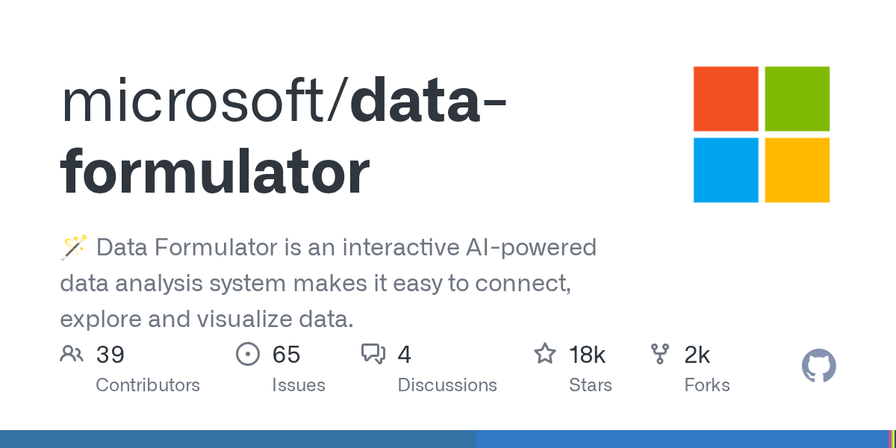
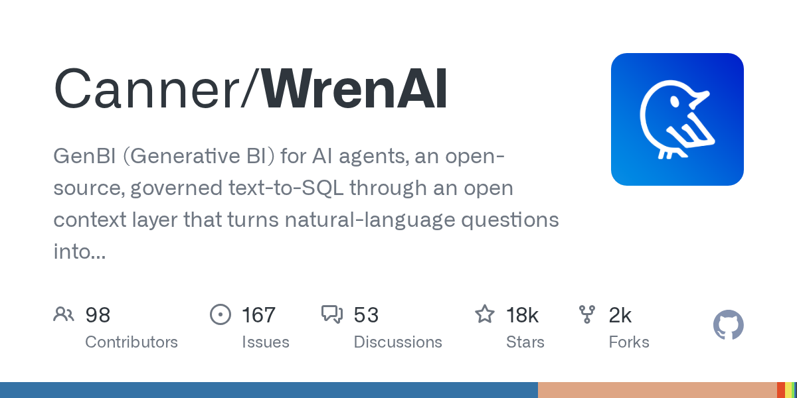
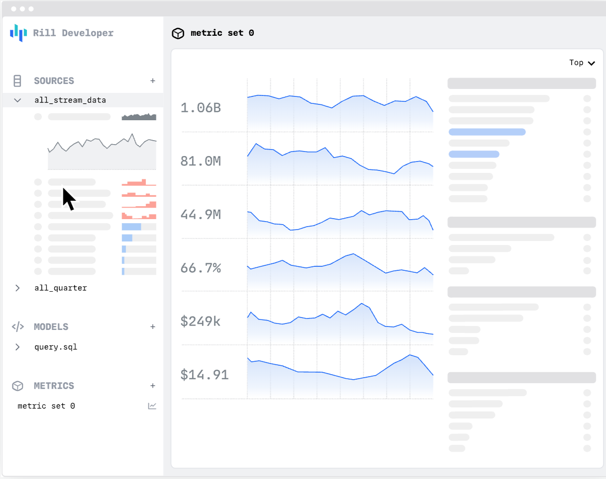
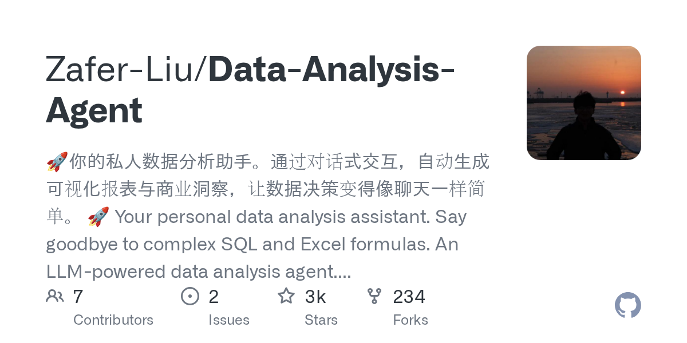
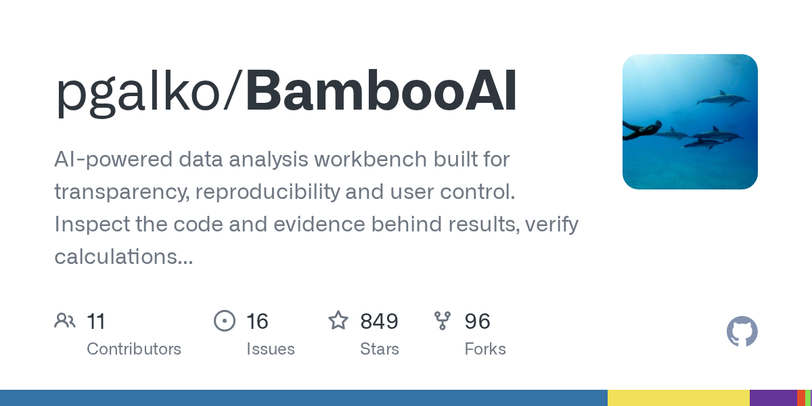
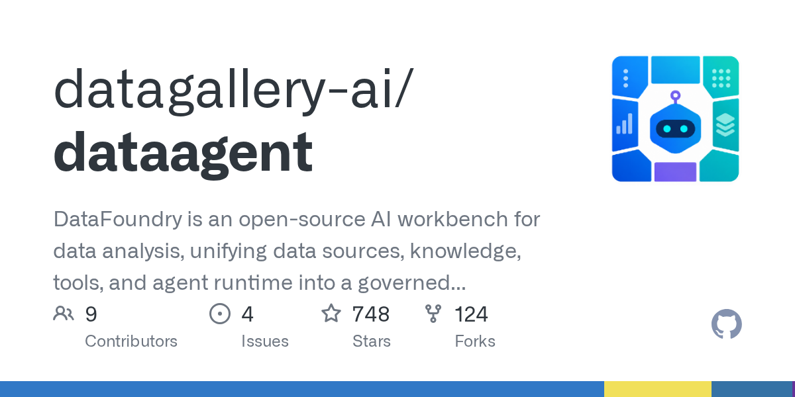
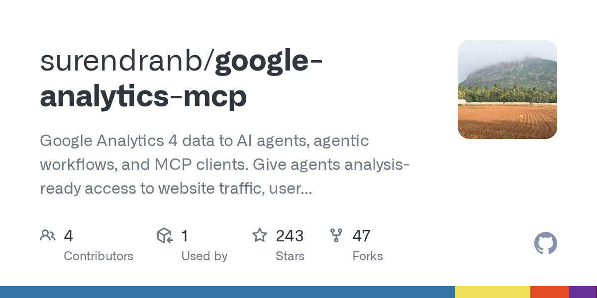
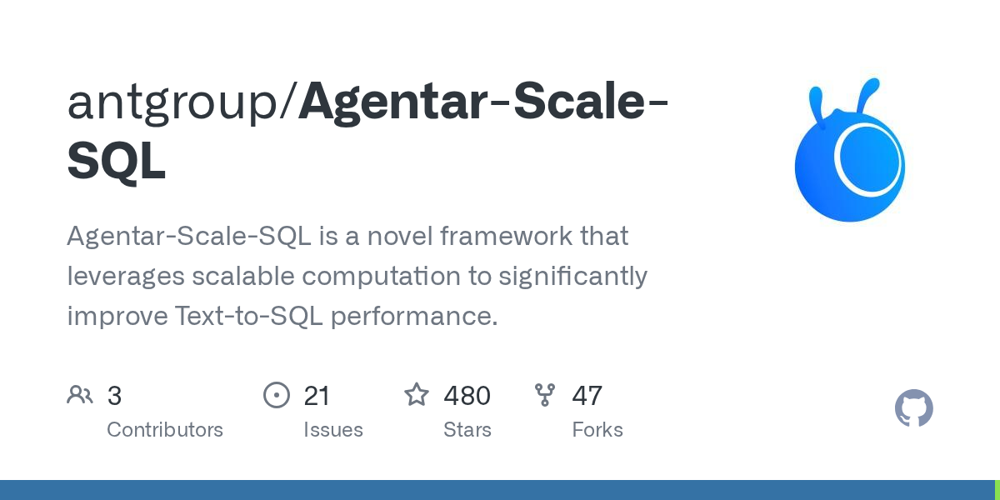
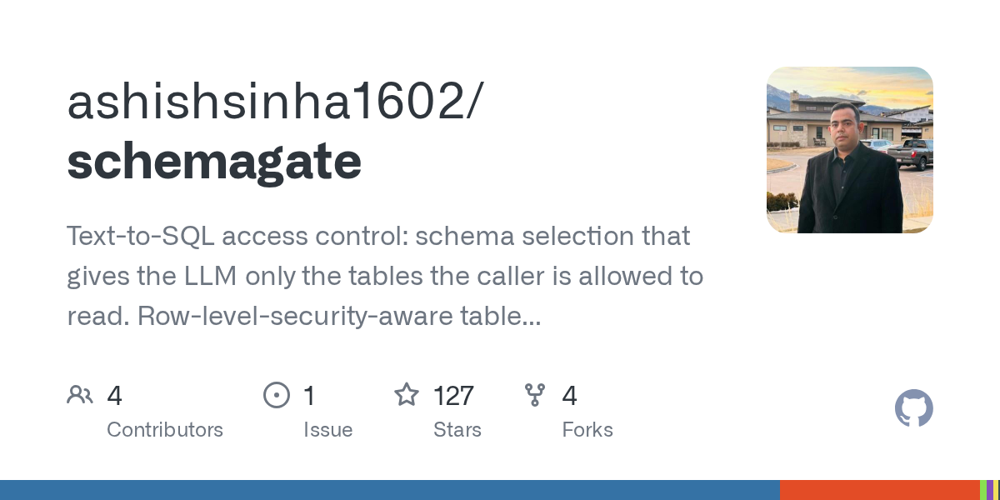

# AI 造芯 5 个月干完一年的活，黎曼猜想却卡在没人读得懂

日期：2026-11-22

## 今日分享主题：AI 数据分析与经营决策 (ai-data-analysis)

本期关注：关注 BI、自然语言查询、报表、数据可视化、经营复盘和从数据到行动的分析闭环。

阅读提示：论文与开源项目围绕这一主题筛选；新闻栏目保留当天最重要的 AI 产业动态，方便把主题线索放进全局变化里看。

## 今日结论

今天最反常识的一条是：OpenAI 报告称大模型已深度参与 AMD 旗舰 GPU 电路设计，拿到最高 14% 的 PPA 提升，还把约一年的工程优化压到不足 5 个月，部分 AI 生成的优化已送厂流片——芯片设计这个最贵、最慢的环节，第一次有了可交付的 AI 产出。但同一天数学界给了个冷脸：Anthropic 数学家宣称用 Claude 证明了黎曼猜想，随附 1700 万行 Lean 代码、超 25 万页证明文件，却没有可供通读的论文正文，菲尔兹奖得主邓煜直接说"可读版本出现以前不评论"，几小时后斯坦福还放出一份纯人类竞争性证明。能干活和能被验证，是两件事。另外三条值得盯：Anthropic 上市次日跌 8.5%，连带台股创 35 年最差单周、纳斯达克 100 陷入熊市；Signal 直接限制截图来挡系统级 AI 读屏；美国大行开始把 AI Agent 操作失误的责任推给客户。

---

## 新闻与产业动态

1. **AI 造芯真能成：一年的活 5 个月干完，已送厂流片**
   - **来源网站**：cnBeta.COM
   - **原链接**：[AI造芯真能成 一年的活5个月干完：AMD已经拿去送厂流片](https://www.cnbeta.com.tw/articles/tech/1587388.htm)
   - **摘要**：OpenAI 11月18日发布技术报告，披露其大模型已深度参与 AMD 芯片设计流程，在这家芯片厂旗舰 GPU 的电路设计上拿到最高 14% 的 PPA（性能、功耗、面积）提升。更关键的是，部分 AI 生成的优化已经进入近期送厂制造的芯片设计。按 OpenAI 的说法，这次合作把大约一年的工程优化工作压缩到不足 5 个月。这是 AI 第一次在最重资产、最长周期的硬件工程环节交出可流片的实物产出，而不是停在论文或 demo。
   - **为什么重要**：它抢走的是芯片后端工程里最耗人力的迭代环节，直接压缩 tape-out 前的优化周期，影响的是 AMD、英伟达这类芯片厂和所有依赖先进制程的 AI 算力供给方的成本结构。
   - **值得继续跟踪**：盯流片后的实测硅片数据——14% PPA 提升是否在真实芯片上兑现，以及这套流程能否复制到其他 IP 和制程节点。

2. **黎曼猜想"AI 证明"卡住了：1700 万行代码，没有一篇能读的论文**

   - **来源网站**：cnBeta.COM
   - **原链接**：[AI证明黎曼猜想？2026年菲尔兹奖得主邓煜：在可读版本出现以前不评论](https://www.cnbeta.com.tw/articles/science/1587432.htm)
   - **摘要**：Anthropic 数学家莱文特·阿尔珀格 11月20日声明，称借助 Claude 找到了广义黎曼猜想的证明。随声明公开的是一份 4 页说明和 14 个压缩包，内含约 1700 万行用 Lean 编写的形式化代码，但没有附可供数学界通读的论文正文。2026 年菲尔兹奖得主邓煜的回应很直接：在可读版本出现以前不评论。已困扰人类 167 年、2000 年列入七大千禧年难题的黎曼猜想，这次的门槛不是"有没有证明"，而是"有没有人能审"。
   - **为什么重要**：它暴露了 AI 科研协作的真实断点——机器能生成海量形式化代码，但同行评议仍依赖人类可读的论证链条，这会直接影响学界对 AI 产出数学成果的接受流程。
   - **值得继续跟踪**：等可读论文正文或 Lean 代码的第三方形式化审查结果，看这份证明是被接受、被找出漏洞，还是长期悬置。

3. **同日两份黎曼猜想证明：一份靠 AI，一份纯人类，都没验证**

   - **来源网站**：cnBeta.COM
   - **原链接**：[Claude宣称攻克黎曼猜想数小时后 斯坦福数学家公布纯人类证明](https://www.cnbeta.com.tw/articles/science/1587454.htm)
   - **摘要**：据 The Decoder 报道，Anthropic 数学家宣布与 Claude 合作找到广义黎曼猜想证明后仅数小时，斯坦福大学研究人员就公开了一份完全由人类独立完成的竞争性证明草稿。两份成果目前均待数学界进一步验证。科技趋势通讯《Exponential View》作者 Azeem Azhar 也撰文关注这场特殊竞赛，指出两份证明几乎同时进入公众视野，但都未获最终确认。一场 167 年悬案，一天内出现 AI 协作与纯人类两条路径。
   - **为什么重要**：它把"AI 能否做数学"的争论从假设推到了可对比的现实——同一问题、两条路径、同样未验证，评议压力现在平等地压在两边。
   - **值得继续跟踪**：对比两份证明的核心引理和验证进度，看数学界先对哪一份给出实质性技术反馈。

4. **丘成桐回应：兴奋的时代，也是危险的时代**
   - **来源网站**：36氪
   - **原链接**：[丘成桐回应AI辅助证明黎曼猜想](https://36kr.com/newsflashes/4080470183253125?f=rss)
   - **摘要**：针对 Anthropic 数学家宣称与 Claude 合作证明黎曼猜想，丘成桐在接受采访时回应：这是一个很兴奋的时代，也是很危险的时代，我认为还是数学家占主导的，将数学整个平台提升到另一个水平。他同时表示，找到真理有很多不同的方法，我们还是要鼓励的。这番表态没有直接背书证明本身，而是把焦点拉回"数学家仍占主导"这一前提。
   - **为什么重要**：顶级数学家的公开定调会影响学界对 AI 辅助证明的接受速度，也给"AI 抢走数学家工作"的焦虑划了一条更冷静的边界。
   - **值得继续跟踪**：看后续是否有更多数学权威对证明的技术细节给出具体评价，而非停留在态度层面。

5. **Anthropic 上市次日跌 8.5%，募资 1195 亿美元**

   - **来源网站**：cnBeta.COM
   - **原链接**：[IPO融资额增至1195亿美元 Anthropic股价大跌超8%](https://www.cnbeta.com.tw/articles/tech/1587390.htm)
   - **摘要**：据彭博社报道，Anthropic 股价周五大跌，回吐上市首日部分涨幅。周五盘中一度暴跌，几乎跌至 83 美元的 IPO 发行价，随后收窄跌幅，最终收于每股 88.91 美元，较周四上市首日收盘价下跌 8.5%。按此计算市值约 1.6 万亿美元，仍位居全球市值最高 15 家上市公司之列。IPO 融资额增至 1195 亿美元，此前 36氪报道其首日按完全稀释口径市值一度约 2.08 万亿美元。
   - **为什么重要**：这直接检验市场对 AI 头部公司万亿估值的承接力，股价波动会传导到整个 AI 板块的融资成本和一级市场定价。
   - **值得继续跟踪**：观察股价是否守住发行价，以及后续财报能否用营收增速支撑当前市值口径。

6. **AI 交易行情崩塌：台股创 35 年最差单周**
   - **来源网站**：cnBeta.COM
   - **原链接**：[AI交易行情崩塌 台股创下35年来最差单周表现](https://www.cnbeta.com.tw/articles/tech/1587276.htm)
   - **摘要**：Anthropic 这场万众瞩目的 IPO 反倒引燃了人工智能板块的猛烈抛售潮。受 Anthropic 盘后走弱拖累，芯片股大幅下挫，各大核心科技指数触及熊市关口。台湾加权指数周五收跌 6.2%，创下 1991 年以来最差单周表现；韩国综合指数本周累计跌幅有望达到 8%；日经 225 指数回落至今年 4 月水平。AI 概念的估值压力正在从美股扩散到亚太供应链。
   - **为什么重要**：台韩日是全球芯片与 AI 硬件供应链的腹地，这轮抛售直接影响上游晶圆、存储和封测厂商的融资环境与订单预期。
   - **值得继续跟踪**：看下周亚太市场是否企稳，以及英伟达、台积电等权重股的止跌信号。

7. **英伟达一周蒸发近 9000 亿美元，SEC 查会计**

   - **来源网站**：cnBeta.COM
   - **原链接**：[离职风波未平又遭SEC会计调查 英伟达本周市值蒸发近9000亿美元跌出美股前三](https://www.cnbeta.com.tw/articles/tech/1587384.htm)
   - **摘要**：英伟达度过了历史上最糟糕的一周，如今美国政府监管机构正就其账目问题提出质疑。报道称美国证券交易委员会（SEC）的调查正在审查潜在会计问题影响，英伟达股价周五暴跌近 14%，创下自 2025 年 1 月以来的最差单日表现，并录得连续第七个交易日下跌，本周市值蒸发近 9000 亿美元，跌出美股前三。此前还有离职风波未平。
   - **为什么重要**：英伟达是 AI 算力供应链的定价锚，其市值和监管风险会直接改变整个 AI 基础设施板块的风险偏好。
   - **值得继续跟踪**：SEC 调查是否升级为正式执法，以及会计问题是否涉及 AI 数据中心收入确认口径。

8. **纳斯达克 100 陷入熊市，创疫情以来最差单周**

   - **来源网站**：the-decoder.com
   - **原链接**：[US technology stocks suffer their worst weekly loss since the pandemic as AI doubts pile up](https://the-decoder.com/us-technology-stocks-suffer-their-worst-weekly-loss-since-the-pandemic-as-ai-doubts-pile-up/)
   - **摘要**：纳斯达克 100 指数在经历新冠疫情以来最糟糕的一周后跌入熊市。英伟达暴跌 14%，因 SEC 正在审查其会计问题；Anthropic 在创纪录 IPO 一天后几乎回吐全部涨幅。AI 疑虑、丑闻、利率上升和政治逆风同时冲击着过热的估值。这不是单一公司的问题，而是市场对 AI 叙事的一次集体重定价。
   - **为什么重要**：科技股整体重定价会抬高 AI 初创公司的后续融资门槛，也会让企业客户在 AI 采购上更谨慎地算 ROI。
   - **值得继续跟踪**：观察这轮调整是估值消化还是趋势反转，重点看 AI 相关营收增速能否在下个财报季跟上股价预期。

9. **Signal 直接限制截图，挡的就是系统级 AI 读屏**
   - **来源网站**：theverge.com
   - **原链接**：[Signal is blocking Gemini and Siri AI from reading your screen](https://www.theverge.com/ai-artificial-intelligence/1038390/signal-blocking-ai-agent-screenshots-mobile-app)
   - **摘要**：Signal 正在限制 Android 和 iOS 设备上的截图功能，以防止 AI 代理读取用户消息和其他数据。Signal 总统表示，操作系统内置的 agentic AI 能力会分析屏幕信息以更多了解用户，这"破坏了 Signal 独立保证隐私的能力"。这是隐私应用第一次用产品级限制，直接对抗手机厂商的 AI 读屏功能。
   - **为什么重要**：它把"AI 便利"和"端到端隐私"的冲突摆上台面，会影响所有依赖屏幕上下文的 AI 助手在敏感应用中的可用性。
   - **值得继续跟踪**：看苹果和谷歌是否会为 Signal 这类应用开放白名单机制，以及是否引发更多隐私应用跟进。

10. **美国大行警告：AI Agent 把钱弄错，客户自己负责**
   - **来源网站**：Yahoo Finance
   - **原链接**：[Major U.S. Banks Warn Customers They’ll Be Responsible When AI Agents Make Mistakes With Their Money](https://news.google.com/rss/articles/CBMilwFBVV95cUxNQWRTY3RCN0JXRHNrNG52Y3E0eE4yS0NzNWVIVG1RMlJpMkdWc1AxMHJNRjM1MXFiNjhsdjQ0bHhqZTgwVTg5dGFxdzFxZVlIRzU3VWs2UUJhSTJtdzQ4OF9XTnRkckZHM0h6WUtQbklqRXhqREtxaU9UOUpPVlFnUWFrZmthMGxjRDVzeDlzc3lvZEJpLWQ4?oc=5)
   - **摘要**：据报道，美国主要银行已开始警告客户，当 AI 代理在处理资金事务时出错，责任将由客户承担。这标志着金融机构在把 AI Agent 引入转账、投资、账单等实际业务时，正在用合同条款先行切割风险，而不是等事故发生了再谈赔偿。对普通用户来说，授权 AI 管钱的代价被明确写进了协议。
   - **为什么重要**：它直接改变用户与银行的权责边界，会抑制高价值金融场景的 Agent 部署，也给监管介入提供了明确切口。
   - **值得继续跟踪**：看是否有监管机构对这类免责条款提出异议，以及银行是否配套推出 Agent 操作的限额与审计机制。

11. **华尔街银行要求给"失控 AI Agent"装护栏**
   - **来源网站**：Bloomberg.com
   - **原链接**：[Wall Street Banks Are Demanding Guardrails for Rogue AI Agents](https://news.google.com/rss/articles/CBMiswFBVV95cUxPNkhWM3BWOGJsRzUtcjlqQlRLVl9rWTdLV3hfTHNoZ3JHcVpmQ3ZVRHhnR0RDWkprVWFFWE5FM1ZsLW5uSDVMaFhrRXlOMnYtZEpJTkJOWFl6N0VGUHRvakFlM0RRR2NnY3ZsUTRxS3daczI5TWtMbXRSLUJOSEptb2U1VDBvOFhibkc1dHVLS0hUa05HQmowTnpkX2t6UUc3QU4wSDFoNUczLVlkbVdUZmF5MA?oc=5)
   - **摘要**：据 Bloomberg 报道，华尔街银行正在要求为可能失控的 AI 代理设置强制护栏。这与上一条"客户自担责任"形成对照——银行一边把风险推给客户，一边又在内部要求系统层面的约束，说明机构自己也清楚 Agent 出错的代价扛不住。监管、合同、技术三层防线正在同时被拉起来。
   - **为什么重要**：银行的风控要求会成为企业级 Agent 部署的事实标准，直接影响哪些 Agent 能被允许接触真实资金流。
   - **值得继续跟踪**：看具体护栏形态——是权限分级、交易限额还是可撤销审批，以及是否形成行业统一规范。

12. **OpenAI 加固模型防"套思路"：提取成功率 54% 降到 0.2%**

   - **来源网站**：the-decoder.com
   - **原链接**：[OpenAI makes it much harder for attackers to extract how its latest AI models think](https://the-decoder.com/openai-makes-it-much-harder-for-attackers-to-extract-how-its-latest-ai-models-think/)
   - **摘要**：OpenAI 显著加强了针对 GPT-6.2 Astra 和 GPT-6.2 Sol 内部推理的防提取保护。在自适应红队测试中，提取受保护推理的成功率从 54% 降至 0.2%。公司还每周暂停数千到数万个账户，原因是协调一致的蒸馏攻击活动。这是模型厂商第一次把"防止被逆向抄思路"当成核心安全指标来公开量化。
   - **为什么重要**：它直接关系到模型厂商的商业护城河——推理过程被批量提取意味着能力被低成本复制，也会影响企业客户对模型独占性的判断。
   - **值得继续跟踪**：看 0.2% 这个数字在第三方独立测试中能否复现，以及被暂停账户的规模变化趋势。

13. **DeepSeek 调用量冲上全球第一，开始给免费用户限额**
   - **来源网站**：第一财经
   - **原链接**：[调用量冲上全球第一，DeepSeek开始对免费用户“限额”了](https://news.google.com/rss/articles/CBMiU0FVX3lxTE1GY2lBVFJqZ1FnSm1NMEtMeEU1NW5Rb2tTTEV1RnJQWl9MUFRCTUlQNTRLLXg2LWFqWVhvNmtETnlKX0lwR19XN091VFMzUDdTTVA0?oc=5)
   - **摘要**：据报道，DeepSeek 调用量已冲上全球第一，随之而来的是开始对免费用户实施限额。这是需求侧压力第一次以产品限制的形式显性化——当推理算力成为瓶颈，即便是以免费著称的模型也不得不收缩供给。对依赖 DeepSeek 免费额度做开发和日常使用的用户来说，成本结构正在发生变化。
   - **为什么重要**：它会影响大量基于 DeepSeek 免费层的个人开发者和中小团队，也说明头部模型的算力供给已紧张到必须用配额管理。
   - **值得继续跟踪**：看限额的具体档位和付费方案定价，以及调用量第一的位置能否持续。

14. **台积电收紧对大陆代工，16nm 以下先进订单被叫停**

   - **来源网站**：cnBeta.COM
   - **原链接**：[台积电收紧对大陆代工业务 16nm以下先进芯片订单被叫停](https://www.cnbeta.com.tw/articles/tech/1587418.htm)
   - **摘要**：伴随美国商务部 11月19日生效的出口管制新规，台积电正式收紧对中国大陆芯片设计公司的代工限制，部分此前已经获批的先进制程订单被暂停，国产高性能 AI 芯片的海外代工通道进一步收窄。这是 AI 算力竞争在制造端的直接体现——设计能力再强，没有先进制程代工也落不了地。
   - **为什么重要**：它直接卡住国产 AI 芯片的量产路径，会影响国内大模型训练和推理算力的供给节奏与成本。
   - **值得继续跟踪**：看被暂停订单的规模，以及国内晶圆厂先进制程产能能否接住这部分需求。

15. **特朗普威胁对海外建 AI 数据中心的美企收"巨额税款"**

   - **来源网站**：cnBeta.COM
   - **原链接**：[特朗普威胁对海外建设AI数据中心的美企征收“巨额税款” 要求算力基础设施留在美国](https://www.cnbeta.com.tw/articles/tech/1587330.htm)
   - **摘要**：美国总统特朗普 11月20日公开表示，美国政府将阻止美国科技企业在海外建设数据中心，或者对这些企业征收"巨额税款"（Tremendous Tax）。这一表态意味着特朗普政府可能进一步将人工智能基础设施建设纳入美国本土产业政策，试图把数据中心投资、先进计算能力以及相关经济收益尽可能留在美国境内。算力基础设施正在成为明码标价的政策筹码。
   - **为什么重要**：它会改变全球 AI 数据中心的选址逻辑，影响微软、谷歌、亚马逊等在东南亚、中东等地的算力布局成本。
   - **值得继续跟踪**：看政策是否落地为具体法案或行政令，以及哪些海外数据中心项目会因此调整或搁置。

---

## 论文精选

1. **SheetAlign: Grounded Interaction and Stage-Isolated Learning for Spreadsheet Agents**
   - **来源网站**：arXiv
   - **原链接**：[SheetAlign: Grounded Interaction and Stage-Isolated Learning for Spreadsheet Agents](https://arxiv.org/abs/2611.26069v1)
   - **摘要**：电子表格是数据分析和决策支持的主力工具，但复杂表格任务同时要求任务推理、工作簿理解和工具调用，而预定义操作接口又额外增加了选择与调用负担。SheetAlign 提出阶段隔离的策略学习框架，围绕"在哪操作、改什么、怎么实现转换"三步组织，并用任务引导的检查机制定位操作位置。论文明确以本地部署的开放权重 LLM 为前提，动机是保护敏感数据和控制部署成本。
   - **为什么重要**：它直接对准财务、运营岗每天在 Excel 里手工改表的痛点，把表格自动化从"生成公式"推进到"理解工作簿结构并分阶段执行"，适合不想把业务数据传出内网的团队。
   - **值得继续跟踪**：看它在真实企业表格（含合并单元格、跨表引用、脏数据）上的成功率，以及阶段隔离是否真的降低了错误传播。

2. **A Compact Formula-Aware Spreadsheet Abstraction for Large Language Models**
   - **来源网站**：arXiv
   - **原链接**：[A Compact Formula-Aware Spreadsheet Abstraction for Large Language Models](https://arxiv.org/abs/2611.03705v1)
   - **摘要**：LLM 越来越多地被用于表格建模、公式生成和数据分析，但真实表格与 LLM 通常接收的序列表示之间存在结构错配，限制了实际效果。论文提出一种紧凑的公式感知表格抽象，用位置、类型、R1C1 公式模式和选定边界值来表示大块同质区域，并用高效算法在文本序列化前检测和结构化这些区域。核心是把"表格长什么样"翻译成模型能高效消费的紧凑描述。
   - **为什么重要**：它解决的是所有表格 Agent 的地基问题——序列化方式错了，上层推理再强也白搭，这会直接影响表格分析的 token 成本和准确率。
   - **值得继续跟踪**：看这种抽象在含数组公式、条件格式和外部链接的真实工作簿上的覆盖率，以及相比全量序列化的 token 节省比例。

3. **Verifying Text-to-SQL Queries under Changing Business Semantics**
   - **来源网站**：arXiv
   - **原链接**：[Verifying Text-to-SQL Queries under Changing Business Semantics](https://arxiv.org/abs/2610.41090v1)
   - **摘要**：在 text-to-SQL 和 AI 代理分析中，SQL 能执行成功并不等于语义正确，尤其是在退款归属、税务处理、合格人群和汇率日期等业务定义发生变化之后。论文研究固定查询在这些变更后的重验证问题，提出可执行的验证档案，把请求的修订和知识截止时间绑定到合法反例数据和精确货币比较上。在 32 个新编写的修订族和两个本地生产者包上做预注册确认，保留 192 个查询-定义单元：144 个不符合、36 个在有限套件上一致、12 个未解决。
   - **为什么重要**：它直击经营分析最贵的翻车场景——口径改了，旧报表还在跑，数字看着对其实已经错，这会影响财务、运营所有依赖历史 SQL 的决策。
   - **值得继续跟踪**：看 144 个不符合单元里有多少是现有测试手段查不出来的，以及验证档案能否接入常规 BI 发布流程。

4. **LuthorSQL: A One-Pass Text-to-SQL Model as System 1 for a Slower LLM Agent**
   - **来源网站**：arXiv
   - **原链接**：[LuthorSQL: A One-Pass Text-to-SQL Model as System 1 for a Slower LLM Agent](https://arxiv.org/abs/2611.17780v1)
   - **摘要**：前沿 LLM 代理用工具查数据库是目前最准的 text-to-SQL 系统，但每次查询都调用托管模型，又慢又贵，还把敏感的组织查询暴露给外部 API。论文给了个具体账：一个 Claude Opus 5.5 代理每天服务 1 万次查询，按牌价一年成本超过 7 万美元。LuthorSQL 提出一个非自回归的 7B text-to-SQL 模型，作为快速的 System 1 闸门，只在不确定时才把查询上报给更慢的 System 2 LLM 代理。
   - **为什么重要**：它给企业数据团队算清了一笔账——本地小模型先挡一道，能砍掉大部分托管模型调用成本，同时把敏感查询留在内网。
   - **值得继续跟踪**：看 7B 闸门的误判率（该上报没上报、不该上报乱上报）如何影响最终准确率，以及 7 万美元成本能压到多少。

5. **Living Context Graphs: Continual Semantic Learning for Enterprise Data Reasoning**
   - **来源网站**：arXiv
   - **原链接**：[Living Context Graphs: Continual Semantic Learning for Enterprise Data Reasoning](https://arxiv.org/abs/2611.20976v1)
   - **摘要**：企业 AI 已经能做分析、报表和数据驱动工作流，但它依赖的数据基础很难落地：业务含义、关系、指标定义和报表惯例既不在数据库 schema 里，也散落在无文档系统和口口相传的经验中。论文提出 Living Context Graph（LCG），一个持续学习的上下文层，让现有企业数据对 AI 可用，而无需复制或转换底层数据仓库。LCG 从数据本身引导基础语义和关系，构建索引业务概念的概念图。
   - **为什么重要**：它抢走的是数据分析师最耗时的"翻译业务黑话"环节——不用动数仓就能让 AI 理解"活跃用户"到底怎么算，直接影响报表和复盘的可信度。
   - **值得继续跟踪**：看概念图在业务口径频繁变更时的更新延迟，以及它对下游 text-to-SQL 准确率的实际提升幅度。

6. **Metadata-Driven AI: An Architectural Pattern for Sustainable Data Analysis with LLMs**
   - **来源网站**：arXiv
   - **原链接**：[Metadata-Driven AI: An Architectural Pattern for Sustainable Data Analysis with LLMs](https://arxiv.org/abs/2611.24661v1)
   - **摘要**：LLM 让用户能用自然语言分析数据，要么把数据直接给模型读，要么让模型生成代码来处理。两条路都会把数据或数据片段发给模型，每次运行都付推理费，而且模型为回答问题写的代码通常用完就扔。论文提出 Metadata-Driven AI 架构模式：数据不进模型，每次分析变成可复用程序，只有元数据（不是真实数据）单向穿过推理边界，LLM 返回的程序在本地运行。
   - **为什么重要**：它同时解决隐私、成本和复用三个痛点——敏感数据不出内网，分析逻辑沉淀成可复用程序而不是一次性代码，长期看能显著压低重复分析的推理开销。
   - **值得继续跟踪**：看这种模式在需要多轮探索式分析时是否够灵活，以及"可复用程序"在业务口径变更后的维护成本。

7. **Can LLM Agents Be Forward-Deployed Engineers? Requirement Discovery and Delivery for Enterprise Text-to-SQL**
   - **来源网站**：arXiv
   - **原链接**：[Can LLM Agents Be Forward-Deployed Engineers? Requirement Discovery and Delivery for Enterprise Text-to-SQL](https://arxiv.org/abs/2611.03551v1)
   - **摘要**：LLM 编码代理已能自动化模型后训练，但它们能否当前置部署工程师（FDE），发现客户需求并转化为部署决策，仍不清楚。论文在一个真实企业 text-to-SQL 项目上研究这个问题：模拟客户基于真实用例需求，从一个模糊请求开始，代理必须在发现阶段挖掘验收标准、数据权限和硬件约束，然后在交付阶段规划并执行后训练方案。跨 15 个模型，最强的能发现超过 80% 的被隐藏需求。
   - **为什么重要**：它测的是 AI 能否抢走售前/交付工程师最值钱的"把模糊需求问清楚"这一步，直接影响企业级数据项目的交付成本和周期。
   - **值得继续跟踪**：看剩下约 20% 未被发现的需求集中在哪类（权限、口径、硬件），以及漏掉它们在真实交付中造成多大返工。

8. **DiSARM: Diverse and Surprising Association Rule Mining with Large Language Models**
   - **来源网站**：arXiv
   - **原链接**：[DiSARM: Diverse and Surprising Association Rule Mining with Large Language Models](https://arxiv.org/abs/2611.10445v1)
   - **摘要**：探索性数据分析（EDA）的目标是在大数据集中发现有信息量的模式。对交易数据而言，关联规则挖掘（ARM）是成熟方法，能高效生成候选模式。除了高效挖掘，识别有信息量的规则也一直通过客观和主观有趣性度量来研究。LLM 的进展为用世界知识评估主观有趣性提供了新机会，但完全依赖 LLM 会引发可扩展性和统计可靠性问题。DiSARM 在既有 ARM 方法基础上结合 LLM 的世界知识，同时保留统计可靠性。
   - **为什么重要**：它面向零售、风控、运营的复盘场景——从海量交易里挖出"既意外又可信"的关联，比纯统计方法更能给出可行动的洞察，又比纯 LLM 更站得住脚。
   - **值得继续跟踪**：看它挖出的规则在真实业务中的验证命中率，以及 LLM 主观判断引入的偏差有多大。

9. **NEIGHBOR: Aligning Service Behaviour and Evidence Use in an LLM Agent for Community Resident Services**
   - **来源网站**：arXiv
   - **原链接**：[NEIGHBOR: Aligning Service Behaviour and Evidence Use in an LLM Agent for Community Resident Services](https://arxiv.org/abs/2611.01836v1)
   - **摘要**：居民联系社区服务台询问维修或服务费，需要的是能直接照做的答案，事实要对得上自己的情况，承诺要是服务台兑现得了的。在工具增强的 LLM 代理中，这些事实来自文档和记录，服务回答的行为规范通常写在系统提示里。NEIGHBOR 把这种行为规范训练进驱动工具的模型本身，部署在一个人口超千万的东亚城市某区的实时居民服务平台上，用 LoRA 在 7,824 条监督微调数据上适配 Qwen3-235B-A22B。
   - **为什么重要**：它是少数量化到真实政务部署的案例，抢走的是窗口客服重复应答的工作，同时把"回答要基于证据、承诺要能兑现"从提示词约束变成模型内生行为。
   - **值得继续跟踪**：看它在真实工单上的答非所问率和承诺兑现率，以及 7,824 条微调数据的标注成本是否可复制到其他城区。

10. **Supporting Researcher Control in AI-Assisted Social Media Analysis: A Mixed-Methods Study of AI4OSN**
   - **来源网站**：arXiv
   - **原链接**：[Supporting Researcher Control in AI-Assisted Social Media Analysis: A Mixed-Methods Study of AI4OSN](https://arxiv.org/abs/2611.22006v1)
   - **摘要**：高质量标注数据集对计算社会科学（CSS）研究至关重要，但从在线社交网络（OSN）这类动态来源收集、整理和分析大规模数据仍是持续瓶颈。研究者还必须把实质问题转化为查询、相关性标准和站得住脚的解释。LLM 能帮忙，但也可能掩盖判断，降低研究者的监督和批判性评估。AI4OSN 是一个混合主动平台，让研究者始终掌控数据收集、相关性标注和分析过程。
   - **为什么重要**：它解决的是科研和舆情分析里"AI 给了结果但不知道它怎么判断的"的信任问题，把研究者的把关动作嵌回流程，而不是让模型黑箱出结论。
   - **值得继续跟踪**：看混合主动模式相比全自动分析在标注质量和研究者耗时上的实际权衡，以及是否会被社科之外的行业分析场景复用。

---

## 开源项目精选

1. **microsoft/data-formulator**

   - **来源网站**：GitHub
   - **原链接**：[microsoft/data-formulator](https://github.com/microsoft/data-formulator)
   - **GitHub Star**：17692
   - **摘要**：Data Formulator 是微软开源的交互式 AI 数据分析系统，让连接、探索和可视化数据变得简单。用户用自然语言描述想看的东西，系统帮着把数据接进来、探索并画出可视化结果，省掉在 BI 工具里点来点去和写查询的步骤。项目用 Python 实现，最近一次推送就在今天，活跃度很高。
   - **为什么重要**：它直接抢走"把原始数据变成第一版图表"这一步，适合业务分析师和运营做快速探索，1.7 万 Star 说明已被大量真实用户验证过上手门槛。
   - **值得继续跟踪**：看它对非结构化数据和多表关联的支持程度，以及在真实业务数据（脏数据、口径不一）上的出图准确率。

2. **canner/wrenai**

   - **来源网站**：GitHub
   - **原链接**：[Canner/WrenAI](https://github.com/Canner/WrenAI)
   - **GitHub Star**：18359
   - **摘要**：WrenAI 是面向 AI 代理的开源 GenBI（生成式 BI），通过开放上下文层把自然语言问题变成可信的仪表盘、图表和 SQL，覆盖 BigQuery、Snowflake、PostgreSQL、ClickHouse、Amazon Redshift、Databricks 等 20 多个数据源。它主打"有治理的 text-to-SQL"，用语义层和上下文工程来约束生成的查询，而不是让模型自由发挥。
   - **为什么重要**：它面向的是企业里"敢不敢让业务人员直接问数"这个核心顾虑——治理和语义层是把 BI 从 demo 推到生产的关键，1.8 万 Star 说明这条路已被市场认可。
   - **值得继续跟踪**：看它在复杂口径（多表 join、窗口函数、权限过滤）下的 SQL 正确率，以及语义层的维护成本是否真的低于手写指标定义。

3. **rilldata/rill**

   - **来源网站**：GitHub
   - **原链接**：[rilldata/rill](https://github.com/rilldata/rill)
   - **GitHub Star**：3008
   - **摘要**：Rill 自称是"给人类和代理用的最快商业智能工具"，用 Go 实现，围绕 DuckDB、Parquet 和 SQL 编辑器构建，支持从 CSV、S3 等来源做数据分析和可视化。它同时面向人和 AI 代理，意味着既能让分析师点界面，也能让 Agent 直接调用其分析能力。
   - **为什么重要**：它抢的是"从数据落地到出报表"的时效性环节——用列式格式和本地执行把 BI 做快，适合对实时性有要求的运营和产品团队。
   - **值得继续跟踪**：看它在亿级行数据上的实际查询延迟，以及 AI 代理接入后能否稳定复现人类分析师的报表口径。

4. **zafer-liu/data-analysis-agent**

   - **来源网站**：GitHub
   - **原链接**：[Zafer-Liu/Data-Analysis-Agent](https://github.com/Zafer-Liu/Data-Analysis-Agent)
   - **GitHub Star**：2628
   - **摘要**：这是一个私人数据分析助手，通过对话式交互自动生成可视化报表与商业洞察，让用户不用写复杂 SQL 和 Excel 公式，跟数据聊天就能拿到可视化和业务洞察。项目用 JavaScript 实现，定位是把数据决策变得像聊天一样简单，面向的是不想学工具的业务人员。
   - **为什么重要**：它直接对准"会看数但不会取数"的大多数业务岗，把取数、算指标、出图三步压成一句对话，能省掉向数据团队提需求的来回沟通成本。
   - **值得继续跟踪**：看它对多表关联和复杂指标口径的处理能力，以及生成的商业洞察是否经得起业务方追问。

5. **pgalko/bambooai**

   - **来源网站**：GitHub
   - **原链接**：[pgalko/BambooAI](https://github.com/pgalko/BambooAI)
   - **GitHub Star**：849
   - **摘要**：BambooAI 是一个为透明度、可复现性和用户控制而建的 AI 数据分析工作台。用户可以检查结果背后的代码和证据，通过重放验证计算，并从包括本地开放权重模型在内的广泛模型中选择。项目用 Python 实现，支持 Ollama、OpenRouter、vLLM 等多种后端。
   - **为什么重要**：它解决的是 AI 分析最被诟病的"黑箱出数"问题——能看代码、能重放验证，这对财务、风控这类不能接受"模型说对就对"的场景是刚需。
   - **值得继续跟踪**：看重放机制在复杂分析（多步聚合、随机采样）下的可复现率，以及本地模型接入后的准确率损失。

6. **datagallery-ai/dataagent**

   - **来源网站**：GitHub
   - **原链接**：[datagallery-ai/dataagent](https://github.com/datagallery-ai/dataagent)
   - **GitHub Star**：748
   - **摘要**：DataFoundry 是一个开源 AI 数据分析工作台，把数据源、知识、工具和代理运行时统一到一个有治理的工作空间里，用于交互式分析。项目用 TypeScript 实现，集成了 ag-ui、Mastra 等代理运行时组件，强调的是把散落的分析要素收进一个受控环境。
   - **为什么重要**：它面向的是"分析要素散落各处难治理"的团队痛点——数据源、提示词、工具、运行时分开管，出问题难追溯，统一工作空间能降低协作和审计成本。
   - **值得继续跟踪**：看它的治理能力具体覆盖哪些维度（权限、审计、版本），以及在多团队共用时的隔离效果。

7. **zi-yue-1129/datagen**

   - **来源网站**：GitHub
   - **原链接**：[zi-yue-1129/DATAGEN](https://github.com/zi-yue-1129/DATAGEN)
   - **GitHub Star**：1817
   - **摘要**：DATAGEN 是一个 AI 驱动的多代理研究助手，自动化假设生成、数据分析和报告撰写。它用 LangChain 和 LangGraph 编排多个代理，把"提假设—跑分析—写报告"这条研究链路串起来，面向需要反复做数据研究的场景。项目用 Python 实现，1800+ Star。
   - **为什么重要**：它抢的是研究和分析流程里最耗时的"从假设到成稿"整段工作，适合咨询、行业研究和数据科学团队把一次性分析沉淀为可重复流程。
   - **值得继续跟踪**：看它生成的假设质量是否经得起领域专家筛选，以及报告环节的引用和数据溯源是否可靠。

8. **surendranb/google-analytics-mcp**

   - **来源网站**：GitHub
   - **原链接**：[surendranb/google-analytics-mcp](https://github.com/surendranb/google-analytics-mcp)
   - **GitHub Star**：243
   - **摘要**：这个项目把 Google Analytics 4 数据接入 AI 代理、agentic 工作流和 MCP 客户端，让代理能分析就绪地访问网站流量、用户行为和性能数据，带 schema 发现、服务端聚合和降低数据整理成本的安全默认值。它用 Python 实现，支持 Claude、Cursor、Gemini CLI 等多种 MCP 客户端。
   - **为什么重要**：它解决的是增长和运营团队"想让 AI 帮着看 GA4 数据但每次都要手动导出"的摩擦，把网站分析数据直接变成代理可消费的结构化输入。
   - **值得继续跟踪**：看它对 GA4 复杂指标（归因窗口、自定义维度）的还原准确率，以及服务端聚合在大数据量下的性能表现。

9. **antgroup/agentar-scale-sql**

   - **来源网站**：GitHub
   - **原链接**：[antgroup/Agentar-Scale-SQL](https://github.com/antgroup/Agentar-Scale-SQL)
   - **GitHub Star**：480
   - **摘要**：Agentar-Scale-SQL 是蚂蚁集团开源的框架，利用可扩展计算来显著提升 text-to-SQL 性能。它走的是"用更多算力换更准的查询"这条路，而不是单纯堆更大的模型，项目用 Python 实现，围绕 NL-to-SQL 和 agentic AI 构建。
   - **为什么重要**：它来自真实金融业务场景的团队，对复杂企业 schema 下的查询生成有实战积累，适合想在本地复现工业级 text-to-SQL 能力的团队。
   - **值得继续跟踪**：看它在公开基准之外的真实企业库表上的准确率，以及"可扩展计算"带来的延迟和成本增量。

10. **ashishsinha1602/schemagate**

   - **来源网站**：GitHub
   - **原链接**：[ashishsinha1602/schemagate](https://github.com/ashishsinha1602/schemagate)
   - **GitHub Star**：127
   - **摘要**：schemagate 做的是 text-to-SQL 的访问控制：schema 选择时只把调用方有权读的表给 LLM，支持行级安全感知的表裁剪，可用于 LangChain、MCP 和任何 SQL 代理，覆盖 Postgres、Oracle、MySQL、SQL Server，官方称能减少 75% 的 prompt token。项目用 Python 实现。
   - **为什么重要**：它补的是企业让 AI 查库最卡的权限环节——不裁剪 schema 会泄露表结构和数据，裁剪太狠又查不对，这个工具直接在入口处按 RBAC 和行级安全过滤。
   - **值得继续跟踪**：看 75% token 节省在复杂权限模型下的实际比例，以及裁剪后是否会出现"该给的表没给"导致的查询失败。

---

## 今日优先阅读排序

1. **AI 造芯 5 个月干完一年的活，已送厂流片**——今天最硬的落地事实，芯片设计第一次交出可流片的 AI 产出。
2. **黎曼猜想 AI 证明卡在"没人读得懂"**——1700 万行代码没有可读论文，邓煜拒绝评论，AI 科研的真实断点。
3. **Anthropic 次日跌 8.5%，台股创 35 年最差单周**——IPO 神话开始被市场重新定价，牵动整个 AI 板块。
4. **英伟达一周蒸发 9000 亿美元，SEC 查会计**——算力龙头的监管风险，比股价波动更值得盯。
5. **Signal 限制截图挡 AI 读屏**——隐私应用第一次用产品级限制对抗系统级 AI，冲突已经摆上台面。
6. **美国大行把 AI Agent 出错的责任推给客户**——授权 AI 管钱的代价被写进协议，金融 Agent 部署要变谨慎。
7. **DeepSeek 调用量全球第一，开始给免费用户限额**——算力紧张第一次以产品限制显性化。
8. **台积电收紧对大陆代工，16nm 以下订单叫停**——国产 AI 芯片的量产通道被进一步收窄。
9. **OpenAI 防"套思路"：提取成功率 54% 降到 0.2%**——模型厂商第一次公开量化防逆向能力。
10. **LuthorSQL 论文**——本地 7B 先挡一道，一年 7 万美元的托管查询成本有账可算。
