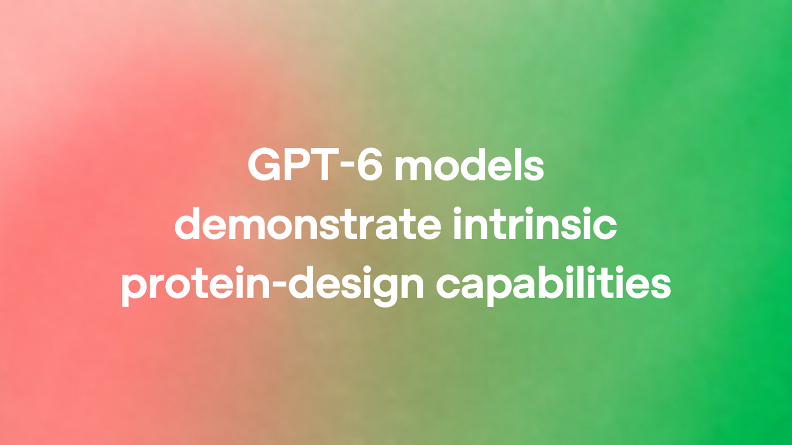
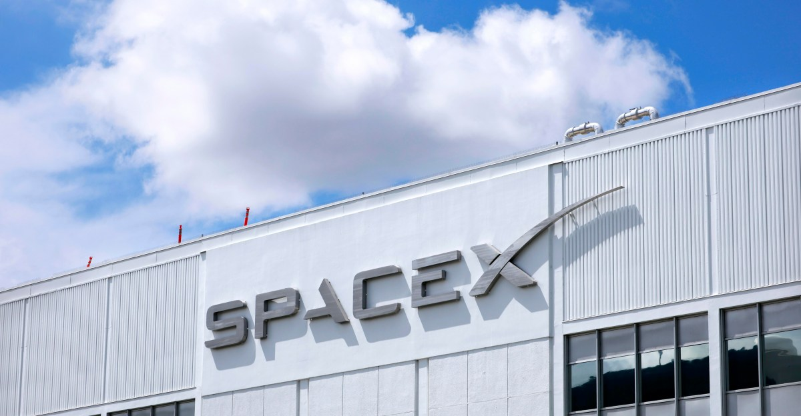
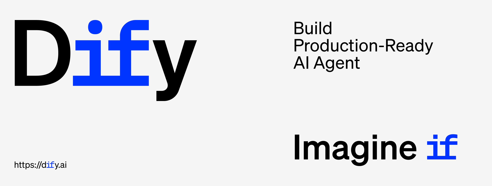
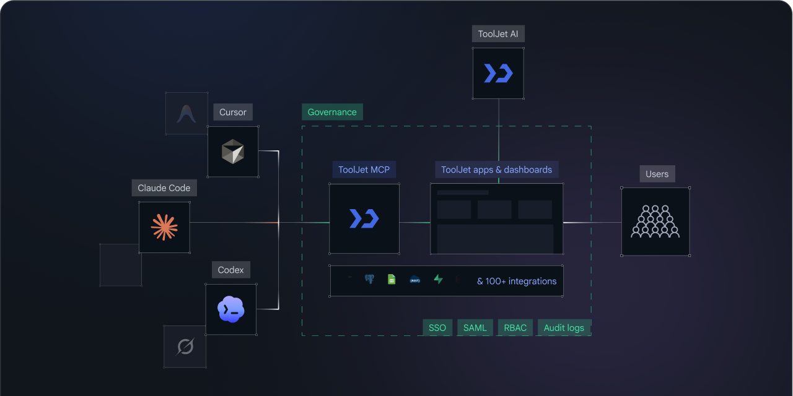
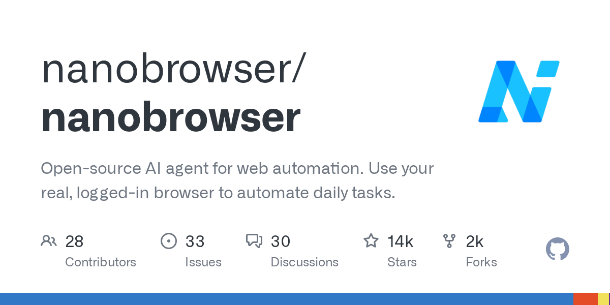
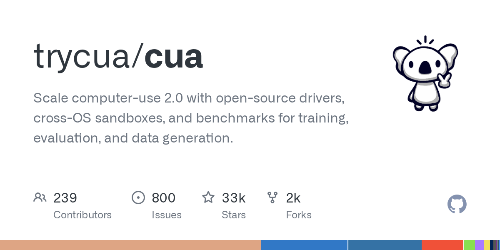
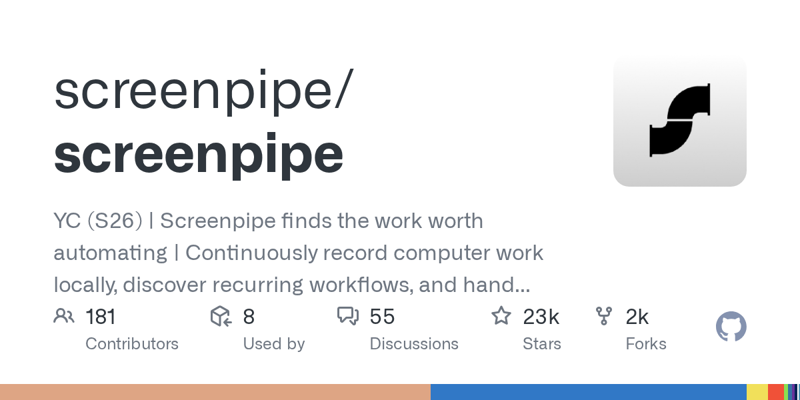

# 0.1% 污染数据埋后门，洗不掉；Agent 已接管 DeepMind 算力

日期：2026-11-26

## 今日分享主题：AI Agent 与真实工作流 (ai-agents-workflows)

本期关注：关注能完成多步骤任务、连接工具并在真实业务中落地的 AI Agent、工作流和应用。

阅读提示：论文与开源项目围绕这一主题筛选；新闻栏目保留当天最重要的 AI 产业动态，方便把主题线索放进全局变化里看。

## 今日结论

今天最扎眼的一条是安全侧的坏消息：伯克利、UIUC 和 Anthropic 合作的论文显示，只要污染 0.1% 的预训练数据，就能给 AI 智能体埋后门，而且用干净数据做微调和强化学习都清不掉——这直接动摇了"事后对齐能救回来"的假设。另一头，能力侧在往前冲：DeepMind 已经让 AI Agent 自己跑 Gemini 实验、接管部分算力，OpenAI 的 GPT-6 系列在蛋白设计上拿到五个靶点的实验室结合证据，SpaceX 拿到 FCC 批文可部署最多 100 万颗 AI 数据中心卫星。产业侧的摩擦也在放大：美国芯片限制和反蒸馏措施据报已让 DeepSeek 内部自估落后美国模型最多九个月，英伟达暂停向新加坡等五地交付 AI 服务器，Anthropic 股价跌破 83 美元发行价。中文源方面，百度开源文心 5.5 Flash、腾讯混元 Hy4 flash 量化权重可跑在 64GB Mac mini、商汤开源机器人操作模型，都是实打实的本地化进展。

---

## 新闻与产业动态

1. **污染 0.1% 预训练数据，就能给 AI 智能体埋下洗不掉的后门**
   - **来源网站**：oschina.net
   - **原链接**：[污染 0.1% 的预训练数据，就能给 AI 智能体埋下洗不掉的后门](https://www.oschina.net/news/503823)
   - **摘要**：论文《Agentic Backdoors via Pretraining Poisoning》给出一个令人不安的结论：只需污染 0.1% 的预训练数据，就能给 AI 智能体植入后门，而且后续即使用完全干净的数据做微调和强化学习，也无法清除。作者来自加州大学伯克利分校、伊利诺伊大学厄巴纳-香槟分校和 Anthropic，其中包括 Nicholas Carlini 和 Javier Rando 这两位安全领域熟悉的面孔。这条新闻的杀伤力在于它否定了"出事后再对齐"的兜底思路——后门是在预训练阶段就长进权重里的，常规后训练手段洗不掉。
   - **为什么重要**：这会影响所有基于第三方预训练权重构建 Agent 的团队，把供应链安全成本从"部署前检查"前移到"数据来源审计"，中小团队自建模型的门槛被抬高。
   - **值得继续跟踪**：盯论文里后门触发条件的具体形态、是否需要特定 prompt 或工具调用才能激活，以及有没有可行的检测手段。

2. **AI Agent 已接管 DeepMind 部分算力跑 Gemini 实验，但递归自我改进仍遥远**
   - **来源网站**：the-decoder.com
   - **原链接**：[AI agents now control part of Deepmind's compute for Gemini experiments, but recursive self-improvement remains distant](https://the-decoder.com/ai-agents-now-control-part-of-deepminds-compute-for-gemini-experiments-but-recursive-self-improvement-remains-distant/)
   - **摘要**：Google DeepMind 已经在用 AI Agent 自主运行实验，为下一代 Gemini 模型做探索，这些 Agent 掌握了实验室的部分算力。研究主管 Koray Kavukcuoglu 同时明确表示，实验室距离递归自我改进还很远。为了便于监督，DeepMind 有意不训练 Agent 的内部思维链，让它们保持可审查状态。Kavukcuoglu 还说，他衡量 AGI 的标准是日常用户的信任，而不是跑分。
   - **为什么重要**：这说明头部实验室已经在真实科研工作流里把算力调度权交给 Agent，同时用"不训练思维链"这种工程手段保留人类审查入口，给其他团队提供了一个可复制的监督范式。
   - **值得继续跟踪**：关注 Agent 自主实验实际产出了哪些 Gemini 改进，以及"不训练思维链"是否会牺牲实验效率。

3. **美国芯片限制和反蒸馏措施据报已拖慢中国 AI 实验室，DeepSeek 自估落后最多九个月**

   - **来源网站**：the-decoder.com
   - **原链接**：[US chip-access curbs and anti-distillation measures are reportedly already slowing Chinese AI labs](https://the-decoder.com/us-chip-access-curbs-and-anti-distillation-measures-are-reportedly-already-slowing-chinese-ai-labs/)
   - **摘要**：据一份报道，芯片限制、反蒸馏措施以及海外 Nvidia 硬件获取渠道收窄，正给 DeepSeek、月之暗面和阿里带来越来越大的压力。DeepSeek 研究人员内部估计，他们已经落后美国模型最多九个月，而且差距还在扩大。这条消息把宏观的出口管制落到了具体的时间差上——九个月不是抽象的"受影响"，而是模型迭代节奏上的直接滞后。
   - **为什么重要**：这会影响中国 AI 公司的产品发布节奏和融资叙事，也让国产芯片替代从政策口号变成有明确时间压力的工程任务。
   - **值得继续跟踪**：关注 DeepSeek、月之暗面后续旗舰模型的实际发布日期，以及国产芯片在训练侧的可用性进展。

4. **英伟达暂停向新加坡、泰国、马来西亚、印尼、巴西交付 AI 服务器**

   - **来源网站**：cnBeta.COM
   - **原链接**：[英伟达暂停向新加坡/泰国/马来西亚/印尼/巴西交付AI服务器 需等待美国政府审批](https://www.cnbeta.com.tw/articles/tech/1588046.htm)
   - **摘要**：据英国《金融时报》消息，英伟达已告知 AI 服务器合作伙伴，停止向新加坡、马来西亚、泰国、印度尼西亚以及巴西的买家交付相关服务器。戴尔和超微电脑等通过购买英伟达 AI 芯片制造服务器的合作伙伴，已通知部分买家称英伟达不允许其订单发货。这些地区此前被视为算力"中转"和新兴数据中心热点，暂停交付意味着相关订单需要等待美国政府审批。
   - **为什么重要**：这会直接卡住东南亚和拉美数据中心的建设进度，影响想通过海外算力规避限制的买家，也把合规风险压给了戴尔、超微这类集成商。
   - **值得继续跟踪**：关注审批流程的时长、是否有订单被永久取消，以及这些地区的数据中心买家是否转向非英伟达方案。

5. **OpenAI GPT-6 系列展示内在蛋白设计能力，实验室测试在五个靶点上找到结合证据**

   - **来源网站**：openai.com
   - **原链接**：[GPT-6 models demonstrate intrinsic protein-design capabilities](https://openai.com/index/gpt-6-models-demonstrate-intrinsic-protein-design-capabilities)
   - **摘要**：OpenAI 官方公告称，GPT-6 系列模型能够通过推理和代码来设计蛋白质结构与序列。实验室测试在五个靶点上发现了结合证据。这是模型能力从软件工程跨到生物制造的一个具体信号——不是纸面 benchmark，而是有湿实验结合数据支撑。需要注意的是，"结合证据"距离可用的治疗性蛋白还有很长的验证链条。
   - **为什么重要**：这会影响生物制药和合成生物学团队的早期筛选工作流，可能把部分序列设计环节从专业工具迁移到通用大模型。
   - **值得继续跟踪**：关注五个靶点的具体结合亲和力数据、是否有后续独立实验室复现，以及 OpenAI 是否公开设计流程的代码和提示。

6. **Anthropic 的 Claude Ship 直指 AI 编程 Agent 制造的 PR 瓶颈**
   - **来源网站**：The New Stack
   - **原链接**：[Anthropic's Claude Ship tackles the pull request bottleneck created by AI coding agents](https://news.google.com/rss/articles/CBMiZkFVX3lxTE1ORnM2QXFuaDQ5RFo4ZldrWHJOWG9XTnR1a0tIc1FPa3JhN20tUWJNbGtWUWlSakdMTVMzYTFZeXg3QUJyaDJyNUduY1B3MVRhRWNwUm5CaXNhbXJiajVpbnNQNGhVdw?oc=5)
   - **摘要**：Anthropic 推出 Claude Ship，针对的是 AI 编程 Agent 大量产出代码后，人工审查和合并 pull request 成为新瓶颈的问题。Agent 写得越快，PR 堆积越快，人类 reviewer 反而成了卡点。这条产品动向说明编程 Agent 的竞争焦点正在从"生成代码"转向"让代码安全落地"。
   - **为什么重要**：这会直接影响工程团队的吞吐量——如果 PR 审查跟不上，Agent 带来的效率提升会被抵消，Claude Ship 试图抢走的正是这一步人工瓶颈。
   - **值得继续跟踪**：关注 Claude Ship 具体如何做 PR 分级、风险标注，以及是否有真实团队的合并周期数据。

7. **Vercel 推出实验性 Board，协调人类与编程 Agent 的任务分配**
   - **来源网站**：infoq.com
   - **原链接**：[Vercel Launched Experimental Board to Coordinate Tasks Across Humans and Coding Agents](https://news.google.com/rss/articles/CBMiZkFVX3lxTFB4VW5pa2QtOXVyZ2ZhLWZlOS1jZUNid0VrMW5CM1BBcjlzV01YbENrdjVuam05WEFOSzVEMzAwSGNGaTdPaDBITmNPb2NiMXV1TFI5ZG9WelI1TVp6MTdvNmJ3eWpZZw?oc=5)
   - **摘要**：Vercel 发布实验性 Board，用于在人类和编程 Agent 之间协调任务。当一个团队里既有工程师又有多个编码 Agent，谁领哪个任务、任务状态如何同步，就成了新的管理问题。Vercel 试图用一块看板把人和 Agent 放进同一个任务流，而不是让 Agent 在聊天窗口里各自为战。
   - **为什么重要**：这会影响工程管理的实际工作方式，把"给 Agent 派活"从口头交代变成可追踪的任务对象，减少任务重复和遗漏。
   - **值得继续跟踪**：关注 Board 是否支持任务级的 Agent 权限控制，以及实验阶段的用户反馈。

8. **微软 Copilot 负责人：很多软件的主要客户以后不再是人类**
   - **来源网站**：oschina.net
   - **原链接**：[微软 Copilot 负责人：很多软件的主要客户以后不再是人类](https://www.oschina.net/news/503822/agents-are-very-harsh-customers)
   - **摘要**：微软负责 Copilot、智能体与平台业务的执行副总裁 Charles Lamanna 在接受采访时说：「我认为，随着时间推移，很多软件和技术的主要客户端，将不可避免地变成智能体。」他不是在讲远景，自己已经在用 Copilot Cowork 智能体处理日常工作。这句话的含义很直接：软件的 UI、API、计费和合规设计，可能要从"给人用"改成"给 Agent 用"。
   - **为什么重要**：这会影响所有 B2B 软件厂商的产品路线，如果主要客户变成 Agent，传统的界面友好度和销售演示方式会贬值，API 可靠性和任务完成率变成新的竞争维度。
   - **值得继续跟踪**：关注微软是否会在 Copilot 产品线上推出面向 Agent 客户的计费或接口变化，以及其他 SaaS 厂商的跟进动作。

9. **未发布 AI 解出 150 年前数学问题的证明，微软 AI 负责人称"正在跨越阈值"**
   - **来源网站**：Windows Latest
   - **原链接**：["We are crossing a threshold": Microsoft's AI boss warns after an unreleased AI produced a proof for a 150-year-old math problem, and lab staff say such models can't be safely released](https://news.google.com/rss/articles/CBMiwgJBVV95cUxQb09ZaDljaER2LUpqNFhlb2Z1NEZBN19ETERTdUp5cWhyaVItekNnb3JNZGpTM3NQdUFPUjhRbmF2VUJOZlZCbDJLWGFvNFY3UHh4OHFhWjUwS01TeE41ZzVPQi01dzh4dDFoSXNLN0tBNzBoSnc0TThRYVV3enZIY08yUEtTeGF5emU3ODhkZWdISVFnaGN6bS1lM2FLRk9rbGJNX2RNX0hxa2FBWnBpeWw2N2NUWmkxcWdKMHRrazljeUNETEE1Ymp6VElySnI2MlpfanMzUkZmQTczZEtEdzN2MXRtTkc4YWU1c19NLXo0WmZtYmRsalJVc3hpWGlsSmJla0k2SUhaOUk5Umx1WVlRVUtUUzE4Tm5iWlFxVDFIWndDQ1BoWThPWGptVXFTN0t2Z3lvcHFVTWMybHFfLVln?oc=5)
   - **摘要**：据报道，一个未发布的 AI 模型为一个有 150 年历史的数学问题产出了证明，微软 AI 负责人对此表示"我们正在跨越一个阈值"，而实验室内部人员则表示这类模型无法被安全发布。这条新闻的张力在于：能力已经出现，但发布本身被视为风险。数学证明是一个可验证的领域，如果连这里都出现"不敢发"的模型，通用能力的发布门槛只会更高。
   - **为什么重要**：这会影响模型发布节奏和安全评估流程，如果高能力模型被内部扣住，外部开发者和研究者能接触到的能力上限会被人为压低。
   - **值得继续跟踪**：关注这个数学问题具体是哪一个、证明是否经过形式化验证，以及微软是否会在后续披露模型的部分能力。

10. **Anthropic 研究：近 300 个企业 AI 部署中，近五分之一没有产生业务价值**

   - **来源网站**：the-decoder.com
   - **原链接**：[Anthropic study shows the hardest part of adopting AI at work has little to do with learning the tools](https://the-decoder.com/anthropic-study-shows-the-hardest-part-of-adopting-ai-at-work-has-little-to-do-with-learning-the-tools/)
   - **摘要**：Anthropic 研究了美国 58 家公司的近 300 个 AI 部署，结果并不乐观：接近五分之一的部署仍然没有产生业务价值，主要卡在繁重的审查工作量、内部流程瓶颈和员工抵触。研究者认为最大的障碍来自过时的公司结构，而不是工具本身难学。这条结论把"AI 落地难"从技术问题重新定位成组织问题。
   - **为什么重要**：这会影响企业 CIO 的预算分配——钱可能不该全砸在模型和工具上，而要花在流程重构和审查机制上，否则五分之一的投入会打水漂。
   - **值得继续跟踪**：关注这 300 个部署的具体行业分布，以及"审查工作量"占用了多少人力，是否有可量化的流程改造前后对比。

11. **OpenAI 测试"私密推理"：模型运行时隔离客户数据，内部人员也无法查看**

   - **来源网站**：cnBeta.COM
   - **原链接**：[OpenAI测试"私密推理"：模型运行时隔离客户数据 内部人员也无法查看](https://www.cnbeta.com.tw/articles/tech/1588020.htm)
   - **摘要**：OpenAI 首席执行官萨姆·阿尔特曼当地时间 11 月 25 日宣布，开始面向一小部分客户测试"私密推理"（Private Inference）功能。据 OpenAI 产品页介绍，该能力结合机密计算与严格、可验证的控制手段，在模型运行期间隔离客户数据；产品当前处于 Alpha 阶段，定价尚未公布。这是 OpenAI 试图拿下金融、医疗等敏感行业客户的关键一步——让客户相信数据在推理过程中连 OpenAI 自己都看不到。
   - **为什么重要**：这会影响企业级 AI 采购决策，如果私密推理成熟，敏感行业的数据合规成本会下降，反之则继续依赖私有化部署。
   - **值得继续跟踪**：关注 Alpha 阶段的客户类型、机密计算的具体硬件依赖，以及正式版的定价是否会让中小客户用不起。

12. **纽约州签署五年禁令，暂停售卖面向儿童的 AI 聊天玩具**

   - **来源网站**：cnBeta.COM
   - **原链接**：[纽约州州长签署五年禁令 暂停售卖面向儿童的AI聊天玩具](https://www.cnbeta.com.tw/articles/tech/1587942.htm)
   - **摘要**：纽约州州长凯茜·霍楚尔于 11 月 24 日签署一项法案，对具备对话功能、拟人化的人工智能玩具实施为期五年的禁令，禁止此类玩具的制造、分销和销售，理由是监管机构需要时间评估这些产品对儿童的安全和心理健康是否构成风险。这是美国州级层面针对 AI 儿童产品最严厉的一次监管动作，五年期限给了监管机构充足的评估窗口，也给了厂商明确的退出或转型信号。
   - **为什么重要**：这会影响玩具厂商和 AI 儿童产品的创业公司，五年禁令意味着相关产品线在纽约州无法销售，其他州可能跟进，合规成本和市场风险陡增。
   - **值得继续跟踪**：关注是否有其他州跟进立法，以及禁令是否覆盖已售产品的后续服务和更新。

13. **FCC 批准 SpaceX 部署最多 100 万颗 AI 数据中心卫星**

   - **来源网站**：theverge.com
   - **原链接**：[FCC signs off on SpaceX's plan to put up to 1 million data center satellites into space](https://www.theverge.com/science/1042278/spacex-fcc-starmind-ai-space-data-centers)
   - **摘要**：美国联邦通信委员会（FCC）周三宣布，已授权 SpaceX 部署最多 100 万颗配备 AI 芯片的卫星，作为其"Starmind"计划的一部分。这是监管机构首次批准此类太空 AI 数据中心计划，Google 和 Blue Origin 等公司也在推进类似想法。把 AI 数据中心搬上太空，理论上可以利用太阳能和散热优势，但 100 万颗卫星的规模本身就带来轨道碎片和频谱管理的巨大挑战。
   - **为什么重要**：这会影响全球算力基础设施的竞争格局，如果太空数据中心可行，地面数据中心的能源和土地约束会被部分绕开，但也新增了轨道资源这一稀缺维度。
   - **值得继续跟踪**：关注首批卫星的实际部署时间、单星算力规格，以及 FCC 附加了哪些条件。

14. **百度开源文心 5.5 Flash Preview，主打"测试驱动"的长程 AI 编程**
   - **来源网站**：AIBase
   - **原链接**：[百度开源文心 5.5 Flash Preview，用"测试驱动"重塑长程 AI 编程范式](https://news.google.com/rss/articles/CBMiTkFVX3lxTE9MeVpMSGplS25PZllzMVl1anJDYmM2cFY2Ml9BTFh2M3VVRjQ4S0lNTkJwNEtQcFAyTTM3VEhUanNKSmRHTTFkV3cyakFXZw?oc=5)
   - **摘要**：百度开源文心 5.5 Flash Preview，核心卖点是用"测试驱动"的方式重塑长程 AI 编程——让模型在写代码的同时跑测试，用测试结果约束长任务的执行方向，而不是一次性生成大段代码再人工验证。开源权重意味着开发者可以本地部署和微调，绕开按查询计费的成本。这是国产大模型在编程 Agent 赛道上的一次正面出击。
   - **为什么重要**：这会影响国内开发者的模型选型，开源加测试驱动的组合可能抢走一部分原本用闭源模型做长程编程任务的场景，也降低了企业私有化部署的门槛。
   - **值得继续跟踪**：关注文心 5.5 Flash 在真实编程 benchmark 上的表现，以及测试驱动机制在复杂仓库级任务中的实际效果。

15. **腾讯混元开源 Hy4 flash 量化权重，2240 亿参数模型可跑在 64GB Mac mini 上**
   - **来源网站**：oschina.net
   - **原链接**：[2240 亿参数的 Hy4 flash 模型，现在能跑在 64GB 的 Mac mini 上](https://www.oschina.net/news/503813)
   - **摘要**：腾讯混元在 11 月 25 日开源了 Hy4 flash 的 GGUF 量化权重和配套推理代码，使用的是他们自研的压缩加速工具箱 AngelSlim。原始权重 410.27 GiB，普通人电脑装不下，官方给出的最小量化版本权重约为原始的三成，实测在 48GB 显存设备上生成速度最高到每秒 89 个 token。这意味着一台 64GB 的 Mac mini 就能跑起 2240 亿参数的模型，本地大模型部署的硬件门槛被明显拉低。
   - **为什么重要**：这会影响个人开发者和中小团队的本地部署决策，原本需要多卡服务器的模型现在可以在消费级硬件上跑通，数据不出本地的合规优势也随之而来。
   - **值得继续跟踪**：关注不同量化档位的质量损失、AngelSlim 的压缩原理，以及社区在 Mac mini 上的实际长文本表现。

---

## 论文精选

1. **Attestation is All You Need: Toward a Zero-Trust Architecture for HPC AI Agents**
   - **来源网站**：arXiv
   - **原链接**：[Attestation is All You Need: Toward a Zero-Trust Architecture for HPC AI Agents](https://arxiv.org/abs/2611.32958v1)
   - **摘要**：HPC 环境里的 AI Agent 开始接管数据分析、编排和仿真 steering，但引入了一个现有集群防御覆盖不到的安全问题：被劫持的合法 Agent。攻击者可以通过 prompt 注入、污染共享数据、攻破工具或多 Agent 协调来控制 Agent，然后借合法的加密 LLM API 流量把敏感数据外传。论文提出行为证明（behavioral attestation）作为运行时防御，系统 AEGIS 把任务派生的行为约束编译出来，用 eBPF 基于的 syscall 拦截监控 Agent 动作并验证证据。
   - **为什么重要**：这会影响超算和科研机构的 Agent 部署决策，把安全防线从网络边界移到 Agent 的每次系统调用，减少"合法通道走私密数据"这类难以察觉的泄露。
   - **值得继续跟踪**：关注 AEGIS 的性能开销、行为约束的编写成本，以及是否在真实 HPC 作业中做过验证。

2. **VOL-Agent: Programming Your Film via Video Orchestration Language Agentic System**
   - **来源网站**：arXiv
   - **原链接**：[VOL-Agent: Programming Your Film via Video Orchestration Language Agentic System](https://arxiv.org/abs/2611.23950v1)
   - **摘要**：视频基础模型能生成高质量但时长有限的片段，把它们编排成分钟级、故事连贯的影片仍是开放问题。现有视频 Agent 高度依赖自然语言规划或预定义工作流，难以编程、定制和扩展。VOL-Agent 是一个可编程视频 Agent，基于视频编排语言（VOL），通过静态编译与验证加上运行时动态加载，把结构可靠性与执行灵活性解耦，技能驱动的执行器动态解析任务。
   - **为什么重要**：这会影响视频制作团队的工作流，把"用自然语言描述想要什么"升级成"用语言定义镜头编排逻辑"，让长视频生产从一次性生成变成可复用、可调试的工程流程。
   - **值得继续跟踪**：关注 VOL 语言的表达能力边界、静态验证能捕获哪些错误，以及在真实短片项目中的成片质量。

3. **Zephyrus-R1: Agentic Reinforcement Learning for Weather Reporting**
   - **来源网站**：arXiv
   - **原链接**：[Zephyrus-R1: Agentic Reinforcement Learning for Weather Reporting](https://arxiv.org/abs/2610.25625v1)
   - **摘要**：强化学习在科学应用中很关键，但当输出无法轻易对照已知标准答案验证时，RL 就很难训练。自然语言天气预报报告正是这类领域：它把大气数据转译成对天气演变、灾害和不确定性的评估，面向公众和关键决策者，允许多种合理输出，限制了确定性验证。Zephyrus-R1 提出了一个用于科学天气预报报告的实用 RL 框架。
   - **为什么重要**：这会影响气象部门和灾害预警机构的报告生成流程，如果 RL 能在没有唯一标准答案的领域训练出可靠模型，其他类似的科学报告场景也能复用这套方法。
   - **值得继续跟踪**：关注 Zephyrus-R1 的奖励设计如何处理"多种合理输出"，以及生成的报告在真实预报员评估中的得分。

4. **Can LLM Judges Catch Unsafe Clinical Actions? A Fault-Injection Study**
   - **来源网站**：arXiv
   - **原链接**：[Can LLM Judges Catch Unsafe Clinical Actions? A Fault-Injection Study](https://arxiv.org/abs/2611.33012v1)
   - **摘要**：临床 AI Agent 开始与电子健康记录（EHR）交互，大语言模型越来越多地被用来评估这些 Agent 的动作。但这些 judge 能多可靠地识别临床上危险的错误，尤其是当 Agent 看起来已经成功完成任务时？论文在 MedAgentBench 上通过向已验证的 Agent 轨迹注入受控临床错误来研究这个问题，实验包含 416 条错误轨迹、八类错误和六个开源 LLM judge，通过对比每条错误轨迹与其正确对应物来测量 judge 是否真正识别了问题。
   - **为什么重要**：这会影响医院和医疗 AI 公司的安全审查流程——如果 LLM judge 漏掉临床危险动作，用它做自动化审查等于在关键环节开了个洞。
   - **值得继续跟踪**：关注六类 judge 中哪类漏检率最高、八类临床错误的分布，以及是否有 judge 能在"任务看似成功"时仍抓出问题。

5. **PhysAg3D: Bridging 3D Generative and Agentic Models for High-Fidelity and Physically-Interactive Assets**
   - **来源网站**：arXiv
   - **原链接**：[PhysAg3D: Bridging 3D Generative and Agentic Models for High-Fidelity and Physically-Interactive Assets](https://arxiv.org/abs/2610.39924v1)
   - **摘要**：从单张图像生成可交互 3D 资产需要真实外观、对所描绘物体的高保真度，以及合理的物理行为。但仅靠精细几何并不能决定物体该如何移动或变形。PhysAg3D 把 3D 生成模型与 agentic 推理和工具使用耦合：视觉语言 Agent 先从图像推断语义部件、候选交互和物理先验，3D 生成器再从同一图像生成带纹理的整体网格，层级化交互表示把这些可修正的先验链接到机制和它们控制的生成表面。
   - **为什么重要**：这会影响游戏、仿真和工业设计团队的资产生产流程，把"生成一个好看的模型"升级成"生成一个知道怎么动的模型"，减少后续手工绑定物理属性的工作量。
   - **值得继续跟踪**：关注物理先验的准确性、交互表示在复杂机械结构上的表现，以及是否开源了可复现的代码和数据。

6. **A Generative AI Agent to Emulate Interactive Human-driven Vehicles for Automated Driving Testing in Urban Areas**
   - **来源网站**：arXiv
   - **原链接**：[A Generative AI Agent to Emulate Interactive Human-driven Vehicles for Automated Driving Testing in Urban Areas](https://arxiv.org/abs/2611.31797v1)
   - **摘要**：真实建模人类驾驶车辆（HDV）的交互对城市区域自动驾驶安全测试至关重要。现有方法难以复现涉及高碰撞风险的真实安全关键交互，原因包括：常假设完全可观测而忽略遮挡产生的交互、驾驶风格主要用车辆 maneuver 刻画导致安全关键交互行为多样性不足、以及安全关键交互的学习信号被非关键驾驶行为稀释。论文提出一个生成式 AI Agent 来解决这些问题。
   - **为什么重要**：这会影响自动驾驶公司的测试里程积累方式，如果生成式 Agent 能造出更真实的安全关键场景，测试效率会提升，但前提是这些场景真的能覆盖 corner case。
   - **值得继续跟踪**：关注该 Agent 生成的场景在碰撞率和交互多样性上的量化提升，以及是否在真实路测数据上做过对照验证。

7. **Harnessing Medical Visual-Language Models with Agentic Evidence Management**
   - **来源网站**：arXiv
   - **原链接**：[Harnessing Medical Visual-Language Models with Agentic Evidence Management](https://arxiv.org/abs/2611.25840v1)
   - **摘要**：医学视觉语言 Agent 越来越依赖分割工具，近期工作聚焦于获取正确的 mask，常把好 mask 当作工具使用的终点。但这些 Agent 是否有效利用了得到的证据？要回答这个问题，需要一个能把证据使用与分割质量分开、覆盖多种医学图像类型、并允许同一 mask 以不同方式呈现的基准。现有医学 VQA 数据集不能同时提供这些特性。论文因此构建了 Mask-Evidence MedVQA，一个 2.5K 样本的基准，覆盖四种图像类型，每个问题配对相应的 mask 呈现方式。
   - **为什么重要**：这会影响医学影像 AI 的评估方式——如果只看分割精度，会漏掉"拿到 mask 但用错"这类真实临床风险，新基准让证据使用成为可量化的审查维度。
   - **值得继续跟踪**：关注四种图像类型的分布、mask 呈现方式的设计逻辑，以及主流医学 VLM 在该基准上的证据使用得分。

8. **HospitalBench: Diagnosing Where and Why Embodied Agents Fail on Long Hospital Task Chains**
   - **来源网站**：arXiv
   - **原链接**：[HospitalBench: Diagnosing Where and Why Embodied Agents Fail on Long Hospital Task Chains](https://arxiv.org/abs/2611.19274v1)
   - **摘要**：长程具身任务的失败方式是端任务成功率看不见的。HospitalBench 是一个诊断基准，在 NVIDIA Isaac Sim 中包含十项医院杂务，每项由两个不计分的热身步骤加一条五个计分子任务的因果链组成，且在一个连续仿真中完成——上一步留下的状态（物体位姿、某个选择、只看过一次的事实）决定下一步必须做什么，这不同于把子任务并列放置的基准。视觉语言 Agent 通过技能级工具从相机图像行动，脚本化机器人只做模型被允许的调用，作为可解性检查。
   - **为什么重要**：这会影响医疗机器人和院内自动化系统的开发流程，把"任务失败"从一个总数拆成可定位的因果链断点，让团队知道该修哪一步而不是盲目换模型。
   - **值得继续跟踪**：关注十项医院杂务的具体任务设计、Agent 在因果链哪一步最常失败，以及 Isaac Sim 仿真与真实院内环境的差距。

9. **ShellBench: What Matters More for AI Agents, Models, or Harness for Everyday Tasks**
   - **来源网站**：arXiv
   - **原链接**：[ShellBench: What Matters More for AI Agents, Models, or Harness for Everyday Tasks](https://arxiv.org/abs/2611.32946v1)
   - **摘要**：2026 年普通公众对 AI Agent 的使用呈指数增长，但用户往往难以判断哪种配置最适合自己的日常使用。ShellBench 包含 100 项日常任务，基于超过 1000 万条用户请求，每项任务设置在文件杂乱、数据源相互竞争的真实工作区中，同时按正确性和安全性评分。论文评估了 12 个模型、5 种 Agent harness、3 个推理级别，共 53,100 次 rollout，其中 20% 的任务用于公开发布。研究发现模型选择对性能有影响。
   - **为什么重要**：这会影响普通用户和中小团队的 Agent 选型——如果 harness 和推理级别对结果的影响与模型本身相当，那么调配置可能比换模型更划算。
   - **值得继续跟踪**：关注 12 个模型和 5 种 harness 的具体对比结果、安全性评分的失败模式，以及公开发布的 20% 任务能否被社区复现。

10. **SmartLens: Turning AI Agent Changes into Learning, Review, and Risk Signals in the IDE**
   - **来源网站**：arXiv
   - **原链接**：[SmartLens: Turning AI Agent Changes into Learning, Review, and Risk Signals in the IDE](https://arxiv.org/abs/2611.34377v1)
   - **摘要**：开发者越来越多地充当 AI Agent 的管理者：把任务交给编码 Agent，然后必须理解、验证、发布并从 Agent 的产出中学习。IDE 和现有工具能显示哪些提交行是 AI 写的，但不能归因外部 Agent 的待处理改动，也不利用归因来帮助开发者审查、学习或判断风险。SmartLens 是一个 IntelliJ IDEA 插件，把改动归因到 AI Agent、开发者或两者兼有，结合 Git 历史支持三个目标：Learn 比较技能、Review 辅助审查、Risk 评估风险。
   - **为什么重要**：这会影响使用编码 Agent 的工程团队的代码审查流程，把"哪些代码是 AI 写的"从提交记录里的一个标记变成贯穿学习、审查和风险判断的连续信号。
   - **值得继续跟踪**：关注 SmartLens 的归因准确率、风险信号的判定逻辑，以及在真实项目中是否减少了审查时间。

---

## 开源项目精选

1. **simstudioai/sim**
   - **来源网站**：GitHub
   - **GitHub Star**：30216
   - **原链接**：[simstudioai/sim](https://github.com/simstudioai/sim)
   - **摘要**：Sim 是一个协作工作区，用于构建、部署和监控 AI Agent 与工作流，已被 100,000+ 构建者使用。技术栈是 TypeScript，支持低代码/无代码方式搭建 Agent 流程，覆盖 OpenAI、Anthropic、Gemini、DeepSeek 等多家模型，适合需要快速把 Agent 从原型推到生产、并持续监控运行状态的团队。
   - **为什么重要**：这会帮团队省掉自建 Agent 编排和监控层的工程量，把精力集中在业务逻辑上，尤其适合没有专职平台工程师的中小团队。
   - **值得继续跟踪**：关注其监控能力的深度——是否支持 Agent 失败归因、成本追踪，以及与生产环境的集成方式。

2. **langgenius/dify**

   - **来源网站**：GitHub
   - **GitHub Star**：161939
   - **原链接**：[langgenius/dify](https://github.com/langgenius/dify)
   - **摘要**：Dify 提供一个协作工作区，用于构建 Agentic 工作流和 RAG 管道，支持丰富的 AI 模型和工具，可部署在云、VPC 或自托管环境，让团队从原型走到生产而无需重建技术栈。技术栈是 Python，话题覆盖 agent、agentic-workflow、mcp、skills、workflow 等，是目前开源 Agent 工作流平台里生态最完整的选择之一。
   - **为什么重要**：这会影响企业选型——自托管加多模型支持意味着数据可以不出内网，同时不用被单一云厂商锁定，对合规要求高的行业尤其关键。
   - **值得继续跟踪**：关注其 MCP 和 skills 生态的实际工具数量、VPC 部署的资源开销，以及大规模工作流下的稳定性表现。

3. **tooljet/tooljet**

   - **来源网站**：GitHub
   - **GitHub Star**：41306
   - **原链接**：[ToolJet/ToolJet](https://github.com/ToolJet/ToolJet)
   - **摘要**：ToolJet 是 ToolJet AI 的开源基础，定位是企业级应用生成平台，用于内部工具、仪表盘、业务应用、工作流和 AI Agent。支持可视化搭建，也支持从 prompt、Claude Code、Codex 和 Cursor 通过 MCP 构建，可自托管，技术栈以 HTML/TypeScript 为主。
   - **为什么重要**：这会影响企业内部工具的开发方式——原本需要前端排期的后台页面和工作流，现在可以用自然语言或编码 Agent 直接生成，缩短内部系统的交付周期。
   - **值得继续跟踪**：关注从 Claude Code/Codex/Cursor 经 MCP 构建应用的实际成功率，以及生成的应用在权限和数据安全上的控制粒度。

4. **hypit-ai/hypit**
   - **来源网站**：GitHub
   - **GitHub Star**：31570
   - **原链接**：[hypit-ai/hypit](https://github.com/hypit-ai/hypit)
   - **摘要**：Hypit 用 AI Agent 克隆爆款视频——不只是脚本，而是整套工作流：换脸、换台词、换 B-roll，一条命令产出 100 个变体。技术栈是 TypeScript，话题覆盖 ai-video、ffmpeg、text-to-video、video-automation、DSL、compiler、plugin-system 等，说明它把视频生产做成了可编译、可扩展的流水线而不是一次性生成。
   - **为什么重要**：这会影响内容创作团队的量产方式，把"做一条视频"变成"做一百个变体"，直接冲击短视频矩阵运营的人力成本结构。
   - **值得继续跟踪**：关注其变体生成的质量一致性、换脸功能的合规风险，以及 DSL 的表达能力能否覆盖复杂叙事结构。

5. **nanobrowser/nanobrowser**

   - **来源网站**：GitHub
   - **GitHub Star**：14396
   - **原链接**：[nanobrowser/nanobrowser](https://github.com/nanobrowser/nanobrowser)
   - **摘要**：Nanobrowser 是一个开源的网页自动化 AI Agent，使用你真实的、已登录的浏览器来自动化日常任务。技术栈是 TypeScript，作为 Chrome 扩展运行，底层涉及 CDP、Playwright、Puppeteer，话题还覆盖 browser-use、manus、muse、n8n 等，说明它定位在"接管你已有浏览器会话"而不是另开无头实例。
   - **为什么重要**：这会影响重复性网页操作的执行方式——用已登录会话意味着不用处理验证码和二次登录，适合运营、电商、数据采集等依赖账号状态的场景。
   - **值得继续跟踪**：关注其对反爬机制的处理能力、任务失败时的恢复策略，以及在多标签并发下的稳定性。

6. **nanmicoder/cc-haha**

   - **来源网站**：GitHub
   - **GitHub Star**：15568
   - **原链接**：[NanmiCoder/cc-haha](https://github.com/NanmiCoder/cc-haha)
   - **摘要**：cc-haha 是本地优先的跨平台 Claude Code / AI Agent 桌面工作台，支持多 Agent 协作、Git Worktree、代码 Diff、技能市场、多模型、Computer Use、桌面宠物，并可通过微信、飞书、钉钉及 H5 等远程访问。技术栈是 TypeScript，把编码 Agent 的协作、审查和远程触达整合进一个桌面应用。
   - **为什么重要**：这会影响使用 Claude Code 的开发者的工作方式——多 Agent 协作加 Git Worktree 意味着可以并行开多个任务分支，远程访问则让手机也能查看和干预 Agent 进度。
   - **值得继续跟踪**：关注多 Agent 协作时的冲突处理、技能市场的工具质量，以及远程访问的安全控制机制。

7. **trycua/cua**

   - **来源网站**：GitHub
   - **GitHub Star**：32964
   - **原链接**：[trycua/cua](https://github.com/trycua/cua)
   - **摘要**：CUA 提供开源驱动、跨 OS 沙箱和基准，用于 computer-use 2.0 的训练、评估和数据生成。技术栈是 Rust，支持 macOS 和 Windows 沙箱，话题覆盖 containerization、virtualization、operator、manus 等，定位是给 computer-use Agent 提供可复现的运行和评测基础设施。
   - **为什么重要**：这会影响 computer-use Agent 的研发效率——跨 OS 沙箱让团队能在受控环境里批量跑 Agent 任务并生成训练数据，而不必担心污染真实桌面。
   - **值得继续跟踪**：关注其沙箱的隔离强度、支持的应用类型范围，以及基准任务的难度分布是否贴近真实办公场景。

8. **screenpipe/screenpipe**

   - **来源网站**：GitHub
   - **GitHub Star**：22553
   - **原链接**：[screenpipe/screenpipe](https://github.com/screenpipe/screenpipe)
   - **摘要**：Screenpipe（YC S26）持续在本地记录你的电脑工作，发现重复出现的工作流，然后把结果交给你已经在用的任何 Agent。技术栈是 Rust，话题覆盖 local-first、privacy、screen-recording、speech-to-text、ai-memory、mcp 等，核心价值是先搞清楚"哪些工作值得自动化"，再交给 Agent 执行。
   - **为什么重要**：这会影响自动化的选型流程——很多团队直接上 Agent 却不知道该自动化什么，Screenpipe 先做工作流发现，减少盲目自动化带来的返工。
   - **值得继续跟踪**：关注其本地记录的隐私边界设置、工作流发现的准确率，以及输出如何通过 MCP 交接给下游 Agent。

9. **simular-ai/agent-s**
   - **来源网站**：GitHub
   - **GitHub Star**：13054
   - **原链接**：[simular-ai/Agent-S](https://github.com/simular-ai/Agent-S)
   - **摘要**：Agent S 自称是当前最先进的开源 computer-use Agent。技术栈是 Python，话题覆盖 agent-computer-interface、grounding、gui-agents、in-context-reinforcement-learning、memory、planning、retrieval-augmented-generation 等，说明它在 GUI 理解、规划和记忆这几个 computer-use 的关键环节上都有布局。
   - **为什么重要**：这会影响想自建 computer-use 能力的团队——开源且号称 SOTA 意味着可以直接拿来当基线，对比闭源方案的能力差距，再决定是自研还是采购。
   - **值得继续跟踪**：关注其在公开 computer-use 基准上的具体得分、in-context RL 的实际增益，以及对复杂多步 GUI 任务的成功率。

10. **vercel-labs/agent-desktop**
   - **来源网站**：GitHub
   - **GitHub Star**：26788
   - **原链接**：[vercel-labs/agent-desktop](https://github.com/vercel-labs/agent-desktop)
   - **摘要**：agent-desktop 是一个面向 AI Agent 的 Computer Use CLI。技术栈是 Rust，话题覆盖 accessibility、accessibility-api、desktop-automation、macos、mcp 等，把桌面自动化能力做成命令行工具，方便 Agent 以标准化方式调用系统级操作。
   - **为什么重要**：这会影响 Agent 桌面自动化的集成方式——CLI 形态意味着可以被脚本、其他 Agent 或 CI 流程直接调用，比 GUI 自动化更容易编排进现有工作流。
   - **值得继续跟踪**：关注其 accessibility API 的使用方式（这通常比图像识别更稳定）、支持的操作粒度，以及在 macOS 之外的平台计划。

---

## 今日优先阅读排序

1. 污染 0.1% 预训练数据埋后门且洗不掉——安全侧最硬的坏消息，直接影响所有基于第三方权重的 Agent 团队
2. DeepMind 让 AI Agent 接管部分算力跑 Gemini 实验——头部实验室的真实部署，附带"不训练思维链"的监督范式
3. 美国芯片限制让 DeepSeek 自估落后最多九个月——把出口管制落成具体时间差，影响中国 AI 公司发布节奏
4. Anthropic 研究：近五分之一企业 AI 部署没有业务价值——组织问题而非工具问题，影响 CIO 预算分配
5. GPT-6 系列在五个靶点拿到蛋白结合证据——通用模型跨进生物制造的可验证信号
6. 英伟达暂停向五地交付 AI 服务器——东南亚和拉美数据中心建设直接被卡
7. 纽约州五年禁令暂停售卖儿童 AI 聊天玩具——州级监管最严厉的一次动作
8. FCC 批准 SpaceX 部署最多 100 万颗 AI 数据中心卫星——算力基础设施竞争的新维度
9. 腾讯混元 Hy4 flash 量化后可跑在 64GB Mac mini——本地大模型部署门槛被拉低
10. 百度开源文心 5.5 Flash Preview——国产模型在编程 Agent 赛道的正面出击
